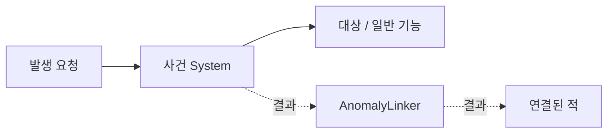
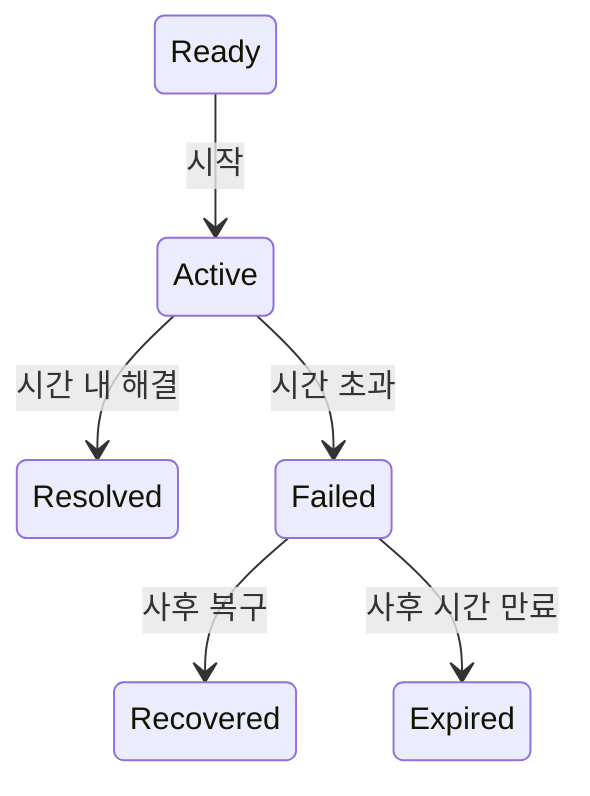

# ANOMALY

## PURPOSE

Anomaly의 정의, 사건 규칙과 런타임 상태, 정상 상태, Pressure 기반 발생, 대응 / 해결 및 다른 시스템 연동 구조를 관리합니다.

## SYSTEM_OVERVIEW

AnomalyEventSystem은 실제 사건 실행과 월드 적용을 중재하고 AnomalyEvent / 사건별 Model은 상태와 시간을 판단합니다. 점선은 결과 알림입니다. 발생 방 / 종류 선정은 [발생 관리](ANOMALY_PRESSURE.md)를 따릅니다. 실패 후 환경을 복구해도 실패 결과는 바뀌지 않습니다.

## DEFINITION

- `Enemy`: 실제 월드 안에서 이동하고 행동하는 주체
- `Anomaly`: 물건 위치 / 회전 / 활성 / 구조 변화 등 월드에 발생한 비정상적인 사건
- Anomaly는 별도 정답 맞히기 퀴즈가 아니라 처리되지 않은 문제나 위협을 플레이어에게 알리는 정보입니다.
- 실제 위협은 결국 처리해야 하며 무대응이 정답인 Anomaly는 만들지 않습니다.

`이상 변화 발견 → 원인 추론 → 조사 → 실제 위협 확인 → 적절한 대응`

## CURRENT_SCOPE

- 현재 주 작업은 변칙 사건 전체 유형과 공통 발생 / 대응 / 결과 구조의 확장입니다. 낙하 사건은 이미 구현된 첫 사례이며 전체 범위를 낙하 점검이나 실패 피해 처리로 한정하지 않습니다.
- 유형 7종, 방별 후보와 A / B / C 우선순위, 대응 Action, 권장 구현 순서는 [ANOMALY_CATALOG.md](ANOMALY_CATALOG.md)를 기준으로 합니다. Drop / Displacement / OrientationChange / StateChange / CompositionChange / BehaviorChange / Distortion을 포함합니다. StateChange를 State로 줄이지 않으며 유형과 구현 클래스 수를 동일시하지 않습니다.
- 현재 우선순위 / 구현 순서 / 남은 확인은 TODO, 구현과 실행 확인 범위는 DONE을 따릅니다. 유형별 동작 규칙과 상세 설계는 EVENT_DESIGN에서 관리합니다.
- 첫 사건은 공통 아이템 낙하 1종입니다. 음식은 테스트 대상이며 음식 전용 사건 클래스로 분리하지 않습니다.
- Pressure의 방 선정 / 종류별 가중치 선택과 Room 등록은 코드 반영 상태이며 [ANOMALY_PRESSURE](ANOMALY_PRESSURE.md)를 따릅니다. 방별 콘텐츠 설정과 실제 네트워크는 별도 후속입니다.
- 담비 / 여우의 사건 목록은 SpawnData의 Event 설정과 AnomalySpawnGroup에서 관리합니다. Linker는 선정된 실제 사건의 결과만 연결하며 적마다 대기 사건 한 건을 추적합니다. 난이도별 동시 진행 수는 후속입니다. 조사 입력 계약은 PLAYER_INTERACTION의 INVESTIGATION을 따릅니다.

## COMMON_TARGET_AND_NORMAL_STATE

| 항목 | 계약 / 조건 |
| --- | --- |
| 공통 대상 | AnomalyTarget은 등록 / 공통 잠금 / 정상 배치 저장 / 배치 / 보유 알림 / 무효화를 담당합니다. ItemCarry는 선택 연결하며 개폐와 회전 기능을 직접 참조하거나 구독하지 않습니다. |
| 저장 상태 | AnomalyTargetState는 Position / Rotation / Active(activeSelf) / Parent / PlacementTarget을 저장합니다. Parent와 배치 대상은 별개이며 기능별 정상 상태는 여기에 추가하지 않습니다. |
| 개폐 기준 | 개폐 복구 기준은 발생 직전 열림 여부를 OpenCloseAnomalyEvent에 보관합니다. 평상시 개폐 상태는 모두 정상으로 취급합니다. 외부 기능이 만든 비정상 개폐를 별도로 구분해야 할 때 정상 기준 관리 확장을 검토합니다. |
| 회전 기준 | 회전 복구 기준은 RotateView에 저장한 초기 정자세이며 Model 각도 0입니다. 평상시 기울어진 각도를 새로운 정자세로 저장하지 않습니다. |
| 위치 복구 | Drop / Displacement는 최초 좌표나 Parent 복귀를 일괄 강제하지 않습니다. 배치 가능 대상은 기존 PlacementTarget 허용 규칙을 재사용하고 환경 대상의 복구 조건은 개별 사건에서 정합니다. |

## OBSERVATION_WEIGHT

- 플레이어가 관찰 중이어도 사건 발생을 금지하지 않습니다. 관찰 인원에 따라 발생 확률 또는 Weight를 낮추며 여러 명이 보면 더 크게 낮춥니다. 아무도 보지 않을 때 기준 Weight 예시는 1.0이며 정확한 배율은 플레이테스트 후 결정합니다.
- 특정 공간 감시로 사건을 완전히 봉쇄하거나 멀티 인원 증가로 발생이 멈추지 않게 합니다. 낮은 확률로 눈앞에서 발생하는 것도 허용합니다. 시야 밖에서만 발생하도록 구현하지 않습니다.

## CORE_DATA

### AnomalyEvent / ItemDropEvent

- AnomalyEvent는 사건별로 새로 생성하는 C# 추상 Model입니다. AnomalyStatus / 제한시간 / 경과시간 / 중복 완료 방지를 소유합니다.
- 현재 런타임 상태는 AnomalyEvent 내부에 둡니다. 별도 AnomalyEventState / AnomalyRuntimeState는 만들지 않습니다.
- ItemDropEvent는 정상 재배치 성공 여부를 받아 해결 또는 사후 복구를 판정합니다. Food와 FoodPlacementType을 참조하지 않습니다.
- 발생 대상 검사와 월드 적용은 Presenter가 중재하고, 배치 허용 규칙은 기존 아이템 배치 시스템이 소유합니다.

### AnomalyOccurrence<TEvent>

| 항목 | 계약 / 조건 |
| --- | --- |
| 발생 건 수명 | 발생 건의 공통 부모입니다. 대상 / 구체적인 사건 Model / 마지막 시간 / 무효화 / 상태 변경 콜백을 보관하고, 경과시간 반영과 대표 대상의 구독 / 정상 잠금 해제를 공통 처리합니다. |
| 발생 건 수명 | 자식은 기능별 참조와 상태를 보관하며 교체의 두 대상 정리처럼 개별 처리가 필요한 부분은 유지합니다. |
| 디버그 조회 | IAnomalyDebugOccurrence를 구현해 발생 건 ID / 상태 / 남은 시간 / 대표 / 관련 대상 / 기능별 상세 / 테스트를 제공합니다. ID는 조사 ID와 별개이며 Editor 표시 계약은 EDITOR_TOOLS를 따릅니다. |
| 사건 조회 / 기록 | 사건 Presenter는 DebugName / DebugOccurrenceCount / GetDebugOccurrence / 지정 대상 디버그 요청을 제공하고 종료 콜백에서 RecordDebugStatus를 호출합니다. |
| 사건 조회 / 기록 | 게임의 TryStart / OnResult 계약은 유지합니다. |
| 공통 중재 / 이력 | AnomalyEventSystem는 요청 / 결과와 공통 취소 흐름을 중재하고, AnomalyDebugHistory는 디버그 세션 / 실패 사유 / 최근 종료 기록을 보관합니다. 사건별 종료 처리와 발생 건 정리 순서는 각 Presenter에서 유지합니다. |

### AnomalyTarget / AnomalyTargetState

| 항목 | 계약 / 조건 |
| --- | --- |
| 구독 / 잠금 | AnomalyTarget은 선택적인 운반 대상의 OnPlaced / OnHoldChanged를 구독합니다. 정상 배치 저장 / 잠금 / OnPlacementAttempt / 대상 무효화를 담당하며 개폐 전달 이벤트는 없습니다. |
| 저장 항목 | AnomalyTargetState는 Position / Rotation / Active(activeSelf) / Parent / PlacementTarget을 저장합니다. Parent와 배치 대상은 별개이며 개폐 상태와 준비 여부는 공통 정상 배치 저장 조건이 아닙니다. |
| 초기화 / 배치 | Start에서 초기 상태를 저장하며, 씬 초기 PlacementTarget은 Inspector로 지정합니다. 이후 일반 배치 완료 알림으로 최종 보정된 Transform을 저장합니다. |
| 진행 중 기준 | Active / Failed 동안 정상 상태 갱신을 잠급니다. 배치 알림은 해결 시도로 전달하고 Resolved / Recovered로 잠금이 풀리면 현재 배치를 새 정상 상태로 저장합니다. |
| 개폐 연결 | 개폐 사건은 OpenCloseController.OnOpenChanged를 직접 구독해 발생 당시 저장한 열림 여부와 비교합니다. 개폐 때문에 공통 배치 정상 정보를 갱신하지 않습니다. |
| 대상 무효화 | 소비 또는 대상 비활성화 / 다른 적의 World 보유 시 정상 정보를 무효화하고 사건 취소를 알립니다. 플레이어 View 보유는 해결 과정으로 허용합니다. |
| 재등록 | 무효화된 대상은 정상 재배치로 기준을 다시 등록합니다. 풀링 초기 배치 재등록은 후속입니다. |

### DropAnomalySystem

- 지정 대상 1개 / 밀기 충격량 / 지지 표면 허용 간격 / 제한시간을 연결하고 TryStartManual 또는 Play 중 Debug Inspector의 지정 대상 발생로 수동 발생시킵니다. 기본 TryStart(out AnomalyEvent)는 등록 대상에서 발생 가능한 사건 하나를 선택합니다.
- 정상 정보와 실제 지지 표면 / 유효 Collider / 미보유 / 미잠금을 확인한 뒤 정상 상태 잠금 → TryPush → 사건 시작 순서로 처리합니다.
- Update와 재배치 판정 직전에 실제 경과 시간 차이를 반영합니다. 현재 코드는 Time.timeAsDouble을 사용하며 같은 구간을 중복 누적하지 않습니다.
- 대상 비활성화 / 탈취 알림으로 즉시 취소하고 Update의 유효성 검사도 유지합니다. 사건 생성 전 비활성화에는 null 검사를 적용합니다.
- 음식 소비에도 계속 처리할 수 있도록 대상 아이템과 별도의 활성 관리 오브젝트에 둡니다.

### 공통 Presenter / 링커 / 로그

| 항목 | 계약 / 조건 |
| --- | --- |
| 공통 계약 | AnomalyEvent는 발생 건 하나의 상태 / 제한시간 / 실패 / 사후 복구 / 취소를 소유하는 일반 C# Model입니다. |
| 공통 계약 | AnomalyEventSystem는 MonoBehaviour 공통 부모로 TryStart(out AnomalyEvent) / OnResult / protected Result를 제공합니다. Result는 Ready와 Active를 제외하고 외부 결과를 전달합니다. |
| 공통 계약 | 개별 대상과 표현 또는 해결 Action은 공통 계약에 넣지 않습니다. |
| 발생 API / 역할 | DropAnomalySystem와 OpenCloseAnomalySystem는 공통 부모를 상속합니다. 기본 발생 API는 TryStart(out AnomalyEvent), Inspector 지정 대상 테스트는 TryStartManual입니다. |
| 발생 API / 역할 | 자동 대상 선정은 기본 동작이며 TryStartAuto 명칭은 사용하지 않습니다. 발생 시점과 종류 선택은 Pressure가, 대상 선정과 실제 시작 결과는 사건 Presenter가 담당합니다. |
| 컴포넌트 연결 | SpawnData의 적 종류 / Event 목록과 실제 사건 컴포넌트를 발생 그룹으로 구성합니다. 추상 AnomalyEventSystem 자체를 컴포넌트로 추가하지 않습니다. |
| 후보 / 결과 연결 | SpawnSelector / Group이 후보를 선택하고 Linker.TryPrepareStart로 시작 전 구독을 준비합니다. 실제 시작 성공 시 CompleteStart로 해당 사건과 적 시작 상태를 확정하고 시작 중 수신 결과를 전달합니다. 실패 시 CancelStart로 준비 구독을 정리합니다. |
| 결과 전달 | _activeEvent와 _activePresenter로 자신의 사건과 실제 발생 중재자를 추적합니다. 첫 결과 전달 전에 해당 중재자의 구독과 참조를 정리해 다른 적의 사건을 받지 않고 Recovered를 적에게 다시 전달하지 않습니다. |
| 결과 전달 | _isStarting은 발생 처리 중 재진입을 막습니다. |
| 동시 진행 범위 | 현재 제한은 적마다 결과를 기다리는 사건 한 건입니다. Failed에서 링커의 대기는 끝나지만 사건 Presenter는 사후 복구를 유지하므로 미복구 환경 이상이 남을 수 있습니다. |
| 동시 진행 범위 | 난이도별 동시 발생 수와 미복구 사건의 상한 포함 여부는 후속 정책이며 적 하나당 사건 종류 하나라는 뜻이 아닙니다. |
| 활동 종료 | Begin / Stop은 결과 연결의 활동 주기를 관리합니다. Stop이 월드 사건을 자동 취소하지 않습니다. 사건 Presenter 종료는 해당 발생 건을 취소하고 정리합니다. |
| 진단 표시 | AnomalyDebugViewBuilder는 실패 코드의 설명과 Debug 표시값을 구성합니다. 요청 결과 / 실패 이력은 Presenter가 보관하고 Debug Inspector가 표시합니다. |

### 폴더와 역할

- 일반 기능: Assets/02. Scripts/Action/02. Object/OpenClose의 OpenCloseModel / OpenClosePlacement / OpenCloseController.
- 변칙 공통: Assets/02. Scripts/AnomalyEvent의 AnomalyEvent / AnomalyEventSystem / AnomalyTarget / AnomalyTargetState / AnomalyRegister / AnomalyLinker / AnomalyDebugViewBuilder.
- 낙하 사건: AnomalyEvent/Drop의 ItemDropEvent / DropAnomalySystem / DropOccurrence.
- 개폐 사건: AnomalyEvent/StateChange/OpenClose의 OpenCloseAnomalyEvent / OpenCloseAnomalySystem / OpenCloseOccurrence.
- 현재 폴더 배치는 사용자 정리 결과이며 Drop과 StateChange의 기획상 유형 구분을 합친다는 의미는 아닙니다. 일반 기능은 변칙 없이도 동작하고 변칙 Presenter가 해당 기능에 상태 변경을 요청합니다.

### 사건 상태와 사후 처리

Active / Failed에서 대상 무효화 또는 관리자 종료가 발생하면 Cancelled로 정리합니다. Failed 결과는 한 번 확정됩니다. Recovered / Expired는 그 실패를 성공으로 바꾸지 않으며, Expired가 물체 원상 복구를 뜻하지도 않습니다. 사건별 만료 적용은 아래 표를 따릅니다.

설정 시간은 발생 시 Model에 복사합니다. 그룹은 시작 전 결과 구독을 준비하고 사건 / 적 시작 성공을 확정합니다. 시작 확정 전 받은 결과는 연결 담당이 대기 후 전달하고, 활동 종료의 구독 해제가 이미 발생한 사건 취소를 뜻하지는 않습니다.

## EVENT_LIFECYCLE

| 항목 | 계약 / 조건 |
| --- | --- |
| 상태 전환 | Ready → Active → Resolved / Active → Failed → Recovered 또는 Expired. Active / Failed에서 무효화나 관리자 종료 시 Cancelled. |
| 결과 의미 | Resolved: 시간 내 올바른 대응 완료 / Failed: 시간 초과 / Recovered: 실패 후 정상화 / Cancelled: 대상 무효화 또는 Presenter 종료. 현재 Drop의 올바른 대응은 정상 재배치이며 StateChange 개폐는 발생 전 정상 논리 상태로 돌아오면 해결합니다. |
| 실패 후 처리 | Failed에서는 사후 처리 시간 동안 수동 복구와 잠금을 유지합니다. 만료 시 Expired로 종료하며 현재 상태를 유지하고 목록 / 구독 / 사건 잠금을 정리합니다. |
| 실패 후 처리 | Recovered / Expired는 저지 성공이 아니며 기존 Failed를 성공으로 변경하거나 Mood / Predator Control의 실패 기록을 환급하지 않습니다. Preparation은 실제 유효 준비 상태만 반영합니다. |
| 만료 대기 | RequiresAutomaticRecovery는 Failed 상태에서 사후 처리 시간이 끝났는지 나타내는 만료 대기 조건이며 자동 복구 실행을 뜻하지 않습니다. TryExpire로 만료를 확정하고 Swap은 이 조건으로 만료 후 수동 완료를 제한합니다. |
| 담비 저지 | 담비 저지 성공은 연결된 사건의 Resolved만 1회 집계합니다. 발견 / 집기 / Failed / Recovered / Expired / Cancelled는 성공으로 집계하지 않습니다. 담비 연결과 집계는 이미 반영됐으며 반복 흐름과 밸런스 검증은 TODO를 따릅니다. |
| 결과 / 보상 | OnResult 결과 전달과 Inspector용 상태 기록을 유지합니다. Recovered는 환경 정상화와 정상 기준 갱신이며 Resolve 보상이나 적 저지 횟수를 주지 않습니다. 이미 발생한 실패 결과와 여우 행동을 취소하지 않습니다. |

### 설정 데이터와 사후 처리 만료

- AnomalyEventSettings는 해결 / 사후 처리 시간을 보관합니다. PlayScene이 EventSettingsDataMap에서 종류별 SO를 조회해 Presenter에 전달하고, 발생 시 AnomalyEventTimes에 복사합니다. SO 변경은 진행 중 사건에 소급하지 않습니다. 잘못된 시간은 TryStart에서 오류 로그와 false로 처리합니다.
- 공통 Model은 시간과 상태를 판정하며 Presenter는 정리와 결과를 연결합니다. 사후 처리 만료는 같은 시점의 수동 완료보다 우선합니다. 일반 재충전 시간은 별도입니다.
- 보유 중에도 만료하며 강제로 내려놓거나 원위치로 옮기지 않습니다.

| 사건 | 만료 동작과 다음 기준 |
| --- | --- |
| 개폐 | 현재 개폐 유지, 다음 발생 직전 상태가 복구 기준 |
| 회전 | 기울기 유지, 기울어진 대상에도 다음 발생 가능. 해결 기준은 항상 초기 정자세 0도 |
| 흔들림 | 해당 ID의 흔들림 정지, 조사 성공 알림 없이 종료 |
| Add | 표시 유지, 조사 종료 |
| Remove | 숨김 유지, 빈자리 조사 / 재충전 / 미리보기 / 공간 대기 종료 |
| Drop | 위치 / 물리 / 보유 유지. 낙하나 물리 정착 상태를 새 정상 기준으로 저장하지 않고 배치된 상태가 기준 |
| Displace | 현재 상태 유지. 직접 배치 완료 또는 미보유 상태의 물리 정착과 지지 표면 확인 후 현재 상태를 기준으로 저장 |

- Add / Remove는 실제 조사와 재충전 완료 적용 직전에도 시간을 확인하며 같은 조사 ID만 정리합니다.
- 이동 만료 후 AnomalyTarget이 정상 기준 갱신 대기를 관리하고 ItemCarry가 보유 / 수면 상태 / 지지 표면을 조회합니다. 현재 위치 / 회전 / 부모 / 실제 PlacementTarget을 저장하며 일반 지형에 배치 대상이 없으면 null을 저장합니다. 이전 표면을 복사하지 않습니다.
- 갱신 대기 중 NormalLocked로 새 사건을 보류합니다. 배치 완료 / 정착 후 해제하며 비활성화 / 적 보유로 무효화되면 대기를 정리합니다.

### 낙하 사건 실패와 현재 준비 상태

- Active → Failed 자체로 별도 Preparation 영구 페널티를 적용하지 않습니다. 사건으로 유효 배치가 실제로 깨지면 현재 Preparation이 감소하고, 이후 정상 상태로 복구되면 현재 상태가 회복됩니다.
- Failed 이후 아이템은 현재 월드 상태로 남습니다. 유효한 PlacementTarget에 정상 배치하면 Recovered이지만 결과명만으로 Preparation을 올리지 않고 실제 유효 상태를 확인합니다. Failed 이력은 Mood / Predator Control에 유지하며 Recovered로 환급하지 않습니다.
- 단순 낙하에 Damage를 적용하지 않습니다. 다른 사건도 Preparation은 실제 유효 준비 상태 변화에 따라 반영합니다.
- ItemDropEvent는 사건 상태와 해결 판정을 담당하며 Preparation 수치를 직접 변경하지 않습니다. 현재 상태 집계는 실제 배치와 정착 확인을 따릅니다.

## ARCHITECTURE

현재 실행 관계는 상단 [아키텍처](#아키텍처)를 따릅니다. 발생 관리의 상세 책임은 [ANOMALY_PRESSURE](ANOMALY_PRESSURE.md#responsibility_boundary)에 모읍니다. 과거 상위 AnomalyPresenter / SpawnPresenter / ResolvePresenter 분리안은 현재 구현 구조로 사용하지 않습니다.

### AnomalyPressureModel

방별 Pressure / 증가 / 감소 / 미방문 시간 / 임계치 대기 / RoomCooldown을 보관합니다. AnomalySpawnSystem이 게임 시간 갱신과 실제 발생 요청을 중재합니다.

### AnomalySpawnSelector

발생 가능한 그룹의 Weight와 RepeatDelay로 그룹을 선택합니다. AnomalyRoomSelector가 방을, AnomalySpawnGroup이 실제 적 / 사건 후보를 선택하고 시작합니다. Linker는 후보를 추첨하지 않습니다.

### AnomalyResolveModel

이 이름의 별도 공통 Model은 현재 사용하지 않습니다. 시간 / 해결 / 실패 / 사후 복구 / 만료는 AnomalyEvent와 사건별 Model이 판단합니다. 일반 기능의 실제 적용과 결과 연결은 해당 사건 시스템이 중재합니다.

### AnomalyLinkPresenter

과거 분리안의 이름이며 현재 연결 담당은 AnomalyLinker입니다. 그룹이 시작 전에 결과 구독을 준비하고, 실제 사건과 적의 시작 성공을 확정한 뒤 대기 중 결과를 전달합니다. 활동 종료는 구독만 해제하며 이미 발생한 사건을 취소하지 않습니다.

여우는 연결 사건의 실패에서 표적 선정 / 포획 행동을 시작합니다. 사건 해결은 NPC 구조 누적에 합산하지 않으며, 구조 누적 보복은 사건을 생략하는 별도 분기입니다. 상세 조건은 [PREDATOR](PREDATOR.md#여우)를 따릅니다.

## PRESSURE

방별 Pressure는 확률 발생 / 강제 발생 / Room 및 Global Cooldown을 조율합니다. 실제 시작 성공 때만 Pressure를 감소시키며 적의 FSM과 발생 자격은 직접 변경하지 않습니다. 상세 규칙은 [ANOMALY_PRESSURE](ANOMALY_PRESSURE.md)를 따릅니다.

## RESPONSE_TYPE

- 조사형: 상자 / 옷장 / 커튼 / 테이블 아래 확인
- 원상복구형: 상자 / 장식 원위치 / 문 닫기. Enemy가 원인이면 환경 복구만으로 완전 해결되지 않을 수 있습니다.
- 도구 사용형: 빗자루 등 퇴치 도구 사용
- 행동 수행형: 개와 뼈다귀 놀이 / 곰에게 적절한 음식 제공
- 구조형: 여우에게 붙잡힌 토끼 등 진행 중인 피해 구조
- 오판 페널티: 정상 대상에 대한 과도하거나 공격적인 대응은 Mood를 감소시킵니다.

## NEGLECT_RESULT

- NPC 납치 / 손실 / Mood / Preparation 감소 / 음식 손실 / 장식 / 세팅 파괴
- 업무 방해 / 시간 손실 / 플레이어 행동 제한
- 방치가 길어질수록 피해와 최종 결과 악화가 누적됩니다.

## FIRST_IMPLEMENTATION

### 공통 아이템 낙하 + 담비 연동

- 테이블 / 음식 / 접시 / 상자는 같은 낙하 구조를 재사용합니다.
- 벽 부착은 고정 해제 후 중력 낙하 / 테이블, 의자, 박스 등 윗면은 가까운 가장자리 방향으로 밀어낸 뒤 물리 낙하합니다.
- 주변 물체와 충돌하거나 그 위에 안착하는 과정은 물리로 처리합니다. 다른 물체를 목적지로 선정해 옮기는 사건은 별개입니다. 자연 안착은 자동 해결로 집계하지 않습니다.
- 밀기 방향은 월드 Bounds 기준이며 충격량은 Inspector에서 조정합니다. 주변 물체나 마찰로 이동이 막혀도 사건은 시작되므로 실제 낙하를 보장하는 처리는 아닙니다.
- 해결은 유효한 PlacementTarget에 실제 배치 완료로 판정하며 원래 좌표 / Parent / 테이블로 돌아갈 필요는 없습니다. 집기만으로는 해결되지 않습니다.
- 음식의 허용 타입은 기존 배치 시스템이 검사합니다. 일반 아이템의 추가 배치 제한도 해당 시스템에서 확장합니다.
- 저장된 배치 대상과 현재 중심 기준 지지 표면을 비교하고 Floor 및 유효하지 않은 아이템 Collider는 발생에서 제외합니다. 일반 투척, 밀어내기 후 정상 배치 유효성 추적과 관찰 인원에 따른 발생 Weight 조정은 후속입니다.
- AnomalyRegister는 활성 대상을 자동 등록하고 비활성 시 해제합니다.
- DropAnomalySystem 하나가 등록 목록에서 발생 가능한 첫 대상을 선택하며, 수동 지정 검증도 같은 발생 처리를 사용합니다. 발생 건별 대상과 콜백을 보관해 시간 초과 후 사후 수동 복구 또는 만료까지 유지합니다. Debug Inspector에서 수동 요청의 실패 원인을 확인합니다.
- AnomalyLinker는 자신의 요청으로 생성된 발생 건만 결과로 전달합니다. 담비 HarmRetaliationModel은 Resolved를 한 번 집계하고 여우 KidnapModel은 Failed를 일반 납치 시작 조건으로 사용합니다. Failed 이후 Recovered는 이미 시작된 여우 납치를 취소하지 않습니다. 낙하 세부 보완은 후속입니다.
- 첨부 인수인계의 Pressure 수치 / 동시 발생 상한 / 저지 3회 / 잠복 시간 등 권장값은 확정 밸런스가 아닙니다.
- 실제 코드 반영과 실행 확인 범위는 DONE, 현재 작업 순서는 TODO를 따릅니다.

## PREFAB_VARIANT

- 별도 Prefab 또는 Variant 고려: 실루엣 / 자식 구조 / Collider / Mesh / 애니메이션 구조의 큰 변화
- 런타임 변경: 위치 / 회전 / 활성 / 비활성 / 색상 / Material / 단순 표시 상태
- 실제 구조 변화형 콘텐츠 목록 확정 뒤 필요한 Variant 수를 산정합니다.

## NEXT_IMPLEMENTATION

현재 작업은 [TODO](../TODO.md), 전체 단계는 [ROADMAP](../ROADMAP.md)를 따릅니다.

## EVENT_DESIGN

### 범위와 진행 기준

- 승인된 상세 계획입니다. 변칙 7종에서 대표 사건 하나씩 먼저 구현하고 같은 기능을 재사용하는 방별 콘텐츠로 확장합니다. 유형마다 클래스 하나를 강제하지 않으며 조사 / 배치 / 도구 사용은 별도 해결 Action입니다. 후보 전체는 ANOMALY_CATALOG를 따릅니다.
- 전체 개발 단계는 ROADMAP, 구체적인 작업 순서와 남은 확인은 TODO, 실제 확인 결과는 DONE에서 관리합니다.
- 현재 상태는 오브젝트 Model, 돌아갈 정상 기준은 정상 상태 관리가 소유합니다. View는 실제 표시, 오브젝트 Presenter는 평상시 기능 연결, 사건 Model / Presenter는 비정상 변화와 해결 판정, AnomalyEvent는 시간과 생명주기, AnomalyLinker는 발생 요청과 자신의 결과 수신, 적은 결과에 따른 행동을 담당합니다.

### 1. StateChange / 개폐

| 항목 | 계약 / 조건 |
| --- | --- |
| 일반 기능 | 일반 기능: OpenCloseModel / OpenClosePlacement / OpenCloseController. 뚜껑을 본체 오른쪽 바닥에 기대고 닫을 때 초기 자세로 복원합니다. 형상과 바닥을 계산하며 열림 적용 실패 시 Model을 변경하지 않습니다. |
| 표시 조건 | 표시 조건: 수평 바닥 / 바로 선 본체 / 균일 뚜껑 월드 배율. 긴 뚜껑 접촉 보정 포함, 주변 점유 검사 미포함. 경첩 / 접이식은 후속입니다. |
| 입력 | 입력은 IInteractable E 홀딩입니다. 대상과 거리 재검사는 PLAYER_INTERACTION을 따릅니다. |
| 사건 구성 | 사건: OpenCloseAnomalyEvent / OpenCloseOccurrence / OpenCloseAnomalySystem. 발생 직전 열림 여부를 저장하고 반대로 개폐한 뒤 원래 상태로 돌아오면 복구합니다. |
| 발생 조건 | 후보: 활성 / 미잠금 / 개폐 가능 / 유효 제한시간 / World 보유가 아님. 비운반 대상도 허용하며 공통 정상 배치 정보는 요구하지 않습니다. |
| 시작 순서 | 시작: 기준 저장 → 발생 건과 구독 → 잠금 → 상태 적용 → 유효성 확인 → Active. Ready의 적용 알림은 해결에서 제외하고 준비 실패는 구독과 잠금만 정리합니다. |
| 시간 / 재진입 | 판정 직전에 시간을 반영합니다. 제한시간에 도달한 뒤 복구하면 Recovered이며 상태 콜백에서 취소되거나 대상이 바뀌면 이전 알림으로 완료하지 않습니다. |
| 결과별 정리 | Resolved / Recovered / Expired는 잠금과 구독 정리, Failed는 이상 상태와 복구 구독 유지, Cancelled는 자동 복원 없이 정리합니다. 개폐 복구로 공통 배치 기준을 갱신하지 않습니다. |
| 독립 복구 / 준비 | 여러 발생 건의 사후 복구를 독립 관리합니다. 열림 계산 실패 시 복구가 완료되지 않으며 사건 결과명만으로 Preparation을 변경하지 않습니다. |
| 연결 / 확인 | 적 결과와 생명주기는 CORE_DATA / EVENT_LIFECYCLE, 실제 확인 범위는 DONE, 남은 확인은 TODO를 따릅니다. |

### 2. BehaviorChange / 자루 흔들림

| 항목 | 계약 / 조건 |
| --- | --- |
| 일반 기능 | 일반 기능은 Action/Shake의 ShakeModel / ShakeView / ShakePresenter입니다. |
| 일반 기능 | Model은 흔들림 여부와 ShakeId, View는 자식 표시 대상의 초기 로컬 자세와 반복 이동 / 회전, Presenter는 시작 / 종료와 조사 완료 알림을 담당합니다. |
| 조사 ID | 새 흔들림 시작 때만 ShakeId를 증가시키고 InvestigationId로 노출합니다. 조사 대상과 ID의 검증 책임은 [PLAYER_INTERACTION의 INVESTIGATION](PLAYER_INTERACTION.md#investigation)을 따릅니다. |
| 사건 구성 | 사건은 BehaviorChangeEvent/Shake의 ShakeAnomalyEvent / ShakeOccurrence / ShakeAnomalySystem입니다. |
| 사건 구성 | 발생 건마다 대상 / 흔들림 Presenter / ShakeId / 사건 Model / 시간 / 구독을 보관합니다. |
| 발생 / 시작 | 정상 기준이 있고 잠기지 않았으며 정지 중인 등록 대상을 선택합니다. 구독과 정상 기준 잠금 → 흔들림 시작 → ID 저장과 적용 확인 → Active 순서로 연결하며 준비 실패는 구독과 잠금을 정리합니다. |
| 조사 / 취소 | OnInvestigated만 조사 성공으로 받습니다. 직접 정지나 비활성화는 조사 성공이 아니며, 진행 중 대상 무효화 / 다른 ShakeId / 조사 없는 정지는 Cancelled로 정리합니다. |
| 시간 / 결과 / 정리 | 조사 완료 시점까지 시간을 먼저 반영합니다. 시간 내 조사는 정지와 Resolved, 시간 초과는 Failed와 흔들림 및 잠금 유지, 실패 후 조사는 정지와 Recovered입니다. 해결 / 복구 시 구독과 잠금을 해제하고 유효한 정상 기준만 갱신합니다. |
| 시간 / 결과 / 정리 | 취소는 해결이나 사후 복구 완료로 취급하지 않습니다. 사후 처리 만료는 조사 성공 없이 정지와 Expired로 연결하며 상세는 EVENT_LIFECYCLE을 따릅니다. |
| API / 확인 | 공통 TryStart(out AnomalyEvent) / OnResult와 링커를 재사용하며 수동 테스트는 TryStartManual / Debug Inspector의 지정 대상 발생입니다. 구현과 사용자 실행 확인은 DONE, 남은 검증은 TODO에서 관리합니다. |

### 3. OrientationChange / 액자 회전

| 항목 | 계약 / 조건 |
| --- | --- |
| 일반 기능 / 사건 | 일반 회전은 Action/Rotate의 RotateModel / RotateView / RotatePresenter, 사건은 OrientationChangeEvent/Rotate의 RotateAnomalyEvent / RotateOccurrence / RotateAnomalySystem가 담당합니다. |
| 각도 / 표시 | Model은 초기 자세 기준 현재 각도(0 이상 360 미만)를 관리합니다. View는 자식의 초기 로컬 회전과 정규화한 로컬 축을 저장하고 초기 자세 × 현재 각도로 표시하며 위치는 변경하지 않습니다. |
| 일반 회전 규칙 | 일반 조작은 Inspector의 최소 / 최대 범위에서 매번 랜덤 회전량을 선택합니다. 30도 고정이나 360도 약수 제한이 없으며 60도 / 90도 / 78도 등 임의 회전량을 허용합니다. |
| 일반 회전 규칙 | 마지막 조작은 360도까지 남은 양만 적용해 Model을 정확히 0으로 만들고 View가 저장한 초기 회전을 직접 복원합니다. 예: 현재 348도에서 50도 요청 → 남은 12도만 회전 → 정자세. |
| 초기 설정 / 입력 | 축과 일반 회전량 범위는 초기화 때 확정합니다. 방향은 축의 부호로 설정합니다. IInteractable의 기존 E 홀딩 완료 경로를 사용하며 조사 계약은 사용하지 않습니다. |
| 발생 조건 | 사건 후보는 활성 / 준비된 회전 기능 / 현재 각도 무관 / 미잠금 / 운반 가능 대상의 미보유 / 유효 제한시간과 발생 각도 범위입니다. 사건 발생 각도 범위는 일반 조작 범위와 별개이며 0도 초과 360도 미만입니다. |
| 시작 순서 | 발생 건 생성 / 구독 → 잠금 → 랜덤 이상 각도 적용 → 적용과 대상 유효성 확인 → Active 순서입니다. Ready 중 회전 알림은 복구 판정에서 제외하며 준비 실패 시 구독과 잠금을 정리합니다. |
| 대응 판정 | 사건 Presenter는 RotatePresenter.OnAngleChanged를 직접 구독합니다. 대응 직전 시간을 반영하고 RotateAnomalyEvent.TryRestore(angle)이 Model 각도 0을 확인합니다. |
| 대응 판정 | Quaternion의 부동소수점 정확 일치를 검사하는 방식이 아닙니다. |
| 결과 / 링커 | 시간 내 복구는 Resolved, 시간 초과는 Failed와 이상 상태 / 잠금 / 복구 구독 유지, 이후 복구는 Recovered와 정리입니다. 대상 무효화는 Cancelled입니다. 링커는 실패 때 결과 수신을 마치므로 사후 복구를 적에게 중복 전달하지 않습니다. |
| API / 연결 | 공통 후보 API와 수동 테스트를 제공합니다. 대상에는 AnomalyTarget / RotatePresenter / RotateView, 별도 관리자에는 RotateAnomalySystem를 연결하고 적 후보 배열에 추가합니다. |
| API / 연결 | 디버그 상세와 버튼은 EDITOR_TOOLS를 따릅니다. |
| 피벗 / 배치 | 초기 정자세와 중심 피벗은 사용자 설정 대상입니다. 배치 방향 보정과 표면 방향 분리는 코드에 반영됐으며 설정과 입력 계약은 PLAYER_INTERACTION의 INPUT_TARGET_AND_PLACEMENT를 따릅니다. |
| 준비 / 보유 경계 | RotatePresenter는 Model을 먼저 생성한 뒤 View를 초기화합니다. IsReady는 기능 준비 상태, CanRotate는 준비 상태와 미보유 조건이며 CanInteract는 사건의 입력 허용 조건도 확인합니다. |
| 준비 / 보유 경계 | 진행 중 사건의 대상 유효성은 IsReady로 확인하므로 플레이어 보유만으로 사건을 취소하지 않으며 제한시간도 계속 흐릅니다. 다른 적의 World 보유에 따른 기존 무효화는 유지합니다. |
| 보유 중 제한 | 보유 중 회전은 일반 입력과 디버그 조작 모두 제한합니다. 집기 / 배치가 Model 각도를 초기화하거나 자식의 초기 정자세를 다시 저장하지 않습니다. 이 경로는 현재 일반 E 입력으로 회전 대상을 집을 수 없어 플레이 확인되지 않았습니다. |
| 입력 연결 | 사건 상태에 따른 회전 입력과 복수 기능 입력의 구분은 [PLAYER_INTERACTION](PLAYER_INTERACTION.md#회전--복수-기능-입력)을 따릅니다. |
| 후속 연출 | 사건 완료 연출은 후속입니다. 해결 순간을 소리 / 시각 효과 등으로 명확히 전달하되 구체적 방식과 Resolved / Recovered의 표현 차이는 미정입니다. |
| 실행 확인 | 실행 확인 범위는 DONE, 남은 시간 경계 / 실패 후 복구 / 보유 차단 / 무효화와 후보 연결은 TODO를 따릅니다. |

### 4. Displacement / 운반 소품 이동

| 항목 | 계약 / 조건 |
| --- | --- |
| 일반 기능 | 일반 기능은 ItemCarry.TryDisplace / ItemDisplacement / ItemWorldController.SetDisplacement입니다. ItemThrow도 상속된 이동 경로를 사용합니다. |
| 일반 기능 | 상세 책임과 계산은 PLAYER_INTERACTION의 DISPLACEMENT를 따릅니다. |
| 사건 구성 | 사건 클래스는 DisplaceAnomalyEvent / DisplaceOccurrence / DisplaceAnomalySystem이며 실제 위치는 AnomalyEvent/StateChangeEvent/Displace입니다. |
| 사건 구성 | Model 파일명은 DisplacAnomalyEvent.cs입니다. 기획 유형 Displacement와 실제 폴더 분류를 혼동하지 않습니다. |
| 현재 범위 / 후속 | 현재 범위는 주변 바닥의 유효 목적지로 즉시 이동하며 적용 순간의 회전을 유지하는 운반 소품입니다. 이동 거리 / 탐색 횟수 / 바닥 마스크와 탐색 범위를 설정하며 비운반 환경 대상 / 지정 영역 복귀 / 이동 연출은 후속입니다. |
| 발생 / 시작 | Model.CanStart가 정상 기준 / 잠금 / 제한시간을 판정합니다. Presenter는 대상 / 운반 기능 확인 → 발생 건 / 구독 준비 → 정상 기준 잠금 → TryDisplace → 유효성 확인 → Active 순서로 연결합니다. |
| 발생 / 시작 | 준비 실패 시 구독과 잠금을 정리합니다. |
| 배치 판정 | 강제 이동은 OnPlaced를 발행하지 않습니다. 실제 배치 알림을 받아 TryPlace(hasPlacement, isHeld)에서 유효 배치 대상 존재와 미보유를 확인해 해결합니다. 최초 좌표 복귀를 요구하지 않으며 집기나 투척만으로 해결하지 않습니다. |
| 결과 / 정리 | 시간 내 배치는 Resolved / 시간 초과는 Failed와 복구 대기 유지 / 실패 후 배치는 Recovered입니다. 플레이어 보유 중에도 시간은 진행하며 무효화 / 관리자 종료는 취소 경로를 사용합니다. |
| 결과 / 정리 | 사후 처리 만료와 정상 기준 갱신 대기는 EVENT_LIFECYCLE을 따릅니다. |
| 진단 / 확인 | 공통 후보 API / 지정 대상 수동 발생 / 실제 실패 사유 / 발생 전 위치 / 보유 상태와 복구 조건을 조회합니다. 실행 확인 이력은 [DONE](../DONE.md#변칙-사건)을 따릅니다. |

### 5. CompositionChange / 구성 변화

#### Add 범위와 현재 단계

- 첫 사례: 빈 관리 지점에 비운반 장식 등장 → IInvestigatable E 조사로 제거 → 정상 구성 복구.
- 일반 물건 폐기 시스템이나 Food.Consume을 재사용하지 않습니다. 음식 소비 / 재료 수량 / 재보충과 분리하며 정상 물건 오제거 페널티 / 운반 후 폐기는 이번 첫 범위에서 제외합니다. 모든 구성 변화가 조사 한 번으로 해결되는 규칙은 아닙니다.
- 첫 정상 구성은 해당 관리 지점에 추가 물건이 없는 상태입니다. 방 전체 목록 / 수량 시스템부터 만들지 않고 이후 Remove → Replace / Swap으로 확장합니다.

- Presence는 일반 등장 / 제거 / 공간 검사 / 조사 ID / E 제거를 담당하며 추가 사건은 AddAnomalyEvent / AddAnomalySystem / AddOccurrence가 담당합니다. 일반 기능의 계약은 [PLAYER_INTERACTION](PLAYER_INTERACTION.md#presence), 실행 확인은 [DONE](../DONE.md)을 따릅니다.

#### 관리 루트와 표시 분리

- PresenceDisplayController._target은 관리 루트 자신이 아닌 표시 외형 자식이며 _collider는 해당 Target 또는 그 자식에 있어야 합니다. Target과 Collider를 형제에 각각 연결하면 외형 숨김과 충돌 수명이 어긋나므로 구성 오류로 처리합니다.
- _restoreCheckCollider는 관리 루트 아래에서 표시 Target과 별도 계층인 복구 조사 영역을 사용합니다. 대표 Collider와 같은 객체 / 참조로 대체하지 않습니다. 등장 장애물 레이어는 PresenceController._obstacleMask가 소유하고 표시 기능에 전달합니다.
- 초기화 시 대표 Collider의 활성 상태를 검사한 뒤 초기 표시를 적용합니다. 초기 숨김은 PresenceController._initiallyPresent로 지정하며 꺼진 대표 Collider를 초기 숨김 설정 대신 사용하지 않습니다.
- 프리팹 원본이 정상이어도 맵 / 씬 Override가 이전 Target이나 Collider 활성 상태를 덮어쓸 수 있습니다. 구성 점검 / 보완 계약은 [EDITOR_TOOLS](EDITOR_TOOLS.md#presence_map_check)를 따릅니다.

- 항상 활성인 관리 루트에 AnomalyTarget과 추가 / 제거 기능을 둡니다. 실제 물건 / Collider는 미리 배치한 자식에 두고 평소 비활성 / 등장 시 활성 / 정식 제거 시 자식만 비활성화합니다.
- 관리 루트 소실 / 비활성화는 기존 대상 무효화와 Cancelled 규칙을 유지합니다. 의도한 표시 제거와 대상 무효화는 별개입니다.
- 첫 표현은 자식 켜기 / 끄기이며 위치 / 회전 / 크기를 미리 설정합니다. 공간 검사로 다른 물체와 겹치면 발생을 거절합니다. 프리팹 동적 생성 / 풀링 / 삭제 수명 관리는 후속입니다.

#### 책임과 조사 계약

| 구성 | 책임 |
| --- | --- |
| 기능 Model | 추가 물건 존재 여부 / 추가 / 제거 가능 판정 / 조사 ID |
| View | 자식 물건과 Collider 표시 / 숨김 |
| 공간 검사 기능 | 등장 위치의 다른 물체 겹침 검사 |
| 기능 Presenter | Model / 검사 / View 실행 순서와 조사 입력 연결 |
| 사건 Model | 정식 제거 결과로 해결 / 사후 복구 판정 |
| 사건 Presenter / Occurrence | 발생 요청 / 시간 / 구독 / 결과 / 공통 디버그 연결 |

- 새 등장 때 조사 ID를 갱신하고 홀딩 시작 시 대상 / ID를 저장합니다. 완료 시 같은 대상 / ID와 Model의 제거 가능 여부를 확인한 뒤 표시 제거와 정식 제거 알림을 전달합니다.
- 정식 조사 / 제거 경로만 해결 판정에 전달합니다. Inspector나 외부 코드가 자식을 비활성화한 사실만으로 해결하지 않으며, 이전 등장에 대한 홀딩 입력으로 새 물건을 제거할 수 없게 합니다.
- 현재 Add Presenter는 정식 조사 알림 없이 표시가 꺼지거나 존재 상태 / 조사 ID가 달라지면 취소합니다. 임의 비활성화를 자동 해결로 간주하지 않습니다. 외부 변경을 취소로 처리하는 정책의 최종 확정과 실행 확인은 남아 있습니다.

#### 코드에 반영된 사건 생명주기

| 상황 | 처리 |
| --- | --- |
| 발생 | 정상 기준 잠금 후 추가 물건 표시 |
| 시간 내 정식 제거 | Resolved / 구독 / 잠금 해제 |
| 시간 초과 | Failed / 물건과 복구 가능 상태 유지 |
| 실패 후 정식 제거 | Recovered |
| 관리 루트 무효화 | Cancelled |
| 공간 부족 / 표시 실패 | 발생 실패 / 준비 구독 / 잠금 정리 |

- 관리자 종료 / 취소는 자동 해결이 아닙니다. 현재 코드는 취소 시 표시를 자동 복원하지 않습니다. 물건을 남길지 정리할지에 대한 정책의 최종 결정은 별도입니다.
- 제작 소비 / 포식자 소실 / 재보충과 사건의 의도한 구성 변경을 구분합니다. 재보충 자체를 자동 해결로 처리하지 않습니다.

#### Remove 대응 설계

| 항목 | 계약 / 조건 |
| --- | --- |
| 복구 흐름 | Presence의 복구용 제거 → 빈자리 E 조사 → 재충전 → 공간 확인 후 정상 복구를 사용합니다. 일반 기능의 구성과 초기화 계약은 [PLAYER_INTERACTION](PLAYER_INTERACTION.md#presence)을 따릅니다. |
| 복구 흐름 | 재고 UI나 재료 수량 소진과 연결한 구현은 아닙니다. |
| 조사 / 완료 구분 | 조사 완료는 OnRestoreRequested로 재충전 시작만 기록합니다. 대기 중 물건이 보여도 해결하지 않으며, 표시 / 물리 / 존재 상태 복원 후 OnRestored가 전달됐을 때 해결합니다. |
| 사건 책임 | RemoveAnomalyEvent / RemoveOccurrence / RemoveAnomalySystem가 사건의 발생, 시간, 구독과 정상 잠금을 담당합니다. |
| 사건 책임 | 발생 전에 기능 준비 / 표시된 존재 상태 / 미보유 / 복구 설정 / 정상 잠금 / 유효한 제한시간을 검사합니다. |
| 발생 / 시작 | 정상 잠금과 구독을 준비한 뒤 TryRemoveForRestore를 실행하고 빈자리 조사 ID를 저장합니다. 대기 중에는 조사 ID와 조사 / 재충전 단계의 상태를 검사하며 외부 표시 변경만으로 해결하지 않습니다. |
| 복구 ID | 복구 완료 시 Presence의 현재 ID는 이미 새 값입니다. OnRestored에 전달된 복구 시작 ID로 발생 건을 식별하고, 완료 시점까지 사건 시간을 먼저 반영해 Resolved 또는 Recovered를 판정합니다. |
| 실패 / 취소 | 시간 초과는 Failed이며 복구 구독과 잠금을 유지합니다. 대상 무효화 / Presenter 종료는 Cancelled와 구독 / 잠금 정리이며, 일반 기능의 숨김 상태나 재충전을 강제로 되돌리지 않습니다. |
| 디버그 / 확인 | 공통 후보 / 지정 대상 발생 / 실패 사유 / 빈자리 조사 테스트 / 복구 단계와 공간 대기 사유 조회를 제공합니다. 실제 사용자 확인 범위는 [DONE](../DONE.md)을 따릅니다. |
| 후속 위치 | 존재 사건의 위치 다양화 방향은 매번 발생 위치를 바꾸는 것입니다. 현재 고정 위치 구현과 구분하며 이동 기능과의 조합 상세는 아직 확정하지 않았습니다. |

#### Replace / 대체 — 색 / 외형 1차 구현

| 항목 | 계약 / 조건 |
| --- | --- |
| 명칭 | 한국어 사건명은 Replace = 대체, Swap = 교체입니다. 영어 코드 식별자는 유지하며 일반 동작을 뜻하는 '외형 교체'와 사건명은 구분합니다. |
| 변경 범위 | 관리 루트와 아이템 기능을 유지하고 색 또는 외형을 변경합니다. 데이터 / 사용 기능 자체는 바꾸지 않습니다. |
| 유형 후보 | ReplaceController의 Types 목록으로 유형과 가중치를 지정합니다. Color / Appearance만 지원하며 ChildLayout, 가중치 0 이하 / 비유한 값, 사용 불가 기능은 후보에서 제외합니다. |
| 가중치 선택 | 요청마다 가중치로 선택하며 강제 교대가 아니므로 같은 유형도 연속 발생합니다. 중복 유형은 가중치를 합산하되 한 요청에 한 번만 시도합니다. |
| 실패 재시도 | 적용 실패 유형을 제외하고 남은 후보로 재시도합니다. 외형 참조 복구 실패나 대상 상태 변경은 요청을 중단합니다. 실제 발생 비율은 후보의 적용 가능 여부에 따라 설정 가중치와 달라질 수 있습니다. |
| 진행 중 상태 | 성공한 유형과 조사 ID를 저장하고 이후 복원 / 확정에 사용합니다. 실행 중 설정을 바꿔도 진행 중 사건의 유형은 바뀌지 않습니다. 현재 두 유형의 동시 사건 발생은 지원하지 않습니다. |
| 설정 / 이관 | 설정 목록은 대상별 Inspector 값이며 통합 관리 창에서 일괄 편집할 수 있습니다. 공유 설정 SO는 미구현입니다. 초기 단일 Type 설정은 새 목록으로 자동 변환되지 않습니다. |

##### Color / 매트리얼 변경

- MaterialMap의 기존 매트리얼을 지정 Renderer 슬롯에 할당하며 공유 에셋의 색상값 자체는 수정하지 않습니다.
- 현재 매트리얼과 복원 참조는 런타임 상태입니다. null / 현재 매트리얼 / 중복 후보는 제외하며 보유 중 변경과 복원을 제한합니다.
- MaterialChangeModel은 후보와 복원 정보, View는 슬롯 적용, Presenter는 변경 / 복원 / 유지를 담당합니다.
- 해결과 사후 복구는 직전 매트리얼을 복원하고, 만료는 변경된 매트리얼을 유지해 다음 기준으로 사용합니다.

##### Appearance / 외형 변경

| 항목 | 계약 / 조건 |
| --- | --- |
| 설정 데이터 | AppearanceData는 외형 ID, GameObject 프리팹과 로컬 위치 / 회전 / 크기 보정을 제공합니다. AppearanceMap은 후보 목록을 보관합니다. |
| 책임 분리 | AppearanceChangeController가 변경 / 복원의 순서를 중재하고, AppearanceFactory는 비활성 후보 생성과 사용이 끝난 외형 정리, AppearanceLinker는 색 / 존재 / 아이템 참조 연결과 연결 실패 복구를 담당합니다. |
| 복제 범위 | 전체 아이템 프리팹도 지정할 수 있습니다. 내부에서 AppearanceComponents 하나를 찾고 해당 오브젝트와 하위 외형만 복제합니다. 관리 루트 / 아이템 기능 / Rigidbody는 복제하지 않습니다. |
| 초기 외형 | 씬 초기 외형은 Awake에서 Appearance Root 바로 아래 자식의 AppearanceComponents 하나를 자동 연결합니다. 누락 / 중복 / 비활성 / 구성 오류는 진단합니다. |
| 초기 외형 | Initial Appearance 수동 필드는 제거됐으며 Initial Data는 식별과 후보 중복 제외를 위해 유지합니다. |
| 변경 순서 | 현재 외형과 직전 복원용 외형을 구분합니다. 비활성 상태에서 후보 생성과 보정 / 표면 경계 / 공간 검사 후 활성화하고, 색 / 존재 / 아이템 기능의 연결 조건을 확인해 참조를 갱신합니다. 모두 성공한 뒤 이전 외형을 숨기고 변경 정보를 확정합니다. |
| 참조 갱신 | ItemWorldController의 물리 / 배치 / 보유 참조와 Presence의 표시 / 충돌체, 색 변경 Renderer 슬롯도 현재 외형으로 갱신합니다. 보관한 비활성 외형은 보유 처리에서 제외합니다. |
| 연결 실패 | 중간 실패는 완료한 연결부터 역순으로 복구합니다. 존재 기능은 실패한 새 외형의 표시 상태에 의존하지 않는 복구 경로를 사용합니다. 복구 실패 시 관련 외형을 보존하고 추가 변경을 차단하며 사유를 남깁니다. |
| 후보 / 복원 정리 | 변경 실패는 새 후보를 정리합니다. 복원 실패는 현재 외형과 복원 정보를 유지하며 보관 위치를 되돌려 재시도를 허용합니다. 복원 성공은 교체 외형 삭제, 만료 확정은 이전 외형 삭제입니다. |
| 컴포넌트 제거 | 정상 상태에서 프레젠터만 제거하면 현재 외형은 유지하고 불필요한 보관 외형을 정리합니다. 처리 중 / 참조 복구 실패 상태는 임의 삭제하지 않습니다. |
| 지지 표면 | 고정 배치는 저장한 실제 배치 표면 방향을 우선 재확인하며 초기 씬 배치는 배치 회전 보정과 기존 탐색 방향을 사용합니다. |
| 공간 검사 한계 | 비활성 Collider.bounds 대신 형상 계산으로 표면 축의 영역을 구합니다. 중심과 가장자리 8곳이 같은 표면에 있는지 검사하며 주변 장애물 겹침도 확인합니다. 외접 영역의 보수적 거절과 9점 사이의 작은 구멍 미검출 한계가 있습니다. |
| 풀링 범위 | 풀링은 현재 구현에 포함하지 않습니다. |

##### 대체 사건 연결

| 항목 | 계약 / 조건 |
| --- | --- |
| 기능 / 사건 책임 | ReplaceModel / ReplaceController가 기능과 E 홀딩 조사를 연결하고, ReplaceAnomalyEvent / ReplaceOccurrence / ReplaceAnomalySystem가 시간 / 결과 / 잠금 / 발생 건 구독을 관리합니다. |
| 시작 순서 | 후보 가능 여부와 대상 확인 / 잠금 → 가중치 선택 및 실제 변경 → 조사 ID와 유형 저장 → 사건 시작 순서입니다. |
| 조사 / 시간 판정 | OnActionRequested에서 시간을 먼저 반영하고 만료 여부를 처리한 뒤 동일 조사 ID와 상태를 다시 검사합니다. 실제 복원 성공 후 OnInvestigated로만 Resolved / Recovered를 판정합니다. |
| 복원 / 만료 | 복원 공간 부족은 해결로 처리하지 않고 같은 사건의 재시도를 허용합니다. 사후 처리 만료는 TryKeep으로 현재 색 또는 외형 유지 후 Expired 처리합니다. |
| 취소 | 취소는 해결이 아니며 같은 ID의 관리 상태와 구독 / 잠금을 정리합니다. 일반 기능의 현재 표시는 가능한 범위에서 유지합니다. |
| 디버그 | 지정 대상 디버그와 등록 후보 / 적 요청은 같은 발생 경로를 사용합니다. 발생 당시 유형 / 조사 ID / 시간 / 상태 / 최근 요청 실패를 표시합니다. |
| 확인 / 후속 | 실제 사용자 확인은 [DONE](../DONE.md), 남은 작업은 [TODO](../TODO.md#replace_follow_up)에 기록합니다. |

##### 자식 대상 변경 — 후순위 방향

- 모델 부족으로 착수를 연기합니다. 자식 하나의 색 / 외형 변경은 기존 Action 기능을 재사용하고 로컬 위치 변경과 복원을 추가하는 방향입니다.
- 대상 자식 지정, 루트 참조, 사건 잠금과 세부 클래스 구성은 미확정입니다. 현재 기능을 자식에 그대로 붙이면 된다고 보장하지 않습니다.

#### Swap / 교체

- 두 물건의 위치를 서로 바꾸는 하나의 사건입니다. 이동 사건 두 건으로 분리하지 않으며 피해와 적 결과도 사건당 처리합니다.
- 대상 조건: 활성 / 미보유 / 미잠금 / 정상 기준 갱신 대기 아님, 운반 기능과 유효한 충돌체, 유효한 원래 PlacementTarget과 실제 지지 표면 일치.
- 원래 PlacementTarget이 서로 다른 두 물건을 선정합니다. 같은 배치 대상 안의 좌표 교체는 1차 범위에서 제외합니다. 자동 요청은 가능한 조합을 무작위 순서로 확인하며 디버그는 A/B를 지정합니다.

##### 배치와 함께 적용

| 항목 | 계약 / 조건 |
| --- | --- |
| 자세 계산 | A를 B의 표면 위치에, B를 A의 표면 위치에 놓되 각 물건 자신의 크기 / 배치 회전 보정과 표면 법선으로 자세를 계산합니다. 피벗 좌표만 맞바꾸지 않습니다. |
| 양쪽 공간 검사 | 양쪽 표면 경계와 장애물을 검사합니다. 이동 전 A/B는 장애물에서 제외하지만 최종 목적지에서 A/B가 서로 겹치는지도 검사합니다. |
| 대상 / 모듈 | 일반 물건도 대상으로 하므로 AppearanceComponents를 필수로 요구하지 않고 아이템 소속 유효 충돌체를 사용합니다. 공통 배치 계산과 검사 모듈을 재사용합니다. |
| 강제 배치 규칙 | 사건용 강제 배치는 플레이어의 음식 종류 등 배치 제한과 구분합니다. 표면 / 공간 조건은 만족해야 하며 벽 배치는 고정합니다. 플레이어 대응은 기존 배치 규칙을 사용합니다. |
| 검사 / 알림 | 지정 목적지 검사와 새 위치를 뽑는 TryGetPlacement를 구분합니다. 강제 적용은 OnPlaced를 발행하지 않습니다. |
| 적용 순서 | 적용 직전 두 상태 재검사와 잠금 후 위치 / 회전 / 부모 / 변경할 물리 설정을 저장합니다. 양쪽 검사와 적용 성공 후 사건을 시작합니다. |
| 실패 복구 | 중간 실패는 먼저 움직인 대상까지 되돌립니다. 한쪽만 바뀐 상태를 발생 성공으로 처리하지 않습니다. 발생 전 적용 실패 복구와 진행 중 취소는 별도 처리입니다. |

##### 해결과 종료

| 항목 | 계약 / 조건 |
| --- | --- |
| 해결 기준 | 발생 당시 원래 PlacementTarget을 대상별로 저장합니다. 실제 정상 배치 완료가 해당 대상과 일치하면 인정하며 원래 좌표 일치는 요구하지 않습니다. |
| 부분 진행 | 진행은 0/2 → 1/2 → 2/2. 대상별 완료는 한 번만 확정하고 다시 집거나 옮겨도 취소하지 않습니다. 1/2에서는 타이머가 계속 진행하며 전체 해결 / 저지 성공을 발행하지 않습니다. |
| 부분 해결 제약 | 부분 해결 대상도 일반 집기와 배치를 허용하지만 새 사건 발생은 기존 사건 종료까지 막습니다. |
| 시간 / 결과 | 시간 내 2/2는 Resolved, 시간 초과는 0/2 또는 1/2 모두 Failed, 사후 처리 안에 나머지 완료는 Recovered, 사후 처리 만료는 Expired입니다. 배치 판정 전에 시간을 갱신합니다. |
| 만료 후 기준 | 만료 시 원위치로 강제 복원하지 않습니다. 두 물건 각각의 현재 배치 또는 정착 상태를 정상 기준으로 채택합니다. 고정 또는 수면 상태를 확인하고, 고정 물건은 기록된 표면 / 배치 방향을 우선 조회하며 일반 물건은 아래 방향을 조회합니다. |
| 양쪽 기준 정리 | 마지막 대상의 해결로 사건이 끝날 때 먼저 해결한 대상의 정상 기준도 정리합니다. 한쪽 배치 알림만으로 두 대상의 기준 갱신이 완료됐다고 간주하지 않습니다. |
| 전체 취소 | 한 대상 삭제 / 비활성 / 적 보유 시 사건 전체 취소. 양쪽 구독과 사건 잠금을 정리하고 유효한 나머지는 현재 상태의 정상 기준 갱신을 요청합니다. 관리자 종료도 같은 경로를 사용합니다. |

##### 역할 분리

- ItemSwap 실행 모듈: 두 대상 검사와 일반 교체 요청, 양쪽 적용과 실패 복구. 배치 모듈은 자세 / 충돌 영역 / 표면 검사를 담당합니다. 사건 Presenter가 검사 설정을 보관하고 Awake에서 모듈을 생성하며, 모듈은 생성 시 설정을 복사합니다. 두 목적지는 SwapPlacementData로 함께 반환합니다.
- SwapAnomalyEvent: 대상별 완료와 진행도 / 결과 판정. SwapOccurrence: 두 대상 / 원래 배치 대상 / 구독 정보 보관.
- SwapAnomalySystem: 조합 선정 / 잠금 / 시간 / 배치 알림 / 종료 연결. 실행 모듈에서 사건 Presenter를 참조하지 않습니다.
- 구현과 사용자 확인 범위는 [DONE](../DONE.md#교체-사건-1차-구현), 남은 확인과 작업은 [TODO](../TODO.md#swap_follow_up)를 따릅니다.

### 6. Distortion / 표현 왜곡

#### 정의와 적용 범위

- Hard 난이도 전용 변칙사건의 확정 기획 방향이며 아직 구현되지 않았습니다.
- 원본 월드 상태나 콘텐츠 자체는 유지하면서 플레이어에게 전달되는 시각 / 청각 출력을 비정상적으로 표현합니다. 파티 준비와 포식자 징후의 판독을 조금 어렵게 하는 것이 목적입니다.
- Replace는 무엇이 표시되는가 자체를 바꿉니다. 색상 / 다른 Appearance / 다른 그림이나 외형으로의 교체가 해당합니다. Distortion은 같은 텍스처의 좌표, 같은 음악의 출력, 켜진 조명의 출력, 같은 거울 반사의 동기를 교란합니다.
- 월드 내부의 Diegetic 표현만 대상으로 합니다. HUD 숫자 거짓 표시 / UI 정보 왜곡 / 입력 방향 강제 변경 / 카메라 조작 방해 / 화면 전체 VHS나 강한 Glitch는 사용하지 않습니다.
- 강한 점멸 / 암전 / NPC 얼굴의 기괴한 변형 / 피와 살점 / 공간 전체의 비현실적 붕괴는 제외합니다. “어? 이거 뭔가 이상하게 작동하는데?” 정도로 귀여운 파티 준비 분위기를 유지합니다.

#### 대표 사건과 대응

| 사건 | 표현 후보 | 대응 흐름 |
| --- | --- | --- |
| 음악 출력 왜곡 | 원래 AudioClip 유지. 미세 Pitch 변화 / 재생 속도 불안정 / 짧은 구간 반복과 끊김 / Low-pass / 좌우 출력 불안정 | 음악 이상 감지 → 여러 스피커 중 문제 출력 위치 탐색 → 문제 스피커 상호작용 → 조율 / 리셋 → 정상화 |
| 표면 / 텍스처 좌표 왜곡 | Shader Graph 우선 후보. UV Offset / 띠 어긋남 / Stretch·Squash / Wave / 패턴 위치 불일치 / 약한 Pixelation | 이상 표면 발견 → 짧은 커서 보정 퍼즐 → 정렬 / 보정 → 정상화 |
| 조명 출력 왜곡 | Light의 On / Off 상태 유지. 밝기의 완만한 흔들림 / 색온도 미세 변화 / 특정 영역 출력 불안정 / 약한 색 출력 변화 | 방 조명 이상 감지 → 계통 문제 판단 → 제어 패널 / 전원 장치 탐색 → 리셋 → 정상화 |
| 거울 반사 동기 왜곡 | 드레스룸 후보. 같은 반사 콘텐츠의 약한 지연 / 미세 위치·스케일 오차 / 일시적 동기 불일치 | 거울 이상 발견 → 담요 / 천 확보 → 운반 → 거울에 배치 → 반사 차단 → Resolved |

- 음악은 파티룸 중심 후보입니다. 포식자 위치성 SFX를 완전히 제거하지 않으며 징후 판독을 조금 어렵게 할 수 있습니다. 별도의 복잡한 미니게임은 우선 만들지 않습니다.
- 표면 퍼즐은 밀린 이미지 띠 드래그 / 조각 정렬 / 늘어난 영역 슬라이더 보정 / 패턴 위치 맞추기 등 CAPTCHA처럼 한눈에 이해되는 짧은 조작을 목표로 합니다. 퍼즐 진행도와 Shader 왜곡 감소 연결을 고려하며 정확한 UI는 미정입니다. 색상 변경 중심 효과는 Replace와 겹치므로 피합니다.
- 조명의 On → Off는 StateChange, 조명 자체나 색 설정의 교체는 Replace 가능 범위, 같은 상태의 출력 불안정은 Distortion입니다. 빠른 Flicker와 강한 암전은 피합니다.
- 거울은 반사 콘텐츠를 괴물 등으로 바꾸지 않습니다. 담요 대응은 감각 채널을 막는 방식이지만 시스템 결과는 정상 Resolved를 우선합니다.
- 이후 담요는 별도의 Drop / Displacement 대상이 될 수 있습니다. 담요가 벗겨져도 완료된 기존 거울 왜곡은 재활성화하지 않으며 새 왜곡은 Pressure의 새 사건으로 발생해야 합니다.

#### 실험 후보 — 공간 음향 방향 왜곡

- 실제 위치와 들리는 방향을 조금 어긋나게 하여 정확한 위치 판단을 어렵게 합니다. 완전히 반대 방향에서 들리게 속이는 방식은 금지합니다.
- 대응 후보: 방의 간섭 발생원 탐색 → 비활성화 / 리셋 → 정상 공간 음향 복구.
- 불공정성 여부를 플레이테스트한 뒤 채택하며 확정 대표 사건에 포함하지 않습니다.

#### 대응 원칙과 Audio 연계

- 음악은 청각 탐색형, 표면은 직접 보정형, 조명은 원인 제거형, 거울은 봉쇄형입니다. 공간 음향은 원인 제거형의 실험 후보입니다. 모든 사건을 Investigate → 즉시 복구로 통일하지 않습니다.
- 공통 플레이 흐름은 **정보 교란 → 이상 감지 → 원인 / 대상 파악 → 적절한 방식으로 안정화**입니다.
- 음악 / 공간 음향은 향후 일반 BGM / SFX와 함께 사용할 Audio 구조가 필요합니다. AudioManager / AudioMixer / Filter / Speaker 시스템의 구체 설계나 API는 여기서 확정하지 않습니다.
- 파티룸 음악과 NPC 춤 반응의 담당 구조는 음악 출력 왜곡과 함께 설계합니다. [NPC 음악 반응 설계 후보](NPC_RABBIT.md#music_reaction_design)의 단일 음악 담당 구조를 여러 스피커 / 출력 정상화 계약과 대조하며, 왜곡 중 반응 유지 / 중단 정책을 먼저 정합니다. 착수 상태는 [TODO](../TODO.md#npc_implementation)를 따릅니다.

#### 미정 사항

- 특정 포식자 직접 연결 여부 / 독립 사건만으로 발생할지 여부.
- 사건별 제한시간 / 사후 처리 방식 / Failed 후 왜곡 유지 여부.
- 표면 퍼즐의 정확한 UI / 담요의 일반 ItemCarry 또는 전용 대상 여부 / 거울 PlacementTarget 구조.
- 방별 동시 왜곡 수 / Hard Pressure Weight / RepeatDelay.
- 공간 음향의 허용 방향 오차 / 조명의 방 단위 또는 개별 Light 단위.
- 해결 전용 연출 / SFX.

### 7. 발생 관리 확장

- Room / Pressure 기반 방·종류 선정과 종류별 RepeatDelay는 [ANOMALY_PRESSURE](ANOMALY_PRESSURE.md)를 따릅니다. 대상 선정과 실제 시작은 Enemy / 사건 Presenter가 담당하며 적의 잠복 주기가 별도로 사건을 자동 발생시키지 않습니다.
- 후속 후보: 동일 월드 대상의 재선정 제한, 최근 종류의 Weight 보정, 동시 진행 수 상한, 관찰 인원별 Weight 보정. 종류별 RepeatDelay와 대상 잠금은 이미 적용된 계약으로 구분합니다.

### 8. 외부 시스템 연결 규칙

- Drop: 다른 허용 대상에 배치 후 다음 발생 기준 갱신 / 집기나 물리 안착만으로 미해결 / 시간 경계 / 발생 건별 독립 처리 / 중복 결과 / 소비와 탈취 및 비활성화 시 잠금과 구독 정리를 확인합니다. Debug Inspector의 발생 불가 진단에서 설정 누락과 후보 부재를 구분합니다.
- Preparation은 실제 유효 준비 상태만 평가합니다. Failed 자체나 이후 Cancelled로 별도 영구 페널티를 남기지 않으며, 사건으로 배치가 깨지면 감소하고 실제 복구되면 회복합니다. Recovered 결과명만으로 수량을 올리지 않습니다. Failed 이력은 Mood / Predator Control에 유지하고 Recovered가 기존 실패를 성공으로 바꾸거나 기록을 환급하지 않습니다. 단순 낙하에 직접 파손은 적용하지 않습니다.
- 재고와 재보충은 PARTY_PREPARATION의 INGREDIENT_REFILL을 따릅니다. 정상 소비와 실제 소실만 원래 공급원의 재고 감소로 연결하고 일반 비활성화와 중복 알림은 제외합니다. 재보충은 실제 재료 인스턴스를 공급원에서 다시 사용 가능하게 준비하며, 그 자체로 정상 배치 기준을 저장하거나 변칙 사건을 해결하지 않습니다. 정상 기준 저장은 이후 실제 배치 계약을 따릅니다. 음식의 현재 투입량 / 필요량 HUD는 별도 제작 진행 Model에 연결합니다.

## PENDING

- 관찰 인원별 발생 Weight 배율 / 투척과 밀어내기 이후 배치 유효성 추적 / 풀링 시 정상 기준 재등록
- 확정된 Pressure 발생식의 설정 수치 / 판정 주기 / 임계값 / Room·Global Cooldown 튜닝과 실행 검증
- 담비 연결 전체 검증 / 저지 기준과 기절, 잠복 밸런스 / 여우 정식 징후와 다른 사건 연결 / 사건별 실패 피해와 오대응 규칙
- 카탈로그의 방별 후보 중 실제 제작 범위와 개별 Enemy 연동 여부
- 구조 변화형 Prefab Variant 목록

## UPDATE_RULE

- Anomaly 책임 / 데이터 / 발생 / 대응 / 해결 / 시스템 연동 규칙이 확정 또는 변경될 때 갱신합니다.
