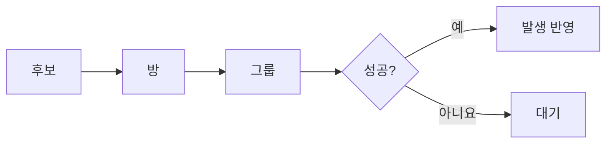

# ANOMALY_PRESSURE

## PURPOSE

방별 변칙 발생 Pressure와 발생 시점, Cooldown, 발생 후보의 책임 경계를 관리합니다.

## SYSTEM_OVERVIEW

AnomalySpawnSystem이 시간 갱신과 발생 요청을 중재하고 AnomalySpawnGroup이 실제 적 / 사건을 시작합니다. 압력은 Cooldown 중에도 누적합니다.

방 선정은 임계 도달 후 가장 오래 기다린 방 우선이며 동률은 무작위입니다. 임계 도달 방이 없으면 방별 압력 비례 판정 후 통과 방 중 동일 확률로 고릅니다. 그룹은 Weight / RepeatDelay를 사용합니다.

압력 감소와 Room / GlobalCooldown, 그룹 RepeatDelay는 실제 시작 성공 시에만 반영합니다. 후보 없음 / 시작 실패는 값을 유지하고 다른 후보를 연쇄 재추첨하지 않습니다.

## CURRENT_DECISION

| 항목 | 내용 / 조건 |
| --- | --- |
| 방별 누적 | Pressure는 조리실 / 창고 / 파티룸 / 드레스룸별로 독립 관리하며 시간에 따라 증가합니다. |
| 판정 / 방 선정 | 일정 주기마다 유효 후보를 조회하고 한 판정에서 최대 한 번 시작을 시도합니다. 임계치 이상 방이 있으면 도달 후 가장 오래 기다린 방을 우선하고 동률은 무작위로 선택합니다. |
| 판정 / 방 선정 | 없으면 방별 Pressure 비례 확률을 판정하며, 통과한 방이 여럿이면 동일 확률로 하나를 선택합니다. Pressure를 후보 종류의 Weight에 다시 적용하지 않습니다. |
| 시작 성공 / 실패 | 후보가 없거나 시작 요청이 실패하면 Pressure / Cooldown / RepeatDelay를 변경하지 않습니다. 실제 시작 성공 때만 Pressure를 감소시키고 Room / GlobalCooldown과 그룹별 RepeatDelay를 적용합니다. |
| 시작 성공 / 실패 | 선정된 대상의 시작 실패 시 다른 후보를 연쇄 재추첨하지 않습니다. |
| Cooldown 중 증가 | Cooldown 중에도 Pressure는 계속 증가합니다. |
| 미방문 보정 | 플레이어가 없는 연속 시간을 미방문으로 계산하고 누군가 머물면 미방문 경과만 초기화합니다. 미방문 방에는 추가 증가 보정을 적용하되 방문만으로 누적 Pressure를 낮추지 않습니다. 방 안 플레이어 수는 증가량에 직접 곱하지 않습니다. |
| 방 / 그룹 / FSM | Pressure는 방과 Spawn 그룹을 선정합니다. 그룹은 적의 발생 자격과 사건 프레젠터의 실행 가능 여부를 확인하고 시작을 요청합니다. 그룹의 컴포넌트 수가 Weight를 늘리지 않으며 Pressure는 FSM을 직접 변경하지 않습니다. |
| 자동 시작 경계 | 발생 대상의 기존 자동 시작과 Pressure 판정을 중복 운영하지 않으며 매 프레임 재시도하지 않습니다. 발생 대상은 발생 승인 전 Update에서 미시작 상태를 안전하게 처리하고, 승인 뒤 진행 중 행동은 자체 흐름으로 완료합니다. |
| 자동 시작 경계 | Final Rush에도 같은 발생 규칙을 적용합니다. |
| 제외 범위 | 적 수 비례 증가와 Threat Budget은 우선 도입하지 않습니다. |
| SpawnData 구성 | SpawnData는 단일 Enemy와 Event 목록을 가집니다. Harm / Kidnap에는 사건 후보가 필요하며, 일반 적의 Event 목록은 비웁니다. Enemy가 None이면 독립 사건 후보로 사용합니다. |
| 연결 사건 선택 | Harm / Kidnap의 사건은 Pressure 측 그룹이 SO의 Event 목록에서 선택하고 실행합니다. 적은 발생 자격과 시작 성공 상태, 연결된 사건 결과에 따른 행동만 담당하며 별도 프레젠터 목록을 보관하지 않습니다. |
| 후보 중복 / 선택 | 적이 지정된 그룹의 사건을 같은 그룹의 독립 발생 후보로 중복 등록하지 않습니다. 그룹 선택 후 실행 가능한 적 하나와 사건 프레젠터 하나를 각각 균등 선택합니다. 독립 사건 그룹은 사건 프레젠터만 선택합니다. |
| 그룹 가중치 / 검증 | Weight와 RepeatDelay는 그룹 단위입니다. 같은 SO와 Enemy 종류의 중복 등록, 한 SO 내부 Event 중복, 독립 사건 그룹 간 같은 Event 중복은 거절합니다. 서로 다른 적은 같은 Event 종류를 사용할 수 있습니다. |
| 결과 구독 / 수명 | 사건 시작 전에 결과를 구독하고 실제 시작한 사건 객체만 해당 적에게 연결합니다. 시작 호출 중 받은 결과는 적의 시작 상태 반영 후 전달하며, 시작 실패나 적의 활동 종료 시 준비 구독을 해제합니다. 이미 발생한 사건은 구독 해제만으로 취소하지 않습니다. |
| Inspector 이관 | Enemy 배열에서 단일 필드로 변경한 값은 Inspector에서 다시 설정합니다. 기존 Event 목록은 유지하며 종류별 SO 분리는 요구하지 않습니다. |
| 발생 확률 | PressureChanceScale은 압력 비율에 곱할 일반 발생 확률 계수입니다. 임계치 우선 선정이 없는 경우 일반 발생 확률은 Pressure / 최대 Pressure × PressureChanceScale입니다. |

## RESPONSIBILITY_BOUNDARY

| 항목 | 내용 / 조건 |
| --- | --- |
| AnomalyPressureModel | AnomalyPressureModel: 방별 Pressure / 증가 / 감소 / 미방문 경과 / 임계치 대기 기록 / RoomCooldown |
| AnomalyRoomSelector | AnomalyRoomSelector: 유효한 방 후보를 받아 임계치 도달 시각 우선 / 압력 확률 / 동률 추첨으로 한 방 선정. 후보 순서와 난수 호출 순서를 유지하며 시간 갱신이나 실제 시작을 수행하지 않음 |
| AnomalySpawnSelector | AnomalySpawnSelector: 그룹별 Weight / RepeatDelay / 후보 선택 |
| AnomalySpawnGroup | AnomalySpawnGroup: 적과 사건 후보 선택 / 실제 시작 요청 / 적의 사건 결과 연결 |
| AnomalyLinker | AnomalyLinker: 사건 시작 중 결과 보관 / 발생 건 구독 / 활동 종료 정리 |
| Enemy / Event | Enemy / Event: 적의 발생 자격과 결과 행동 / 프레젠터의 실제 사건 실행 |
| AnomalySpawnSystem | AnomalySpawnSystem: 게임 경과 시간과 방별 압력 갱신 / 유효 후보 수집 / 판정 주기 / GlobalCooldown / 실제 발생 요청 / 시작 요청 재진입 차단 중재. AnomalyRoomSelector에 방 선정을 위임하고 실제 시작 직전에 그룹 후보를 다시 검사하며 시작 실패 시 다른 후보로 연쇄 재시도하지 않음 |

## PENDING

- Pressure 범위 / 증가량 / 미방문 보정 수치
- 판정 주기 / PressureChanceScale / 강제 발생 임계치 / 발생 후 감소량 튜닝
- Room / GlobalCooldown / 후보별 Weight / 반복 제한 시간
- [PREDATOR](PREDATOR.md)의 초기 승인 방 / 이후 활동 계약에 따른 Inspector 연결과 반복 발생 검증
- 난이도 / 관찰 인원 / 멀티플레이 보정

## UPDATE_RULE

- Pressure 누적 / 발생 판정 / 감소 / Cooldown / 발생 자격 규칙이 변경될 때 갱신합니다.
