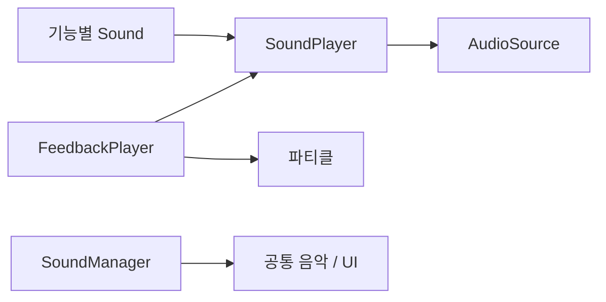

# AUDIO

## PURPOSE

오디오 재생 책임, 연결 위치와 미정 정책을 관리합니다. 실제 반영 / 확인 이력은 [DONE](../DONE.md#오디오)에서 관리합니다. 음원 요구사항은 [ASSET_REQUIREMENT](ASSET_REQUIREMENT.md#audio), 연출은 [UI_PRESENTATION](UI_PRESENTATION.md), 작업 순서는 [TODO](../TODO.md#presentation_and_audio)를 따릅니다.

## SYSTEM_OVERVIEW

행동 담당이 재생 조건을 전달하며 공간 / 감쇠 / Mixer 설정은 AudioSource가 소유합니다. FeedbackPlayer의 실제 연결 범위는 곰이고 다른 적 이전은 보류입니다.

| 지속 연출 요청 | 처리 |
| --- | --- |
| 같은 Cue Begin | 재시작 없이 유지 |
| 다른 Cue Begin | 이전 반복음 / 입자를 정리하고 새 Cue 시작 |
| 현재 Cue End | 반복음 중지 / 입자 제거 / Cue 해제 |
| 다른 Cue End | 현재 출력 유지 |
| 비활성화 / ResetFeedback | 소유 사운드 전체 중지 / 기록한 파티클 제거 |

단발은 한 번 재생하고 지속 출력은 행동 종료에서 중지합니다. 일시정지의 출력 정지 / 재개는 Cue 종료와 구분하며 [PAUSE_AUDIO](#pause_audio)를 따릅니다.

## AUDIO_RESPONSIBILITY

- 재생 데이터 / 모듈 / 전역 출력의 역할은 아래 [담당 표](#responsibility_and_modules)를 따릅니다. 핵심 행동의 실제 결과를 오디오에 전달하고 오디오가 게임 규칙을 판단하지 않습니다.
- 공간 / Mixer / 반복 설정은 AudioSource에서 관리합니다. 소유자별 재생과 중단이 필요한 월드 대상은 개별 재생기, UI는 공통 2D 출력을 사용합니다.
- 상태별 요청과 구독 / 정리 계약은 [이동](#movement), [아이템 / 제작](#item_and_production), [적 / NPC](#enemy_and_npc), [UI / 음악](#ui_and_music), [수명](#lifecycle_and_performance)에 모읍니다.

## REQUESTED_CONTENT

- 플레이어 걷기 / 달리기 / 점프, 아이템 집기 / 내려놓기, 제작 시작 / 진행 / 성공 / 실패, 적별 울음과 행동음, NPC 포획 버둥거림, 배경음악을 포함합니다.
- 개: 컹컹 / 끼잉, 까마귀: 날갯짓 / 까악, 여우: 캥캥, 담비: 작은 끙 소리 후보, 곰: 푸흥 / 커헝, NPC: 포획 중 푸닥푸닥. 의성어는 게임용 표현 방향이며 실제 동물 울음의 고증 계약이 아닙니다.
- 추가 제안: 착지 / 투척 / 충돌, UI 선택 / 클릭 / 패널 / 구매 결과, 미션 완료 / Final Rush / 결과, 구조 성공 / 스턴 진입, 공급원 리필 / 음식 폐기 / 섭취, 변칙 징후 / 해결, 환경음.

## RESPONSIBILITY_AND_MODULES

| 담당 | 함수 / 연결 | 책임 |
| --- | --- | --- |
| SoundData | SO 설정 | AudioClip[] / Volume 범위 / Pitch 범위 / Cooldown |
| SoundPlayer | PlayOneShot(SoundData sound) / StartLoop(SoundData sound) / StopLoop / StopAll | OneShot / Loop AudioSource를 분리해 음원 선택과 실제 재생 |
| SoundBase | Init / PlaySound / StartLoop / StopLoop / ResetSounds | 재생기 연결과 공통 재생 / 정리 |
| CharacterSound : SoundBase | UpdateFootsteps / UpdateMovement / ResetSounds | 공통 발소리와 이동 기록 초기화 |
| PlayerSound : CharacterSound | Init(Player, Mover, SoundPlayer) / PlayJump / PlayLand | 이동 / 포획 이벤트와 점프 / 착지, 포획음 복구 |
| PlayerSound / PlayerItemHolder / Player | PlayItemAction / 실제 행동 결과 전달 | 플레이어 위치에서 집기 / 정상 배치 / 실제 투척 성공음 재생 |
| ItemSound | 기존 SoundData 참조 | 이전용 데이터 보존, 현재 재생 기능 없음 |
| ProductionSound | Init / Subscribe / Unsubscribe / HandleStartResult / HandleMinigameResult / HandleCompleted / HandleProductionEnded / RestoreLoop / Stop | 제작 결과 재생과 세션 연결 / 종료 정리 |
| BothersomeSound / HarmSound / KidnapSound | UpdateMovement / 행동 재생 함수 | 개 / 담비 / 여우의 실제 이동과 해당 행동음 |
| DemandSound / FeedbackPlayer | UpdateMovement / Play / Begin / End / ResetFeedback | 곰 발소리는 기존 상속, 행동 사운드와 파티클은 FeedbackPlayer. 현재 연결 / 확인 범위는 DONE 참조 |
| StealSound : SoundBase | InitFlight / UpdateFlight / ResetSounds | 까마귀 이동 이벤트와 비행 / 음식 확보음 |
| NpcSound : CharacterSound | Init / LateUpdate / ResetSounds | NPC 이동 / 포획 상태에 따른 재생 |
| GameFlowSound / GameResultSound | Init / 중재자 이벤트 구독 | 전체 미션 완료 / 마무리 구간 / 결과 효과음 |
| ShopSound / ButtonSound | 구매 결과 / Button.onClick 구독 | 실제 구매 결과와 클릭 효과음 |
| TitleScene / PlayScene | SoundManager.FadeBgm | 타이틀 / 플레이 / 결과 음악 요청 |
| SoundManager | PlayBgm / StopBgm / FadeBgm | BGM / Common 2D SFX / AudioMixer / 전역 음량 |

- 모든 클래스를 필수로 생성하지 않습니다. 공통 SoundData / SoundPlayer와 실제 책임이 필요한 연결부터 구현합니다.
- SoundData에는 공간 / 반복 설정을 넣지 않습니다. 2D / 3D, Spatial Blend, Min / Max Distance, Rolloff, Mixer Group은 AudioSource 설정으로 유지합니다. 특정 소리만 다른 공간 설정이 필요할 때 별도 Source 또는 공간 설정을 검토합니다.
- 기존 성공 / 상태 변경 이벤트 → 해당 Sound 모듈 → SoundPlayer 흐름을 우선합니다. Enemy / Item / Production의 핵심 로직에서 직접 오디오 의존을 최소화하되, 오디오만을 위한 의미 없는 이벤트를 대량 추가하지 않고 직접 호출이 훨씬 단순한 경우에는 과도하게 분리하지 않습니다.
- SoundManager는 적 AI / 제작 판정 / 미션 규칙을 판단하지 않습니다. 기능의 승인된 결과를 해당 소유자가 전달하고 오디오는 표시만 수행합니다.
- 독립적인 위치 / 재생 / 중단 상태가 필요한 월드 주체는 개별 SoundPlayer를 사용하고 UI는 공통 2D 경로를 재사용합니다. 단순히 월드 아이템이라는 이유만으로 재생기를 추가하지 않습니다. 단발음과 중단 가능한 반복음의 소스를 분리해 루프 정지가 다른 단발음을 끊지 않도록 합니다.
- Pitch 변화와 개별 중단이 필요한 단발음은 공유 2D 소스 전체 설정을 바꾸지 않고 독립 소스에서 재생합니다. 하나의 공유 소스를 움직여 다수 적의 3D 재생을 구현하지 않습니다.
- 초기에는 OneShot / Loop Source만 사용하고 AudioSource 풀링은 구현하지 않습니다. 단발음이 많이 겹쳐 재생별 Pitch / Volume의 독립 제어가 필요해지면 역할별 Source 또는 AudioSource Pool 확장을 검토합니다.

## FEEDBACK_PLAYER_PLAN

곰의 행동 연출은 FeedbackPlayer를 사용하고 DemandSound는 발소리 상속만 유지합니다. 다른 적은 기존 연결을 유지합니다. 개 이전 / 발소리 공통화 / 다른 적 이전은 아래 재개 후보로 보존하며 자동 진행하지 않습니다. 곰의 확인 범위와 잔여 검증은 [TODO](../TODO.md#feedback_player_migration)를 따릅니다.

### 구성과 책임

- FeedbackPlayer는 공통 재생 / 정리만 담당하고 곰 설정은 DemandFeedbackProfile의 고정 음원 필드를 사용합니다. FeedbackCue는 코드에서 지속 요청을 구분하며 Inspector에서 입력하지 않습니다. 별도 서비스나 바인딩 클래스는 추가하지 않습니다.
- 흐름은 행동 코드 → FeedbackPlayer → 기존 SoundPlayer / 연결된 ParticleSystem의 직접 호출입니다. 기존 이벤트 연결이 적합한 플레이어 / NPC / 제작 / UI / 화면 연출은 일괄 교체하지 않습니다.
- DemandFeedbackProfile은 먹기 / 만족 / 분노 / 공격 / 포획 SoundData를 명시된 필드로 보관합니다. 지속 여부는 호출 API로 결정하며 SoundData의 Clips / VolumeRange / PitchRange / Cooldown은 유지합니다.
- EnemyDemand가 곰 프로필과 먹기 / 분노 ParticleSystem을 연결해 FeedbackPlayer에 직접 전달합니다. FeedbackPlayer의 Inspector에는 기존 SoundPlayer만 연결합니다. 공유 SO에는 씬 파티클 참조를 넣지 않습니다.
- 키 배열 조회 / 중첩 설정 타입 / 바인딩 배열은 사용하지 않습니다. FeedbackPlayer는 재생한 파티클을 실행 중 목록에 기록해 단발 입자까지 전체 정리합니다. 여러 효과는 부모 ParticleSystem의 자식 재생을 사용합니다. 풀링은 이번 범위가 아닙니다.
- Play(sound, particle)는 단발, Begin(cue, sound, particle)는 지속 시작, End(cue)는 해당 지속 종료, ResetFeedback()은 전체 정리입니다. 범용 FeedbackProfile은 런타임 사용처가 없으며 기존 에셋 / 스크립트는 Unity에서 정리합니다.
- 같은 Begin 요청은 반복음과 파티클을 재시작하지 않습니다. 현재 지속 요청 키를 기록해 다른 키의 End가 새 반복음을 끊지 않도록 합니다. 반복음 슬롯은 SoundPlayer의 기존 1개를 유지하며 다른 지속 키로 전환하면 이전 파티클과 반복음을 먼저 종료합니다. 키는 실제 음원 재생 성공이 아니라 요청 상태이며 쿨다운 / 일시정지의 재생 거절은 기존 SoundPlayer를 따릅니다.
- OnDisable / 풀 반환 / 명시적 리셋에서는 소유 사운드와 파티클 입자 / 현재 키를 정리합니다. 기존 쿨다운 / 랜덤 음원 / 일시정지 / 공간·Mixer 설정과 소유자별 재생 독립성을 보존합니다. 재활성화 시 진행 상태 복구가 필요한 경로를 확인합니다.
- StunEffect / CaptureEffect / UI Effect는 대상의 피벗·기본 자세·UI 복원을 담당하므로 유지합니다. CharacterSound의 이동 거리 계산도 FeedbackPlayer로 합치지 않습니다.

### 적용 범위와 재개 후보

- 적용 완료: 공통 직접 재생 API, 곰 프로필 / 파티클 연결과 EnemyDemand의 행동 호출 교체. DemandEffect 런타임 호출은 제거했으며 스크립트 파일 정리와 실행 확인은 별개입니다. 실제 확인 이력은 [DONE](../DONE.md#오디오)을 따릅니다.
- 보류: 개 FeedbackPlayer 이전. 발소리 공통화와 다른 적 이전도 확정된 후속 순서가 아닙니다.
- 재개 시 CharacterSound의 거리 누적 / 접지 / 실제 이동 판정과 ResetFootsteps를 유지하면서 재생 연결만 분리할지 검토합니다. DemandSound 제거는 해당 연결 전환 이후 판단합니다.
- 다른 적 이전 시 설정 / 호출 / 상태 판정 / 프리팹 연결을 함께 비교합니다. 까마귀의 InitFlight / UpdateFlight와 이동 / 정지 이벤트 판정은 보존합니다.
- 플레이어 / NPC / 제작 / UI 공통화, AudioSource / 파티클 풀링과 다중 반복음은 별도 범위입니다. 코드 반영 / Unity 연결 / 실행 확인을 구분하며 기존 전용 Sound를 선행 삭제하지 않습니다.

## SOUND_DATA_CONNECTIONS

아래는 음원 용도와 현재 연결 필드의 대응입니다. 실제 생성 / 적용 / 청취 확인은 [DONE](../DONE.md#오디오), 남은 설정은 [TODO](../TODO.md#manual_setup_checklist)를 따릅니다. 같은 SoundData를 재사용할 수 있으므로 표의 용도 수가 필수 에셋 수는 아닙니다. ItemSound 항목은 현재 연결이며 합의한 담당 변경은 아래 계약과 구분합니다.

| 데이터 용도 | 음원 용도 | 연결 컴포넌트 / 필드 | 재생 |
| --- | --- | --- | --- |
| 발소리_공통 | 바닥을 밟는 짧은 소리 여러 개 | PlayerSound / NpcSound / 지상 적의 CharacterSound._walkSound | 단발 |
| 토끼_버둥거림 | 플레이어 / NPC가 포획 중 몸부림치는 소리 | PlayerSound / NpcSound의 _capturedSound | 반복 |
| 플레이어_점프 | 실제 점프 시작 소리 | PlayerSound._jumpSound | 단발 |
| 플레이어_착지 | 지면 착지 소리 | PlayerSound._landSound | 단발 |
| 개_요구 | 관심을 요구하는 짖음 | BothersomeSound._requestSound | 단발 |
| 개_만족 | 요구 충족 반응 | BothersomeSound._satisfiedSound | 단발 |
| 곰_먹기 | 씹는 소리 | DemandFeedbackProfile.EatSound | 반복 |
| 곰_만족 | 선호 음식 / 만족 퇴장 반응 | DemandFeedbackProfile.SatisfiedSound | 단발 |
| 곰_분노 | 비선호 음식 / 난동 진입 반응 | DemandFeedbackProfile.MadSound | 단발 |
| 곰_공격 | 난동 타격 동작 소리 | DemandFeedbackProfile.AttackSound | 단발 |
| 곰_포획 | 토끼 확보 성공 소리 | DemandFeedbackProfile.CaptureSound | 단발 |
| 담비_수집 | 물건을 뒤적이는 소리 | HarmSound._collectSound | 반복 |
| 담비_공격 | 보복 공격 동작 소리 | HarmSound._attackSound | 단발 |
| 여우_포획 | 토끼 확보 성공 소리 | KidnapSound._captureSound | 단발 |
| 까마귀_날갯짓 | 비행 날갯짓 소리 | StealSound._flightSound | 반복 |
| 까마귀_음식확보 | 음식 확보 반응 | StealSound._takeSound | 단발 |
| 아이템_집기 | 손으로 집는 소리 | ItemSound._pickUpSound | 단발 |
| 아이템_배치 | 정상 배치 소리 | ItemSound._placeSound | 단발 |
| 아이템_투척 | 던지는 소리 | ItemSound._throwSound | 단발 |
| 제작_시작 | 제작 시도 시작 알림 | ProductionSound._startSound | 단발 |
| 제작_진행 | 섞기 / 조리 등 진행 소리 | ProductionSound._processSound | 반복 |
| 제작_중간성공 | 미니게임 중간 성공 알림 | ProductionSound._successSound | 단발 |
| 제작_실패 | 제작 실패 알림 | ProductionSound._failureSound | 단발 |
| 제작_완성 | 최종 음식 완성 알림 | ProductionSound._completeSound | 단발 |
| 버튼_클릭 | 공통 버튼 클릭음 | ButtonSound._clickSound | 단발 |
| 상점_구매성공 | 결제 성공 알림 | ShopSound._purchaseSuccessSound | 단발 |
| 상점_구매실패 | 결제 실패 알림 | ShopSound._purchaseFailureSound | 단발 |
| 미션_전체완료 | 전체 미션 완료 알림 | GameFlowSound._missionCompletedSound | 단발 |
| 진행_마무리진입 | 마무리 구간 진입 알림 | GameFlowSound._finalRushSound | 단발 |
| 결과_성공 | 게임 성공 결과 알림 | GameResultSound._successSound | 단발 |
| 결과_실패 | 게임 실패 결과 알림 | GameResultSound._failureSound | 단발 |

## APPROVED_ITEM_SOUND_RESPONSIBILITY

- 집기 / 정상 배치 / 투척 성공음은 행동 주체인 플레이어 위치에서 재생하는 방향입니다. PlayerItemHolder의 실제 성공 결과를 Player가 중재하고 PlayerSound가 담당합니다. 독립적인 소리가 없는 일반 아이템에 전용 재생기를 요구하지 않습니다.
- PlayerItemHolder의 실제 성공 결과를 Player가 중재하여 PlayerSound.PlayItemAction에 전달하는 경로가 구현됐습니다. 현재 ItemSound는 이전용 데이터만 보존하며 ItemCarry → ItemSound → 전용 재생기 경로로 재생하지 않습니다.
- 기존 적별 데이터와 새 데이터는 참조를 유지해 이전하며 새로 지정한 값을 임의로 덮어쓰지 않습니다. 기존 EnemySound는 이전용 컴포넌트이며 적별 현재 재생 담당은 전용 Sound입니다.
- 기존 데이터 이전 / Inspector 연결의 남은 확인은 [TODO](../TODO.md#presentation_and_audio), 실제 반영 이력은 [DONE](../DONE.md#오디오)를 따릅니다. 이전용 컴포넌트가 존재한다는 이유만으로 현재 재생 담당으로 해석하지 않습니다.

## PAUSE_AUDIO

- 싱글 메뉴는 AudioListener.pause로 월드 효과음을 정지 / 재개합니다. 멀티 메뉴는 월드 소리를 멈추지 않습니다. PlayPauseController가 이전 정지 상태를 보관하고 소유한 정지를 해제합니다.
- SoundManager의 BGM / 공통 SFX Source는 ignoreListenerPause=true를 사용합니다. ButtonSound는 연결한 공통 UI SoundPlayer에 SetIgnoreListenerPause(true)를 적용합니다. 월드 재생기에 이 예외를 일괄 적용하지 않습니다.
- 닫기 버튼으로 패널이 사라져도 UI 클릭음은 공통 재생기로 유지합니다. 버튼의 시각 ButtonEffect와 ButtonSound는 별도 컴포넌트이며 한쪽 부착을 다른 쪽의 완료로 해석하지 않습니다.
- 실제 일시정지 청취 / 반복음 재개 / 메뉴 종료 복원은 [TODO](../TODO.md#latest_play_readiness)를 따릅니다.

## MOVEMENT

| 항목 | 내용 / 조건 |
| --- | --- |
| 발소리 조건 | Grounded / 정상 Locomotion / Threshold 이상의 실제 수평 이동량을 모두 확인합니다. 넉백 / 포획 따라가기 / 강제 이동 / 재배치 / 리스폰 / 이동 불가 / 플랫폼에 의해 위치만 움직인 경우에는 재생하지 않습니다. 속력이 있다는 이유만으로 발소리를 내지 않습니다. |
| 이동량 계산 | 플레이어는 CharacterController.Move 직전 / 직후의 수평 displacement를 우선 사용하고 외부 이동과 정상 이동 상태를 구분합니다. NavMeshAgent 캐릭터는 실제 Agent velocity를 사용할 수 있습니다. 이동 기준을 재설정할 때 이전 위치 / 누적 거리 / 접지 기록을 초기화합니다. |
| 점프 / 착지 연결 | 점프는 플레이어 전용입니다. Mover.OnJumped / OnMoveApplied / OnMovementReset을 PlayerSound에서 구독합니다. MoveResult의 Distance / IsGrounded / CanMove / IsRunning으로 발소리 / 착지를 처리하고 최초 접지 / 초기화 직후 착지음과 착지 프레임의 발소리 중복을 방지합니다. |
| 발소리 방식 | 현재는 실제 이동 거리 누적이며 걷기 / 달리기에 같은 SoundData를 사용하고 달리기 거리 간격을 줄입니다. 최종 클립의 Animation Event 적용 시 트리거만 교체하고 두 경로를 동시에 재생하지 않습니다. |
| NPC / 적 이동 | NPC / 적도 실제 이동과 접지 / 비행 상태를 기준으로 재생합니다. 스폰 / 포획 / 재활성 / 리스폰은 누적 거리와 이전 위치를 초기화합니다. 비행은 발소리가 아니라 날갯짓 반복을 사용합니다. |

## ITEM_AND_PRODUCTION

| 항목 | 내용 / 조건 |
| --- | --- |
| 아이템 결과 | ItemCarry.OnHoldChanged / OnPlaced 등 기존 결과 이벤트를 우선 사용합니다. 일반 OnHoldEnded만으로 배치를 판단하지 않습니다. 폐기 / 소비 / 손실 / 투척과 정상 내려놓기를 구분합니다. |
| 중복 재생 방지 | OnHoldChanged는 집기 상태 확인, OnPlaced는 정상 배치, ItemThrow.OnThrown은 실제 투척 성공에 사용합니다. 보유 해제만으로 내려놓기음을 내지 않습니다. 충돌음은 충격량 / 최소 간격으로 작은 접촉과 구르는 동안의 반복 재생을 제한합니다. |
| 제작 세션 / 반복음 | ProductionSound는 OnStartResult / OnCompleted / OnProductionEnded와 Minigame.OnResult를 구독합니다. OnStateChanged는 구독하지 않습니다. CookController.Init은 Session / 제작 전용 SoundPlayer를 전달하고 Unbind는 Stop을 호출합니다. |
| 시작 / 완료 순서 | 성공한 OnStartResult에서만 시작음과 Loop를 재생합니다. OnStateChanged가 먼저 발생해도 시작음을 중복 요청하지 않습니다. OnProductionEnded에서 Loop 정지 후 OnCompleted에서 최종 완성음을 재생합니다. |
| 중간 / 최종 결과 | 마지막 미니게임 성공은 세션 상태를 함께 확인해 완성음과 무조건 중첩하지 않습니다. 취소는 Loop만 종료하고 실제 실패 판정에서만 실패음을 재생합니다. 실패한 시작, HUD 열기, 중복 완료 통지로 완성음을 재생하지 않습니다. |
| 그릇별 수명 | 제작 반복음은 그릇 위치의 3D 재생을 기본 제안으로 둡니다. HUD를 닫아도 실제 제작이 유지되면 소리도 유지하며 세션 종료에 맞춰 끕니다. 복수 그릇의 소리와 중단은 독립적으로 관리합니다. |
| 제작 정리 / 복구 | 제작 종료는 Loop만 정지하고 후속 실패 / 완성음을 유지합니다. 모듈 비활성화 / 연결 해제에서는 전체 재생과 기록을 정리합니다. CookController의 연결 해제와 PlayScene.StopPlay는 제작 사운드를 정리합니다. 진행 중 모듈 재연결에서는 Loop만 복구하며 그릇 아이템 사운드와 제작 SoundPlayer는 분리합니다. |

## ENEMY_AND_NPC

| 항목 | 내용 / 조건 |
| --- | --- |
| 상태 / 행동 재생 | 적별 상태 진입 / 실제 공격 / 섭취 / 포획 성공 / 대응 결과와 클립을 연결합니다. Update에서 울음 재생을 반복 호출하지 않습니다. 반복 울음은 최소 간격과 활성 상태를 확인합니다. |
| 적별 연결 | 개의 요구 / 만족 / 퇴장, 곰의 먹기 / 난동 / 납치, 까마귀의 비행 / 절도 / 퇴장, 담비의 뒤적임 / 공격, 여우의 포획 / 도주 / 결과를 기존 행동 결과 / 상태 이벤트에서 적별 전용 Sound로 연결합니다. 직접 호출은 단순한 연결이 필요한 경우에만 사용합니다. |
| 잠복 징후 | 소리가 플레이어에게 위치 / 상태 정보를 주므로 잠복 적의 상시 울음은 기본으로 넣지 않습니다. 징후가 필요한 상태와 노출 강도는 PREDATOR / ANOMALY의 기존 규칙을 보존하고 추가 힌트는 별도 결정합니다. |
| NPC / 플레이어 상태 | NpcSound는 자신의 SetCaptured(bool)를 사용하고 구조 / 납치 완료 / 취소 / 비활성에서 중단합니다. PlayerSound는 플레이어 포획 이벤트와 이동 초기화에 맞춰 반복음을 복구합니다. 비활성화 / 리스폰 / 재등장에서 이전 반복음과 기록을 정리합니다. |
| 종료 단발음 | 사라진 적의 종료 단발음을 끝까지 남겨야 하면 해당 행동만 독립 단발 소스 수명을 사용합니다. 모든 소리에 같은 잔존 정책을 강제하지 않습니다. |

- NpcSound.Init은 Npc / NpcMover / 전용 재생기를 연결하고 LateUpdate에서 상태와 실제 수평 속도로 갱신합니다. NPC / 사운드 비활성화 경계에서 정리합니다. StealSound.InitFlight는 OnMoveApplied / OnMovementReset을 구독하며 UpdateFlight에서 이동 성공 기록을 소비합니다. 정지 알림은 이전 기록을 지우고 다음 성공 이동에서 날갯짓을 다시 요청합니다.

## UI_AND_MUSIC

| 항목 | 내용 / 조건 |
| --- | --- |
| UI 재생 경로 | ButtonSound가 실제 클릭을, ShopSound가 구매 결과를, GameFlowSound / GameResultSound가 중재자의 알림을 받아 2D 효과음을 재생합니다. 같은 결과를 뷰와 사운드 양쪽에서 중복 재생하지 않습니다. |
| 결과 재생 | 구매 실패 / 구매 성공, 제작 판정 / 미션 완료 / Final Rush / 결과는 기능 결과 수신 지점에서 재생합니다. Tween 반복 / OnComplete가 보상 지급이나 판정을 수행하지 않습니다. |
| 씬 음악 후보 | 씬의 기존 수명 또는 필요 시 SceneAudio에서 타이틀 / 플레이 / 결과 음악과 재시작 / 복귀를 연결합니다. PlayScene의 Begin 성공 이후 플레이 음악을 요청하고 시작 실패에서는 이전 곡과 페이드를 복구합니다. |
| 배경음 수명 | PlayBgm / StopBgm을 유지하고 단일 Source에서 Fade Out → 곡 교체 → Fade In으로 시작합니다. Fade는 unscaledDeltaTime 또는 Unscaled Time을 사용해 timeScale 0에서도 진행합니다. 새 BGM 요청은 기존 Fade를 정리하고 전환합니다. 실제 Cross Fade가 필요할 때만 Source 2개로 확장합니다. |
| Final Rush | Final Rush 효과음은 진입 1회, 텍스트 점멸마다 재생하지 않습니다. 긴박 BGM 교체 / 레이어 추가는 음원 확보 후 결정합니다. 결과는 승리 / 실패 Sting과 순차 UI 효과음 연결을 제안합니다. |
| 스피커 / Mood / Distortion | 준비 BGM과 파티룸 스피커 음악은 별도입니다. 파티룸 음악과 NPC 반응의 담당 구조는 음악 출력 왜곡의 스피커 / 출력 구조와 함께 설계합니다. NPC Dance / Excited 조건은 오디오 음량이나 isPlaying만으로 판단하지 않습니다. 설계 후보는 [NPC 음악 반응](NPC_RABBIT.md#music_reaction_design), 작업 상태는 TODO를 따릅니다. |

- MissionView.OnCompleted → GameFlowHud.OnMissionCompleted → GameFlowController.OnMissionCompleted 순서로 실제 완료 표시를 전달합니다. GameFlowSound는 초기화 이후 전체 완료 / FinalRush를 각각 한 번, GameResultSound는 중재된 결과 화면 표시를 한 번 처리합니다. Unscored에서는 성공 / 실패음을 재생하지 않습니다.
- ShopSound는 ShopPresenter.OnPurchaseCompleted의 실제 결과를 구독합니다. ButtonSound는 닫기 클릭 후에도 알림을 받도록 Awake에서 구독하고 OnDestroy에서 해제하며 컴포넌트 비활성화만으로 해제하지 않습니다.

## LIFECYCLE_AND_PERFORMANCE

- Master / BGM / SFX 설정과 저장은 기존 SettingManager → SoundManager 경로를 유지합니다. 각 Source의 Mixer 출력 연결은 Unity에서 확인합니다. 캐릭터별 재생마다 설정값을 다시 곱해 이중 감쇠하지 않습니다.
- timeScale 0을 오디오 정지로 간주하지 않습니다. 게임 종료에서 월드 반복음 / 발소리 / 제작음은 명시 정리하고 결과 / UI 소리는 유지합니다. 싱글 메뉴의 AudioListener.pause 적용은 위 [일시정지 계약](#pause_audio)을 따릅니다.
- MonoBehaviour OnDisable / OnDestroy / 풀 반환과 씬 End에서 소유 루프 / 이벤트 / 페이드를 해제합니다. 한 대상의 종료에서 SoundManager.StopSfx로 모든 UI 소리를 끊지 않습니다.
- 대상별 거리 감쇠 / 최소 간격 / 동시 재생 상한과 우선순위를 설정합니다. 구체 수치는 맵과 실제 음원으로 튜닝합니다. 인접 NPC 다수의 발소리 / 울음이 과도하게 중첩되는지 확인합니다.
- 실시간 GetComponent / Find를 매 재생에 반복하지 않고 참조를 초기화 때 연결합니다. 클립 배열 / 설정을 재사용하며 재생마다 임시 객체를 생성하지 않습니다.
- 멀티 후속에서는 로컬 UI와 월드 효과를 구분하고 한 행동을 로컬 예측 / 네트워크 통지 양쪽에서 중복 재생하지 않습니다. 현재 작업에서 네트워크 권한을 구현한 것으로 기록하지 않습니다.

## PENDING

- 구현 / 연결 / 검증 작업 목록은 [TODO](../TODO.md#presentation_and_audio)에서 관리합니다. 아래 목록은 미정 정책만 설명합니다.
- 아래 음원 선택 / 공간 재생 / 음악과 NPC 반응 정책은 미확정입니다. 큰 방향 검토 완료를 개별 정책이나 권장안의 일괄 확정으로 해석하지 않습니다.

- 동물별 음원 표현과 Variant 선택 기준. 음원 확보 / 사용 권한 / 파티클 연결 작업은 TODO에서 관리합니다.
- 로컬 플레이어 발소리의 2D / 3D 선택, NPC 경고 수신 범위, 월드 소리의 방 간 감쇠 / 차폐. 기본 위치 감쇠 이후 차폐는 후속 권장입니다.
- 타이틀 / 플레이 / 결과 곡, Final Rush 음악, 파티룸 음악의 감지 / NPC 반응 조건과 BGM 동시 재생 방식.
- 발소리와 클립 Animation Event 전환 시점, 반복음 / 최소 간격 / 동시 재생과 Pitch 수치.
- 추가 오디오 자동화의 확장 범위는 별도 결정합니다. 현재 일괄 설정 도구의 사용 계약과 실행 이력은 EDITOR_TOOLS / DONE, 남은 이전 도구 작업은 TODO에서 관리합니다.

## VERIFICATION

실행 확인 항목은 [TODO](../TODO.md#presentation_and_audio), 확인 이력은 [DONE](../DONE.md#오디오)를 따릅니다.

## REFERENCES

- [Unity 6.0 AudioSource](https://docs.unity.com/en-us/engine/6000.0/script-reference/unityengine/audiosource): 공간 재생 / PlayOneShot / 반복음과 소스 설정.
