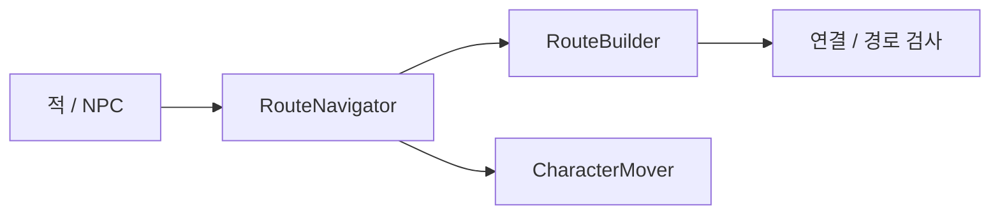

# ENEMY_PATHFINDING

## SYSTEM_OVERVIEW

호출자는 목적지와 행동 결과, RouteBuilder는 경로 구성, RouteNavigator는 진행, CharacterMover / NavMeshAgent는 실제 이동을 담당합니다.

| 이동 상태 | 의미 / 호출자 처리 |
| --- | --- |
| Idle | 시작 전 |
| Moving | 이동 / 경로 계산 대기 / 다음 경유점 / 재검사 |
| Arrived | 최종 목적지 도착. 납치 / 탈취 완료는 호출자가 별도 확정 |
| Failed | 경로 구성 실패 / 이동 불가 / 전체 제한시간 초과. 호출자가 보유 / 포획 정리 |
| Cancelled | 외부 취소. 호출자가 보유 / 포획 정리 |

계산 대기는 Moving 내부 진행이며 새 실패 상태가 아닙니다. 정체 재검사는 통행 가능 시 이동을 재개하고 선정 경유점 / 진행 번호 / 전체 경과시간을 유지합니다. 세부 조건은 본문을 따릅니다.

### 경로 선정 차이

| 요청 | 선정 방식 |
| --- | --- |
| 일반 이동 | 유효 연결에서 목적지까지 탐색 |
| 여우 포획 도주 | 반대 방향 A / B 우회 후 입구 복귀, A 재방문 제한 |
| 담비 기본 도주 | 기본 경로 또는 최소 거리를 확보하는 경유, 노드 재방문 허용 |

## COMMON_CONTRACT

- 이동 결과는 Moving / Arrived / Failed로 구분합니다. 경로 계산 대기는 실패와 구분하며 이동 중 CanNavigate 소실이나 실제 경로 실패는 도착으로 처리하지 않습니다.
- 까마귀의 경유점 일시 차단은 제한적으로 재시도하고 지속 차단은 실패로 종료합니다. 이동 실패 시 보유 음식을 해제 / 복구하며 정상 탈출에서만 실제 소비합니다.

- Route는 처음부터 적 / NPC가 함께 사용하는 공통 경로 기능입니다. 현재 적에게 적용되어 있다는 이유로 적 전용 시스템으로 한정하지 않습니다.
- 경로 계산 / 경유점 이동 / 재계산 / 도착과 실패 결과를 담당합니다. 목적지 방 선택과 행동 확률, 도주 후 손실 / 포획 결과 처리는 호출자가 담당합니다.
- RouteNavigator는 CharacterMover의 경로 상태와 이동 실행을 사용합니다. NpcMover는 CharacterMover를 상속해 같은 경로 기능을 사용합니다. NPC 구조는 [NPC_RABBIT](NPC_RABBIT.md#first_implementation)을 따릅니다.

## STATUS

| 구분 | 현재 상태 |
| --- | --- |
| 적용 범위 | 공격 적 / 납치 적의 Escape에 노드 경로 연결 |
| 이동 구분 | 잠복 중 방 이동은 지정 지점 재배치 / 보이는 도주는 노드 경로 이동 |
| 경로 선택 / 이동 | A*로 경유 노드 선택 / 기존 NavMeshAgent로 실제 이동 |
| 확인 기록 | [DONE](../DONE.md#포식자), 남은 검증은 [TODO](../TODO.md#enemy_harm) |
| 설계 목적 | 큰 동선과 우회 선택을 위한 그래프. 현재는 거리 기반이며 단순 이동은 기존 NavMesh 유지 |
| 미적용 | Chase의 구역 간 노드 경로, 위험 / 은신 등의 추가 비용 |

## RESPONSIBILITIES

| 담당 | 역할 |
| --- | --- |
| Enemy State | 도주 시작과 종료에 따른 행동 전환 |
| RouteNode | 위치와 인접 연결 보관. 방 입구 / 복도 분기 / 출구 등에 배치 |
| RouteGraph | 수동 등록된 활성 노드와 그래프 내부 연결 조회 |
| RoutePathChecker | NavMesh 위치 보정, 완전 경로 검사, 실제 경로 길이 계산 |
| RouteBuilder | 노드 검사, 임시 출발 / 목적지 연결, A* 입력과 이동 목록 구성 |
| RoutePlanner | 연결 비용으로 A* 계산. 적 종류별 행동 분기 없음 |
| RouteNavigator | 경유점 순차 요청, 도착 / 실패 / 취소 / 재시도 관리. 직접 Transform 이동 없음 |
| CharacterMover / NavMeshAgent | 실제 보행, 코너 이동, 장애물 회피와 경로 상태 제공 |

### 실행 순서

| 순서 | 처리 | 결과 |
| --- | --- | --- |
| 1 | 적이 Navigator에 개별 지점 또는 공용 입구 위치와 도주 방식을 전달 | 최종 목적지 확정 |
| 2 | Builder가 출발 / 목적지와 등록 노드 주변 NavMesh 조회 | 이동 가능한 좌표 확보, 무효 노드 제외 |
| 3 | 현재 위치와 목적지를 계산용 임시 노드로 추가 | 씬의 노드 설정은 유지 |
| 4 | 출발 → 후보 노드, 후보 노드 → 목적지 연결 검사 | 가장 가까운 하나가 아닌 유효 후보 전체 연결 |
| 5 | 등록된 노드 간 연결의 NavMesh 경로 검사 | 통행 가능한 단방향 연결과 거리 비용 구성 |
| 6 | Planner가 출발부터 목적지까지 계산 | 출발 접근 / 노드 사이 / 목적지 접근을 합한 경로 선택 |
| 7 | Navigator가 첫 노드부터 목적지까지 차례로 이동 요청 | 각 구간은 NavMeshAgent가 실제 이동 |

## CONNECTION_AND_COST

| 항목 | 현재 적용 방식 |
| --- | --- |
| SampleDist | 지정 좌표 주변에서 NavMesh 위치를 찾을 범위. 노드 Transform 자체는 이동하지 않음 |
| ConnectDist | 임시 출발 / 목적지와 등록 노드를 연결할 범위. 직선거리와 실제 NavMesh 경로 길이가 모두 이내여야 함 |
| 노드 간 연결 | 인스펙터에 등록한 단방향 연결만 검사. A → B가 B → A를 자동 생성하지 않음 |
| 통행 검사 | 해당 Agent Type / Area에서 완전한 경로만 허용. 부분 / 무효 경로 제외 |
| 연결 비용 / G | NavMesh 경로의 실제 길이 / 출발부터 해당 길이의 누적 합 |
| H / F | 목적지까지 직선거리 / G + H. 거리 단위를 맞추고 H는 실제 최소 비용을 초과하지 않게 구성 |
| 배열 순서 | 사용할 노드 목록이며 이동 순서가 아님. 연결과 비용으로 순서 결정 |
| 임시 지점 | 출발과 목적지를 직접 연결하지 않으므로 등록 노드를 최소 하나 경유 |
| 연결 거리 확대 | 연결 후보는 늘지만 출발 / 목적지가 같은 노드에 연결되어 중간 노드를 건너뛸 수 있음 |
| 추가 비용 | 위험 / 밝기 / 은신 / 적 선호는 확장안. 현재는 거리만 사용하며 음수 비용은 사용하지 않음 |

실제 맵의 동선 검증 항목은 [TODO](../TODO.md#enemy_harm)를 따릅니다.

## KIDNAP_ESCAPE

- 포획 성공 도주는 RouteBuilder.TrySelectEntranceDetour로 기존 그래프의 가까운 접근 노드 A와 입구에서 멀어지는 연결 노드 B를 자동 선정합니다. 접근 구간이 입구 방향으로 시작하는 후보를 제외하며 B에서 A를 제외하고 입구로 복귀 가능한 단방향 A* 경로를 확인합니다. 같은 접근 거리에서는 입구 반대 방향 일치도가 높은 조합을 우선합니다. A 제외는 그래프 재방문 제한이며 실제 NavMesh 동선의 겹침까지 금지하지 않습니다.
- RouteNavigator.BeginEntranceDetour는 시작 시 A / B와 입구 복귀 구간을 포함한 전체 경유점 목록을 받아 순서대로 진행합니다. 중간 노드는 정지 없이 통과하며 마지막 입구에서는 감속 / 정지합니다. 재시도는 현재 위치에서 다음 미통과 지점까지의 완전 경로를 확인하고 선정 목록 / 진행 번호 / 전체 경과시간을 유지합니다. 새 우회 조합을 선정하거나 이미 통과한 노드부터 다시 시작하지 않습니다.
- A / B 도착은 납치 완료가 아닙니다. 전체 경로가 Arrived가 되고 포획 대상이 남아 있을 때 호출자가 입구 도착 결과를 전달합니다. 우회 후보 없음 / 경로 실패는 납치 성공으로 바꾸지 않고 대상 해제로 처리합니다.
- 빈손으로 시작한 도주는 가까운 첫 노드와 앞쪽 연결 노드까지 이동합니다. 포획 성공 도주 중 구출된 경우에는 이미 진행 중인 입구 경로를 유지합니다.
- 방별 도주 경로 배열이나 여우 전용 경유점 수동 할당은 사용하지 않습니다. 기존 RouteGraph의 활성 노드 / 단방향 연결과 EnemySceneController의 공용 입구 참조가 필요합니다. 최소 이동 거리 제한이나 구조 시간 보장 타이머는 두지 않습니다.
- 맵 동선은 직선거리보다 실제 우회 경로와 구조 입력 시간을 기준으로 검토합니다. 파티룸과 현관 사이 거리만으로 벽 차단이나 구조 시간을 보장하지 않습니다. 실제 배치 / 이동 검증은 [TODO](../TODO.md#enemy_kidnap), 최신 설정 / 확인 결과는 [DONE](../DONE.md#2026-10-10-여우-도주--토끼-복원--이동-진단)을 따릅니다.

## HARM_ESCAPE

- 개별 EscapePoint가 있으면 기존 Begin의 일반 경로로 이동합니다. 미지정 시 EnemySceneController.TryGetEntrance의 공용 현관을 최종 목적지로 사용하며 활동 시작 위치를 기본 도주 목적지로 사용하지 않습니다.
- RouteNavigator.BeginDistanceDetour는 EnemyHarmData.EscapeMinDistance를 받아 RouteBuilder.TrySelectDistanceDetour를 호출합니다. 기본 경로가 최소 거리 이상이면 그대로 사용하며, 짧으면 실제 등록 노드별 출발 → 경유 / 경유 → 현관의 A* 결과를 비교합니다.
- 전체 거리는 이미 검사된 그래프 연결 비용의 합입니다. 최소 거리 이상이면서 도주 속력 × 전체 제한시간 이하인 후보 중 가장 짧은 경로를 선택합니다. 이 상한은 대기 / 회피 시간을 보장하지 않으며 전체 제한시간 판정은 유지합니다.
- 두 구간을 합칠 때 경유 지점만 중복 제외하며 다른 노드 재방문은 허용합니다. 여우의 입구 반대 방향 / A 재방문 금지 조건을 담비에 적용하지 않습니다. 후보가 없으면 도주 실패를 반환하며 짧은 경로로 조용히 대체하지 않습니다.
- 전체 목록을 한 번 선정하고 미통과 지점 번호를 유지합니다. 재시도는 다음 구간만 검사하며 경로 선정이나 전체 경과시간을 초기화하지 않습니다. NavMesh / 연결 검사는 기존 구성 결과를 재사용합니다.
- 실제 현관 도착 시 남아 있는 보유 물건만 손실 처리합니다. 실패 시 보유 물건을 내려놓고 현재 활동 방으로 복귀하며 성공 후 방 이동 추첨은 기존 계약을 유지합니다. 확인 결과는 [DONE](../DONE.md#2026-10-11-담비-거리-기준-도주), 반복 검증은 [TODO](../TODO.md#enemy_harm)를 따릅니다.

## NAVIGATION_LIFECYCLE

| 상황 | 처리 |
| --- | --- |
| 경유점 도착 | 잔여 경로 거리와 실제 위치를 확인하고 다음 지점 요청. 부분 경로는 도착으로 취급하지 않음 |
| 경로 없음 | 가까워도 완전 경로로 도달 가능한지 재확인 |
| 노드 / 연결 변경, 경로 무효, 정체 | 이동 중단 후 재시도 간격을 둠. 일반 목적지는 현재 위치에서 경로 재구성, 선정 경유점 도주는 진행 목록을 유지하고 다음 구간 재검사 |
| 재시도 | 전체 제한시간 유지. 매 프레임 A*를 실행하지 않음 |
| 전체 제한시간 초과 | 최근 재시도 사유를 포함해 실패 반환. 도착 성공으로 처리하지 않음 |
| 최종 도착 | 보유 / 포획 결과 처리 후 재잠복 |
| 잠복 중 방 이동 | 목적지 방의 잠복 지점으로 재배치하며 Agent 위치와 이전 경로 정리. 방 사이 보행 경로는 요구하지 않음 |
| 행동 전환 / 중단 | State와 Navigator의 이동 요청이 겹치지 않도록 이전 요청 취소와 이동 정리 |
| 개 / 곰 등장 준비 | HideActivationController.TryPreparePosition에서 Agent를 숨긴 상태로 시작 위치를 재배치하고 Agent 복구 / 위치 초기화를 수행함. 곰은 대기 목적지 완전 경로 확인 후 표시. 설정 반영과 실제 진입 / 반복 등장 검증은 별도 |

방별 행동 규칙은 [PREDATOR](PREDATOR.md#room_activity_plan)를 따릅니다.

## EXPANSION

| 대상 | 방향 |
| --- | --- |
| 담비 | 플레이어 밀집과 노출 회피, 창고 / 복도 / 은신 동선 선호 검토 |
| 여우 | 빈손 / 포획 동반 도주는 현재 적용. 노드 기반 추적은 확장안 |
| 개 / 곰 | 기존 NavMesh 유지, 필요 시 연결 |
| 까마귀 | 현재 경유점 비행 유지. Planner를 재사용해도 비행 실행은 지상과 분리 |
| 다익스트라 | 미구현. 여러 출구 / 표적까지의 이동 비용 비교가 필요할 때 검토 |

## ORDER

구현 및 사용자 확인 이력은 DONE, 다음 작업과 남은 검증은 [TODO](../TODO.md#enemy_harm)에서 관리합니다.

## NODE_SETUP_SCOPE

- 등록된 노드는 목록 순서가 아니라 명시한 연결로 지상 경로를 구성합니다. 까마귀의 EnterPoints / EscapePoints 배열 순서는 FlightMover의 비행 경유 순서이며 RouteGraph 등록 순서와 혼동하지 않습니다. 담비는 개별 지정 경로 또는 거리 기준 현관 도주를 사용합니다.
- 적별 직접 목적지 우선 / 공용 목적지 / 곰 자동 후보와 경로 실패 경계는 [PREDATOR](PREDATOR.md#scene_destination_selection)를 따릅니다. 설정 편의를 위해 벽 너머나 접근 불가능한 지점을 강제 도달로 처리하지 않습니다.

- 노드 자동 수집 / 그래프 등록과 노드 사이 연결 설정은 별도 기능으로 구분합니다. 목록에 등록됐다는 이유만으로 연결이 완성된 것으로 취급하지 않습니다.
- 설정 편의 검토 범위는 자식 노드 일괄 수집, 연결 누락 / 중복 검사, 양방향 연결 설정입니다. 자동 연결 기준과 기존 수동 연결 보존 방식은 상세 계획에서 결정합니다.
- 공간상 가까움만으로 벽 너머나 의도하지 않은 통로를 연결하지 않으며 단방향 의도를 보존합니다. 에디터 설정 도구가 NPC / 적 행동 판단을 소유하지 않습니다.
- 기존 Route의 NavMesh 유효성 검사와 이동 실행 계약은 유지합니다. 착수 순서와 확인 항목은 [TODO](../TODO.md#node_setup)를 따릅니다.

## DIAGNOSTICS

- NavMesh 위치 조회 성공과 두 위치 사이의 완전 경로는 별도 조건입니다. NavMeshLink 양 끝의 PathComplete는 다른 연결을 경유할 수 있으므로 해당 링크의 직접 연결이나 모든 노드 사이의 연결을 보장하지 않습니다. 같은 Agent Type / Area로 링크 양방향과 실제 노드 / 목적지 경로를 구분해 검사합니다.
- 출발 / 도착 후보 없음, 후보 사이 연결 경로 없음, A / B 우회 조합 없음은 경로 구성 단계의 실패입니다. 경로 생성 후 이동 정체 / 재시도 / 전체 제한시간 초과와 구분합니다. ConnectDist 확대로 후보가 늘어도 부분 경로 자체가 완전 경로로 바뀌지는 않습니다.
- 방에 대상 없음은 활동 대상 선택 결과이며 이동 실패와 구분합니다. 실제 이동 확인 범위는 [DONE](../DONE.md#포식자), 여우 도주와 벽 관통 조사는 [TODO](../TODO.md#enemy_kidnap)을 따릅니다.
- Collider 존재만으로 베이크 입력 포함이나 실제 경로 차단을 보장하지 않습니다. 좁은 문 통로의 연결과 벽 차단을 함께 확인하며 베이크 정밀도 조정만으로 해결됐다고 취급하지 않습니다. 개별 오류의 근거와 원인 확인은 [ERROR](../ERROR.md)를 따릅니다.
- 방 잠복 지점의 NavMesh 보정 결과는 목적지 방에 속해야 합니다. 소품 중심 / 방 경계의 지점은 방 밖으로 보정될 수 있으므로 실내의 이동 가능한 빈 바닥에 배치합니다. 방 재배치 거절을 노드 연결 실패로 취급하지 않습니다.

- 별도 NavMeshSurface가 겹치거나 높이가 가까운 것만으로 내부 / 외부 경로 연결을 보장하지 않습니다. 수집 범위 / Agent Type / 통로의 실제 베이크 결과와 완전 경로를 확인하고, 분리된 영역에는 필요한 연결을 설정합니다. 플레이어 차단 Collider가 적 경로와 비행 장애물 검사에도 포함되는지 함께 확인합니다.
- 곰 / 개는 지상 NavMesh, 담비는 RouteGraph와 지상 이동, 절도 적은 FlightMover의 경유점과 Wall 구간 검사로 검증합니다. 노드 탐지 거리를 늘려도 절도 적의 경로 차단은 해결되지 않습니다.
- 과거 NPC의 ServiceCorridor / EntryHall 이동 실패는 통로 / 완전 경로 검증 대상입니다. 경로 검사 실패 집계를 탐지 거리로 해석하지 않으며 부분 경로 허용 / 강제 순간 이동 / 제한시간 증가로 연결 실패를 숨기지 않습니다.

| 진단 항목 | 확인할 내용 |
| --- | --- |
| 경로 구성 실패 | 실패 사유에 포함된 노드 집계와 연결 / 경로 검사 실패 구분 |
| 재시도 / 제한시간 초과 | FailureReason에 보관한 최근 재계산 사유와 최종 실패 사유 |
| 기록 / Console | 실패 Warning은 유지. 선정 / 구간 / 재시도 / 착지 진단은 PlayDebugHistory에서 확인하고 Console 출력은 디버그 출력 설정을 따름 |

## REFERENCES

- 현재 경로 계약의 단일 원본은 이 문서입니다. 방 활동 규칙은 [PREDATOR](PREDATOR.md#room_activity_plan)를 따릅니다.
- [Unity Navigation 설명](https://docs.unity.cn/Manual/nav-InnerWorkings.html)
- [Unity NavMesh API 원본](https://github.com/Unity-Technologies/UnityCsReference/blob/master/Modules/AI/NavMesh/NavMesh.bindings.cs)
