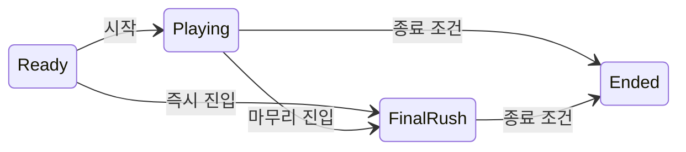
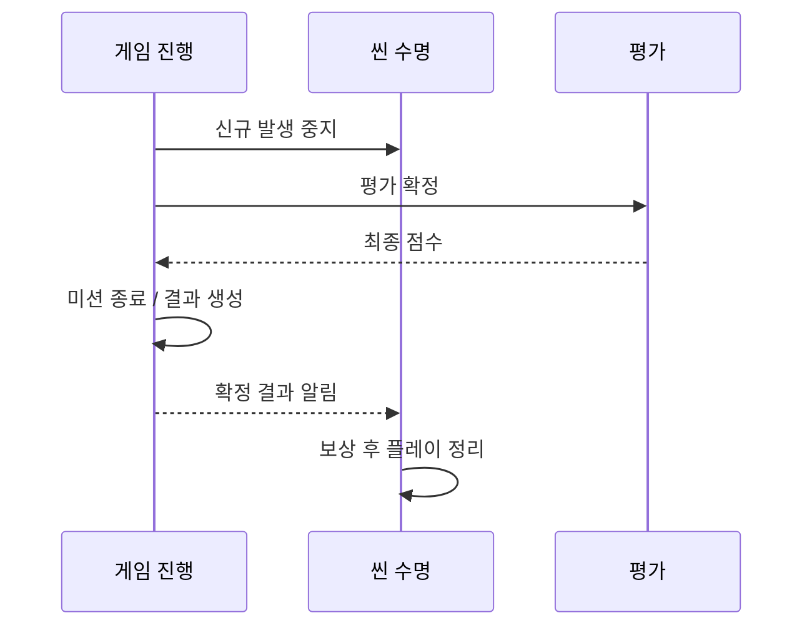

# GAMEPLAY_CYCLE

## PURPOSE

게임 시작 / 진행 / 종료와 단계형 미션 규칙을 관리합니다.

## SYSTEM_OVERVIEW

### 진행 상태

종료 조건은 시간 만료 또는 NPC 전원 이탈이며, 같은 갱신에서 겹치면 NPC 전원 이탈이 우선합니다. Final Rush 시간이 0이면 Playing에서 시간 만료로 종료합니다. 미션 전체 완료 후에도 종료 조건까지 진행합니다.

### 정상 종료 순서

게임 진행은 GameFlowController, 씬 수명은 PlayScene, 평가는 ResultEvaluationSystem입니다. 미션 입력 차단 / 마지막 시간 전달 / 결과 화면 요청을 포함한 정확한 호출 순서는 아래 SESSION 표를 따릅니다. 월드 정리는 평가 확정 이후입니다.

시작은 초기화 → 개인 서포트 준비 → 반입 차감 → 적 시작 → GameFlow.Begin → 반입 확정 → NPC / 음악 / 입력 연결 순서입니다. 시작 알림 중 이미 종료돼도 반입은 확정하고 플레이 후속 처리는 생략합니다. 반입 실패 / 복원은 [REWARD_ITEM](REWARD_ITEM.md#system_overview)을 따릅니다.

시작 실패는 GameResult나 보상을 생성하지 않습니다. 준비 실패 인스턴스는 재사용하지 않고 씬 재로드로 복구합니다. 중도 나가기도 정상 평가 / 보상을 거치지 않으며 시작 확정 반입분은 반환하지 않습니다. 씬 정리 실패 시 이동을 보류하고 재시도를 허용합니다.

## SESSION

- 기본 플레이 시간은 10분, 종료 30초 전 Final Rush에 진입하는 방향입니다. 시간은 조정 가능한 설정으로 둡니다.
- 초기 NPC 등록과 게임 초기화가 끝난 후 진행을 시작합니다. 초기화 중 등록 수 0을 전멸로 판정하지 않습니다.
- 시간 만료 또는 NPC 전원 납치 완료 / 게임 이탈 시 종료합니다. 포획 중 NPC는 잔존 수에 포함합니다.
- 필수 미션을 완료해도 조기 종료하지 않고 유지 / 복구 / 대응을 계속합니다.
- 종료는 한 번만 확정하고 결과 스냅샷 이후 이벤트로 점수와 통계가 바뀌지 않도록 합니다. 진행 중 행동과 구독의 종료 처리를 연결합니다.
- 현재 씬 NPC의 Awake 등록 이후 PlayScene.Start에서 진행을 시작합니다. 이후 비동기 생성 방식으로 바뀌면 등록 완료 신호를 별도로 연결합니다.
GameFlow가 종료 상태와 시점을 소유합니다.

| 순서 | 종료 처리 |
| --- | --- |
| 1 | Ended 판정 |
| 2 | 미션 입력 차단 |
| 3 | 마지막 경과 시간 전달 |
| 4 | PrepareEnd |
| 5 | Evaluation.FinalizeAt |
| 6 | 평가 결과 조회 |
| 7 | MissionProgress.End |
| 8 | GameResult 생성 |
| 9 | 결과 화면 |
| 10 | OnEnded |
| 11 | 보상 |
| 12 | StopPlay |

필수 종료 순서는 이벤트 등록 순서에 의존하지 않으며 OnEnded는 확정된 GameResult 알림입니다.
- PrepareEnd는 Pressure의 신규 발생을 중지합니다. 전체 플레이 입력 / 적 / NPC / 변칙 사건 정리와 시간 배율 0 설정은 평가 / 결과 / 보상 이후 StopPlay에서 처리합니다. HUD를 숨기고 결과 캔버스를 사용하며 커서를 해제합니다. 재시작 / 씬 종료 시 기존 시간 배율을 복원합니다.
- 종료 평가로 GameResult와 결과 화면을 확정한 뒤 PlayScene이 코인을 지급하고 획득액 / 잔액을 결과 화면과 Console에 표시합니다. 지급 계약은 [REWARD_ITEM](REWARD_ITEM.md)을 따릅니다.

## START_READINESS

| 항목 | 내용 / 조건 |
| --- | --- |
| 필수 구성 | PlayScene은 Mission / Preparation 준비와 활성 상태, 필수 입력 액션, 진행 / 평가 관리자 연결을 확인한 뒤 초기화와 Begin을 호출합니다. |
| 필수 구성 | 음식 입력이 필요하거나 Product가 명시된 구성은 Product / 제작 HUD / 재고 준비도 필수입니다. 음식 입력과 Product가 없는 비음식 구성에는 제작 HUD / 재고를 강제하지 않습니다. |
| 아이템 / 화면 준비 | 비활성 선배치 / 공급원 생성 ItemCarry도 초기화하며 ItemCarry가 Rigidbody / 대표 Collider / ItemWorldController 모듈의 준비 계약을 확인합니다. |
| 아이템 / 화면 준비 | PlayScene은 ItemCarry의 준비 결과를 사용하며 일반 장식에 ItemCarry나 Rigidbody를 강제하지 않습니다. GameFlowHud는 직접 사용하는 표시 참조를 초기화 전에 검사합니다. |
| 시작 실패 | 시작 실패는 결과 확정으로 처리하지 않습니다. 입력 / 시간 / 플레이 동작을 중지하고 Mission / Preparation / Product 구독, 재고와 준비된 관리자 연결을 정리합니다. |
| 시작 실패 | GameFlow의 초기화 시도 기록은 성공 상태와 구분하며 같은 인스턴스 재시도를 막습니다. 복구는 씬 재로드입니다. |
| 세션 참조 일치 | PlayScene의 Mission / Preparation과 Mission의 GameFlow / Preparation / Product, 평가의 Preparation 참조는 같은 플레이 세션의 구성요소를 가리켜야 합니다. |
| 확인 / 검증 | 구현 / 확인 이력은 [DONE](../DONE.md#준비-검증과-시작-차단), 남은 Unity 회귀 검증은 [TODO](../TODO.md#gameplay_implementation)를 따릅니다. |

## MISSION

| 항목 | 내용 / 조건 |
| --- | --- |
| 목표 추첨 | 단계별 후보 맵에서 목표 개수와 요구 수량을 설정 범위로 추첨합니다. 난이도 설정과 개별 수량 재정의는 아래 현행 계약을 따릅니다. |
| 이력 / 현재 상태 | 달성 이력과 현재 파티 준비 상태를 구분합니다. 완료한 음식이 탈취돼도 미션 완료는 유지하되 현재 준비 점수는 감소합니다. |
| 미션 성격 | 이번 단계의 미션은 제작 / 최초 유효 배치처럼 완료 행동을 기록하는 이력형입니다. 현재 유효 배치 음식 수와 NPC 생존 수 같은 상태형 조건은 미션 달성 이력과 구분합니다. |
| 중복 인정 키 | 음식 제작과 음식 배치는 서로 다른 Mission ID를 사용합니다. 기존 음식 중복 인정 키는 Mission ID + Result ID이며 단계나 행동 종류를 추가하지 않습니다. |
| 중복 인정 키 | 같은 제작 결과는 제작과 배치에 각각 한 번 인정할 수 있지만, 같은 음식 결과의 재배치나 중복 완료 통지는 같은 목표를 다시 늘리지 않습니다. 일반 아이템은 물건 ID를 유지하고 단계별 재사용을 허용하며 중복 계약은 [일반 아이템 배치 미션](PARTY_PREPARATION.md#item_placement_mission)을 따릅니다. 일반 아이템 경로는 코드 반영 / 공급원과 배치 준비 보류 상태입니다. |
| 공동 진행 | 파티 공동 진행, 단계 내 자유 수행, 필수 미션 전부 완료 후 다음 단계 진입을 초기 구현안으로 둡니다. |
| 단계 / 소급 | 이번 단계의 이력형 미션은 현재 단계에서 발생한 행동만 인정하고 이전 단계의 행동을 소급하지 않습니다. 현재 코드는 같은 단계 안의 Mission ID 중복을 시작 시 차단합니다. 단계별 목표 수는 설정으로 관리하고 현재는 필수 목표 전부 완료 시 다음 단계로 전환합니다. |
| 핵심 / 후보 | 핵심 미션은 음식 제작과 파티룸 꾸미기입니다. 의상은 선택 / 보너스 미션 후보로 두며 실제 포함 범위는 후속 확정합니다. |
| 평가 연결 | Preparation과 보너스의 평가 계약은 [RESULT_EVALUATION](RESULT_EVALUATION.md)을 따릅니다. |

## CURRENT_VALIDATION_DATA

현재 저장된 FlowData의 검증 설정입니다. 목표 선정 개수와 목표별 필요 수량은 서로 다른 값입니다.

| 난이도 | 전체 시간 | 각 단계 목표 선정 범위 | 단계 기본 필요 수량 |
| --- | --- | --- | --- |
| Easy | 8분 | 1~3 | 1~3 |
| Normal | 10분 | 1~3 | 1~4 |
| Hard | 12분 | 1~3 | 1~5 |

- 단계 후보는 기본 제작 3개 → 전체 제작 10개 → 음식 배치 10개입니다. 기본 제작 후보 수는 3개이므로 선정 상한과 구분해 확인합니다.
- 현재 연결된 미션은 모두 개별 필요 수량 재정의를 사용합니다. 일반 음식은 4회, 케이크 / 파이 / 타르트는 2회로 설정되어 단계 기본 필요 수량 범위보다 우선합니다.
- 일반 소품 미션은 공급원 프리팹 / 배치가 준비되지 않아 이번 후보에서 제외합니다. 새 미션 종류 추가가 아닌 선정 개수 확대 검증입니다.
- 파티룸 테이블의 음식 배치 설정과 준비 평가 경계는 [PARTY_PREPARATION](PARTY_PREPARATION.md#완성품과-배치-집계)을 따릅니다. 실제 미션 진행 / 단계 전환 / 결과 검증은 [TODO](../TODO.md#current_todo)를 따릅니다.

## DIFFICULTY_PLAN

난이도별 설정을 적용하는 기획 기준입니다. 남은 구현과 수치 조정은 [TODO](../TODO.md#difficulty_implementation)를 따릅니다.

- 기본 구성은 Easy / Normal / Hard 3단계입니다.
- 미션 개수는 이번 플레이에서 실제 선택되는 목표의 수입니다. 난이도별로 정한 개수 범위 안에서 사용할 수를 랜덤 결정하고 후보 미션 중 실제 미션을 선정합니다. 설정된 미션 전체를 항상 사용하는 것이 최종 의도는 아닙니다.
- 필요 수량은 개별 목표의 완료 횟수이며 목표 개수와 별도 설정입니다. 단계 기본 범위와 개별 미션 재정의를 사용합니다. 기존 최소 Easy 1 / Normal 3 / Hard 5는 확정 수치가 아닙니다.
- 일반 변칙 사건은 선택 난이도의 AnomalyPressureData / AnomalySpawnDataMap을 적용하며 별도 난이도 배율을 중첩하지 않습니다.
- 난이도 구현 계획: **Hard에서만 Distortion 발생을 허용**합니다. 상세 사건 설계는 [ANOMALY의 Distortion](ANOMALY.md#6-distortion--표현-왜곡)을 따르며 아직 구현되지 않았습니다.

## DIFFICULTY_IMPLEMENTATION_PLAN

난이도 설정 / 미션 생성 / 타이틀 전달의 현행 계약입니다. 구현과 사용자 확인은 [DONE](../DONE.md), 남은 작업은 [TODO](../TODO.md#difficulty_implementation)를 따릅니다.

| 항목 | 내용 / 조건 |
| --- | --- |
| 난이도 설정 맵 | GameDifficultyDataMap은 3종 난이도의 Flow / Pressure / SpawnMap / 제작 대응표 / Mood / 평가 설정과 안내 문구를 묶습니다. 공통 에셋 공유를 허용하고 난이도 등록과 Flow의 난이도 일치를 검사합니다. |
| 설정 확정 / 전달 | GameFlowController가 초기화 전에 선택 설정을 확정하고 PlayScene이 각 시스템에 전달합니다. 초기화 후 난이도 변경은 거절하며 콘텐츠 목록과 사건 자체 설정은 기존 위치에 유지합니다. |
| 목표 설정 | MissionStageSettings는 후보 맵 / 목표 개수 범위 / 기본 요구 수량 범위를 보관합니다. MissionData는 기본 범위를 따르거나 고정 수량 / 개별 범위로 재정의합니다. |
| 설정 검증 | GameFlowData.CheckSettings가 전체 단계, MissionStageSettings.CheckSettings가 후보 연결 / 양수 범위 / 후보 수 / 단계 안 ID 중복 / 개별 범위를 검사합니다. |
| 설정 검증 | 후보 부족은 시작 실패이며 Editor와 Player의 고정 Normal 제한은 제거했습니다. |
| 추첨 / SO 보존 | MissionProgress는 전체 검증 후 단계별 중복 없는 목표와 요구 수량을 추첨합니다. 원본 SO는 변경하지 않으며 실제 추첨 목표를 HUD와 디버그 완료에 사용합니다. |
| 추첨 / SO 보존 | 단계 간 같은 후보 사용을 허용하고 Mission ID + Result ID 중복 방지와 이전 행동 소급 금지는 유지합니다. |
| 제작 대응 | ProduceMinigameDataMap은 기본 제작 설정을 선택 난이도 설정으로 대응합니다. 제작 유형을 유지하고 세션 / 모델 / 미니게임이 같은 데이터를 사용합니다. 뒤집개 효과 해제 시 선택 난이도의 기본값으로 복원합니다. |
| 초기화 순서 | 씬 초기화는 난이도 선택 → 아이템 / 제작 → 준비 / 미션 → NPC / 사건 → 흐름 / 발생 / 분위기 / 평가 → 반입 차감과 Begin 순서입니다. 미션 / 분위기 / 발생 Presenter의 Flow 참조는 PlayScene이 Init에서 전달합니다. |
| 초기화 순서 | 실패 반입 복원과 종료 평가 / 보상 / 정리 순서는 유지합니다. |
| 선택 화면 | DifficultySelectView는 난이도 3종 / 선택 / 취소 입력과 강조 / 설명 표시를 담당합니다. DifficultySelectPanel은 임시 선택과 확정값을 구분하며 선택 시 확정값을 전달하고, 취소 시 이전 확정값을 유지한 채 닫습니다. |
| 선택 화면 | 열 때는 확정값을 표시합니다. TitleScene은 확정값을 GameDifficultySelection에 전달하고 게임 시작에 사용합니다. 화면 전환은 [REWARD_ITEM](REWARD_ITEM.md#화면-흐름)을 따릅니다. |
| 선택값 수명 | GameDifficultySelection은 세션 선택을 유지하여 타이틀 복귀 / 재시작에 사용하고 플레이 모드 진입 시 초기화합니다. Play 직접 실행은 인스펙터 기본 난이도를 사용하며 영구 저장하지 않습니다. |
| 임포트 연결 | RabbitParty_All_Data_2026-09-28은 튜닝 참고입니다. 임포트 전 후보 맵 / 범위 / 제작 대응표는 수동 구성하며 패키지의 레시피별 제작 설정은 게임 난이도 대응표와 구분합니다. |

## SYSTEM_HANDOFF_TO_CONTENT

- 맵 / 모델 작업 전 기준은 무구매·구매 시작 → 난이도별 진행 → 시간 만료·NPC 전원 이탈 → 결과 / 코인 → 타이틀 복귀 → 다음 판 반복입니다. 모든 TODO 예외 검증을 콘텐츠 작업의 선행 조건으로 두지 않습니다.
- 시작 실패·씬 해제 후 입력 / 구독 / 서포트 효과 / 예약 / 구매 상태 / 시간 배율이 남지 않는지 확인합니다. 기존 튕김 등 치명적 문제가 현재도 재현되면 우선 해결합니다.
- 모델 / 맵 이후 작업은 실제 경로와 병목, 보유 지점·Bounds, 공격 / 먹기 / 운반 클립과 판정 시점, NPC 음악 / Dance / Struggle, 음향·머티리얼 기반 표현입니다. 모델 작업 전 필요한 클립 / 부착 지점 / 이동과 Root Motion 책임만 먼저 정합니다.
- Hard Distortion은 후속으로 미룰 수 있습니다. 대표 사건 1종 우선 검증은 제안이며 조명 등 특정 종류를 확정하지 않습니다. 상호작용 안내 / 일시정지 / 나가기 / Comeback은 별도 승인 범위입니다.

## FINAL_RUSH_AND_COMEBACK

- Comeback은 도입과 세부 조건이 미정입니다. 기본 난이도 검증 후 필요성을 판단하며 맵 제작의 필수 선행 구현으로 두지 않습니다. [결정 목록](../PENDING_DECISIONS.md#later_systems)을 따릅니다.

- Final Rush에는 신규 행동 시작 제한을 추가하지 않습니다. 적 / 사건은 평상시와 같은 발생 규칙을 적용하며 진행 중인 업무 / 구조 / 피해 복구도 기존 흐름으로 처리합니다.
- Comeback은 게임 상황이 크게 불리할 때 회복 효율을 높이는 보정입니다. NPC 잔존 수 / Mood / Preparation 복합 조건을 우선 검토합니다.
- 효과 후보는 구조 / 필수 미션 완료 / 실제 피해 복구의 Mood 회복 증가입니다. Pressure 감소나 적 약화는 우선 제외합니다.
- 발동 / 해제 조건과 반복 보상 방지, 보정량은 기본 사이클 플레이 후 확정합니다.

## BOUNDARY

| 설정 | 역할 |
| --- | --- |
| MissionData | 개별 미션 SO. ID / 이름 / 필요 수량 재정의 |
| MissionDataMap | 단계 이름과 추첨할 미션 후보 목록 |
| MissionStageSettings | 단계 후보 맵 / 목표 개수 범위 / 기본 요구 수량 범위 |
| GameFlowData | 단계 설정 배열, 제한시간 / Final Rush 시간 / 난이도 |
| MissionProgress | 설정을 런타임 객체로 복사하고 단계 진행, Mission ID + Result ID 중복 방지 관리 |
| GoalProgressData | 개별 목표의 현재 수량과 필요 수량 반영. 런타임 객체이며 SO가 아님 |
| StageProgressData | 단계의 목표 목록과 전체 완료 판정. 런타임 객체이며 SO가 아님 |

- 시작 검증은 전체 단계의 후보 / 범위 계약을 사용하며 Editor와 Player가 동일합니다.
- 제작 완료는 ProductionSession.OnCompleted → ProductionManager → MissionResultRecorder.TryRecord → GameFlowController → MissionProgress로 전달합니다. ProductionManager가 전달한 결과의 RecipeData로 제작 미션을 찾습니다. 유효 배치는 ProductionManager의 결과를 PreparationSystem가 추적하고 실제 정착을 확인한 뒤 OnValidPlacement → MissionResultRecorder.TryRecord → GameFlowController → MissionProgress로 전달합니다.

- 난이도는 쉬움 / 보통 / 어려움이며 타이틀 선택 기록이 없으면 보통입니다. Play 직접 실행은 Presenter의 기본 난이도를 사용하며 자동 수치 보정은 하지 않습니다.
- GameFlowHud는 진행 HUD, GameResultView는 별도 결과 캔버스를 담당합니다. 진행 Presenter는 HUD를 꺼도 유지되는 오브젝트에 배치합니다. 결과 연출은 정지된 시간 배율과 독립적으로 갱신해야 합니다.
- PlayScene은 씬 참조 / 초기화와 시작 승인 / 사건 설정 연결 / 종료 전 처리 / 결과와 보상 / StopPlay / 씬 수명을 담당합니다. 입력 중재와 제작 입력의 책임은 [PLAYER_INTERACTION](PLAYER_INTERACTION.md), 서포트 생성과 효과 수명은 [REWARD_ITEM](REWARD_ITEM.md)을 따릅니다.
- PlayLogPresenter가 제작 / 미션 / 변칙 사건 / NPC 로그를 구독하고 문구를 변환해 GameFlow의 LogBox 표시에 연결합니다. LogBox는 마지막 로그 이후 설정 시간이 지나면 목록을 숨깁니다. 난이도별 표시 여부는 아직 적용하지 않았습니다.
- 미션 박스는 접기 없이 제목과 진행량을 표시하며 높이는 씬 설정을 사용합니다.
- 진행량은 실제 반영된 완료 개수, 미션 완료 결과는 제작 / 배치 등이 전달한 결과를 뜻합니다. 별도 용어 “실적”을 사용하지 않습니다.
- 미션 중복 키는 목표 ID와 결과 ID입니다. 음식은 제작 결과 ID, 일반 아이템은 물건 ID를 사용하며 일반 아이템의 단계별 재사용 경로도 구현돼 있습니다. 실제 공급원 / 배치 준비와 실행 확인은 [TODO](../TODO.md#gameplay_implementation)를 따릅니다. 음식과 일반 아이템의 상세 인정 조건은 [PARTY_PREPARATION](PARTY_PREPARATION.md#item_placement_mission)에서 관리합니다.
- GameFlowModel은 시간 / 종료 상태와 DetermineOutcome의 승패 판정을 담당합니다. GameFlowController는 종료 전 처리 / 평가 조회 / 미션 종료 / 결과 생성 / 화면과 이벤트 전달 순서를 중재합니다. 승패 규칙은 기존대로 전원 이탈 시 실패, 점수 또는 등급 미확보 시 미정산, 시간 만료와 필수 미션 완료 및 A / B 등급일 때 성공입니다. 제작 / 적 행동은 직접 구현하지 않습니다.
- 제작은 완료 결과를 전달하고 미션이 목표 달성을 집계합니다. 점수는 평가 시스템이 계산합니다.
- Pressure / 적 발생 경계는 [ANOMALY_PRESSURE](ANOMALY_PRESSURE.md), 제작은 [PARTY_PREPARATION](PARTY_PREPARATION.md#production)을 따릅니다.
- 이 문서는 게임 흐름 계약을 관리합니다. 앞으로 할 작업은 [TODO](../TODO.md), 완료와 확인 이력은 DONE에서 관리합니다.
