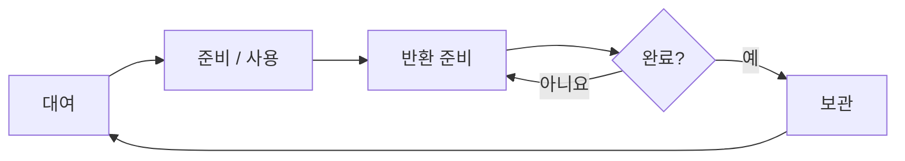

# 매니저 / 오브젝트 풀링

## SYSTEM_OVERVIEW

### 풀 객체의 수명

대여는 프리팹별 Pool을 사용하는 PoolingManager가 관리하고 Poolable이 명시적으로 반환을 요청합니다. 일반 비활성화는 자동 반환이 아닙니다.

- 대여 객체는 사용 씬으로 이동한 뒤 데이터를 준비하고 활성화합니다. 준비 실패도 반환 준비를 거칩니다.
- 반환 준비가 끝나지 않으면 반환 / 씬 이동을 대기합니다. 성공 시 대여 기록을 먼저 해제한 뒤 비활성화합니다.
- 보관 상한을 넘긴 반환 객체와 씬 언로드 후 남은 미반환 객체는 제거하며 재사용하지 않습니다.

공통 서비스는 GameManager가 저장 → 사운드 → 설정 → 풀링 순으로 초기화합니다. 실패한 서비스는 부분 자원을 정리하고 이미 성공한 서비스의 등록된 종료 작업은 역순으로 실행합니다. 정상 종료도 역순이며 리소스 캐시는 서비스 종료 뒤 해제합니다.

## 공통 매니저

| 항목 | 내용 / 조건 |
| --- | --- |
| 생성 / 유지 | 첫 씬 로드 전에 Resources의 GameManager 프리팹을 생성합니다. GameManager만 싱글톤이며 같은 루트의 서비스와 함께 씬 전환 동안 유지됩니다. 중복 인스턴스는 제거합니다. |
| 초기화 / 종료 | 씬의 플레이 준비 전에 저장 → 사운드 → 설정 → 풀링 순서로 초기화합니다. 성공한 서비스의 종료 작업을 기록하고 역순으로 정리하며, 실패한 서비스는 자신의 부분 자원을 정리합니다. 리소스 캐시는 서비스 종료 후 해제합니다. |
| 서비스 경계 | 공통 서비스 계약은 초기화만 요구합니다. 종료 작업이 없는 서비스에 종료 인터페이스를 강제하지 않습니다. 씬의 게임 진행과 플레이어 / 적 관리는 씬 측에서 담당합니다. |
| SaveManager | SaveManager는 사용자 설정과 실행 중 코인 / 서포트 아이템 저장의 관리 창구입니다. 상점 / 아이템 선택 / 반입 요청과 Budget은 SaveManager를 사용하고, 코인 / 아이템의 실제 저장은 SupportItemSave에 위임합니다. |
| SaveManager | 기존 저장 키 / 형식과 코인 이전을 유지하며 별도 캐시는 두지 않습니다. 타이틀의 편집 모드 저장 디버그는 SupportItemSave를 직접 사용합니다. |
| SettingManager 설정 | SettingManager는 화면 크기 / 전체 화면, 마스터 / 배경음 / 효과음 음량, 키보드와 언어 선택을 관리합니다. 변경을 적용한 뒤 확정 시 저장하며, 설정 패널 취소는 편집 전 상태를 복원합니다. 빈 키 목록은 원본 입력 바인딩을 사용합니다. |
| SettingManager 설정 | 언어 선택과 실제 번역 콘텐츠는 구분합니다. |
| SettingManager 실패 정리 | SettingManager 초기화는 완료 여부를 기록하고, 준비 / 적용 실패와 예외 시 finally에서 Shutdown으로 부분 연결을 정리합니다. 저장 데이터의 키 목록 null 발생 가능성은 별도 확인 대상입니다. |
| Sound / ResourceManager | SoundManager는 배경음과 중첩 효과음을 재생하고 AudioMixer로 음량을 적용합니다. ResourceManager는 Resources 프리팹을 경로별로 캐시합니다. |

## 풀의 수명과 사용

| 항목 | 내용 / 조건 |
| --- | --- |
| 풀 공유 / 보관 | 원본 프리팹별로 풀을 공유합니다. 비활성 객체는 GameManager 자식이 아닌 별도 Pool_프리팹명 오브젝트 아래 보관하며 씬 전환 동안 유지합니다. 씬 전용 풀과 공통 풀을 따로 만들지 않습니다. |
| 초기 준비 | 플레이 씬의 공급원 초기화에서 프리팹별 기본 10개를 준비합니다. 초기 수량은 PoolingManager Inspector에서 조절합니다. 같은 프리팹을 쓰는 공급원이 여러 개여도 중복 추가하지 않으며, 재시작 시 보관 객체를 재사용합니다. |
| 필수 구성 검사 | IngredientSource는 풀 등록 / 생성 전에 재료 프리팹의 ItemWorldController 구성 검사를 수행합니다. Collider / Rigidbody가 없으면 공급원 초기화가 실패합니다. 검사는 모듈 초기화나 대체 컴포넌트 추가 없이 필수 구성의 존재 여부를 확인합니다. |
| 대여 / 보관 상한 | 대여는 보관 객체를 우선 사용하고 풀이 비었으면 Instantiate로 추가 생성합니다. 최대 보관 수량은 동시 사용 상한이 아니며, 반환 시 보관 한도를 넘는 객체는 제거합니다. |
| 활성화 / 반환 | 대여 객체는 사용할 씬으로 옮긴 뒤 비활성 상태에서 사용 데이터를 준비하고 활성화합니다. Poolable이 자신의 풀로 반환을 요청하며, 기능별 반환 준비가 끝난 객체만 보관합니다. 일반 비활성화를 자동 반환으로 취급하지 않습니다. |
| 재료 반환 정리 | 재료 반환은 소비 알림이 모두 끝난 뒤 처리합니다. 재고 소속 / 구독과 제작 등록을 해제하고 보유 / 투척 / 물리 / 배치 / 손실 상태를 정리합니다. 공급원 재고 규칙은 [재료 재보충](PARTY_PREPARATION.md#ingredient_refill)을 따릅니다. |
| 씬 이동 / 언로드 | 정상 씬 이동은 플레이와 제작 종료 → 재고 연결 정리 → 해당 씬의 대여 객체 반환 순서입니다. 반환이 끝나지 않으면 이동을 보류합니다. 씬 언로드 시 남은 미반환 객체는 재사용하지 않고 정리합니다. |
| 디버그 | 플레이 디버그의 풀링 탭에서 프리팹별 대여 / 보관 수, 객체 ID와 반환 실패 사유를 확인합니다. 같은 ID의 반환 후 대여 기록으로 재사용을 구분합니다. |

구현 / 사용자 확인 이력은 [DONE](../DONE.md#매니저--오브젝트-풀링), 남은 수정과 검증은 [TODO](../TODO.md#pooling_and_managers)에서 관리합니다.
