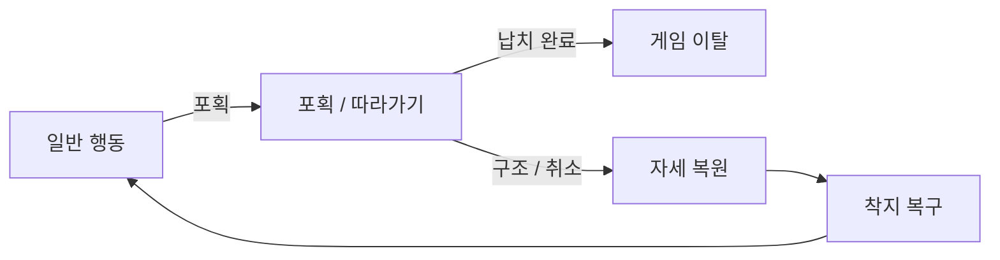

# NPC_RABBIT

## PURPOSE

초대 NPC 토끼의 역할, 안전 상태와 플레이어의 오인 대응에 대한 반응을 관리합니다.

## SYSTEM_OVERVIEW

자세는 해제 즉시 복원하며 일반 이동은 착지 복구 후 재개합니다. Capturable은 포획 / 해제를 연결하고 NpcSafetyModel이 안전 상태, Npc가 행동 FSM, NpcMover가 이동 / 따라가기 / 착지를 담당합니다.

Captured가 Excited / Normal보다 우선합니다. 포획 중은 NpcRegister의 잔존 수와 Safety 평가에 포함하며 실제 납치 완료에서만 제외합니다. 착지 복구는 이동 실행의 조건이며 별도 NPC 행동 상태가 아닙니다. 음악에 따른 Excited 진입 정책은 아래 설계 후보와 구분합니다.

## CURRENT_DECISION

- 프라이빗 파티에 초대된 손님 약 8마리가 싱글·멀티 모두 등장합니다.
- NPC 토끼는 파티 손님 / 포식자 표적 / 분위기 평가 / 위장·이상 탐지 기준 / 과잉 대응 제한 장치 역할을 합니다.
- 모든 포식자가 NPC만 노리지는 않습니다.
- 정상 토끼에게 반복 검사 / 불필요한 구금 / 공격 / 지속적인 추궁이나 방해를 하면 Mood가 하락합니다.
- 수상한 대상을 무차별 공격하는 방식으로 게임을 해결할 수 없도록 설계합니다.

## FSM

- NPC 토끼는 복잡한 AI보다 간단한 FSM을 사용합니다.
- 1차 행동 상태는 `Normal / Excited / Captured`, 우선순위는 `Captured > Excited > Normal`입니다.
- 대기 / 로컬 이동 / 방 이동 / 복귀는 Normal 내부 행동으로 처리하고 별도 Idle / Wander / Return 상태를 만들지 않습니다. Panic은 실제 공포 / 도주 행동이 필요할 때 검토합니다.
- 행동 FSM은 기존 NpcSafetyModel의 안전 상태를 따릅니다. 포획 / 게임 이탈 판정을 중복 소유하지 않으며 게임 이탈 시 일반 행동을 실행하지 않습니다.

## RESPONSIBILITY_BOUNDARY

| 항목 | 내용 / 조건 |
| --- | --- |
| NpcState | NpcState는 StateType / Enter / Update / Exit 계약을 두며 기존 적 IEnemyState와 별도로 유지합니다. |
| NpcNormalState | NpcNormalState = 상위 FSM 전환과 행동 시작 / 갱신 / 종료 연결. 내부 타이머 / 방 선택 / 경로 실행을 소유하지 않습니다. |
| NpcNormalBehaviour | NpcNormalBehaviour = Normal 내부 행동 판단. 대기 / 착지 대기 / 진행 구간 / 방 선택과 복귀 확률 / 이동 요청 및 결과 처리를 담당합니다. |
| Route / NpcMover | Route / NpcMover = 이동 실행. 목적지 검사 / 경로 진행 / 회전 / 도착 / 실패와 이동 제한시간을 처리하며 NPC 행동 확률이나 상위 상태를 결정하지 않습니다. |
| Npc | Npc는 상태와 모듈 생성 / 연결, NpcSafetyModel은 안전 상태를 담당합니다. NpcStateType과 NpcSafeStatusType을 혼용하지 않습니다. |
| NpcSafetyModel 경계 | NpcNormalBehaviour는 NpcMover / NpcData / 파티룸을 받아 한 번 생성 후 재사용합니다. Npc를 역참조하거나 상위 FSM을 직접 변경하지 않습니다. |
| Normal 종료 | Normal 종료 시 이동과 타이머를 정리하되 마지막 방 정보는 보존합니다. 구조 후 착지 위치에서 방을 다시 확인하고 복귀 판단에 사용합니다. |
| 포획 / Agent 수명 | 포획 시 경로를 취소하며 비활성 에이전트에 이동 명령을 보내지 않습니다. 따라가기 / 낙하 / 착지 복구와 포획 판정을 상태나 행동 모듈에 중복 구현하지 않습니다. |

## NORMAL

- 대기 후 같은 방 안에서 랜덤 이동하거나 다른 방을 방문합니다. 로컬 목적지는 현재 방 영역과 이동 반경 안의 유효 NavMesh 위치에서 선택하고 일반 NavMeshAgent 이동을 사용합니다.
- 로컬 이동 도착 / 실패 후 다시 대기하며 목적지 선택과 이동 실패를 무제한 반복 재시도하지 않습니다.
- 파티룸을 기본 거점으로 지정합니다. 파티룸에서는 높은 확률로 체류 / 로컬 이동, 낮은 확률로 다른 방을 방문합니다.
- 다른 방에서는 방 이동 여부를 먼저 결정하고, 이동 시 파티룸 복귀 또는 다른 방 방문을 선택합니다. 정확한 확률은 플레이테스트로 조정합니다.
- 방 도착 시 장거리 이동 대기 시간을 초기화하여 최소 체류시간을 보장하고, 다음 방 이동 판단은 대기 중에만 수행합니다.
- 방 간 이동은 공통 Route의 노드 / A* 경로와 NavMeshAgent 구간 이동을 사용합니다. NPC 행동 규칙을 Route 안에 넣지 않습니다. 공통 경로 계약은 [ENEMY_PATHFINDING](ENEMY_PATHFINDING.md#common_contract)을 따릅니다.
- NPC 방문 방 조회는 적의 잠복 지점 유무와 분리하고, 목적지도 HidePoint를 그대로 사용하지 않습니다.
- 방 목적지는 수평 후보에서 방 높이 범위 안으로 지면 Raycast 후 NavMesh 보정합니다. 기존 지면 레이어와 Trigger 제외를 적용하고 보정 후 방 소속 / 완전 경로를 검사합니다. Room은 영역을 제공하고 실제 탐색은 NpcMover가 처리합니다.
- 경로 생성 / 이동 실패 시 그 위치에서 대기하고 실제 위치로 현재 방을 재확인합니다. 출발 방으로 순간이동하거나 즉시 다른 방을 반복 추첨하지 않습니다. 방 밖이면 대기 후 유효한 방으로 이동을 다시 시도합니다.

## EXCITED

| 항목 | 내용 / 조건 |
| --- | --- |
| 진입 / 행동 | 음악 반응 조건을 만족하면 일반 이동과 기존 경로를 중단하고 Dance 애니메이션을 재생합니다. 춤은 음악 정상 작동의 월드 피드백이며 조건 유지 중에는 배회 / 방 이동을 수행하지 않습니다. |
| 조건 종료 | 음악 조건 종료 시 Normal로 돌아가 새 행동을 선택합니다. 중단 전 경로를 그대로 재개하지 않습니다. |
| 미정 연결 | 음악 감지 범위 / 조건과 신호 제공 방식은 연결 단계에서 결정합니다. |

## MUSIC_REACTION_DESIGN

파티룸 음악과 NPC 반응은 [음악 출력 왜곡](ANOMALY.md)의 스피커 / 출력 구조와 함께 설계합니다. 아래는 상세 설명을 보존한 설계 후보이며, 이름 / 함수 / 반응 정책의 확정 계약이나 구현 완료를 뜻하지 않습니다. 착수 상태와 재개 순서는 [TODO](../TODO.md#npc_implementation), 미정 정책은 [PENDING_DECISIONS](../PENDING_DECISIONS.md#later_systems)를 따릅니다.

| 정책 후보 | 제안 | 경계 |
| --- | --- | --- |
| 감지 범위 | 음악 담당 Room의 내부 여부 사용 | 거리 / 차폐 / 여러 스피커의 합산 방식은 미확정 |
| 반응 조건 | 게임상의 음악 활성 상태와 감지 범위를 함께 검사 | 사용자 음량 / 음소거와 AudioSource.isPlaying만으로 행동을 결정하지 않음 |
| 상태 우선순위 | Captured > Excited > Normal 유지 | 구조 후 Normal로 복귀하고 착지 / 이동 복구 후 음악 재평가 |
| 음악 종료 | 춤을 해제하고 새 일반 행동 선택 | 중단 전 이동 경로를 그대로 재개하지 않음 |

| 대상 후보 | 함수 / 연결 후보 | 책임 |
| --- | --- | --- |
| PartyMusic 신규 | IsActive / Play / Stop / CanReact(position) / OnDisable | 음악 활성 상태, 전용 SoundPlayer 반복음과 반응 영역 제공. 여러 스피커 구조 확정 시 이름 / 경계 재검토 |
| Npc | Awake / Update / SyncState / CanReactToMusic / BeginExcited / EndExcited | 음악 담당 연결, 낙하 / 이동 복구 조건을 포함한 상태 선택과 춤 시작 / 종료 전달 |
| NpcExcitedState | 생성자에 Npc 전달, Enter / Exit 연결 | BeginExcited / EndExcited 호출. 이동 정리는 기존 Normal 종료 경로 재사용 |
| AnimatorHandler | SetDance(bool), IsDancing 파라미터 | NPC 춤 표시. 상태 종료에서 해제하며 공용 초기화에서 모든 캐릭터의 춤 파라미터를 일괄 조작하지 않음 |
| PlayScene | 시작 성공 경로 / StopPlay | 자동 시작안을 채택하면 시작 성공 후 음악 활성화, 종료 / 시작 실패 / 재시작 수명 연결 |

- NpcSafetyModel은 안전 상태를 유지하고 NpcMover의 IsFalling / CanNavigate와 기존 NpcNormalBehaviour의 이동 종료를 재사용합니다. 포획 / 구조 / 낙하 판정을 춤 상태에 중복 구현하지 않습니다.
- 매 상태 동기화에서 현재 조건을 평가하고 기존 ChangeState의 동일 상태 재진입 방지를 사용합니다. 별도 음악 감지 충돌체나 NPC 관리자는 필요성이 확인되기 전 추가하지 않습니다.
- 음악은 기존 SoundPlayer.StartLoop / StopLoop를 사용하는 후보입니다. 씬 배경음과의 동시 재생 / 감쇠, 자동 시작과 스피커 직접 조작, 왜곡 중 NPC 반응 및 음원 미준비 상태의 활성 정책은 미확정입니다.

## CAPTURED

| 항목 | 내용 / 조건 |
| --- | --- |
| 진입 / 종료 | 기존 포획 시스템의 포획 성공에 따라 진입하고 일반 이동 / 춤을 중단합니다. CarryPoint 따라가기는 CaptureFollower가 담당하고 Struggle 애니메이션을 연결합니다. |
| 포획 결과 | 포획 성공 / 구조 진행 / 납치 완료는 기존 포획 시스템과 NpcSafetyModel이 판단합니다. Captured 행동 상태가 별도로 판정하지 않습니다. |
| 구조 / 정상 해제 | 구조 / 정상 해제 시 Normal로 복귀하되 기존 물리 낙하와 착지 / NavMesh 복구가 끝날 때까지 이동과 춤 시작을 기다립니다. 별도 낙하 FSM 상태 없이 기존 IsFalling과 이동 가능 여부를 사용합니다. |
| 자세 복원 | NpcMover.EndCapture에서 따라가기를 종료한 직후 포획 전 수평 회전을 복원합니다. 자세 복원을 착지나 NavMesh 조회 성공까지 미루지 않습니다. |
| 착지 / 이동 복구 | 원래 Collider를 복원하고 물리 낙하를 진행합니다. 유효한 위쪽 지면 접촉점에서 같은 Agent Type / Area의 NavMesh를 조회한 뒤 위치 / Rigidbody / Agent를 복구합니다. 조회 실패 시 복원된 자세로 물리 상태를 유지하며 이동과 춤을 시작하지 않습니다. |
| 음악 재평가 | 음악 재생 중 구조돼도 먼저 Normal로 복귀하고 착지 후 현재 음악 조건을 다시 평가합니다. 납치 완료로 게임에서 이탈하면 일반 상태로 복귀하지 않습니다. |

## FIRST_IMPLEMENTATION

- 기존 Npc / NpcSafetyModel / NpcMover / NpcRegister와 포획 / 구조 기반에 행동 FSM을 연결합니다. NpcRegister의 남은 수와 포획 가능 후보 구분을 유지합니다. 구현과 사용자 확인 범위는 [DONE](../DONE.md)을 따릅니다.
- 정상 / 포획 / 게임 이탈을 구분합니다. 포획 중에도 게임에 남은 NPC 수에 포함하고 납치 완료 시에만 제외합니다. 구조 시 정상으로 복귀하며 수를 중복 추가하지 않습니다.
- ICaptureTarget과 CaptureController를 통해 포획 요청과 해제를 연결합니다. 대상 측 Model이 상태를 판단하고 View가 이동과 표시, 충돌을 적용합니다.
- Npc가 NPC Presenter 역할을 맡고 NpcSafetyModel이 정상 / 포획 / 게임 이탈 안전 상태를 소유합니다. 별도 NPC 납치 Presenter 계층을 중복 추가하지 않습니다.
- 이동 구조: NpcMover는 CharacterMover를 상속합니다. CharacterMover는 공통 이동 / 정지 / 회전 / 경로 조회, NpcMover는 NPC 목적지 조회와 이동 실행 / 포획 시 이동·물리 전환 / 물리 낙하 / 착지 복구를 담당합니다.
- NPC에는 NpcMover 하나만 부착하고 RouteNavigator에 해당 인스턴스를 CharacterMover로 전달합니다. 별도 CharacterMover 컴포넌트나 이동 인터페이스를 추가하지 않으며 경로 알고리즘을 복제하지 않습니다.
- NavMeshAgent 참조는 CharacterMover에서 관리하고 부모 이동 초기화 후 NPC 기능을 연결합니다. 포획 / 낙하 중 이동 요청을 중단하고 착지 복구 후 재개합니다.
- Agent / Collider / Transform의 전환과 복구는 NpcMover에서 처리합니다. 이동과 Rigidbody 물리 처리가 동시에 NPC 위치를 제어하지 않도록 합니다.
- 포획자가 탈출 지점에 도착하면 실제 포획 중인 NPC만 납치 완료로 확정합니다. 게임 이탈 상태를 남기고 NpcMover / GameObject를 비활성화하며 현재 게임에는 복귀하지 않습니다. 비활성화로 상태가 정상으로 초기화되지 않게 합니다.
- 구조 후 즉시 자기 활동 구역으로 강제 복귀하지 않고 착지 위치를 기준으로 Normal 행동 규칙을 적용합니다.
- 조정값 후보: LocalMoveIntervalMin / Max, LocalMoveRadius, RoomMoveCheckIntervalMin / Max, RoomMoveChance, ReturnPartyRoomChance, MoveSpeed. 정확한 수치는 플레이테스트로 조정하고 실행 상태와 설정값은 분리합니다.
- 1차 범위에서 복잡한 욕구 / 스케줄, 사회 행동 / 대화, 자율 공포 도주, 세분화된 감정 FSM, 목적 기반 AI, 방별 고유 행동 세트는 제외합니다. 구현 순서는 [TODO](../TODO.md#npc_implementation)를 따릅니다.

## PENDING

- NPC별 요청의 세부 내용
- 정상 토끼 오인 검사 / 공격 / 구금의 구체적인 Mood 패널티
- 변장 적은 후순위 확장 대상입니다. 대체된 원본은 잔존 수와 Safety를 유지한 임시 비활동 상태로 처리하며, 오인 지목은 약한 Mood 패널티와 재지목 제한을 적용합니다. 상세는 [IMPOSTOR](IMPOSTOR.md)를 따릅니다.
- NPC 손실의 최종 평가 반영 비율
- 로컬 목적지 샘플링과 방 밖 복귀의 탐색 범위 / 재시도 간격, 이동 수치와 확률 조정
- 음악 감지 범위 / 조건 / 신호 제공 방식과 왜곡 중 NPC 반응 정책은 [PENDING_DECISIONS](../PENDING_DECISIONS.md#later_systems)를 따릅니다. 음악 반응과 Dance 연결의 작업 상태는 TODO에서 관리합니다.

## REGISTRATION_AND_EVALUATION

- 시작 NPC 집합은 게임 시작 시 한 번 확정합니다. 이후 등록 NPC는 포획 후보가 될 수 있지만 Evaluation / Mood / 결과 로그의 시작 집합에는 포함하지 않습니다.
- 임시 비활성화 / 구조 / 재활성화로 시작 집합을 변경하지 않습니다. 포획 중에도 잔존 수에 포함하며 납치 완료 때 잔존 수만 감소합니다.
- CaptureFollower의 따라가기 관계 소실은 Cancelled입니다. 구조 성공이나 납치 성공으로 집계하지 않습니다.

## UPDATE_RULE

- NPC 역할 / 상태 / 표적 규칙 / 플레이어 행동 반응이 확정 또는 변경될 때 갱신합니다.
