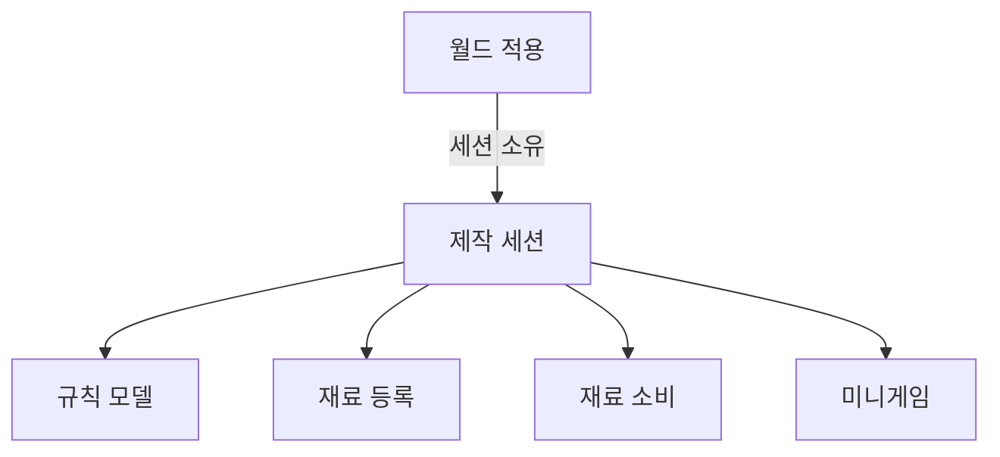
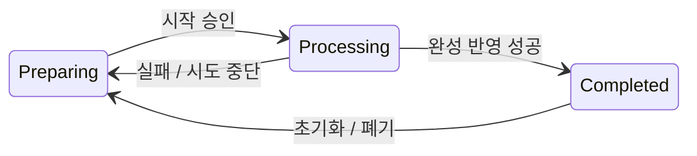
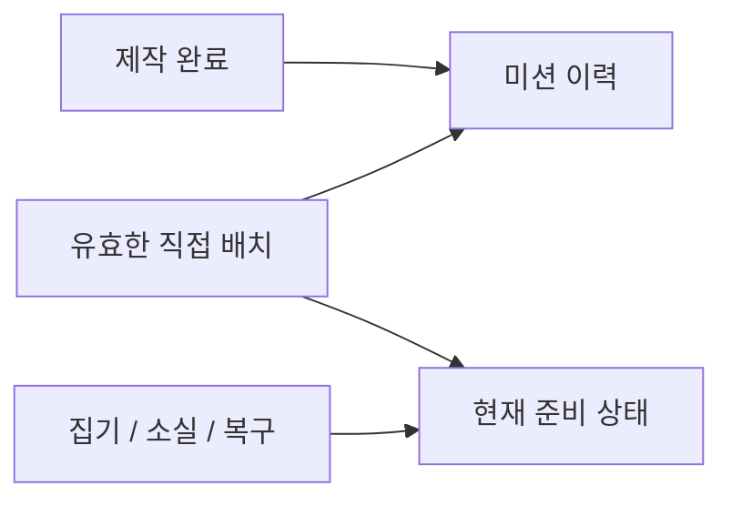

# PARTY_PREPARATION

## PURPOSE

파티 준비 업무의 공통 구현 단위, 공간 간 연결과 업무 복구 규칙을 관리합니다.

## SYSTEM_OVERVIEW

준비 업무는 재료 획득 → 그릇 등록 → 제작 → 완성품 배치 → 현재 준비 상태 갱신으로 이어집니다. 공급원 재고는 실제 획득 성공 시 차감하며 소진 뒤 재보충 대기를 거쳐 공급을 재개합니다.

미션은 완료 행동의 이력이고 Preparation은 지금 남아 있는 유효 준비 상태입니다. 세부 책임과 차이는 아래 제작 도식과 계약 표를 따릅니다.

## CURRENT_DECISION

### 핵심 시스템 단위

1. 조리
2. 물건 찾기
3. 운반
4. 배치
5. 음악 관리
6. 의상 준비

### 업무 규칙

- 음식은 재료 투입과 짧고 직관적인 타이밍 제작 행동을 거쳐 완성하는 방향입니다. 투입 순서와 제작 단계 순서는 구분하며 상세는 PRODUCTION을 따릅니다.
- 창고에서 필요한 물건을 찾고 목적지까지 직접 운반합니다.
- 테이블 / 장식 / 음식은 지정 슬롯에 배치하며 피해 복구에도 같은 배치 시스템을 재사용합니다.
- 음악은 파티 분위기를 높이지만 다른 공간의 포식자 신호를 가릴 수 있습니다.
- 의상은 NPC 요청에 맞는 옷을 찾고 적용합니다.

### 공간 간 연결

- `창고에서 접시 찾기 → 파티룸 운반 → 테이블 세팅`
- `창고에서 재료 확보 → 조리실 조리 → 파티룸 운반 → 음식 배치`
- `창고에서 의상 확보 → 드레스룸 이동 → NPC 의상 준비`

## MVP

- 음식 조리 / 완성 음식 운반
- 요청 물품 찾기 / 물품 운반
- 테이블 세팅 / 장식 설치 / 음악 설정 / 음식 배치 / 세팅 복구
- 요청 의상 찾기와 적용

## FOOD_PROGRESS

제작 전반의 책임과 완성 계약은 아래 PRODUCTION을 따릅니다.

### 확정 표시 정책

| 항목 | 계약 / 조건 |
| --- | --- |
| 레시피 목록 | 화면 고정 제작 HUD의 기본 화면에는 전체 레시피 목록을 스크롤로 표시합니다. 목록 텍스트에는 레시피 이름을 표시하고, 현재 그릇의 재료로 조리 가능하면 흰색, 불가능하면 회색으로 표시합니다. 필요 수량이 부족해도 목록에서 제외하지 않습니다. |
| 레시피 목록 | 이름 오름차순 / 내림차순, 조리 가능 / 불가능 우선으로 정렬하며 같은 순위는 레시피 ID로 정렬합니다. |
| 상세 화면 | 레시피를 클릭한 상세 화면에는 현재 레시피 이름과 필요한 재료 / 요구 수량을 표시합니다. 기본 화면에서는 정렬 드롭다운만, 상세 화면에서는 이전 / 다음 버튼과 현재 레시피 이름만 표시합니다. 기존 재료별 `현재 투입량 / 필요량`도 선택한 레시피 기준으로 갱신합니다. |
| 패널 상태 | RecipePanel은 Preparing, ActionPanel은 Processing과 실패 / 완료 결과 알림 동안 표시합니다. |
| 패널 상태 | 결과 알림 중에는 미니게임 그룹만 숨기고 ActionPanel은 유지하며, 알림 종료 후 남은 재료가 있으면 레시피로 복귀하고 없거나 완료됐으면 닫습니다. |
| 커서 / 입력 | 레시피를 열어 커서를 해제해도 마우스 시점 회전과 이동은 유지합니다. 그릇 조준 영역 또는 상호작용 거리를 벗어나면 레시피를 자동으로 닫습니다. 입력 기준은 [PLAYER_INTERACTION](PLAYER_INTERACTION.md#production_ui)을 따릅니다. |
| 표시 갱신 | 재료 추가 / 제거 / 소비에 따라 표시를 갱신하며 재고 수량이나 곰 만족도와 구분합니다. |

### 현재 코드 책임

| 항목 | 계약 / 조건 |
| --- | --- |
| 제작 목록 / 연결 | `ProductionManager`는 `RecipeDataMap`의 전체 레시피를 제공하고 현재 씬의 그릇을 수집하며, 그릇별 제작 결과를 미션 / 준비 중재자에 전달합니다. 그릇별 레시피 연결 배열은 사용하지 않습니다. |
| 초기화 실패 | 그릇 초기화 중 실패하면 ProductionManager가 이미 연결한 결과 구독과 관리 목록을 즉시 정리하고 준비 실패를 유지합니다. 관리자 중지 / 파괴에도 연결을 정리하며 같은 관리자에서 초기화를 재시도하지 않습니다. 준비 결과는 PlayScene 시작 승인에 사용합니다. |
| 준비 목표 종류 | Preparation은 목표 종류를 먼저 검사합니다. 음식 목표와 명시된 음식 배치 설정이 모두 없으면 Product / 음식 맵 / 배치 Mission 없이 비음식 배치를 추적합니다. |
| 준비 목표 종류 | 비음식 목표와 음식 배치 설정의 허용 표면 종류는 하나 이상이며 None을 포함할 수 없습니다. 음식 설정이 있으면 기존 제작 결과 구독과 배치 미션 검증을 유지합니다. |
| 레시피 검증 | 제작 미션 / 음식 배치에 지정한 RecipeData는 Product의 실제 레시피 목록에 있어야 합니다. 음식 목표마다 해당 ItemData를 결과물로 만드는 레시피의 유효 배치 설정이 필요합니다. 이름이나 ID가 같은 별도 SO로 연결을 대신하지 않습니다. |
| 비음식 미션 | Mission은 제작 목표 맵이 비어 있으면 음식 입력을 요구하지 않고 Preparation의 배치 결과 구독을 유지합니다. Mission / Preparation은 기존 초기화 상태를 IsReady로, 제작 입력 필요 여부만 RequiresProduction으로 노출합니다. |
| 비음식 미션 | 시작 승인 계약은 [GAMEPLAY_CYCLE](GAMEPLAY_CYCLE.md#start_readiness)을 따릅니다. |
| CookController | `CookController`는 월드 배치 / 내용물 표시 / ItemData 적용과 Unity 수명을 담당하고 대상별 ProductionSession을 연결합니다. 세션은 레시피 선택 전부터 재료를 등록하며 선택 시 현재 재료를 ProductionModel에 반영합니다. |
| CookController | Recipe / 완료 결과 / 제작 중재는 세션, 실제 등록 목록 / 배치 연결 / 집기 잠금은 세션이 소유한 ProductionIngredients, 제작 상태 / 성공 횟수 / 조합 수량은 ProductionModel이 관리합니다. |
| CookController | 공유 FoodData나 RecipeData에는 런타임 투입량을 기록하지 않습니다. |
| ProduceHud | ProduceHud는 제작 대상 연결 / 전체 표시 / 패널 전환 / 결과 알림을 담당합니다. |
| ProduceHud | ProduceRecipePanel은 레시피 목록·선택과 재료 수량·제작 시작 입력을, ProduceMinigamePanel은 Timing / Click 표시와 PointerDown 입력을 담당합니다. |
| ProduceHud | 하위 패널끼리 직접 호출하지 않고 Session / Minigame의 상태를 조회합니다. 목표 UI는 상태 변경 즉시 정리하고 전체 패널 전환은 결과 이벤트 이후 LateUpdate에서 갱신합니다. HUD Close는 표시 종료이며 대상 연결 해제와 구분합니다. |
| 소비 / 소실 | Food.Consume은 등록 재료의 실제 소비 성공 때 소비 확정 알림을 발행해 원래 공급원의 재사용 대기로 반환합니다. 공급원 재고는 획득 성공 때 이미 차감하므로 소비 시 다시 차감하지 않습니다. |
| 소비 / 소실 | 제작 투입량은 별도 Model이 관리하며 미완성 재료 소실과 완성품 손실을 구분합니다. |
| 확인 / 후속 | 레시피 목록 / 선택과 결과 연결의 사용자 확인 범위는 [DONE](../DONE.md#제작-진행), 남은 Inspector 연결과 예외 검증은 [TODO](../TODO.md#gameplay_implementation)에서 관리합니다. |

### 제작 내부 책임

화살표는 소유 / 기능 위임입니다. CookController는 같은 그릇의 월드 적용과 Tick을, ProductionSession은 실행 조율을 담당합니다. ProductionModel은 규칙 / 성공 횟수, ProductionIngredients는 등록 / 잠금, IngredientConsumption은 실제 소비, 미니게임 Controller / Model은 회차 연결과 판정을 소유합니다. 공유 SO에는 실행 상태를 기록하지 않습니다.

ProductionManager는 그릇을 등록 / 연결하고 완료 / 초기화 / 등록 알림을 준비와 미션 담당에 전달합니다. HUD는 레시피 선택 / 시작 / 판정 입력을 세션에 요청하고 상태 / 결과를 표시합니다. 세션은 내용물과 결과 ItemData 적용을 CookController에 요청합니다.

### 제작 상태와 소비

- Preparing에서 재료가 있으면 시작할 수 있습니다. 잘못된 조합도 Processing에 진입하며 마지막 성공 판정을 실패로 바꿉니다.
- 중간 성공은 Processing을 유지하고 다음 회차를 시작합니다.
- Completed는 내용물 생성 / 실제 소비 / 모델 반영이 모두 성공한 뒤 확정합니다. 최종 처리 실패를 완료로 표시하지 않습니다.
- 소비 준비 / 적용 실패는 완료를 확정하지 않고 정리합니다. 부분 소비와 외부 손실은 실제 성공분만 반영합니다.
- 소비 중 시도 중단은 예약하고 소비 종료 후 처리합니다. 비활성화 / 종료 정리를 우선하며, 일반 시도 중단은 남은 재료를 보존하고 잠금을 해제합니다. 그 외에는 현재 제작 상태에 맞춰 잠금을 유지 / 해제합니다.

임시 비활성화는 제작 등록과 완성 결과를 유지하고 실행을 정리합니다. 풀 반환은 완성 결과 / 내용물 / 레시피까지 정리하므로 같은 종료 경로로 합치지 않습니다. 소비 실패 / 중단 이후 상태는 실제 소비와 모델 반영 결과를 따릅니다.

### 미션 이력과 현재 준비 상태

위 그림은 결과의 의미를 비교하며 직접 호출 관계를 뜻하지 않습니다. 제작 완료는 ProductionManager를 통해 MissionResultRecorder와 PreparationSystem에 전달하고, 준비 담당의 유효 배치 알림을 MissionResultRecorder가 받아 중복 키 검사 후 MissionProgress에 기록합니다.

이미 인정된 음식이 탈취돼도 미션 이력은 유지합니다. 현재 준비 수량은 감소하고 재제작 / 복구 / 재정착의 실제 유효 상태로 회복합니다. 제작 완료만으로 유효 배치를 인정하지 않습니다.

## PRODUCTION

#### 제작 대상과 설정

| 항목 | 계약 / 조건 |
| --- | --- |
| 제작 대상 관리 | ProductionManager는 제작 대상의 등록 / 등록 해제를 소유합니다. 런타임 새 그릇은 명시적으로 등록하며 중복 등록은 구독을 늘리지 않습니다. 그릇의 OnEnable / OnDisable은 자동 등록 / 등록 해제가 아니며 파괴 시 등록을 해제합니다. |
| 제작 대상 관리 | 이미 완성된 그릇의 등록은 현재 준비 상태에 반영하되 제작 완료 이벤트를 다시 발행하지 않습니다. |
| 공통 상태 | 공통 제작은 재료 요구 / 실제 투입 / 진행 / 완성 판정을 담당하고 첫 콘텐츠는 음식 하나로 검증합니다. 음료 / 장식 전체를 선행 구현하지 않습니다. |
| 데이터 경계 | Requirement / Progress / Action / Result는 책임 구분이며 각각 별도 스크립트를 강제하지 않습니다. 현재 프로젝트의 MVP / 명확한 기능 통합 원칙을 적용합니다. |
| RecipeData | RecipeData는 제작물 ID / 재료 종류와 요구 수량 / 결과 참조를 보관하고, RecipeDataMap은 선택 가능한 전체 레시피를 보관합니다. ProduceMinigameData는 성공 횟수 / 제한시간 / 판정 구간 / 실패 손실 설정을 보관합니다. |
| RecipeData | 투입량과 실행 진행은 그릇별 런타임 상태가 소유하며 공유 SO에 기록하지 않습니다. ProductionManager.Init을 Mission / Preparation / PlayScene이 직접 호출하며 초기화 시도 / 성공 상태는 기존 필드로 관리합니다. |

#### 상태와 재료 입력

| 항목 | 계약 / 조건 |
| --- | --- |
| 제작 상태 | 제작 상태는 Preparing / Processing / Completed를 사용합니다. Failed는 장기 상태가 아니라 실패 결과와 연출로 전달하고 남은 재료와 함께 Preparing으로 복귀합니다. |
| 재료 등록 | Preparing에서는 기존 아이템 운반 / Bowl 배치를 재사용해 재료를 등록합니다. Recipe에 없는 재료와 필요량을 초과한 재료도 허용합니다. 투입 재료는 그릇 위에 고정하고, 제작 시작 전 다시 집을 때 고정을 해제합니다. |
| 재료 등록 | 부모 변경만으로 물리 고정까지 처리된 것으로 보지 않습니다. |
| 레시피 선택 전 | 레시피를 고르기 전에도 재료를 그릇에 올리고 뺄 수 있습니다. 목록의 조리 가능 표시는 공급원 재고나 플레이어 보유량이 아닌 현재 그릇의 재료 종류 / 수량으로 판정합니다. |
| 레시피 선택 전 | 불가능으로 표시된 레시피도 선택과 제작 시작을 허용하며, 실제 조합 실패는 기존 미니게임 규칙에 따라 처리합니다. |
| 시작 조합 검사 | 재료가 있는 상태에서 제작 시작 요청 때 전체 조합을 검사합니다. 부족하거나 잘못된 조합도 Processing에 진입하지만 필요한 성공 횟수의 마지막 판정까지 미니게임을 진행한 뒤 조합 실패를 적용합니다. 미니게임 자체 실패와 시간 초과는 발생 시점에 처리합니다. |
| 시작 조합 검사 | 시작 시 즉시 소비하거나 부족을 이유로 시작을 차단하지 않습니다. |
| 진행 중 제한 | Processing에 들어가면 투입 재료의 개별 집기를 잠급니다. 타이밍 핸들은 왕복하며 이동 속도와 판정 제한시간을 별도로 설정합니다. 반대쪽 끝 도달 자체는 실패 조건이 아닙니다. 정상 조합은 성공 횟수를 누적해 요구 횟수 달성 시 완성합니다. |
| 진행 중 제한 | 타이밍 행동은 성공 판정마다 다음 회차를 시작합니다. |

#### 미니게임과 회차 시간

| 항목 | 계약 / 조건 |
| --- | --- |
| 클릭 목표 | 영역 클릭 행동은 HitPointShowArea 안에 목표가 하나씩 출현하며 개별 유지시간이 지나면 해당 목표만 사라집니다. 출현 간격에 따라 목표가 여러 개 동시에 남을 수 있습니다. |
| 클릭 목표 | 목표 하나를 누를 때마다 성공 횟수를 1회 올리고, 중간 성공이 제작 진행에 반영되면 회차 제한시간을 초기화합니다. 기존 목표 / 시도 ID와 목표 출현 간격 / 개별 수명은 유지합니다. 빈 영역 클릭 또는 제한시간 종료는 실패로 처리합니다. |
| 회차 진행 | 두 미니게임은 성공 입력 하나를 회차 기준으로 사용합니다. 마지막 성공 / 실패에는 다음 회차 시간을 부여하지 않으며 별도 전체 제한시간은 없습니다. |
| 회차 진행 | ProduceMinigameModel의 RemainingTimeRatio와 Presenter의 OnTimeChanged로 실제 판정 시간의 잔여 비율을 전달합니다. 영역 클릭의 목표 생성 / 만료 시간은 회차 경과시간과 별도로 진행합니다. |
| 회차 시간 표시 | ProduceMinigamePanel의 Round Time Bar는 두 미니게임이 공유하는 별도 Image입니다. 개별 미니게임 그룹 밖 공통 영역에 배치하고 Filled / Horizontal / Left로 설정합니다. |
| 회차 시간 표시 | 코드에서 Raycast Target을 해제하고 진행 중 표시 / 결과 알림과 종료 시 숨김을 처리합니다. 참조가 없으면 시간 표시는 생략되며 판정은 계속 진행합니다. |
| 시간 / 입력 중재 | 행동 시간은 Cook.Update → 세션 → 행동 Presenter → 행동 Model의 단일 Tick으로 진행합니다. Model은 시도 Guid / 목표 ID와 만료 시각을 소유하고 처리된 목표는 유효 목록에서 제거합니다. |
| 시간 / 입력 중재 | 이전 시도 / 만료 / 중복 목표 입력과 오래된 빈 영역 입력은 거절합니다. HUD는 ID와 UI만 연결하며 배치 실패한 목표는 무벌점 제거를 요청합니다. 결과 알림 표시 시간은 HUD의 표시 상태로 유지합니다. |

#### 중단과 실패 결과

| 항목 | 계약 / 조건 |
| --- | --- |
| 포획 / 스턴 중단 | 포획 / 스턴은 현재 표시 대상의 세션에 시도 중단을 요청합니다. 성공 횟수 / 행동 / 목표 / 타이머는 초기화하고 투입 재료와 등록은 보존하며 잠금을 해제합니다. 소비 도중에는 이미 성공한 소비를 되돌리지 않고 종료 후 중단을 반영합니다. |
| 포획 / 스턴 중단 | 그릇의 임시 비활성화는 현재 실행을 정리하되 그릇 등록과 완료 결과를 유지합니다. HUD Close의 표시 종료와도 구분합니다. |
| 잘못된 조합 | 잘못된 재료 포함 / 재료 부족 조합은 실패 시 등록 재료 전체를 소비합니다. 해당 조합의 시간 초과 / 미니게임 실패에도 같은 소비 규칙을 적용합니다. 정상 조합의 일반 실패는 최근 투입한 정상 재료부터 FailureLossCount만큼 소비합니다. |
| 잘못된 조합 | 시작 즉시 소비하지 않고 실패 판정 시 IngredientConsumption을 통해 실제 소비를 확정하며 Preparing으로 복귀합니다. |
| 시작 가능 표시 | ProductionSession.CanBeginProduction은 활성 / 초기화 / 레시피 / 제작 상태 / 재료 유무와 시작 / 소비 처리 중 여부를 검사합니다. 조리 버튼과 실제 시작 요청이 같은 검사를 사용하며 재료가 있는 잘못된 조합의 시작은 허용합니다. |
| 알림 후 화면 | 결과 알림 종료 후 완성 / 재료 없음이면 HUD를 닫습니다. 실패 후 재료가 남으면 레시피로 복귀하며 ProduceHud.RefreshPanels에서 표시 전에 레시피와 조리 버튼을 다시 갱신합니다. 소비 처리 중의 일시적인 시작 불가 상태가 버튼에 남지 않도록 합니다. |
| 외부 재료 소실 | Processing 중 등록 재료가 외부에서 실제 소실되면 해당 인스턴스와 종류별 투입 수량만 제거하고 Preparing으로 돌아갑니다. 이번 행동 진행과 시작 조합 판정을 초기화하며 남은 재료와 투입 기록은 유지하고 집기 잠금을 해제합니다. |
| 외부 재료 소실 | 추가 실패 소비나 제작 완료 이벤트는 발생시키지 않습니다. Preparing 중 외부 소실은 해당 재료만 제거합니다. |

#### 소비 준비와 확정

| 항목 | 계약 / 조건 |
| --- | --- |
| 완성 / 실패 소비 | 정상 완성 시 초과분을 포함한 모든 투입 재료를 소비합니다. 소비는 오브젝트 삭제가 아니라 보유 / 물리 / 배치 상태 초기화와 비활성화 후 재사용 대상으로 반환하는 처리입니다. 공급원 재고 감소와 재보충 시작은 획득 확정 경로에서 처리합니다. |
| 소비 준비 | 소비 준비는 전체 재료의 배치 / 물리 유효성과 기존 Model 전환 조건을 확인하고 전용 실행 객체에 대상만 등록합니다. 루트 / 부모 / 물리 / Anomaly를 변경하지 않으며 준비 거절 시 종료 처리에서 로컬 기록을 해제합니다. |
| 소비 준비 | 제작 소비 준비에는 복원 상태를 저장하지 않습니다. |
| 비활성화 / 확정 | 모든 준비 후 IngredientConsumption이 `ProductIngredient.ApplyConsume(CookController, out string reason)`의 bool 결과로 재료별 실제 비활성화를 확인합니다. |
| 비활성화 / 확정 | 성공한 제작 참조를 모두 제거한 뒤 성공분에만 소비 알림을 전달합니다. 세션의 Model 완료 / 실패 반영과 완료 결과 발행은 실제 소비 및 확정 후 상태 검사에 성공했을 때 진행합니다. |
| 부분 확정 실패 | 확정 중 일부 재료만 성공하면 성공분을 복원하지 않고 해당 재료만 재고 / 생산 소비 알림에 반영합니다. 후속 실패 재료는 소비 성공으로 세지 않으며 제작 완료를 발행하지 않습니다. |
| 부분 확정 실패 | 성공분과 독립적인 외부 손실은 기존 Model의 손실 제거 경로로 정리하고 남은 유효 재료는 유지합니다. |
| 소비 재진입 | 소비 처리 중 새 제작 명령 / 중복 소비 / 아이템 재대여를 차단합니다. 성공분 전달 전에 그릇 비활성화 정리로 소비 기록을 잃지 않으며, 실제 외부 손실을 누락하지 않습니다. 실제 성공한 소비 알림은 단회 전달합니다. |
| 소비 재진입 | 임의의 외부 SetActive / 파괴까지 원자적으로 복구하는 계약은 아닙니다. |
| 소비 객체 책임 | 제작 전용 1회성 IngredientConsumption이 준비 / 적용 / 성공 알림 / 외부 손실 / 종료를 소유합니다. |
| 소비 객체 책임 | ProductionSession.CreateConsumption이 제작 대상, ProductionIngredients의 읽기 전용 등록 목록과 RemoveConsumptionIngredient 콜백을 전달합니다. |
| 소비 객체 책임 | 소비 객체는 세션 전체를 직접 참조하지 않으며, 세션은 실제 등록 해제와 Model 반영을 중재하고 활성 소비 참조로 재진입을 차단합니다. 부분 소비 확정 / 성공 알림 / 중단 예약 순서는 유지합니다. |
| 소비 객체 책임 | ItemCarry는 제작 실행 상태를 저장하지 않으며 Food / ItemLoss 경로는 이 객체에 포함하지 않습니다. 소비 계약의 확인 범위는 [DONE](../DONE.md)을 따릅니다. |
| 실패 복원 경계 | 일반 음식 소비 / 손실은 실패 시 배치와 물리 상태를 복구합니다. 제작 소비는 이미 성공한 비활성화를 되돌리지 않습니다. 소비 실패 복구와 풀 반환 상태 정리는 별도 책임이며, 풀 반환 계약은 [매니저 / 풀링](MANAGERS_AND_POOLING.md)을 따릅니다. |

#### 완성품과 배치 집계

| 항목 | 계약 / 조건 |
| --- | --- |
| 완성품 전환 | 완성은 새 Prefab 생성보다 현재 제작 대상의 런타임 데이터 / 외형 / 상태 전환을 우선합니다. 투입 재료는 제작 대상의 재료 루트에 두고, 완성품 전체를 운반 / 배치 단위로 취급하며 자식의 독립 집기와 물리 제어를 중단합니다. |
| 부모 / 자식 피해 | 완성품 부모 / 자식에 소비와 피해가 중복 적용되지 않도록 합니다. 완성 후 일부 재료 훼손 허용 여부는 미정입니다. |
| 공동 제작 | 여러 플레이어가 같은 제작 대상의 진행을 공유합니다. 투입 승인과 실제 소비를 일치시키고 중복 소비 / 완료를 방지합니다. 동시 제작 허용과 네트워크 권한은 후속 결정입니다. |
| 결과 / 미션 / 준비 | 제작 완료는 선택한 RecipeData / 고유 결과 ID / 결과물 정보를 전달합니다. ProductionManager가 그릇별 결과를 중재하고, MissionResultRecorder가 제작 Mission 이력에 한 번 반영합니다. |
| 결과 / 미션 / 준비 | PreparationSystem는 완성품의 생성 / 탈취 / 소비 / 폐기에 따른 현재 상태를 별도로 관리합니다. |
| 결과 / 미션 / 준비 | 제작은 최종 Preparation 점수를 직접 계산하지 않으며 미션 이력과 현재 준비 상태 구분은 [GAMEPLAY_CYCLE](GAMEPLAY_CYCLE.md#mission)을 따릅니다. |
| 목표 데이터 | `CookGoalData`와 `FoodPlacementData`는 SO입니다. 각각 RecipeData와 제작 MissionData, RecipeData와 배치 MissionData / 허용 PreparationLocationType 목록을 설정하며 별도 데이터맵에 모읍니다. |
| 목표 데이터 | 미션 / 준비 설정에 그릇 CookController나 개별 PlacementTarget 배열을 할당하지 않습니다. |
| 표면 종류 | 표면 종류는 PreparationLocationType enum(None = 0, PartyFood = 1)으로 구분합니다. PlacementTarget의 종류와 허용 목록의 값을 비교하며 None인 표면은 인정하지 않습니다. 별도의 표면 종류 SO는 사용하지 않습니다. |
| 이번 음식 배치 검증 | 파티룸 테이블의 PlacementTarget을 PartyFood로 설정했습니다. 테이블마다 레시피별 제작 컴포넌트를 붙이는 방식이 아니며 음식 데이터의 허용 표면과 배치 결과로 판정합니다. 사용자 설정 반영 / 미션과 현재 준비 수의 통합 실행 검증은 별도입니다. |
| 배치 기록 | `PreparationRecord`는 제작 결과별 배치 대기 상태, 아이템 이벤트 구독과 CheckPlacement의 개별 정착 판정을 담당합니다. |
| 배치 기록 | 현재 유효 배치 여부와 직접 배치 요청의 최초 확인 여부를 구분하고, 정착 전 요청은 보존하며 배치 이벤트 대기 중 집계를 보류합니다. |
| 배치 기록 | PreparationSystem.Recheck는 현재 준비 상태를 집계한 뒤 직접 배치가 확인된 경우 OnValidPlacement로 배치 미션과 결과 ID를 전달합니다. |
| 배치 기록 | MissionResultRecorder가 미션을 기록하며 OnFoodStateChanged는 현재 준비 수 변경 알림입니다. |
| 정착 / 미션 판정 | 배치 이벤트 발생만으로 배치 미션을 인정하지 않습니다. |
| 정착 / 미션 판정 | 완성 결과가 등록된 아이템인지, 실제 정착한 PlacementTarget의 PreparationLocationType이 해당 음식 설정에서 허용되는지 확인한 뒤 해당 결과의 배치 미션을 한 번 시도하고 현재 유효 배치 수에 반영합니다. |
| 정착 / 미션 판정 | 허용 표면 종류가 없는 장소는 배치 미션과 현재 준비 수에 포함하지 않습니다. |
| 집기 / 재배치 | 완성품을 다시 집거나 탈취 / 소비 / 폐기하면 현재 유효 배치 수는 감소하지만 이미 인정한 미션 이력은 유지합니다. 같은 결과를 다시 유효한 장소에 놓으면 현재 배치 수만 회복하며 배치 미션은 중복 인정하지 않습니다. |

제작 / 미션 / Preparation의 구현과 사용자 확인 이력은 [DONE](../DONE.md#제작-진행), 남은 연결 / 실행 검증은 [TODO](../TODO.md#gameplay_implementation)를 따릅니다.

현재 레시피 / 제작 / 배치 목표와 표면 판정은 위 계약을 기준으로 관리합니다.

## ITEM_PLACEMENT_MISSION

일반 아이템 배치 미션의 데이터 / 추적 / 중복 처리 계약입니다. 기존 음식 PreparationRecord와 제작 결과 ID 계약은 유지합니다. 실제 반영 / 확인 이력은 [DONE](../DONE.md#일반-아이템-배치-미션--목표별-화면--사운드-분리), 남은 설정 / 검증은 [TODO](../TODO.md#content_preparation)를 따릅니다.

| 항목 | 계약 |
| --- | --- |
| 설정 | ItemPlacementMissionData / ItemPlacementMissionDataMap은 설정을 관리합니다. ItemData, PlacementMission과 허용 PreparationLocationType 목록을 저장하고 아이템 / 미션 / 표면 누락, None 표면과 같은 아이템 종류의 중복 설정을 검사합니다. 첫 구성은 아이템 종류 하나에 미션 하나이며 식탁 장식 / 장식물 표면 종류는 기존 enum 값 뒤에 추가합니다. |
| 추적 | ItemPlacementMissionRecord는 아이템, 설정, 물건 식별자와 요청 표면을 관리합니다. 일반 아이템 결과 ID는 물건 식별자를 유지하며 배치 행동별 ID는 생성하지 않습니다. Subscribe / Unsubscribe, 배치 / 보유 / 정착 / 중단 / 사용 불가 알림과 CheckPlacement로 수명을 관리합니다. |
| 등록 / 수명 | ItemRegister의 신규 등록 알림을 사용하고 PreparationSystem는 기존 활성 목록과 신규 등록을 연결합니다. 등장 직후 배치 이벤트를 놓치지 않도록 등록 시 구독하며 단순 비활성화 / 재활성화만으로 물건 식별자를 바꾸지 않습니다. 풀 재대여는 PoolRentVersion으로 구분하고 새 기록의 물건 식별 결과 ID를 생성합니다. |
| 직접 배치 | ItemCarry.OnPlaced에서 허용 요청 표면을 저장합니다. 반복 배치와 정착 재검사에서도 같은 물건 ID를 유지하고 다시 집기 / 사용 불가에서는 대기를 취소합니다. |
| 정착 | TryGetSettledPlacement로 실제 정착 표면이 요청 표면과 일치하는지 확인합니다. 정착 전 요청은 유지하고 다른 표면에 정착하면 취소합니다. 시작 배치 / 투척 / 밀림 / 변칙 이동을 직접 배치 완료로 자동 인정하지 않습니다. OnPlacementInterrupted는 직접 배치 대기를 취소합니다. |
| 결과 전달 | PreparationSystem는 일반 아이템 정착 결과를 OnValidItemPlacement로 전달합니다. MissionResultRecorder.HandleItemPlaced / TryRecord는 일반 아이템 여부를 GameFlowController.TryAddMission에 전달해 단계별 물건 중복 키를 적용합니다. 음식은 기존 OnValidPlacement 경로를 사용합니다. |
| 재사용 / 중복 | 같은 물건은 다음 단계에서도 다시 직접 배치해 인정받을 수 있습니다. 일반 아이템은 단계 / 미션 / 물건 ID를 중복 키로 사용해 같은 단계의 같은 미션에서 반복 배치로 수량을 늘리지 못하게 합니다. 음식의 기존 미션 / 제작 결과 ID 키는 유지합니다. 실패 / 거절된 결과는 성공 이력에 저장하지 않습니다. |
| 단계 전환 | 성공 이력은 단계 전환 전에 확정합니다. 이전 단계의 배치를 소급하지 않으며 다음 단계에서는 새 직접 배치가 필요합니다. 실제 인정 단계는 정착 결과를 미션에 반영하는 시점의 현재 단계이며 단계 전환만으로 대기 결과를 자동 발행하지 않습니다. |
| 현재 준비 평가 | CollectPlacedGoal / RefreshGoals는 현재 실제 정착 수량을 계속 평가합니다. 시작 배치 / 투척 후 정착도 현재 평가에는 포함할 수 있고 집기 / 소실 시 현재 수량만 감소합니다. 누적 미션 성공 이력은 유지합니다. |

## INGREDIENT_REFILL

- 현재 IngredientSource는 그릇 공급에도 사용합니다. _itemPrefab에는 ItemCarry와 ItemData뿐 아니라 같은 객체의 ItemPoolHandler가 필요합니다. ItemWorldController 구성을 검사한 뒤 풀을 준비하며 그릇의 대여 / 씬 배치 / 제작 등록은 기존 명시적 경로를 따릅니다.
- 그릇은 공급원에서 획득한 후 요리 대상으로 사용할 수 있고 일반 배치 미션에도 사용할 수 있습니다. 공급원 아래의 장식용 그릇과 실제 대여 그릇을 구분하며 표시용 장식에 붙은 기능을 실제 공급 아이템 연결로 해석하지 않습니다.
- 부모 CookController / ProductionEffect 구성과 프리팹 제작 여부를 구분합니다. 씬에서 할당한 항목은 재작업하지 않고 실제 대여 프리팹의 연결을 확인합니다. ItemPoolHandler 누락 등 최신 시작 차단은 [TODO](../TODO.md#latest_play_readiness)를 따릅니다.

| 항목 | 계약 / 조건 |
| --- | --- |
| 공급원 설정 | `IngredientStockData`는 공급원별 최대 재고와 재보충 시간만 설정합니다. 재료 종류는 공급원의 아이템 프리팹이 가진 `ItemData`로 확인합니다. |
| 공급원 설정 | 같은 종류의 여러 공급원이 설정을 공유해도 `IngredientStockModel`은 실제 공급원마다 생성해 재고를 독립 관리합니다. `FoodData`와 설정 SO에 런타임 수량을 저장하지 않습니다. |
| 재고 / 공급원 / 풀 | 재고 중재자는 공급원별 수량, 재료 소속과 소비 알림, 재보충을 관리합니다. 공급원은 풀 준비 요청과 대여 / 손 전달을 담당하고, 객체 생성과 비활성 보관은 풀에서 처리합니다. |
| 프리팹 / HUD | 공급원은 재료 프리팹과 재보충 HUD, 재고 표시용 TMP를 참조합니다. 공급원 아래에 재료 보관 위치를 만들지 않습니다. 초기 객체 수량과 보관 위치는 [매니저 / 풀링](MANAGERS_AND_POOLING.md)의 계약을 따릅니다. |
| 적 공급 / 접근 | 적은 공급원 본체 대신 실제 출력 아이템을 가져갑니다. StealPoint는 적이 접근 가능한 외부 위치에 연결합니다. 활성 / 재고 / 운반 / 변칙 진행과 사후 잠금 / 숨김과 복구 상태를 기존 공급 가능 검사와 함께 확인합니다. 적별 후보와 보유 / 도주 규칙은 [포식자](PREDATOR.md)를 따릅니다. |
| 재고 차감 기준 | 재고는 공급원에서 꺼낼 수 있는 수량입니다. 획득 예약만으로는 차감하지 않고 실제 전달 성공 때 차감합니다. 풀의 보관 수량과 재고는 별개이며, 밖에 있는 재료를 나중에 소비해도 현재 공급 수량은 바뀌지 않습니다. |
| 소비 확정 알림 | 제작 성공 / 일반 실패의 소비 준비와 취소는 재고를 변경하지 않습니다. 제작 측 정리 후 확정된 인스턴스와 소비 원인을 전달하며 `Food.Consume` / `ItemLoss.TryLose`도 실제 처리 성공 때만 같은 계약으로 알립니다. |
| 소비 확정 알림 | 일반 비활성화, 임시 숨김, 손실 실패는 소비가 아닙니다. 이미 소비된 인스턴스의 중복 알림은 무시합니다. |
| 리필 시작 / 완료 | 마지막 재고 획득으로 수량이 0이 되면 `RefillTimer`을 시작합니다. 외부 재료의 소비 / 회수를 기다리지 않고 시간이 끝나면 최대 재고로 복구합니다. 소비 객체는 별도로 보관 정리를 마친 뒤 재사용 가능으로 전환합니다. |
| 리필 시작 / 완료 | 집기 실패는 예약 취소·미차감이며 타이머를 시작하지 않습니다. |
| 리필 표시 | 리필 중 게이지는 0→1로 표시하고 완료 / 종료 시 숨깁니다. 진행률은 최초 리필 시간 대비 남은 시간으로 계산하여 보급권 단축을 즉시 반영합니다. |
| 리필 표시 | `IngredientSource`의 Refill Hud에 `ProgressBarHud`를 연결하고 표시 루트는 공급원 전체가 아닌 UI만 지정합니다. 원형 Image는 Filled / Radial 360을 사용하며 방향은 기존 `BillboardUI`가 처리합니다. |
| 재고 표시 | Stock Text에 TMP를 연결해 현재 / 최대 수량을 `7 / 10` 형태로 표시합니다. 초기 등록, 플레이어 / 적 획득 확정, 재보충 완료, 즉시 보급, 디버그 소진과 종료 정리를 반영하며 수량 변경 때 갱신합니다. 표시 루트는 공급원 전체가 아닌 UI만 사용합니다. |
| 획득 / 실패 반환 | 공급원 상호작용 완료 시 인스턴스를 먼저 획득 예약하고 활성화한 뒤 `ItemHolder.TryPickUp`으로 플레이어 손의 View Hold Point에 바로 전달합니다. 집기에 실패하면 비활성 보관하고 예약을 취소합니다. 일반 월드 배치나 대체 위치 탐색은 하지 않습니다. |
| 획득 / 실패 반환 | 적 공급도 풀 대여 → 예약 → 활성화 → 실제 보유 → 획득 확정 흐름을 공유합니다. 접근 / 예약만으로 차감하지 않으며 활성화 / 보유 알림 중 소유자 변경과 적 종료를 확인합니다. 실패 예약 취소와 풀 반환은 기존 정리 경로를 사용합니다. 플레이어가 밖으로 꺼낸 물건을 회수해도 공급원 재고를 되돌리지 않습니다. |
| 획득 / 실패 반환 | 입력 시작 대상 저장과 완료 시 재확인은 [PLAYER_INTERACTION](PLAYER_INTERACTION.md#input_target_and_placement)을 따릅니다. |
| 시작 / 종료 | 게임 시작 시 입력 / 적 행동 전에 공급원 재고 등록과 풀 준비를 완료합니다. 종료 시 새 획득 / 재고 변경 / 재보충을 차단하고 소속과 구독을 해제한 뒤 대여 재료를 반환합니다. |
| 시작 / 종료 | 재고는 그릇별 투입량, Mission 이력, 현재 Preparation과 구분하며 Anomaly 상태와 독립입니다. |
| 확인 / 후속 | 재고와 재보충의 사용자 확인은 [DONE](../DONE.md#공급원별-재료-재고와-재보충), 예외 경로 검증은 [TODO](../TODO.md#gameplay_implementation)를 따릅니다. |

## SOURCE_LAYOUT

- 기존 재료 13종의 배치안은 채소 박스의 당근 / 감자 / 상추 / 토마토, 과일 박스 / 바구니의 사과 / 딸기 / 포도, 냉장고의 우유 / 치즈 / 계란 / 빵, 선반의 밀가루 / 면입니다. 빵은 사용자 구상대로 냉장고 별도 칸에 둡니다. 새 재료 종류 추가 계획이 아닙니다.
- 각 구획의 모델 / 포장 / 라벨로 외형을 구분하며 장식 메시에는 집기 / 재고 기능을 붙이지 않습니다. 냉장고 네 칸은 개별 Collider로 조준하며 닫힌 문이 먼저 맞고 열린 뒤 공급원을 사용할 수 있도록 기존 OpenCloseController를 구성합니다.
- 공급원은 IngredientStockData / 실제 ItemCarry 프리팹 / Refill Hud를 연결하고 IngredientStockManager.Sources에 등록합니다. 재료 식별은 라벨이 아닌 프리팹 ItemData입니다. Standard / HighDemand / LowDemand 설정은 공유할 수 있어 재료마다 SO를 추가하지 않습니다.
- 출력 재료 보관 지점을 공급원 아래에 따로 만들지 않습니다. UI만 숨기는 리필 루트 / 원형 게이지 / BillboardUI 설정은 [재보충 계약](#ingredient_refill)을 따릅니다.
- 제작 그릇 / 작업대에서 접근 가능한 공급원, 완성 음식 식탁 / 장식 표면과 폐기 지점을 실제 동선에 둡니다. 표면 종류 / PreparationLocation을 목표에 맞추고 가구 Collider / 기존 NavMesh 연결과 NPC / 적 통행을 확인합니다. 현재 작업에 재베이크를 포함하지 않습니다.

## PENDING

- `PreparationGoalData` / `PreparationGoalDataMap`과 활성 아이템 조회를 통한 현재 목표 집계 코드는 반영됐습니다. 같은 `PreparationCategoryData` SO를 참조하는 목표끼리 달성률을 평균 낸 뒤, 해당 SO에 한 번 설정한 가중치를 적용합니다. 목표별 `GoalId`는 유지하며 카테고리 ID 문자열과 목표별 가중치 입력은 사용하지 않습니다. 실제 카테고리 / 준비 목표 / 표면 종류의 Inspector 설정과 음식 / 비음식 목표의 집기·이탈·손실·재정착 검증은 남아 있습니다. Mission 이력은 취소하지 않고 Anomaly 실패 자체로 영구 감점하지 않습니다. 구체 평가 계약은 [RESULT_EVALUATION](RESULT_EVALUATION.md)을 따릅니다.
- 타이밍 구간 / 성공 횟수 / 제한시간과 실패 소실 수량의 실제 밸런스
- 완성 후 일부 재료 훼손 허용 여부 / 적 개입 중 외부 소실 이외의 제작 처리
- 쓰레기통 폐기 후 제작 대상 초기화와 연속 제작 반복 검증, 재료 인스턴스의 공급원 기준 재사용 확인, 완성 내용물 프리팹 높이 조정
- 멀티플레이 동시 투입 / 제거 / 제작 행동 입력과 네트워크 권한
- 음료 준비의 정확한 선택·조합 방식
- 창고 정리와 액세서리 꾸미기의 MVP 포함 여부
- 운반 중 기절 또는 포식자 개입 시 아이템 처리

## UPDATE_RULE

- 업무의 입력 / 진행 / 성공·실패 / 연결 / 복구 규칙이 확정 또는 변경될 때 갱신합니다.
