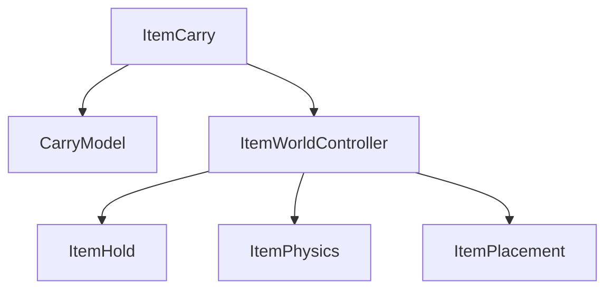

# PLAYER_INTERACTION

## PURPOSE

아이템 / 일반 월드 상호작용의 구조, 공통 상태 / 판정과 책임 경계를 관리합니다. 실제 완료 / 검증 결과는 [DONE.md](../DONE.md), 작업 순서는 [TODO.md](../TODO.md)를 기준으로 합니다.

## SYSTEM_OVERVIEW

### F 입력 우선순위

F는 아래 순서에서 처음 해당하는 행동 하나만 처리합니다.

1. 자기 포획 중이면 자기 탈출
2. 제작 화면이 열렸으면 레시피 닫기 시도
3. 유효한 구조 대상이 있으면 구조
4. 그 외에는 레시피 열기 시도

입력이 꺼져 있거나 일시정지면 처리하지 않습니다. 자기 탈출 다음에 일반 행동 차단을 검사하며, 차단 중이면 나머지 분기를 실행하지 않습니다. 제작 화면이 미니게임 / 결과 화면이면 닫기 요청이 거절돼도 이번 입력을 종료합니다. 구조가 미완료여도 레시피 열기로 넘기지 않습니다. 안내와 실행은 같은 대상 판정을 사용합니다.

### 아이템 보유와 월드 적용

Interacter / ItemHolder가 실행을 요청하고 ItemCarry는 보유 상태와 실행 순서를, CarryModel은 상태 판단을 담당합니다. ItemWorldController는 보유 표시 / 충돌, 물리 / 투척, 배치 적용을 각 기능에 위임합니다. 보유 / 배치 / 사용 중단 알림은 보유자 / 제작 / 준비 추적에 전달합니다.

보유 변경은 검사 → 처리 중 표시 → 월드 적용 → 상태 반영 / 알림 → finally의 처리 표시 해제 순서입니다. 콜백 이후 대상 상태를 다시 확인하며 실패 / 비활성화는 기존 반환 계약을 따릅니다. finally는 적용 결과를 성공으로 바꾸지 않습니다. 홀딩과 즉시 실행의 차이는 본문을 따릅니다.

## CURRENT_DECISION

- 조작키 변경은 같은 설정 화면의 현재 편집값을 기준으로 다른 동작과 중복되는 키를 거절하고 기존 할당을 유지합니다.
- 다중 보유 영역은 모델 메시를 기준으로 계산하며 파티클 등 연출 렌더러는 제외합니다. Editor 플레이 디버그는 보유 위치를 1초 간격으로, 놓기 취소와 배치 단계를 요청 시 기록합니다.

- 아이템과 일반 월드 오브젝트 상호작용을 구분합니다.
- 필요한 기능 인터페이스를 조합하며 IInteractable에 모든 세부 기능을 넣지 않습니다.
- Model은 상태 / 게임 규칙, Interacter는 대상 탐색 / 호출 순서 중재, 아이템 컴포넌트는 물리 / 월드 표현을 담당합니다.
- ItemCarry는 들기와 내려놓기를 함께 처리하며 별도 ItemPlace로 분리하지 않습니다.
- ItemThrow는 ItemCarry를 상속해 들기 / 놓기를 유지하면서 IThrowable을 추가 구현합니다. 모든 아이템이 투척 가능하지는 않습니다.
- 현재는 싱글플레이부터 구현하고 멀티플레이 권한 처리는 이후 추가합니다.
- 보유 중 아이템으로 다른 물체를 미는 시스템은 구현 범위에 없습니다. 내려놓기 / 던지기의 월드 물리와 보유 표시를 구분합니다.
- 독립적인 규칙이나 공통화 필요가 생길 때 추가 분리하며 사용하지 않는 세부 클래스 / 타입을 미리 늘리지 않습니다.

## PRODUCTION_UI

| 항목 | 계약 / 조건 |
| --- | --- |
| 준비 확인 | ProduceHud의 IsReady는 기존 초기화 결과를 읽습니다. 전체 패널과 결과 표시는 ProduceHud가, 레시피 / 미니게임 UI의 필수 참조는 각 하위 패널이 검사합니다. 음식 입력이 없는 세션의 HUD 필수 여부는 PlayScene에서 구분합니다. |
| 열기 / 닫기 | 레시피는 조준 후 F로 열고 닫습니다. 접근 / 재료 배치만으로 패널을 열거나 커서를 해제하지 않습니다. 상세는 [레시피 입력](#recipe_interaction_plan)을 따릅니다. |
| 레시피 표시 | 기본 레시피 화면은 전체 목록과 정렬 드롭다운을 표시하고 현재 레시피 텍스트 / 이전·다음 버튼은 숨깁니다. 목록은 스크롤로 탐색하며 조리 가능 여부는 현재 그릇의 재료 종류와 수량으로 표시합니다. |
| 레시피 표시 | 레시피 클릭 후 상세 화면에는 현재 레시피 이름, 필요한 재료 / 요구 수량, 이전·다음 버튼을 표시하고 정렬 드롭다운은 숨깁니다. |
| 커서 / 입력 | F로 레시피를 열면 커서를 해제하고 이동과 오른쪽 드래그 시점 회전을 유지합니다. 닫으면 커서 잠금과 일반 시점 회전으로 복귀합니다. |
| 대상 유지 | 열린 레시피는 조준 이탈 시 유지하고 기존 아이템 상호작용 거리 밖으로 이동하거나 대상이 무효화되면 닫습니다. 미니게임과 결과 알림은 이 검사로 종료하지 않습니다. |
| 입력 제한 | 미니게임 입력과 레시피 조작의 제한은 구분합니다. 레시피 이탈 검사로 진행 중인 미니게임을 자동 종료하지 않습니다. |
| 타이밍 판정 | 타이밍 판정은 버튼을 누르는 순간의 진행 위치를 사용합니다. 커서 해제 / 시점 회전 / 버튼 조작이 함께 동작하도록 입력을 연결하며, UI 전환 시 중복 구독을 방지합니다. |
| 클릭 ID / 중단 | 클릭 목표와 빈 영역 입력은 표시 당시 시도 ID를 전달하고 목표 입력은 목표 ID도 전달합니다. 판정은 ProduceMinigameController / Model에서 수행합니다. |
| 클릭 ID / 중단 | 포획 / 스턴 때 PlayInputController가 RecipeInputController.CancelProduction을 호출하면 HUD가 현재 표시하는 세션의 시도를 먼저 중단한 뒤 화면을 닫습니다. |
| 클릭 ID / 중단 | HUD Close 자체는 표시 종료이며 재료 보존 / 시도 중단 계약은 [PARTY_PREPARATION](PARTY_PREPARATION.md#production)을 따릅니다. |

## INPUT_TARGET_AND_PLACEMENT

| 항목 | 계약 / 조건 |
| --- | --- |
| 필수 입력 | InputHandler는 필수 Player 액션 6개의 연결과 활성 컴포넌트 상태를 IsReady로 읽습니다. 액션 누락 시 구독하지 않으며 Disable에서는 존재하는 액션만 해제하고 Hold / Run / Move / Look 중립값을 전달합니다. |
| 초기화 계약 | ItemWorldController.Init의 void 계약은 유지합니다. ItemCarry / ItemWorldController 준비 조회는 실제 참조와 기존 모듈을 사용하며 중복 준비 플래그를 추가하지 않습니다. 필수 물리가 없는 아이템은 등록 / 보유 / 투척 / 배치 적용을 거절합니다. |
| Linear 간격 | Linear 배치는 유한한 양수 간격만 탐색하며, 다음 offset이 현재 값보다 커지지 않으면 실패로 종료합니다. 정상 탐색의 간격과 왼쪽부터 첫 유효 위치를 고르는 순서는 유지합니다. |
| 호출 우선순위 | 현재 입력 시작 순서: 월드 상호작용 → 집기 / 배치 → 가능한 경우 즉시 투척. 어느 조건에도 해당하지 않으면 상호작용과 게이지를 시작하지 않으며, 누른 채 나중에 대상을 조준해도 실행하지 않습니다. |
| 레이 / 후보 | InteractionRaycaster는 아이템 / 월드 / 구조의 화면 중앙 탐지를 공통 처리합니다. 거리와 레이어는 호출자가 전달하며, 아이템 / 월드는 트리거 제외, 구조는 트리거 포함을 유지합니다. |
| 대상 선정 | WorldTargetSelector는 탐지한 충돌체에서 전달 / 일반 상호작용 / 조사 기능을 찾고 조사 완료 조건을 검사합니다. 입력 우선순위와 시작 대상 저장 / 실행은 기존 중재자가 담당합니다. |
| 시작 / 완료 대상 | PlayInputController → Player.BeginItemInteract → ItemInteracter.BeginInteract에서 시작 시점의 레이로 집기 / 배치 동작과 아이템 / 배치 대상을 저장합니다. |
| 시작 / 완료 대상 | 완료 때 재탐지해 동일 대상을 확인하고 취소 / 비활성화 때 저장 참조를 정리합니다. |
| 공급원 획득 | 재료 공급원 상호작용은 `WorldInteracter`가 입력 시작 대상을 저장하고 완료 때 같은 대상과 획득 가능 여부를 재확인합니다. |
| 공급원 획득 | `Player`가 자신의 `ItemHolder`와 View Hold Point를 `IngredientSource.TryTake`에 전달합니다. 공급원은 인스턴스 예약 / 활성화 / 집기를 처리하고 실패 시 비활성 보관과 예약 취소를 수행합니다. |
| 공급원 획득 | `IInteractable.Interact()`에 보유자 인자를 추가하거나 전역 Player 참조를 사용하지 않습니다. |
| 동일 표면 배치 | 같은 PlacementTarget 안에서는 완료 순간의 유효 배치 위치를 사용합니다. 도중에 다른 아이템이나 배치 대상으로 바꾸는 입력은 실행하지 않습니다. |
| 회전 보정 | ItemCarry의 Placement Rotation Offset은 표면 기준 회전에 곱하는 아이템 방향 보정값이며 기본값은 (0, 0, 0)입니다. 액자 설정과 재배치 확인은 [TODO](../TODO.md#data_and_asset_follow_up)를 따릅니다. |
| 배치 방향 계약 | ICarryable.PlacementRotationOffset을 PlacementTarget에 전달해 최종 회전으로 배치 가능 여부를 검사합니다. |
| 배치 방향 계약 | ItemWorldController.GetPlacementBoundsSize는 아이템 축 기준 크기를 계산하며 BoxCollider는 실제 꼭짓점, 다른 Collider는 월드 Bounds로 보수적으로 계산합니다. |
| 표면 노멀 | PlacementData.SurfaceNormal은 아이템의 보정된 회전과 별개인 표면 방향입니다. CarryModel은 이 방향으로 표면에서 띄울 위치를 계산합니다. 벽에 가까운 표면의 배치 방향은 월드 위쪽 기준으로 정렬하므로 기존 벽 부착 대상의 방향 확인이 필요합니다. |

### 회전 / 복수 기능 입력

- RotateAnomalySystem가 회전 사건의 Active / Failed 동안 회전 입력을 허용하고 종료 시 해제합니다. 평소에는 일반 집기 / 운반 / 재부착 입력을 사용합니다. 회전 기능의 준비 상태와 플레이어 입력 허용 상태는 구분합니다.
- 한 대상에 여러 사건 기능 컴포넌트가 붙을 수 있음을 고려합니다. 복수 사건 가능 대상에 서브 상호작용키를 활성화하는 방안은 검토안이며 키 / 활성 조건 / 동작 선택과 우선순위 / HUD는 미정입니다.
- 복수 종류의 사건이 가능한 대상과 사건의 동시 발생 수는 별개입니다. 동시 발생 제한은 ANOMALY에서 관리합니다.

## RUN_AND_STUN

- PlayInputController가 InputHandler의 Player/Run 버튼 액션을 Player.Run에 연결합니다. Shift 누름과 해제를 Mover.SetRunning에 전달해 걷기와 달리기 속력을 전환하며 스태미나는 없습니다.
- Player는 이동과 달리기 입력을 보관합니다. 스턴 중 실제 이동과 달리기를 막고 해제 후 현재 입력을 복구합니다.
- IStunTarget / StunTimer / Stunner가 스턴 적용과 지속 시간, 해제를 연결합니다. Player는 점프와 일반 상호작용도 차단하고 진행 중인 상호작용과 HUD를 취소합니다.
- PlayInputController는 OnStunChanged를 CameraFocus.SetLocked에 연결합니다. 잠금 중 시점 입력과 회전 보간을 멈추고 목표 각도와 보간 속도를 정리해 해제 시 밀린 회전을 방지합니다. 중력 처리는 유지합니다.
- 포획과 스턴은 별도 상태로 관리합니다. 납치 탈출과 NPC 구조는 모두 F 연타이며 E 홀딩 완료와 분리합니다. 상세는 [PREDATOR.md](PREDATOR.md)의 KIDNAP_IMPLEMENTATION_PLAN 참조.
- 스턴 시야 90도 기울임 / 화면 점멸 / 모델 넘어짐, 구조 키 이미지와 게이지 연출은 [UI_PRESENTATION](UI_PRESENTATION.md)을 따릅니다. 입력 제한과 연출 표시의 책임은 분리하며 현재 작업 순서는 [TODO](../TODO.md#presentation_and_audio)를 따릅니다.

## CAPTURE_AND_RESISTANCE

아래는 확정된 포획 / 구조 입력 규칙이며 구현 / 검증 결과는 DONE을 기준으로 관리합니다.

| 항목 | 계약 / 조건 |
| --- | --- |
| 구조 / 탈출 입력 | NPC 구조와 플레이어 자기 탈출은 모두 F 연타입니다. 키를 누른 횟수만 반영하고 계속 누르기는 반복 입력으로 처리하지 않습니다. 기존 E 홀딩과 분리하며 자기 탈출과 NPC 구조가 같은 입력을 동시에 소비하지 않도록 연결합니다. |
| 진행도 | 진행도는 플레이어별이 아닌 포획 건 하나가 공통 소유합니다. ResistModel이 진행과 성공을 판단하고 플레이어 측 중재자가 입력을 전달하며 HUD가 게이지를 표시합니다. |
| 복수 구조자 | 여러 플레이어가 같은 NPC를 구조하면 동일 포획 건에 입력을 합산합니다. 진행도는 유예 없이 시간에 따라 감소하고 F 입력마다 증가합니다. 감소는 구조자 수와 무관하게 포획 건에서 한 번만 계산합니다. |
| 재시도 | 진행도가 0이 되어도 계속 시도할 수 있습니다. 플레이어 탈출에는 제한시간을 사용하지만 NPC 구조에는 별도 제한시간을 두지 않고 출구 도착 전까지 허용합니다. |
| 대상 탐지 | 구조 대상 탐지는 중앙 레이를 활용합니다. 거리나 시선 조건을 벗어나면 입력 전달을 중단하며, 공동 진행도는 구조자 한 명의 이탈만으로 초기화하지 않습니다. |
| 조정값 | 연타 요구 횟수 / 제한시간 / 감소 속도 / 구조 거리 / 스턴 시간 등 밸런스 값은 Inspector에서 조정합니다. |
| 조정값 | 가상의 예외나 통상적인 Agent / Collider / Transform 처리 순서를 별도 기획 질문으로 늘리지 않고 실제 코드 충돌이나 플레이 흐름 차이가 있을 때 검토합니다. |
| 입력 제한 | 포획 중 플레이어는 이동 / 달리기 / 점프 / 일반 상호작용과 투척이 제한되고 F 연타 저항과 기존 시점 조작은 가능합니다. 카메라 자유는 시점 잠금을 하지 않는다는 뜻이며 기존 회전 제한을 360도로 확장하는 의미가 아닙니다. |
| 따라가기 | 포획자는 플레이어를 CarryPoint에 붙여 이동과 회전을 함께 따라가게 합니다. 초기 임시 문서의 강제 회전 없음은 이 규칙으로 대체합니다. 포획자 회전 따라가기과 플레이어의 시점 입력을 함께 유지합니다. |
| 이동 / 시점 | 포획 중 일반 이동과 중력을 중단합니다. PlayerCapture는 컨트롤러 전환 / 복구와 CaptureFollower 연결을 담당하고 Player는 이동 제한과 따라가기 소실의 Cancelled 처리를 연결합니다. |
| 이동 / 시점 | 아이템 Rigidbody 처리 코드를 캐릭터에 그대로 적용하지 않습니다. |
| 중첩 상태 | 포획과 스턴은 별도 상태입니다. 둘 중 하나가 남아 있으면 이동과 일반 행동 제한을 유지합니다. 포획 자체로 카메라를 잠그지 않으며 별도로 적용된 스턴의 시점 잠금은 기존 정책을 따릅니다. |
| 탈출 / 출구 결과 | 플레이어는 포획당한 채 이동하는 동안에도 F로 탈출을 시도합니다. 여우의 동반 도주와 출구 결과는 [PREDATOR.md](PREDATOR.md)의 여우 항목을 따릅니다. 납치 완료 시 지정 지점으로 리스폰하고 시간 초과 스턴에 추가 시간을 더하며 게임에서 제거하지 않습니다. |
| 탈출 / 출구 결과 | 리스폰 위치는 컨트롤러 복구 전에 적용하고 이동 속도를 초기화합니다. 리스폰 지점과 두 스턴 설정은 Inspector에서 지정하며, 해제와 리스폰 위치는 장애물과 겹치지 않아야 합니다. |

## ARCHITECTURE

### 아이템 책임 분리 — 현재 코드

| 항목 | 계약 / 조건 |
| --- | --- |
| CarryModel | CarryModel: 보유 상태와 CanPickUp / CanPush / CanDisplace 등 게임 규칙 판정. Model을 단순 필드 보관소로 사용하지 않습니다. |
| ItemCarry / ItemThrow | ItemCarry / ItemThrow: Model 판정과 계산 / 검사 결과를 받아 View 요청 및 알림 순서를 중재합니다. 강제 이동의 진입점은 ItemCarry.TryDisplace입니다. |
| ItemWorldController | ItemWorldController: Transform / 표시 / 물리 적용의 외부 창구이며 ItemHold / ItemPhysics / ItemPlacement를 생성해 세부 처리를 위임합니다. 모듈 세 개는 별도 MonoBehaviour가 아닌 일반 C# 클래스입니다. |
| ItemHold | ItemHold: 보유 표시 레이어 저장 / 복구와 Collider 및 보유자 충돌 제외 설정. ItemPhysics: Rigidbody 고정 / 해제 / 속도 / 충격과 투척 물리 적용. ItemPlacement: 배치 상태 저장 / 적용과 충돌 영역 / 지지 표면 조회를 중재하며 계산과 검사는 전용 모듈에 위임합니다. |
| PlacementTarget | PlacementTarget은 표면 설정과 배치 요청의 창구이며 PlacementCalculator / PlacementChecker가 후보 계산과 검사를 담당합니다. |
| PlacementTarget | ItemPlacementCalculator / ItemPlacementChecker는 아이템 형상과 지지 표면 계산 / 검사를 담당하고, 공통 충돌체 계산은 ColliderCalculator를 재사용합니다. |
| ItemDisplacement | ItemDisplacement: Settings의 거리 / 시도 횟수 / 바닥 탐색 조건으로 주변 목적지를 계산하고 유효 표면과 공간을 검사하는 보조 기능입니다. |
| 설계 기준 | 설계 기준: Model은 규칙 판정 / 모듈은 계산 / 검사와 위임받은 적용 / View는 월드 적용 / Presenter는 연결과 순서. 추가 가능 여부나 해결 규칙을 Presenter에 직접 몰아넣지 않습니다. |
| PlayScene | PlayScene: ItemHolder 생성 / Player와 상호작용 기능에 참조 주입 / PlayInputController 수명 연결 |
| PlayInputController | PlayInputController: 플레이 입력 허용 상태 / 상호작용 우선순위 / 커서 / 포획과 스턴 입력 취소 중재 / 구조 HUD / 입력 구독과 해제 |
| RecipeInputController | RecipeInputController: 레시피 대상 조회와 거리 / 유지 검사, 열기와 닫기, 재료 입력 시작 대상, 제작 시작과 취소 요청. 입력 허용 상태는 PlayInputController에서 조회하며 별도로 보관하지 않음 |
| UI 포인터 판정 | ProduceHud.IsPointerOverUi: EventSystem의 UI Raycast로 커서의 UI 점유 여부 확인. RecipeInputController가 재료 입력 차단에 사용 |
| Player | Player: 입력을 해당 플레이어 모듈로 전달 |
| ItemHolder | ItemHolder: 현재 보유 참조와 보유 여부를 직접 관리하고 아이템 확보 / 전달 / 해제와 상태 알림을 연결합니다. 참조 / 보유 지점 정리와 구독 해제 후 보유 종료를 알리며, 실제 해제 전 소유권을 재확인합니다. |
| ItemInteracter | ItemInteracter: 화면 중앙 탐지 / 들기 / 배치 대상 갱신 / 아이템 기능 호출 중재 |
| ItemCarry | ItemCarry: 보유 / 배치 요청의 규칙 확인과 View 적용 / 알림 순서 중재 |
| WorldInteracter 순서 | WorldInteracter: 음식 전달 → 조사 → 일반 IInteractable 순서 확인 / 홀딩 시작 대상 저장 / 완료 시 동일 대상 재확인 / 음식 전달 성공 후 보유 해제와 소비 중재. 탐지와 기능 선택은 위 모듈에 위임. |
| WorldInteracter 범위 | WorldInteracter는 음식 전달 / 개폐 / 회전 / 조사를 처리합니다. |
| 시스템 경계 | 다른 시스템의 Model은 직접 수정하지 않고 해당 Presenter를 통해 연결합니다. |
| 후속 검증 | 쿨다운 / 점유 / 네트워크 검증 등은 필요한 범위부터 확장하며 현재 ItemHolder에 구현된 것으로 보지 않습니다. |

## CAPABILITY_INTERFACES

| 인터페이스 | 현재 API | 현재 역할 |
| --- | --- | --- |
| IInteractable | CanInteract / Interact() | 일반 월드 대상의 현재 가능 여부와 실행 |
| IInvestigatable | CanInvestigate / InvestigationId / TryInvestigate(int expectedInvestigationId) | 조사 가능 여부 / 조사할 상태의 ID / 해당 조사 완료 시도 |
| ICarryable | PlacementBoundsSize / PickUp(Transform holdPoint) / PutDown(PlacementData placementData) | 공통 들기 / 내려놓기 |
| IPlacable | Place(Transform placePoint) | 선언만 존재. 현재 배치 흐름은 사용하지 않음 |
| IUsable | Use() | 사용 선언, 대상 / 효과 확정 후 확장 |
| IThrowable | Throw(Vector3 velocity, Collider[] ownerColliders) / ThrowPosition / ThrowRadius | 투척 실행과 궤적 기준 |

- 위 인터페이스는 서로 독립적이며 상속 관계가 아닙니다.
- 공급원 획득은 플레이어의 `ItemHolder`와 Hold Point를 전달하는 별도 입력 완료 경로를 사용합니다. `IInteractable.Interact()`는 손 직접 전달에 사용하지 않습니다.
- 일반 명령 함수는 void이며 TryInvestigate는 조사 완료 성공 여부를 bool로 반환합니다.
- 벽 붙이기는 PlacementTarget / ItemCarry 흐름을 사용하며 IPlacable은 사용하지 않습니다.

## PRESENCE

| 클래스 | 책임 |
| --- | --- |
| PresenceModel | 존재 상태와 조사 목적 / ID, 등장 / 제거 / 복구 조사와 정상 복구 판정 |
| PresenceDisplayController | 표시 자식 활성 전환, 검사 Collider 제공, ItemPhysics를 통한 숨김 중 정지와 재등장 설정 복원 |
| PresenceRestoreDisplay | 복구 대기 전 충돌체 상태 보관, 대기 표시 전환과 완료 시 설정 복원 |
| PresenceSpaceChecker | Box / Sphere / Capsule 형상 계산과 겹침 검사, Mesh 로컬 Bounds 기반 보수적 박스 검사 |
| PresenceController | ItemCarry 보유 상태 조회 → Model 판정 → 공간 검사 → View 적용 → Model 상태 반영과 조사 완료 알림 |
| RefillTimer | 재충전 시간과 경과 상태, 실제 복구 완료까지 진행 상태 유지 |

| 항목 | 계약 / 조건 |
| --- | --- |
| 관리 / 표시 루트 | 활성 관리 루트에 Presenter와 View를 두고, 표시 자식에 Enabled / 비Trigger Collider를 둡니다. View의 Target은 루트 자신이 아닌 자식 GameObject이며 Collider도 그 자식에 둡니다. |
| 관리 / 표시 루트 | 초기 표시 활성 상태는 Presenter의 Initially Present 설정으로 적용합니다. |
| 공간 마스크 | Obstacle Mask는 비어 있으면 검사 실패입니다. 부모는 균일 스케일을 사용하며 표시 물건이 지지 표면에 겹치지 않게 설정합니다. |
| 기능 경계 | TryShow / TryRemove / TryRemoveForRestore와 각 Test 컨텍스트 메뉴가 진입점입니다. 제거는 삭제가 아니라 자식 숨김이며 관리 루트는 유지합니다. |
| 공간 형상 | 비활성 Collider의 bounds 대신 실제 중심과 크기로 검사합니다. 외부에서 자식을 꺼도 Model을 자동 변경하거나 정식 제거로 처리하지 않습니다. |
| 조사 ID | 새 정식 등장 때 CurTargetId를 갱신해 InvestigationId로 제공합니다. TryInvestigate는 ID와 제거 조건을 확인하고 숨김 성공 후 OnInvestigated를 전달합니다. 직접 TryRemove는 조사 완료 알림을 보내지 않습니다. |
| 초기화 | Presenter.Awake에서 View.TryInitialize로 초기 표시와 물리를 적용한 뒤 같은 Initially Present 값으로 Model을 생성합니다. |
| 초기화 | 초기 정상 물건의 조사 목적은 None이며, Inspector에서 표시만 바꿔 Model 상태를 동기화하지 않습니다. |
| 빈자리 조사 | 복구 조사는 표시 자식과 분리된 Restore Check Collider를 사용합니다. 초기화 시 해당 GameObject를 켜고 Collider 탐지는 끈 뒤, 빈자리 조사 때만 탐지를 켭니다. 상위 비활성 오브젝트나 잘못된 참조를 임의로 고치지는 않습니다. |
| 복구용 제거 | TryRemoveForRestore는 복구 조사 영역 / 재충전 시간 / 검사 간격 / Obstacle Mask와 제거 조건을 사전 검사합니다. 숨김 후 Restore 조사 목적과 새 ID를 만들고 조사 영역을 활성화합니다. |
| 재충전 시작 | Restore 목적의 TryInvestigate는 표시 자식을 켜되 표시 대상 하위 Collider를 끄고 물리 정지를 유지한 채 RefillTimer을 시작합니다. 조사 탐지를 끄고 OnRestoreRequested로 시작 ID를 전달합니다. |
| 재충전 시작 | 현재 반투명 매트리얼은 적용하지 않습니다. |
| 복구 완료 | 재충전 경과 후 일정 간격으로 공간을 검사하며 막혀 있으면 대기합니다. 공간 확보 후 Collider와 물리 설정, 정상 존재 상태를 복원하고 OnRestored에 복구 시작 ID를 전달합니다. 현재 InvestigationId는 정상 재등장으로 갱신됩니다. |
| 중복 / 시간 경계 | 복구 대기 중 중복 조사 / 등장 / 제거는 차단합니다. 기능 비활성 중 재충전은 정지하고 재활성화 후 이어지며, 사건 취소가 일반 재충전을 취소하지 않습니다. |
| 보유 제한 | 등장 / 제거 / 조사 모두 보유 중에는 Model이 거절합니다. Presenter가 ItemCarry.IsHold를 전달하며 View에는 보유 허용 판정이 없습니다. 표시 변경은 Presenter를 통해 요청합니다. |
| 물리 계약 | ItemWorldController.GetPhysics로 기존 물리 모듈을 공유합니다. 루트 Rigidbody만 있으면 모듈을 연결하고, Rigidbody 없는 장식은 표시만 처리합니다. ItemWorldController.Init은 비활성 자식 Collider도 탐색합니다. |
| 숨김 / 복구 물리 | 처음부터 숨겨진 대상과 제거 대상은 물리를 정지합니다. ItemPhysics는 중력 / Kinematic 설정을 저장해 재등장 시 복원하고, 숨김 중 속도 / 배치 물리 / 충격량 적용을 차단합니다. 숨기기 전 속도는 복원하지 않습니다. |
| 검사 한계 | Mesh 검사는 실제 메시보다 넓은 영역을 차단할 수 있습니다. 미지원 형상 / 유효하지 않은 크기 / Mesh 누락 / 부모 변환에 의한 전단은 검사 실패로 처리합니다. 사건 계약과 취소 정책은 ANOMALY의 CompositionChange를 따릅니다. |
| Hide 구분 | 기존 HideTimer은 잠복 대기시간, HideActivationController는 이전 표시 / Collider / Agent 상태 복구를 담당합니다. Presence의 존재 상태와 표시 전환을 대신하지 않습니다. |

## INVESTIGATION

| 항목 | 계약 / 조건 |
| --- | --- |
| 대체 조사 | ReplaceController는 대체 사건의 IInvestigatable로 기존 E 홀딩 조사에 참여합니다. 같은 InvestigationId / 변경 유지 / 미보유 조건에서 조사하며 OnActionRequested 후 재검사합니다. |
| 대체 조사 | 발생 당시 선택한 Color / Appearance 기능의 실제 복원과 상태 정리가 성공한 뒤 OnInvestigated를 알립니다. 복원 공간 부족은 해결되지 않으며 재시도할 수 있습니다. TryKeep은 현재 색 또는 외형을 유지하고 조사를 종료합니다. |
| 대체 조사 | 사건 계약은 [ANOMALY](ANOMALY.md)의 Replace 절을 따릅니다. |
| 존재 조사 | Presence의 OnActionRequested는 조사 / 재충전 완료 적용 전 시간 확인을 연결합니다. TryEndInvestigation은 같은 ID의 조사 / 복구 대기 / 재충전 / 공간 대기 / 미리보기를 정리하고 존재 상태를 유지합니다. |
| 대상 선택 | E 홀딩 시작 시 WorldTargetSelector.TrySelectInvestigation이 조준한 Collider부터 부모 방향으로 조사 기능을 탐색합니다. 비활성 / 조사 불가 기능을 건너뛰며, 가까운 대상부터 같은 오브젝트의 컴포넌트 순서상 첫 유효 기능을 선택합니다. |
| 대상 선택 | 탐색 목록은 재사용합니다. |
| 대상 / ID 유지 | 선택한 기능 참조와 InvestigationId를 저장합니다. |
| 대상 / ID 유지 | 완료 시 입력 상태를 먼저 정리하고 CanCompleteInvestigation이 시작 컴포넌트의 생존 / 활성 상태, 현재 중앙 레이 적중 Collider가 그 컴포넌트의 Transform 자신 또는 자손인지, 조사 가능 여부와 ID를 확인합니다. 후보를 재선택하지 않습니다. |
| 완료 / 유효성 | 완료 가능하면 시작 기능의 TryInvestigate(expectedInvestigationId)를 호출합니다. 다른 기능이 활성화돼도 입력을 넘기지 않으며, 시작 기능 파괴 / 비활성화 / 조준 이탈 / ID 변경은 완료를 거절합니다. 기능별 우선순위와 서브 키는 후속입니다. |
| ID 명칭 | 명칭은 ShakeId / InvestigationId를 사용합니다. 변경 번호 / 변경 횟수 / Version / Token으로 부르지 않습니다. ShakeId는 새 흔들림 시작 때만 증가하며 정지할 때는 증가하지 않습니다. |
| 흔들림 조사 | ShakePresenter는 ID가 일치하는 흔들림을 정지한 뒤 OnInvestigated를 알립니다. 정지 알림 도중 새 흔들림이 시작되면 이전 조사의 완료 알림을 보내지 않습니다. |
| 흔들림 조사 | 직접 정지의 OnShakingChanged와 조사 성공의 OnInvestigated를 구분합니다. |
| 입력 해제 | 키 해제와 행동 취소 시 저장한 대상과 ID를 비웁니다. 사건의 시간과 결과 판정은 입력 모듈이 아닌 사건 Model / Presenter가 담당합니다. |

## DETECTION_AND_FLOW

- 플레이 중 커서는 Locked이며 Camera.ViewportPointToRay(0.5, 0.5)를 사용합니다. 자유 커서는 메뉴용입니다.
- ItemInteracter가 매 프레임 탐지하고 빈손이면 ICarryable, 보유 중이면 PlacementTarget을 찾습니다.
- 현재 탐지 마스크는 InteractableItem / PlacementTarget / Wall / Floor이며 HoldItem은 제외합니다.
- 현재 PickUp은 갱신된 들기 대상을 사용하고, PutDown은 입력 순간 Raycast와 배치 위치를 다시 확인합니다.
- 입력 순간의 최신 대상 / 상태 검증은 공통 설계 기준이며 현재 모든 기능에서 재검증하는 것으로 기록하지 않습니다.
- OnCarryTargetChanged는 보유 대상 변경 알림입니다. 조준 대상 강조 작업은 [TODO](../TODO.md#follow_up)를 따릅니다.
- WorldInteracter 내부의 음식 수락 대상과 일반 대상 탐지는 TryGetHit을 공유합니다. ItemInteracter와의 공용 탐지 통합이나 사전 Overlap 탐지는 도입하지 않았습니다.

## CARRY_AND_PRESENTATION

- ItemCarry는 ItemWorldController를 통해 보유 설정과 아이템 축 기준 배치 크기를 저장합니다. 실제 레이어 / Collider 설정은 ItemHold, 크기 계산은 ItemPlacement가 담당합니다.
- ItemHold는 집기 직전 비활성 자식까지 탐색해 같은 Rigidbody의 Collider를 자동 수집하고 개별 enabled 상태를 저장합니다. 별도 Rigidbody는 제외합니다. View 보유 중 전체 비활성화, 내려놓기 / 투척 시 개별 복원하며 Rigidbody는 Kinematic / 중력 비활성으로 전환합니다.
- World 보유는 Collider를 유지하고 전체 Collider에 보유자 충돌 제외를 적용합니다. World → View 전달도 최초 상태를 보존합니다. 보유 중 새 Collider 추가는 현재 자동 갱신 범위가 아닙니다.
- SetParent(holdPoint, true)로 월드 스케일을 유지한 뒤 보유 위치 / 회전을 적용합니다.
- 현재는 실제 아이템 하나를 재사용하며 비활성 자식까지 포함한 레이어를 각각 저장하고 HoldItem으로 변경합니다.
- Main Camera는 HoldItem을 제외하고, 자식 HoldItemCam은 Overlay / HoldItem만 표시 / Clear Depth 활성으로 구성합니다.
- 보유 지점은 Main Camera 자식 ViewHoldPoint의 Transform입니다. 장애물 때문에 카메라 쪽으로 당기지 않습니다.
- 별도 렌더링은 보유 아이템이 월드 표면에 가려져 잘리는 현상을 막는 표현 방식이며 실제 물리 관통 방지 기능은 아닙니다.
- 내려놓을 때 기존 레이어를 복구하고 보유 상태를 해제합니다. 던지기에서도 같은 월드 복귀 절차를 연결해야 합니다.
- 현재 레이어 저장 / 복구는 보유 중 자식이 새로 추가되지 않는 구조를 기준으로 합니다.
- 멀티플레이의 ViewHoldPoint / WorldHoldPoint 분리와 플레이어 모델 표시 정책은 [MULTIPLAYER.md](MULTIPLAYER.md)를 따릅니다.

## PLACEMENT

| 항목 | 계약 / 조건 |
| --- | --- |
| 지지 표면 | ItemPlacement.TryGetSupport는 저장된 배치 표면과 독립적으로 현재 지지 표면을 반환합니다. 낙하는 미보유 확인 후 실제 바닥을 먼저 검사하고 표면 없음 / 저장된 표면 불일치를 구분합니다. 진단을 위해 정상 기준을 변경하지 않습니다. |
| 정착 확인 | ItemCarry.TryGetSettledPlacement는 미보유 / Rigidbody 수면 / 현재 아래쪽 지지 표면으로 저장 가능 상태와 사유를 제공합니다. 이동 만료 후 기준 갱신에 사용하며 낙하 정착을 해결로 취급하지 않습니다. |
| 배치 데이터 | PlacementData는 Position / Rotation / SurfaceNormal / Parent / PlacementType / IsFixed / Target을 전달합니다. 표면 방향은 보정된 아이템 회전과 별개이며 위치 보정에 사용합니다. |
| Fixed / Free | PlacementType.Fixed는 자동 선정 위치, Free는 Raycast 충돌 위치를 사용하며 물리 고정 여부는 IsFixed로 전달합니다. |
| 고정 조건 | Fixed는 항상 고정합니다. Free는 실제 충돌한 Collider 오브젝트의 레이어가 Wall이면 고정하고, 나머지는 물리를 적용합니다. |
| 고정 상태 | ItemCarry는 IsFixed가 true이면 isKinematic = true / useGravity = false, false이면 Kinematic 해제 / 중력 활성 / 속도 초기화를 적용합니다. |
| Linear / Random | FixedPlacementType.Linear / Random은 PlacementTarget의 후보 선정 방식이며 PlacementData에는 포함하지 않습니다. |
| 배치 계산 책임 | PlacementTarget은 Collider를 사용합니다. 표면 Collider가 여러 개라면 인스펙터에서 직접 지정합니다. |
| 표면 형상 | 고정 배치는 Collider.bounds를 탐색 범위로 사용하고 표면 Collider.Raycast로 실제 표면을 확인합니다. |
| Linear 후보 | Linear는 아이템 너비 / 배치 간격을 반영하고, Random은 지정 시도 횟수 안에서 후보를 찾습니다. |
| 회전 계산 | 표면 노멀 / forward로 배치 회전을 계산하며 Physics.CheckBox와 아이템 레이어 마스크로 겹침을 검사합니다. |
| Random 재계산 | 랜덤 후보는 갱신 / 입력 때 다시 계산하므로 배치 미리보기 추가 시 결과 캐싱을 검토합니다. |
| 부모 연결 | 현재 PlacementTarget은 Parent를 null로 전달합니다. 비균일 스케일 표면의 자식으로 연결하지 않습니다. |
| 물리 적용 | ItemCarry는 위치 / 회전 적용과 Collider 복구 후 Physics.SyncTransforms()로 최신 bounds를 읽어 표면과 아이템 바닥을 맞춥니다. 매 프레임 반복 호출하지 않습니다. |
| 벽 배치 | 벽 붙이기도 기존 표면 노멀 기반 회전 / 오프셋 계산을 사용하며 배치 후 물리 고정으로 부착 상태를 유지합니다. |

### Anomaly 배치 연결

- PlacementTarget은 자유 / 고정 배치 정보 생성 시 자신을 PlacementData.Target으로 전달합니다. Target은 Transform Parent와 별도입니다.
- ItemCarry.PutDown은 최종 위치 보정 / 물리 설정 / 보유 해제 후 OnPlaced(Target)을 발행합니다. 기존 배치 시스템이 아이템별 허용 여부를 먼저 확인합니다.
- AnomalyTarget은 배치 알림으로 정상 상태를 저장하거나 사건 해결 시도를 전달합니다. 잠금 / 해결 / 사후 복구 규칙은 [ANOMALY.md](ANOMALY.md)를 따릅니다.
- 낙하 사건은 ItemCarry.TryPush를 재사용합니다. 벽은 충격량 0으로 고정 해제, 윗면은 가장자리 방향 충격을 적용합니다. 이동은 별도 ItemCarry.TryDisplace → ItemDisplacement.TryFindPosition → ItemWorldController.SetDisplacement 경로이며 두 동작 모두 OnPlaced를 발행하지 않습니다.
- 일반 투척 / 밀어내기 후 배치 유효성 추적 검토는 [TODO](../TODO.md#data_and_asset_follow_up)를 따릅니다.

## DISPLACEMENT

- ItemCarry.TryDisplace는 활성 상태 / CarryModel.CanDisplace / 검사 Bounds를 확인하고 ItemDisplacement.TryFindPosition으로 목적지를 찾습니다. 유효 후보를 찾은 뒤에만 PrepareDisplacement와 ItemWorldController.SetDisplacement를 호출합니다.
- 목적지는 최소 / 최대 거리와 유한한 시도 횟수 안에서 주변 바닥을 탐색합니다. 바닥 / 지지 / 물체 겹침을 검사하며 실패 사유를 반환하고 탐색 실패 시 기존 위치와 동작을 유지합니다.
- SetDisplacement는 현재 회전을 유지해 위치를 적용하고 부모 / 물리 고정을 해제합니다. 플레이어의 정상 배치가 아니므로 OnPlaced를 보내지 않습니다.
- ItemThrow는 이동 전 투척 진행을 정리합니다. 일반 이동 확인 범위는 DONE, 사건과 복구 계약은 ANOMALY를 따릅니다.

## THROW

- 조준 / 발사 / 충돌 / 착지 / 구르기 / 감속 / 완전 정지 흐름을 구현했습니다.
- 무한정 날아가거나 굴러가지 않고 착지 후 굴러가다가 완전히 멈춰야 합니다.
- Thrower가 입력 / 발사 / LineRenderer 궤적을 중재하고 ItemThrow가 월드 레이어 / Collider / 물리 복귀와 투척을 처리합니다.
- 공중에서는 중력으로 이동하고, 착지 후 선속도 / 각속도를 감속해 기준 시간 동안 유지되면 완전히 정지합니다.
- 투척 직후 던진 플레이어와의 충돌을 일시적으로 제외하고 아이템이 몸에서 벗어나면 충돌을 복구합니다.
- 투척 후 ItemThrow는 다시 주울 수 있으며 반복 투척이 가능합니다.
- 대표 콘텐츠 후보는 개와 놀기 위한 뼈다귀 던지기입니다.

## FOOD_ITEM

- 음식 아이템은 기존 ItemCarry의 들기 / 배치를 재사용합니다.
- FoodData: 데이터별 고유 FoodId / FoodCategory(재료, 완성 음식) / FoodSize / 기본 만족도 / FoodPlacementType(테이블, 그릇, 복수 허용) 설정.
- FoodDataMap: Inspector 배열 등록 후 OnEnable에서 ID 딕셔너리 구성. 같은 ID가 중복되면 마지막 데이터로 덮어씁니다. 크기가 다른 데이터도 별도 고유 ID를 사용합니다.
- Food는 같은 오브젝트의 ItemCarry / ItemWorldController와 조합하며 FoodData를 직접 참조합니다. 재료도 곰에게 전달하려면 재료 프리팹에 Food가 필요하며 재료 / 완성 음식 카테고리만으로 수락에서 제외하지 않습니다. 음식 크기 설정은 Transform 크기를 자동 변경하지 않습니다.
- ItemInteracter가 음식 배치 허용값과 PlacementTarget의 대상 타입을 확인합니다. 허용 타입이 없는 대상에는 음식 배치가 차단됩니다.
- 음식은 데이터를 제공하고, 곰 Model이 취향과 최종 만족도 / 반응을 판단합니다. 음식 자체에 곰의 선호 여부를 저장하지 않습니다.
- 곰 취향은 EnemyDemandData의 좋아하는 음식 / 싫어하는 음식 FoodDataMap을 FoodDemandModel에 전달하고 FoodId로 조회합니다. 비선호 음식은 분노를 우선 적용하고 선호 음식은 최대 만족도, 일반 음식은 기본 만족도를 누적합니다. 기본 만족도는 Inspector 값이며 밸런스 수치는 미정입니다.

### 음식 전달과 소비

| 항목 | 계약 / 조건 |
| --- | --- |
| 수락 검사 | IFoodReceiver의 CanReceive / TryReceive를 사용합니다. WorldInteracter는 TryGetHeldFood와 TryGetReceiver로 조회를 분리합니다. |
| 입력 순서 | 입력 흐름: 음식 보유 → 곰 조준 → 상호작용 홀딩 → 완료 시 최신 조건 확인 → 수락 성공 → 플레이어 보유 해제 / 음식 소비 → 먹기 진행. |
| 전달 조건 | 확인 조건: 실제 HoldType.View 보유 / 음식 여부 / 거리 / 대상 / 곰 수락 가능 상태 / 이미 소비 / 수락된 음식인지 여부. |
| 성공 / 실패 | 전달 실패 시 음식과 보유 상태 유지 / 성공 시에만 소비 / 보유 해제 / 반복 입력에 따른 중복 전달 차단. |
| 소비 책임 | 곰은 수락 결과를 반환하고 플레이어 측 중재자가 Interact를 갱신합니다. 곰이 플레이어 Model을 직접 수정하지 않습니다. |
| 입력 우선순위 | 음식 전달과 일반 월드 대상은 아이템 조작 및 즉시 투척보다 먼저 상호작용 대상으로 인식합니다. 월드 상호작용으로 시작한 입력은 완료에 실패해도 아이템 배치나 투척으로 넘어가지 않습니다. |
| 물리 / 손실 복원 | 수락 성공 후 ItemCarry.Release → Interact.ClearHoldItem → Food.Consume 순서로 처리합니다. Food.Consume은 ItemWorldController.Hide를 통해 비활성화하며, 음식을 곰 보유 지점으로 옮기지 않습니다. |
| 실행 확인 | 실행 확인: 들기 / 배치 / 정상 전달 / 소비 / 비음식 / 거리 이탈 / 수락 불가 시 보유 유지 / 중복 소비 방지 / 전달 / 배치 / 투척 입력 분기. |

### 난동 피해 연결

- ItemCarry.TryPush는 비활성 / 보유 아이템을 거부하고 ItemWorldController.ApplyPush를 호출합니다. 배치 아이템은 HoldType.None이므로 보유 해제용 ItemCarry.Release와 별도 진입점을 사용합니다.
- ItemWorldController.ApplyPush는 기존 View.Release로 부모 / 물리 고정을 해제하고 속도를 초기화한 뒤 ForceMode.Impulse를 적용합니다. 배치 아이템과 바닥의 미보유 아이템 모두 대상이며, 다시 맞으면 기존 속도를 초기화합니다. 배치 정보의 Parent는 현재 null이고 테이블별 배치 목록은 없습니다.
- 재료 소실은 FoodCategory.Ingredient에 Food.Consume을 적용해 오브젝트 전체를 비활성화하며, 오브젝트 하나를 1개로 취급합니다. 공급원 등록 재료의 실제 소비 / 소실 성공은 소비 확정 알림으로 재사용 대기에 반영합니다. 공급원 재고는 획득 시 이미 차감하므로 소비 시 추가 차감하지 않습니다. 일반 음식, 그릇, 임시 비활성화에는 공급원 등록이나 재고 차감을 강제하지 않습니다. Processing 중 외부 소실은 [PARTY_PREPARATION](PARTY_PREPARATION.md#production), 재고 규칙은 같은 문서의 INGREDIENT_REFILL을 따릅니다.

## FEATURE_AND_ANOMALY_BOUNDARY

- 평상시 개폐는 Assets/02. Scripts/Action/02. Object/OpenClose의 OpenCloseModel / OpenClosePlacement / OpenCloseController가 담당합니다. 사건 없이도 상자나 문이 사용하는 일반 기능입니다.
- 사건별 코드만 AnomalyEvent/StateChangeEvent/OpenClose와 Drop에 둡니다. 공통 기반은 AnomalyEvent 폴더에 두며 정확한 클래스와 계약은 ANOMALY를 따릅니다.
- 개폐 사건은 정상 상태와 현재 상태가 일치할 때 반대 상태를 요청합니다. 플레이어가 원래 상태로 돌리면 해결 또는 사후 복구됩니다. 일반 입력과 View에 사건의 시간 / 성공 / 실패 규칙을 넣지 않습니다.
- 낙하 발생과 실제 TryPush는 보유 아이템을 제외합니다. 이미 진행 중인 낙하를 플레이어가 집는 것은 해결 과정으로 허용하며 정상 배치에서 완료됩니다. 다른 대상의 발생까지 막는 전역 보유 차단은 없습니다.

## USE_AND_WORLD_INTERACTION

- Use 후보는 먹기 / 음식 주기 / 조사 / 복구 / Anomaly 대응 등 대상 상태를 바꾸는 행동입니다.
- 곰에게 음식 전달 / 소비는 기존 월드 상호작용으로 유지합니다. 서포트는 슬롯별 Support1 / Support2 / Support3으로 사용하며 일반 월드 사용 인터페이스와 구분합니다. 액티브가 있는 슬롯만 사용 입력을 요구하고 패시브만 있으면 사용 입력을 요구하지 않습니다.
- 서포트 사용은 포획 / 스턴 / 제작 UI / 일반 상호작용 홀딩 중 차단합니다. 보급권은 사용 순간 기존 거리 / 가림 검사를 통해 공급원을 조회하며 CanTake를 사용 조건으로 삼지 않습니다.
- PlayerItemHolder는 개별 ItemHolder를 조합하고 가장 최근에 집은 아이템을 활성화합니다. 집기 / 공급원은 보유 여유를 검사하고 배치 / 전달 / 폐기 / 투척은 활성 대상을 검사합니다. 입력 시작 대상을 유지하며 중간에 사라져도 다음 아이템으로 입력을 넘기지 않습니다.
- Hold Point와 Hold Gap 설정은 Player, 런타임 지점과 Bounds 배치는 PlayerItemHolder, 생성과 종료는 PlayScene이 담당합니다. 상세 효과 / 횟수 계약은 [SUPPORT_ITEM_CATALOG](SUPPORT_ITEM_CATALOG.md#runtime_contract)를 따릅니다.
- OpenCloseController가 IInteractable을 구현해 CanInteract와 Interact → Toggle로 상자 개폐를 연결합니다. View의 자세 계산과 실제 상태 변경은 기존 개폐 기능이 처리합니다.
- WorldInteracter는 시작 대상의 IInteractable 참조와 선택한 행동명을 저장합니다. 완료 때 다시 탐지한 대상의 CanInteract와 참조 동일성을 확인하고 새로 탐지한 대상으로 호출합니다. 별도 MonoBehaviour / Behaviour 참조는 저장하지 않습니다. 컴포넌트 활성 여부와 동작 가능 조건은 대상의 CanInteract가 판단합니다.
- IInteractable / IInvestigatable의 ActionName은 대상 행동을 제공합니다. 음식 전달은 전달, 재료 집기 / 배치는 집기 / 넣기로 표시합니다. Player의 ItemActionName / WorldActionName을 통해 PlayInputController가 실제 시작 행동명을 보관하며 PlayerHud는 홀딩 게이지와 함께 표시합니다. 취소 / 완료 실행 전에는 안내를 숨깁니다.
- PlayInputController는 E 홀딩 종료 시 완료 허용과 입력 분기를 초기화하고 Player.CancelWorldInteract로 저장한 대상을 정리합니다. 기존 스턴 / 포획 취소도 유지하며 WorldInteracter 비활성화 시 참조를 해제합니다. 조준과 거리는 완료 순간에 재확인하며 홀딩 도중 잠시 이탈했다 돌아온 이력을 추적하는 방식은 아닙니다.
- 일반 월드 대상 후보는 문 / 옷장 / 조리대 / 스피커 / NPC / 구조 / 조사 지점입니다.
- Renderer / Transform / Active 변경은 사용 결과의 표현이며 대상별 규칙은 해당 시스템이 소유합니다.

## RECIPE_INTERACTION_PLAN

현재 구현된 입력 계약입니다. 레시피 패널 / 커서 / 미니게임의 표시 계약은 [PRODUCTION_UI](#production_ui), 안내 / 외곽선 렌더링은 [UI_PRESENTATION](UI_PRESENTATION.md#action_and_recipe_guide), 확인 이력은 [DONE](../DONE.md#제작--재료-재고--preparation)을 따릅니다.

- ProductTargetSelector.TryGetProduct가 등록 재료 / 재료 배치 대상 / 그릇 Collider에서 제작 대상을 공통 조회합니다. IngredientInteracter / ItemInteracter가 재사용하며 Player는 행동 가능 여부, PlayInputController는 입력 우선순위, RecipeInputController는 대상 / 거리 수명을 담당합니다.
- 중앙 Raycast와 아이템 상호작용 거리로 유효한 그릇을 선택합니다. 내부 재료도 해당 그릇으로 연결하며 빈 그릇은 허용합니다. 보유 중 / 제작 중 / 완성 그릇은 제외합니다.
- F는 자기 탈출 → 열린 레시피 닫기 → 구조 대상 → 레시피 대상 순으로 한 번 분기합니다. 구조 미완료 입력을 레시피 열기로 넘기지 않으며 미니게임 / 결과 알림 중 토글은 제한합니다. 기존 Player / Rescue 액션과 F 바인딩을 재사용합니다.
- 안내 / 실행은 같은 판정을 사용하고 입력 순간 대상을 갱신합니다. 열린 화면은 같은 그릇을 유지하며 다른 그릇으로 자동 전환하지 않습니다. F 닫기는 조준 여부와 무관합니다. 대상 무효화 / 거리 이탈 / 스턴 / 포획에서 닫고 기존 홀딩을 취소합니다.
- 레시피가 닫힌 동안 E 집기 / 배치 / 전달, 연속 재료 배치 / 구조 / 서포트 입력을 유지합니다. 실행 불가능한 공급원 입력을 일반 배치로 넘기지 않습니다.

## PENDING

- 아이템별 배치 방향 보정은 반영됐으며 액자 재배치와 추가 표면 / 형상 검증은 남아 있습니다.
- 음식별 만족도 밸런스 / 음식 제작 수량과 소비 연동 / 이후 Use 대상과 효과
- 런타임에 Renderer 구성이 변경되는 대상의 강조 갱신 필요 여부
- 공통 진입점과 기능 호출 우선순위 / 성공 / 실패 API / 입력 순간 재검증 범위
- 보유 중 복수 Collider 및 동적으로 추가되는 자식 처리 필요 여부
- 아이템 점유 / 동시 줍기 / 쿨다운 / 이미 해결된 대상 / 네트워크 권한 검증
- 정상 대상 오판 비용 / 다른 시스템과의 상태 전달

## UPDATE_RULE

- 공통 API / 기능 구성 / 대상 탐색 / 책임 경계 / 입력 흐름이 확정 또는 변경될 때 갱신합니다.
