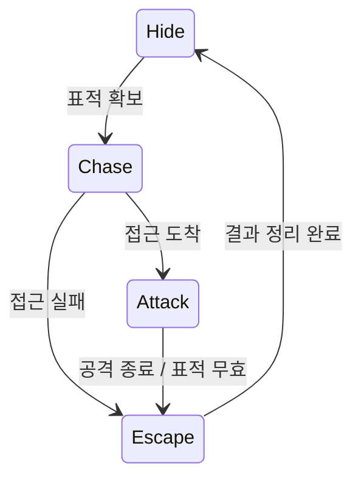
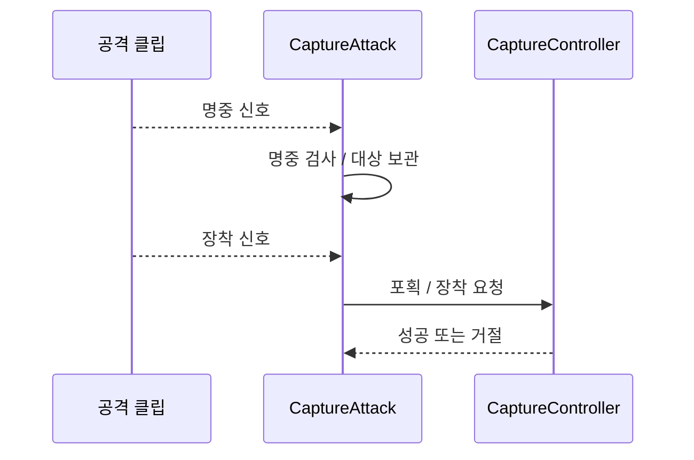

# PREDATOR

## PURPOSE

포식자의 공통 등장과 행동 규칙, 표적, 사전 신호와 5종 고유 대응 구조를 관리합니다.

## SYSTEM_OVERVIEW

EnemySceneController는 적 수명을, 발생 관리는 시작 승인을, Enemy / 적별 클래스와 State는 행동을 담당합니다. 세부 실행은 이동 / 공격 / 포획 기능에 위임합니다.

| 적 | 핵심 행동 / 결과 |
| --- | --- |
| 개 | 플레이어 방해 → 공 추적 / 회수 / 전달 반복 → 목표 횟수 완료 후 퇴장 |
| 곰 | 음식 요구 / 먹기 → 만족도 판정 → 재요구 / 퇴장 / 분노 행동 후 도주 |
| 까마귀 | 침입 / 탐색 → 탈취 / 비행 탈출. 정상 탈출에서 소비, 이동 실패에서 해제 / 복구 |
| 담비 | 잠복 → 수집 또는 보복 추격 / 공격 → 도주 → 방 활동 준비 |
| 여우 | 잠복 → 사건 실패 또는 보복 분기 → 표적 선정 / 접근 / 포획 → 도주 |

활동은 발생 승인 → 고유 행동 → 결과 정리 → 다음 활동 준비 / 승인 대기로 반복합니다. 담비 / 여우는 EnemyRoomActivity로 현재 방에 복귀하거나 다른 방으로 이동합니다. 다음 활동의 방 이동과 현재 도주의 목적지 선정은 구분하며 방 활동을 별도 FSM 상태로 추가하지 않습니다.

### 여우 상태 전이

표적 선정은 연결 사건 실패 또는 보복 분기에서 시작합니다. 사건 해결 / 취소는 출현 없이 잠복 대기를 다시 준비합니다. 도주 중 구조는 실제 포획 관계를 해제하며, 최종 도착과 납치 완료 확정은 구분합니다. 실패 / 취소 이동은 대상 해제가 끝난 뒤 잠복합니다.

### 명중과 장착 시점

적은 목표를 지정해 공격을 시작하고 이번 공격의 클립 신호만 구독합니다. 두 신호는 기록 후 LateUpdateAttack에서 처리하며 같은 프레임에도 명중부터 적용합니다. 실제 명중 검사는 CharacterAttacker가 수행합니다.

명중 대상이 없거나 단계가 무효면 포획하지 않습니다. 클립 복귀 확인 후 구독 / 요청을 정리하고 적은 도주로 전환하며 실제 포획 관계는 유지합니다. 진입 제한시간 초과 / 이벤트 누락은 오류로 종료하고 타이머 포획으로 대체하지 않습니다.

## COMMON_RULE

### 등장 방식

- 대놓고 등장: 개 / 곰. 발견보다 올바른 대응 선택이 핵심입니다.
- 몰래 등장: 까마귀. 침입을 놓치면 내부에서 행동합니다.
- 숨어 있음: 담비 / 여우. 관련 오브젝트 변화로 존재를 추론합니다.
- 한 포식자가 `몰래 침입 → 내부 이동 → 잠복`처럼 여러 방식을 연속 사용할 수 있습니다.

### 등장과 활동 수명

| 항목 | 내용 / 조건 |
| --- | --- |
| 초기 승인 방 | 초기 Pressure 승인 방은 까마귀 → 부엌, 개 / 곰 → 파티룸, 담비 → 창고, 여우 → 드레스룸입니다. 영구 활동 방 제한은 아닙니다. |
| 방 이동 / 재발생 | 담비 / 여우는 최초 승인 후 연결 방 이동과 재잠복을 허용합니다. 승인 상태와 방별 / 누적 저지 이력은 같은 게임 동안 유지합니다. |
| 활성화 / 활동 수명 | OnEnable / OnDisable은 새 등장이 아닙니다. 개 / 곰 / 까마귀의 회차 상태는 새 등장 승인 시 초기화하며 담비 / 여우의 게임 전체 이력과 구분합니다. |
| 개 / 곰 표시 수명 | 승인 전과 활동 종료 후에는 HideActivationController로 모델 / 몸체 충돌 / Agent를 숨기되 Enemy 제어 루트를 유지합니다. 종료의 ResetAppearance는 Suspend / Resume로 회차를 정리하며 다음 발생을 허용합니다. 반복 등장의 실행 검증은 남아 있습니다. |
| HideRoot 연결 | Enemy / 이동 제어가 있는 루트의 시각 자식을 지정합니다. Renderer 컴포넌트 자체를 지정하는 필드가 아닙니다. 제어 루트 자신이나 조상은 지정하지 않으며 지상 적의 Agent도 연결합니다. 절도 적 초기화에는 HideRoot 누락 / 제어 루트 포함 검사 반영. 지상 적의 초기 검사 적용은 남아 있습니다. |

### 현재 코드 구성

| 항목 | 내용 / 조건 |
| --- | --- |
| Enemy | Enemy는 명시적 Init / Begin / End로 준비 / 플레이 시작 허용 / 종료를 구분하고 공통 상태 전환과 최초 발생 방 검사를 담당합니다. |
| Enemy | 초기화 전 OnEnable은 구독하지 않으며 준비된 활성 적은 Activate, 비활성화 / 종료 시 Deactivate로 구독과 활동을 정리합니다. |
| EnemySceneController | EnemySceneController는 BothersomeSceneSettings / DemandSceneSettings / StealSceneSettings / HarmSceneSettings / KidnapSceneSettings 배열로 배치 참조를 전달하고 적을 등록 / 초기화합니다. |
| EnemySceneController | 생성은 담당하지 않으며 등록된 Enemies를 발생 대상 구성에 사용합니다. |
| PlayScene | PlayScene은 아이템 준비 뒤, 사건 연결과 발생 대상 구성 전에 적을 초기화하고 게임 시간 진행 전에 Begin을 호출합니다. 플레이어 / 시선 / 공용 RouteGraph는 PlayScene에서 전달하며 개별 배치 참조는 종류별 SceneSettings에 둡니다. |
| IEnemyState | IEnemyState: 적 상태의 진입 / 갱신 / 종료 계약입니다. 상태 보관과 전환은 Enemy가 담당합니다. |
| 공통 / 고유 역할 | EnemyBothersome: 공 회수·전달 흐름과 추적·회수·전달·퇴장 상태를 구현했습니다. |

### 표적

NPC 토끼 / 플레이어 / 음식 / 장식 / 시설 / 파티 준비물 / 이동 동선 중 고유 목적에 맞는 대상을 선택합니다.

### 공통 행동 뼈대

`Enter → Idle 또는 Hide → SelectTarget → Act → Escape 또는 Retry 또는 Enraged`

- Enemy는 실제 월드 안에서 이동하고 행동하는 개체이며 FSM을 사용합니다.
- 모든 Enemy가 같은 상태를 공유하지 않고 자신의 행동 구조에 필요한 상태만 가집니다.

### 설계 원칙

- 포식자마다 플레이어에게 서로 다른 문제 해결 행동을 요구합니다.
- 포식자 수보다 현재 5종의 행동 깊이를 우선합니다.
- 각 포식자는 피해 전에 알아챌 수 있는 사전 신호를 최소 하나 제공합니다.
- 너구리 계열 변장 적은 담비와 별개의 후순위 Enemy이며 상세는 [IMPOSTOR](IMPOSTOR.md)를 따릅니다.

### 디버그 활동 준비

- 적 5종 모두 기존 활동과 연계 사건을 정리한 후 디버그 테스트를 준비합니다. 개 / 곰 / 까마귀는 설정된 초기 등장 방을 사용하고 담비 / 여우는 선택한 방의 활동을 준비합니다.
- 디버그에서 잠복 / 기존 활동 상태를 이유로 준비를 막지 않으며 초기화 / 활성 상태와 실제 대상 / 이동 준비 조건은 유지합니다. 방별 테스트 누적 상태를 초기화하되 정상 플레이의 발생 규칙과 결과 기록은 유지합니다.
- 방 준비 실패와 대상 없음은 다른 거절 단계입니다. 포획 대상은 활성 / 포획 가능 상태 / 유효한 방 소속이 필요하며 구체적인 제외 조건이 로그에 없는 경우 원인을 단정하지 않습니다.
- 곰의 음식 수락 대기에서는 먹을 것을 건네주세요 안내를 표시하고 먹기 / 이동 / 종료에서는 숨깁니다. FoodGuide는 만족도 표시와 독립된 TMP 참조이며 사용자 연결과 표시 검증은 별도입니다.

## PREDATOR_LIST

### SCENE_DESTINATION_SELECTION

- EnemySceneController._exitPoint는 개 / 곰의 공용 퇴장 지점으로 개별 직접 지정이 우선합니다. _kidnapEscapePoint는 TryGetEntrance로 조회하는 담비 / 여우의 공용 입구입니다. 직렬화 필드명은 기존 연결 보존을 위해 유지합니다. 지점이 없거나 파괴 / 비활성이면 실패를 보고하며 다른 후보로 조용히 바꾸지 않습니다.
- 곰의 WaitPoint 미지정 시 이번 등장 Room에서 바닥 충돌점과 NavMesh / 완전 경로를 확인해 대기 위치를 선정합니다. 직접 지정한 WaitPoint도 경로 검사를 통과해야 합니다. 이번 등장 위치는 이동 중 매번 무작위로 바꾸지 않습니다.
- 개 / 곰은 등장 승인 시 먼저 숨긴 상태에서 SpawnPoint의 NavMesh 위치를 조회하고 Agent를 끈 상태로 이동 루트를 재배치한 뒤 Agent 복구 / 위치 초기화를 수행합니다. 곰은 대기 지점의 경로까지 확인한 뒤 표시합니다. 준비 실패는 등장 실패이며 현재 위치를 정상 등장 위치로 대체하지 않습니다.
- 곰의 AtkStandPoint 미지정 시 DemandAttackPositionSelector가 같은 씬 / 등장 방의 활성 미보유 아이템과 유효 Collider를 조회합니다. 표면 주변 8방향의 완전 경로 후보 중 짧은 경로를 선택합니다. 직접 공격 지점을 지정한 경우 해당 지점 실패를 자동 공격 후보로 우회하지 않습니다.
- 접근 중 대상 이동 / 소실 / 풀 재대여 회차를 확인하고 재선택은 최대 3회로 제한합니다. 이동 제한시간과 경로 실패 처리, 기존 공격 횟수 / 피해 / 지연 / 결과 계약을 유지합니다. 도달 불가 위치를 성공으로 처리하거나 강제 피해를 적용하지 않습니다.
- 담비는 EnemyHarm / CharacterMover / RouteNavigator를 사용합니다. 개별 EscapePoint가 없으면 거리 기준 공용 현관 도주를 사용하며 세부 계약은 [ENEMY_PATHFINDING](ENEMY_PATHFINDING.md#harm_escape)을 따릅니다. 직접 지정된 지점은 일반 경로로 이동하고 파괴 / 비활성은 실패로 처리합니다. 도주 후 잠복 방 재배치는 도주 목적지와 별개이며 여우의 기존 개별 EscapePoint는 설정 보존용입니다.
- 까마귀는 EnemySteal / FlightMover의 EnterPoints / EscapePoints를 배열 순서대로 비행합니다. 담비의 단일 도주 지점과 다른 계약이며 지상 노드를 등록했다고 까마귀 비행 높이가 자동 보정되지는 않습니다.
- Node / Room 설정과 목적지 자동 선정은 실제 이동 검증을 대체하지 않습니다. 코드 / 사용자 설정 이력은 [DONE](../DONE.md#2026-10-06-플레이-준비-보완), 남은 이동 검증은 [TODO](../TODO.md#latest_play_readiness)를 따릅니다.

### 개

| 항목 | 내용 / 조건 |
| --- | --- |
| 유형 / 표적 | 유형 / 표적 / 위험도: 대놓고 등장 / 플레이어 / 낮음 |
| 역할 | 역할: 코믹 / 숨 돌리기 / 동선 방해 |
| 행동 흐름 | 흐름: `등장 → 플레이어 추적 및 진로 방해 → 공 투척 → 공 회수 → 플레이어 전달 → 3회 완료 → 퇴장` |
| 공 전달 | 최초 공 전달은 제외합니다. 목표가 3회라면 앞선 2회는 정상 회수 후 플레이어가 공을 받아야 집계하고, 마지막 회차는 정상 회수 순간 집계해 공을 보유한 채 바로 퇴장합니다. |
| 정상 회수 | 정상 회수는 투척 후 보유 지점 기준 회수 범위를 한 번 벗어난 공에 한합니다. 범위 이탈 없는 즉시 회수와 RecoverBall 복구는 집계하지 않습니다. |
| 퇴장 경로 | 개와 곰의 퇴장은 완전한 NavMesh 경로의 남은 거리로 판정합니다. 개는 현재 출구 Transform을 참조하며, 마지막 공 반환을 위한 PlayScene 연결은 사용하지 않습니다. |
| 플레이어 회수 | 플레이어가 공을 직접 줍거나 단순히 던지지 않은 공을 집는 경우에는 횟수를 올리지 않습니다. |
| 방치 결과 | 방치 결과: 계속 따라붙으며 작업 공간과 동선을 방해합니다. |
| 신호 | 대표 신호: 존재 자체가 보입니다. |
| 애니메이션 | 애니메이션은 Idle / Walk를 우선하며 Tail Wag가 있으면 활용합니다. 뼈다귀 추적은 Walk를 재사용할 수 있습니다. |

### 곰

| 항목 | 내용 / 조건 |
| --- | --- |
| 유형 / 표적 | 유형 / 표적: 정문에 대놓고 등장 / 음식, 잘못 대응 시 NPC 또는 준비물 |
| 역할 | 역할: 교섭 / 음식 선택 |
| 행동 흐름 | 흐름: `정문 등장 → 고정 지점 이동 → 음식 요구·대기 → 음식 전달·먹기 → 취향·만족도 판정 → 재요구 또는 퇴장 또는 분노` |
| 대기 / 음식 | 등장 후 고정 지점에서 대기하며, 초기 음식 취향은 고정합니다. |
| 만족도 | 만족도 게이지를 사용합니다. 좋아하는 음식은 종류·크기에 따른 만족도 값과 관계없이 즉시 만족하고 퇴장합니다. |
| 보통 음식 | 보통 음식은 종류·크기에 따른 만족도를 누적하며, 게이지가 차면 퇴장하고 부족하면 다시 요구합니다. |
| 분노 | 싫어하는 음식을 받으면 분노합니다. |
| 분노 직전 분기 | 분노 행동 시작 직전에 남은 NPC 수를 확인합니다. 4마리 이상이면 난동을 기본으로 낮은 확률로 납치 / 3마리 이하이면 반드시 난동 후 퇴장합니다. 포획 중 NPC도 수에 포함합니다. 난동을 준비물 하나 파손으로 한정하지 않습니다. |
| 납치 범위 | 납치는 분노의 부수적인 확률 분기이며 가장 가까운 포획 가능 NPC를 노립니다. 플레이어는 납치하지 않습니다. NPC 구조가 가능하며 납치 시도 후 구조 성공 / 실패와 관계없이 퇴장합니다. |
| 음식 계약 | 음식 데이터는 [PLAYER_INTERACTION.md](PLAYER_INTERACTION.md)의 FOOD_ITEM을 따르며, 곰 Model이 고정 취향 / 현재·최대 만족도 / 만족·재요구·분노 판정을 소유합니다. |
| 신호 | 대표 신호: 정문으로 대놓고 등장합니다. |
| 애니메이션 | 애니메이션은 Idle / Walk / Eat / 필요 시 Grab·Carry를 사용합니다. 분노는 파티클 / 색상 강조 / 효과음으로 대체할 수 있습니다. |

### 아이템 절도 적(까마귀 / EnemySteal)

| 항목 | 내용 / 조건 |
| --- | --- |
| 유형 / 표적 | 유형 / 공간 / 표적: 몰래 등장 / 조리실 / 음식·재료 |
| 역할 | 역할: 빠른 절도 |
| 행동 흐름 | 흐름: `창문 접근 → 침입 → 목표 탐색 → 절도 → 창문 탈출` |
| 이동 구성 | 현재 EnemySteal이 StealModel과 FlightMover를 중재하고, StealState.cs의 경로 이동 상태와 탐색 상태를 사용합니다. 비행은 NavMesh 대신 지정 경유점과 구간 장애물 검사로 처리하며 자동 우회는 없습니다. |
| 표적 선정 | 개별 재료 / 완성 음식과 Food 출력 공급원을 함께 검사해 접근 가능한 가장 가까운 하나를 선택합니다. 그릇 공급원은 제외합니다. 기존 탐색 거리 / 레이어 / 비행 접근 / 하강 / 확보 거리 / 가림 판정을 유지하며, 공급원은 StealPoint에서 실제 음식 한 개를 꺼내 ItemCarry의 World 보유로 확보합니다. |
| 탐색 시간 | 탐색과 접근 시간을 합산하며 후보가 바뀌어도 제한 시간을 초기화하지 않습니다. 시간 초과 시 빈손으로 탈출합니다. |
| 회수 / 재시도 | 플레이어가 음식을 되찾으면 기본 50% 확률로 한 번 재시도합니다. 재시도 실패 또는 두 번째 회수 시 탈출하며, 끝까지 실제 보유한 음식만 최종 탈출 지점에서 소비합니다. |
| 창문 징후 | 열린 창문을 등장 변칙 사건으로 사용하며, 창문 밖 사각지대에서 활성화와 퇴장을 처리하는 방향입니다. 창문 에셋과 실제 개폐 연동은 아직 없습니다. |
| 창문 대응 후보 | 창문 대응의 설계는 보유 음식을 내려놓고 창문을 연 뒤 탈출하는 방식입니다. 구현 작업은 [TODO](../TODO.md#deferred)를 따릅니다. |
| 회차 초기화 | 새 등장 승인 시 회차 상태 / 탐색 시간 / 재시도 사용 여부를 초기화합니다. OnEnable / OnDisable을 새 등장으로 취급하지 않습니다. 반복 등장과 풀링의 Unity 검증은 TODO를 따릅니다. |
| 표시 / 등장 수명 | Agent 없이 모델 / 몸체 충돌을 HideActivationController로 관리합니다. 승인 전에는 숨기며 TryStart에서 경유점 / 이전 음식 해제 / SpawnPoint를 준비한 뒤 표시합니다. 종료는 ResetAppearance로 제어 루트를 유지합니다. 수동 연결과 반복 등장 실행 검증은 남아 있습니다. |
| 보유 지점 / 종료 경계 | 자체 숨김을 복구했을 때 활성인 HoldPoint를 허용하고 원래 꺼진 부모는 거절합니다. 음식 해제 실패의 재시도와 실제 탈출 완료에서만 소비하는 계약을 보존합니다. |
| 신호 | 신호: 창문 밖 그림자 / 날갯짓 / 울음 / 깃털 / 음식·재료 감소 |
| 실패 결과 | 실패 결과: 음식·재료 손실과 준비도 감소 가능 |
| 애니메이션 | 애니메이션은 Idle / Fly / Walk를 우선하며 절도 전용 동작 없이 음식이 부리 위치로 이동하는 방식으로 단순화할 수 있습니다. |

### 담비

| 항목 | 내용 / 조건 |
| --- | --- |
| 유형 / 표적 | 유형 / 공간 / 표적: 숨어 있음 / 창고 / 파티 준비물 |
| 역할 | 역할: 변화 탐지 / 교란 / 절도 / 저지 누적에 따른 보복 공격 |
| 캐릭터 범위 | 기존 너구리는 담비(족제비 계열)로 변경합니다. 뱀은 삭제하고 플레이어 공격 기믹을 담비로 이전합니다. |
| 목표 흐름 | 목표 흐름: 잠복 → 교란과 복수 물건 절도 / 방별 저지 누적 → 조건에 따른 보복 또는 방 이동 → 도주 / 잠복. 상세 분기와 기존 코드와의 차이는 ROOM_ACTIVITY_PLAN을 따릅니다. |
| 사건 연동 | 첫 연동은 기존 아이템 낙하 사건을 사용합니다. 각도 변화 등 추가 사건은 후속이며 상세는 [ANOMALY.md](ANOMALY.md)의 FIRST_IMPLEMENTATION 참조. |
| 공격 표적 | 공격 대상은 사건을 해결한 플레이어로 고정하지 않습니다. 현재 탐색 범위 내 가장 가까운 공격 가능 플레이어를 선정하며 저지 횟수와 잠복 시간은 설정값으로 조정합니다. |
| 신호 | 신호: 상자 위치·뚜껑 변화 / 바닥에 떨어진 물건 / 움직이는 자루 / 사라진 준비물 / 순간적인 신체 노출 |
| 실패 결과 | 실패 결과: 준비물 절도 / 창고 혼란 증가 / 탐색 난이도 증가 |
| 애니메이션 | 애니메이션은 Idle / Walk / 선택적으로 뒤지기·Carry를 사용하며, 적절한 최종 모델이 없으면 Meshy AI 제작을 고려합니다. |

### 여우

| 항목 | 내용 / 조건 |
| --- | --- |
| 유형 / 표적 | 유형 / 공간 / 표적 / 위험도: 숨어 있음 / 드레스룸 / NPC·상황에 따라 플레이어 / 높음 |
| 역할 | 역할: 납치 / 구조 / 장기 압박 |
| 일반 흐름 | 일반 흐름: `잠복 대기 → 낙하 사건 발생 → 시간 초과 실패 → 표적 선정 → 접근 → 포획 → 도주 → 재잠복`. 시간 내 해결 또는 취소는 출현 없이 잠복 대기를 다시 시작합니다. |
| 신호 | 신호: 열린 옷장 문 / 흔들리는 커튼 / 떨어진 옷 / 움직이는 옷걸이 / 긁는 소리 / 털 |
| NPC 납치 | 공용 입구 도착 전 구조 가능하며, 포획 중인 NPC를 실제 입구까지 데려가면 현재 게임에서 제외합니다. |
| 표적 종류 | 평상시에도 멀티플레이를 고려해 NPC / 플레이어를 확률로 선택하며 NPC 선택 확률이 더 높습니다. NPC는 가장 가까운 포획 가능 대상을 선택합니다. |
| 저지 / 보복 | NPC 납치 구조만 저지 횟수에 집계하며 사건 해결은 합산하지 않습니다. 방별 누적 이력을 유지하며 보복도 확률 분기와 플레이어 접근 / 명중 검사를 거칩니다. 상세는 ROOM_ACTIVITY_PLAN을 따릅니다. |
| 플레이어 납치 | 포획 후 공격 동작 종료를 기다렸다 동반 도주합니다. 이동 중 F 연타 탈출 성공은 해제 / 시간 초과는 해제와 기본 스턴이며 여우는 빈손으로 계속 도주합니다. 플레이어를 든 채 입구에 도착하면 여우 도주 성공 / 플레이어 지정 지점 리스폰과 더 긴 스턴 / 여우 재잠복으로 처리합니다. |
| 잠복 표시 | 별도 Hide 애니메이션 대신 정해진 위치에서 오브젝트 활성화로 발견을 표현할 수 있습니다. |
| 애니메이션 | 애니메이션은 Idle / Walk / Grab / Carry / 필요 시 Attack을 사용합니다. |

## ROOM_ACTIVITY_PLAN

공격 적 / 납치 적의 방 활동 규칙입니다. Unity 연결과 반복 동작 확인은 TODO에서 구분합니다.

| 구분 | 규칙 |
| --- | --- |
| 방 구성 | 방 컴포넌트가 영역 / 식별 / 잠복 지점 / 연결 방을 관리하고 대상 조회에는 필요한 인터페이스 사용. 바닥의 Floor 레이어 유지 |
| 방 이동 | 잠복 중 목적지 방의 잠복 지점으로 재배치. 보이는 도주는 노드 경로를 따라 실제 이동하며 도착 / 보유 결과 처리 후 잠복 |
| 저지 기록 | 적별 / 방별 누적 유지. 다른 방에 갔다 돌아와도 초기화하지 않으며 N회 추가 저지마다 한 번 분기. 방 이동 선택도 해당 기준을 처리한 것으로 기록 |
| 공격 적 보복 | 해당 방에서 저지 N회 도달하고 근처에 유효 플레이어가 있으면 높은 확률로 공격 / 낮은 확률로 방 이동. 물건이 없고 플레이어가 없거나 저지 기준 미달이면 방 이동 |
| 납치 적 보복 | 현재 방에 납치 대상이 없거나 저지 기준 도달 시 높은 확률로 플레이어 포획 시도 / 낮은 확률로 방 이동. 즉시 포획 대신 접근 / 명중 검사 사용 |
| 납치 실패 | 플레이어 대상 없음 / 접근 실패 / 공격 빗나감 / 포획 후 플레이어 탈출은 도주 후 다른 방 이동 |
| 활동 완료 | 공격 / 절도 완료 후 높은 확률로 다른 방 이동 / 낮은 확률로 현재 방에 머물러 잠복 대기. 납치 실패 / 탈출의 방 이동 규칙은 별도 유지 |
| 방 선택 실패 | 이동 가능한 다른 방이 없으면 현재 방에서 대기 후 재확인. 경로 실패를 도착이나 눈앞의 순간이동으로 처리하지 않음 |

### 공격 적 절도

- 자신의 변칙 성공은 플레이어 기준 AnomalyStatus.Failed에 해당하며 절도 수집 한 차례를 시작합니다. Resolved는 플레이어의 절도 저지로 집계합니다.
- 수집 중에는 적이 잠복을 유지하고 확보한 아이템만 사라집니다. 시간 / 용량 / 유효 후보 소진으로 수집을 끝낸 뒤 적이 등장해 확보한 물건을 들고 도주합니다. 수집 시작과 등장 시점은 구분합니다.
- 음식만 훔치는 절도 적과 달리 대부분의 운반 가능한 준비물을 대상으로 하며, 허용 종류는 아이템 데이터 맵으로 관리합니다. 맵은 종류를, 방의 런타임 목록은 실제 인스턴스를 보관합니다.
- 현재 방에서 맵에 해당하는 활성 물건 중 보유 / 변칙 적용 / 사후 복구 대기 상태가 아닌 물건을 선정합니다. 성공한 사건의 대상만 훔치는 것으로 제한하지 않습니다.
- 개별 아이템과 등록 공급원을 함께 검사해 가까운 유효 대상을 선정합니다. HasTarget도 공급원을 포함하며, 공급원은 활동 방에 속하고 출력 ItemData가 StealItemMap에 등록되어야 합니다. 개별 아이템과 공급원 출력 아이템은 ItemCarry와 같은 객체에 활성 ItemLoss가 필요합니다. 공급원 본체나 장식은 운반하지 않습니다.
- 공급원의 재고 / 공급 가능 상태와 활성 StealPoint를 확인하고 실제 출력 아이템을 확보합니다. 같은 공급원에서 반복 획득할 수 있으며 성공만으로 공급원을 제외하지 않습니다. 접근 / 획득 실패 공급원만 이번 수집에서 제외합니다. 재고와 예약 / 반환 계약은 [공급원 재고](PARTY_PREPARATION.md#ingredient_refill)를 따릅니다.
- 확보 직전 다시 검사하며 접근 중 다른 적이 확보하거나 변칙 대상이 되면 재선정합니다. 접근 실패 후보는 이번 수집에서 제외합니다.
- 아이템별 적재 비용과 적의 최대 적재량으로 여러 물건을 수집합니다. 한도 / 수집 제한시간 / 유효 후보 없음이면 현재 확보한 만큼 들고 도주하며 수집 / 도주 중 신규 사건 발생은 중단합니다.
- 남은 적재량에 들어가는 물건이 없으면 이번 수집을 종료하며 방에 물건 자체가 없는 상태와 구분합니다.
- 플레이어가 회수한 물건만 보유 목록에서 제외하고 도주 중 다시 채우지 않습니다. 출구까지 실제 보유한 물건만 손실 확정하며, 게임 초기화 시 복구하는 방향으로 관리합니다.
- 보유 / 손실은 대상 측 기능으로 전달하고 적이 다른 시스템의 Model이나 사건 잠금을 직접 수정하지 않습니다.
- 도주 노드 설계와 구현 / 맵 검증 구분은 [ENEMY_PATHFINDING](ENEMY_PATHFINDING.md)을 따릅니다.

## BEAR_IMPLEMENTATION_PLAN

공격기는 추상 Attacker와 ItemAttacker / CharacterAttacker로 분리되어 있으며 아이템 요구 적은 ItemAttacker를 사용합니다.

- EnemyDemand는 FoodDemandModel / DemandRampage / DemandKidnap과 행동 State를 연결합니다. 실제 이동과 명중 검사는 CharacterMover / ItemAttacker / CharacterAttacker가 담당합니다.
- 대기 중에만 음식 수락 / Eat는 시간 기반 / 먹기 종료 시 취향과 만족도 반영. 먹기 애니메이션 연결은 에셋 확보 후 진행합니다.
- 만족도는 ProgressBarHud로 표시하고 첫 음식 수령 전에는 숨깁니다. 별도 BillboardUI가 카메라 방향으로 회전하며, 값은 먹기 완료 후 갱신합니다.
- Attacker는 양손 공격 지점 배열에서 범위를 탐지하고 HashSet으로 공격당 아이템 중복 피해를 방지합니다. 비활성 상태와 보유 아이템은 제외하며, 선택 시 노란색 Gizmo로 실제 공격 반경을 표시합니다.
- DemandMadState는 지정 공격 지점 하나의 위치·수평 정면을 사용합니다. Approach → Turn → Wait → Attack 순서로 진행하고 설정 횟수만큼 반복 후 Escape로 전환합니다.
- 대상 소실 또는 접근·회전 제한 시간 초과 시 난동을 중단하고 퇴장합니다. 공격 횟수·대기·지속 시간·범위·수평·상향 충격량은 Inspector 설정값입니다.
- 현재 공격은 시간 구간 기반 범위 판정이며 손 휘두르기 애니메이션은 별도 연결 대상입니다. 여러 테이블 선정·순회는 아직 구현하지 않았습니다.
- 기존 LinearTable / RandomTable과 아이템으로 난동 검증이 가능합니다. 손 주변 탐지로 시작하므로 테이블의 배치 목록 관리는 선행 조건이 아닙니다.
- RampageLossCounter는 공격 시작마다 소실 집계를 초기화합니다. 탐지된 FoodCategory.Ingredient부터 설정 상한까지 Food.Consume으로 소실하고 나머지는 밀어냅니다. 거리순·무작위 선택이 아니며 상한 0이면 모두 밀어냅니다. 현재 재료 오브젝트 하나를 1개로 취급합니다.
- 배치 해제는 대상 Presenter를 통해 기존 ItemWorldController 물리 복귀 기능을 재사용하고, 재료 소실은 Food.Consume 흐름을 재사용합니다. 세부 아이템 책임은 PLAYER_INTERACTION 참조.
- 아이템 요구 적은 섭취 결과와 상태 전환, 이벤트 연결을 담당합니다. DemandRampage는 공격당 재료 소실과 밀치기, DemandKidnap은 가까운 NPC 선정 / 접근 / 포획 / 종료를 담당하며 Approacher와 CaptureController를 재사용합니다.
- KidnapModel은 납치 적의 사건 실패 / 목표 종류 / 저지 횟수 / 접근 시간 규칙이며 아이템 요구 적의 실행 모듈과 구분합니다. 실제 사용자 확인 범위는 DONE을 따릅니다.
- 이동 경로 실패를 도착·퇴장 성공으로 처리하지 않습니다.
- NPC 수 조회·납치는 NPC 시스템, 난동 피해는 대상 시스템의 Presenter를 통해 연결합니다. 곰이 다른 시스템의 Model이나 최종 평가 점수를 직접 수정하지 않습니다.
- 실행 확인: 등장·대기·퇴장 / 좋아함 즉시 만족 / 보통 음식별 누적·최대값 도달 / 싫어함 분노 / NPC 4마리·3마리 경계의 납치·난동 분기 / 기존 개 동작 유지.

## COMMON_MODULE_PLAN

- Attacker는 추상 공통 공격기이며 ItemAttacker / CharacterAttacker가 대상 탐지와 공격당 중복 명중 방지를 담당합니다.
- ItemAttacker는 기존 아이템 명중 전달을 유지합니다. CharacterAttacker는 NPC와 플레이어 명중을 전달하며 기절이나 납치 효과 자체를 소유하지 않습니다. 기존 아이템 요구 적의 컴포넌트 교체와 Inspector 재연결 후 별도 회귀 검증이 필요합니다.
- 기절은 IStunTarget / StunTimer / Stunner와 Player에 연결되어 있습니다. 명중 시 지정 시간 적용 후 해제하며 스턴 중 시점 잠금과 달리기 제한을 포함합니다.
- 포획은 NPC와 플레이어의 포획 가능 여부, 보유 관계, 해제를 관리하는 공통 기능으로 분리합니다. 여우와 아이템 요구 적이 재사용합니다.
- 잠복의 표시와 충돌 전환, 시간 관리 / 목표 후보 탐색과 선정 / 목표 접근과 도착, 접근 실패 처리를 재사용 가능한 기능으로 분리합니다. 이동 적용은 기존 CharacterMover를 활용합니다.
- 공통 기능도 Model의 규칙과 상태, View의 측정과 적용, Presenter의 연결 책임을 유지합니다. 각 적의 Presenter와 상태는 기능 실행 시점과 순서를 결정하며 공통 모듈 안에서 적 타입으로 분기하지 않습니다.
- 담비와 여우 모두 Hide / Chase / Attack / Escape 흐름을 사용합니다. 담비 Attack은 타격, 여우 Attack은 포획 시도이며 여우 Escape는 포획 대상을 동반할 수 있습니다. 상태 이름만 같다는 이유로 모든 상태 클래스를 공용화하지 않습니다.
- 공통 기능의 구현 / 실행 확인 이력은 [DONE](../DONE.md#포식자)를 따릅니다.
- 담비는 Pressure가 자신에게 연결한 사건의 Resolved만 한 번 집계합니다. Pressure가 SpawnData의 사건 후보를 선택하고 시작하며, 담비 / 여우는 자체 사건 선택과 실행을 하지 않습니다. 적의 프레젠터 목록은 사용하지 않고 AnomalyLinker로 해당 발생 건의 결과만 받습니다. 수집 / 공격 / 도주 등 발생 불가 상태에서는 새 사건을 연결하지 않습니다.
- EnemyHarm과 HarmState는 Hide / Collect / Chase / Attack / Escape를 연결합니다. 방별 저지 누적과 행동 분기는 ROOM_ACTIVITY_PLAN을 따릅니다. 접근 실패나 공격 빗나감도 도주하며 노드 경로 실패를 도착으로 처리하지 않습니다. 반복 검증 범위는 TODO 참조.
- HideActivationController는 모델 자식과 몸체 충돌을 숨기고 제어 루트는 유지합니다. 수집에서는 숨김을 유지하며 이동 에이전트만 복구하고, 추적 / 도주 시작 시 등장합니다. 재활성화 시 잠복 상태부터 다시 진입합니다.
- 수집 보유 지점은 숨겨지는 모델 밖의 활성 계층에 둡니다. 할당되어 있어도 부모 비활성화로 activeInHierarchy가 false이면 수집할 수 없습니다. 보유 아이템 루트는 활성 상태를 유지하고 렌더링 / Collider만 임시 숨기며, 보유 전환 전에 복구합니다.
- 적 설정은 EnemyBothersomeData / EnemyDemandData / EnemyStealData / EnemyHarmData / EnemyKidnapData SO로 분리합니다. 음식 취향과 레이어마스크를 포함한 튜닝은 Data, 씬 배치는 SceneSettings, 내부 컴포넌트와 실행 중재는 적 스크립트, 진행 상태와 판단은 기존 Model / State에 둡니다. 구조 원칙은 DECISION을 따릅니다.
- 같은 SO를 연결한 적은 설정을 공유하며 런타임 상태를 SO에 기록하지 않습니다. 일부 설정은 초기화 때 전달되므로 플레이 중 데이터 수정의 일괄 즉시 반영은 보장하지 않습니다.
- 담비 Chase에서는 목표와의 수평 거리를 HarmRetaliationModel.StopChase(targetDist, loseTargetDist)에 전달합니다. LoseTargetDist 초과 시 Escape로 전환하며 플레이어 달리기로 거리 이탈이 가능합니다. 탐색 거리와 추격 중단 거리는 별도 설정입니다.
- 준비물 절도와 수집 중 잠복의 구현 / 사용자 확인 범위는 [DONE](../DONE.md), 남은 예외 확인은 [TODO](../TODO.md#enemy_harm)에서 관리합니다.

## KIDNAP_IMPLEMENTATION_PLAN

현재 납치와 방 활동 계약입니다. 방별 분기는 ROOM_ACTIVITY_PLAN을 따르며 실행 검증은 TODO에서 관리합니다.

### 상태와 결과

- 정식 이름: 납치 적 EnemyKidnap. KidnapState.cs 하나에 Hide / Chase / Attack / Escape 네 상태를 작성합니다.
- 기본 흐름: Hide에서 잠복 대기와 낙하 사건 발생 / 사건 실패 후 NPC 또는 플레이어를 확률로 선정 → Chase → Attack의 실제 명중과 포획 요청 → 공격 동작 종료 후 Escape. 포획 성공 시 NPC 또는 플레이어를 동반하며 Hold 정지 대기 상태를 사용하지 않습니다. 저지 3회 미만에도 플레이어가 후보이며 NPC 선택 확률이 더 높습니다. 이 확률 규칙은 멀티플레이를 고려한 변경입니다.
- 공격 판정은 Animator의 현재 Attack 상태 진입 후 HitDelay만큼 기다렸다 시작합니다. Attack으로 전환 중이라는 이유만으로 판정을 시작하지 않으며 명중 처리 / 검사 시간 종료 후 공격 동작이 끝날 때 도주합니다.
- 선택된 종류에서 가장 가까운 포획 가능 대상을 선정합니다. 접근 중 현재 표적이 무효화되면 NPC / 플레이어 종류부터 다시 추첨하며 전체 접근 제한시간은 유지합니다. 선택된 종류에 후보가 없으면 잠복 중에는 다음 탐색 주기에 재추첨하고, 접근 중 재탐색 실패는 빈손 도주로 처리합니다. 접근 실패와 포획 실패도 빈손 도주로 처리합니다.
- 포획 성공 도주는 기존 RouteGraph에서 입구 반대 방향의 노드를 자동 선정해 우회한 뒤 공용 입구로 이동합니다. 빈손으로 시작한 도주는 기존 두 노드 이동이며 방별 경유점 수동 할당은 사용하지 않습니다. 선정 / 이동 / 실패 계약은 [ENEMY_PATHFINDING](ENEMY_PATHFINDING.md#kidnap_escape)을 따릅니다.
- NPC를 출구까지 데려가면 대상 NPC에 납치 완료를 전달하고 현재 게임에서 제외합니다. 실제 포획 중인 대상만 완료할 수 있으며 경로 실패를 납치 완료로 처리하지 않습니다.
- 입구 도착 전에 플레이어가 NPC를 F 연타로 구조하면 대상 해제와 저지 1회 집계 후 여우는 진행 중인 입구 경로를 빈손으로 마치고 재잠복합니다. 구조 시 두 노드를 새로 선정하지 않습니다.
- 해당 포획 건의 구조 성공은 한 번만 집계합니다. 공격 빗나감, 목표 소실, 적 비활성화에 따른 정리는 구조 성공에 포함하지 않습니다.
- 저지 기준에 도달하면 잠복 대기 뒤 플레이어 보복 시도 또는 방 이동을 선택합니다. 보복은 접근 / 공격 명중 / 최종 포획 가능 검사를 거치며 즉시 포획하지 않습니다. 기준 횟수와 확률은 Data 설정값입니다.
- 플레이어 대상 시도 종료나 방 이동으로 저지 이력을 초기화하지 않습니다. N회 추가 저지마다 한 번 분기하고 처리한 기준을 기록합니다.
- 플레이어 포획 중에도 여우는 계속 도주합니다. 탈출 성공 / 시간 초과 / 플레이어를 든 채 출구 도착의 결과 처리는 위 여우 항목을 따르며 플레이어에게 NPC 게임 이탈 처리를 적용하지 않습니다.
- 포획 해제는 여우와 겹치지 않는 유효 위치에 수행하고 원래 이동과 충돌 설정을 복구합니다. 스턴이 남아 있으면 행동 제한을 유지합니다.

### 책임과 기존 기능 재사용

| 항목 | 내용 / 조건 |
| --- | --- |
| EnemyKidnapData | EnemyKidnapData: 잠복 시간, 탐색과 접근 거리, 이동 속력, 공격 준비와 판정 시간, NPC / 플레이어 선택 확률, 저지 기준 등 설정값. 런타임 상태를 저장하지 않습니다. |
| KidnapModel | KidnapModel: 현재 방 / 행동과 방별 구조 저지 이력 / 목표 종류 / 행동 분기 규칙을 소유합니다. 활동 종료는 현재 방과 행동만 정리하고 게임 전체 이력은 유지합니다. |
| EnemyKidnap | EnemyKidnap: 씬 참조와 Model / View / Module 연결 및 결과 중재. 공격 준비와 경로 갱신 타이머는 해당 State에 둡니다. |
| 잠복 / 이동 | HideController / TargetSearcher / Approacher / CharacterAttacker / CharacterMover를 재사용합니다. 포획 후보 조건은 탐색 요청에서 전달합니다. |
| 공격 | CharacterAttacker는 일반 선택과 보복 시도의 명중을 전달합니다. EnemyKidnap → CaptureController → 대상의 최종 포획 가능 확인 순서를 유지합니다. |
| 포획 대상 | ICaptureTarget: 포획 가능 여부와 포획 시작, 해제 계약. CaptureController: 현재 대상 참조와 포획 요청, 해제 및 결과 알림. 대상 측 Model은 자신의 포획 상태를 단일 기준으로 판단합니다. |
| 포획 따라가기 | CaptureFollower는 CarryPoint의 위치와 회전 따라가기를 담당하고 대상 측 기능은 이동 / 충돌 전환과 복구를 담당합니다. 따라가기 관계 소실은 Cancelled이며 구조나 납치 성공이 아닙니다. |
| 포획 따라가기 | NPC 상태와 플레이어 입력 규칙은 NPC_RABBIT와 PLAYER_INTERACTION을 따릅니다. |
| 점유 | 동일 대상을 복수 적이 포획하지 못하도록 후보 선정과 최종 포획 요청에서 확인합니다. 적 비활성화나 대상 소실 시 포획 관계와 이벤트를 정리합니다. |
| NPC / 플레이어 결과 | NPC 게임 이탈과 플레이어 스턴은 대상 Presenter에 전달합니다. 다른 시스템의 Model을 직접 조작하지 않습니다. |
| 스턴과 구분 | 플레이어 포획은 스턴과 별도 상태입니다. 이동, 달리기, 점프, 일반 상호작용을 제한하되 F 연타는 허용합니다. |
| 구조 입력 | 납치 탈출과 NPC 구조는 모두 F 연타입니다. E 홀딩이나 E 연타로 구현하지 않습니다. 눌린 횟수를 집계하며 계속 누르는 입력을 연타로 처리하지 않습니다. |
| 진행 판정 | 연타 진행과 성공 판정은 ResistModel 등 규칙 모델, 입력 연결은 플레이어 측 중재, 게이지는 HUD가 담당합니다. 자기 탈출과 NPC 구조가 같은 입력을 동시에 소비하지 않게 합니다. |
| 구조 대상 탐지 | 구조 대상 탐지는 중앙 레이를 활용하되 완료 처리는 기존 E 홀딩 완료 이벤트와 분리합니다. |

### 포획 결과 계약

- NPC 구조와 출구 도착이 겹쳐도 구조와 납치 완료가 둘 다 적용되지 않아야 합니다.
- 포획 중 NPC는 게임의 남은 수에 포함하고 납치 완료 시 제외합니다. 구조로 NPC 수를 중복 증가시키지 않습니다.
- 포획 / 구조의 경계 및 반복 동작 검증은 [TODO](../TODO.md#follow_up)를 따릅니다.
- 표적 분기 / 시점 / 복수 구조자 검증은 [TODO](../TODO.md#data_and_asset_follow_up)를 따릅니다.
- 연타 요구 횟수, 플레이어 탈출 제한시간, 진행도 감소 속도, 구조 거리, 스턴 시간과 확률 등 수치는 Inspector 조정값이며 별도 기획 확정 질문으로 반복하지 않습니다. NPC 구조에는 별도 제한시간을 두지 않습니다.
- 애니메이션 / 창문 연동은 [TODO](../TODO.md#deferred), 반복 활성화 검증은 [초기화 검증](../TODO.md#enemy_item_initialization)을 따릅니다.

## PENDING

- 담비의 반복 실행 검증은 [TODO](../TODO.md#enemy_harm)를 따릅니다.
- 노드 경로 계약은 [ENEMY_PATHFINDING](ENEMY_PATHFINDING.md), 배치 / 연결 확인과 확장은 [TODO](../TODO.md#node_setup)를 따릅니다.

- 곰 취향을 플레이어에게 알려주는 방식 / 음식 미제공 시 제한 시간과 반응
- 곰 분기 검증은 [TODO](../TODO.md#follow_up)를 따릅니다.
- 곰 난동의 여러 테이블 선정·접근 / 공격 애니메이션·타격 구간 연결 / 공격 범위·시간·힘·횟수·소실 상한 밸런스 / 필요 시 소실 대상 선택 규칙 확장
- 담비 재잠복 / 재발생과 밸런스 확인은 [TODO](../TODO.md#enemy_harm)를 따릅니다.
- 아이템 절도 적 창문 연동 / 담비와 여우의 정확한 발견, 대응, 퇴치 조작
- 포식자 5종의 MVP 포함 범위와 구현 우선순위
- Carry / Grab 애니메이션의 공용 가능 범위와 각 Enemy 최종 모델·리깅 확보 여부

## UPDATE_RULE

- 포식자의 등장 / 표적 / 징후 / 행동 / 대응 / 성공·실패 규칙이 확정 또는 변경될 때 갱신합니다.
