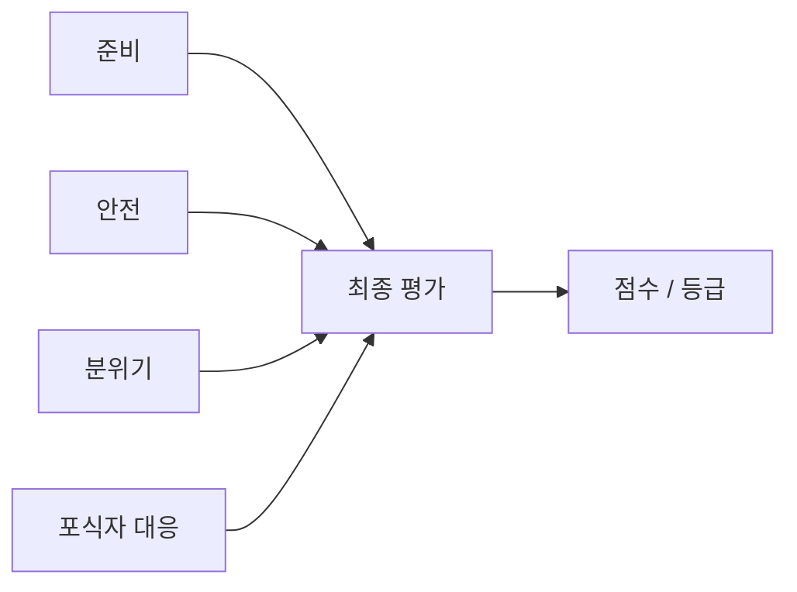

# RESULT_EVALUATION

## PURPOSE

게임 결과의 평가축, 점수 계산과 종료 사유별 보상 기준을 관리합니다.

## SYSTEM_OVERVIEW

GameFlowController가 종료를 요청하면 ResultEvaluationSystem이 집계를 차단하고 Mood의 마지막 시간 구간을 확정합니다. 현재 준비를 재검사하고 실제 잔존 NPC와 확정 대응을 조회해 결과를 GameResult에 보관합니다.

| 입력 상태 | 처리 |
| --- | --- |
| 정상 입력 | 0~100 점수와 등급 계산 |
| 확정 대응 없음 | 대응 축 정상 제외 / 남은 축 가중치 재배분 |
| 필수 상태 입력 누락 | 미정산으로 구분. 0점과 다름 |

준비 평가는 미션 이력이 아닌 현재 유효 상태를 사용합니다. 평가는 신규 발생 중지 후, 전체 월드 정리 전에 확정합니다.

## CURRENT_DECISION

| 평가 요소 | 의미 |
| --- | --- |
| Preparation | 음식 / 장식 / 의상 등 파티 준비 완성도 |
| Safety | 초대 토끼 8마리의 안전 여부 |
| Mood | 손님이 얼마나 즐겁고 편안했는지 |
| Predator Control | 포식자 문제를 얼마나 잘 처리했는지 |

- 준비도가 높아도 정상 토끼를 반복 공격하거나 구금해 분위기를 망치면 좋은 평가를 받을 수 없습니다.
- 모든 포식자를 처리해도 파티 준비를 거의 하지 못하면 높은 평가를 받을 수 없습니다.

## SCORING

| 항목 | 내용 / 조건 |
| --- | --- |
| 결과 확정 / 표시 | 현재 ResultEvaluationSystem이 플레이 중 결과를 집계하고 종료 때 네 축의 가중 점수와 등급을 확정합니다. GameResultView는 결과 요약과 점수 항목별 동적 행을 출력합니다. |
| 결과 확정 / 표시 | 입력 누락에 따른 미정산은 0점과 구분하고 종료 결과는 확정 시점의 데이터를 보관합니다. |
| 정규화 / 튜닝 | 각 축은 0~100으로 정규화한 뒤 가중합하며 실제 가중치와 등급 기준은 플레이 결과로 조정합니다. |
| 이력 / 현재 준비 | 미션 달성 이력과 현재 Preparation을 분리합니다. 완성품 탈취 시 미션 완료는 유지하고 준비 점수는 감소하며 재제작 / 복구로 회복할 수 있습니다. |
| Preparation | Preparation은 음식 / 테이블 세팅 / 장식 등 실제 설정된 목표의 현재 유효 상태를 목표별 상한과 카테고리 가중치로 집계합니다. 같은 PreparationCategoryData SO를 참조하는 목표의 달성률을 평균 낸 뒤 해당 SO의 가중치를 적용합니다. |
| Preparation | Mission 이력은 유지하고 실제 집기 / 이탈 / 소실 때 현재 수량만 낮추며 재정착 때 회복합니다. Anomaly Failed 자체로 영구 감점하지 않고 Recovered도 실제 유효 상태를 확인한 뒤 반영합니다. |
| Preparation | 목표로 설정한 카테고리에 상태 입력이 없으면 미연결로 처리합니다. |
| Mood | Mood는 실제 미션 진행 증가량 1단위당 4~8 범위의 설정값으로 회복합니다. 마지막 미션 진행 이후 일정 시간 동안 추가 진행이 없으면 자연 감소를 시작하고, 미션이 진행되면 그 대기시간을 초기화합니다. |
| Mood | 전체 미션 완료 후에는 미션 진행 없음에 따른 자연 감소를 중지하지만 사건 / NPC 결과 변화는 계속 적용합니다. 별도의 지속 자연 회복은 없습니다. |
| Mood | 사건 Resolved는 유지 또는 소량 증가, Failed는 발생 건별 한 번 감소하며 Recovered / Expired로 같은 실패를 다시 계산하지 않습니다. NPC 구조 / 자력 탈출과 실제 게임 이탈을 구분합니다. |
| Mood | 최종값과 실제 게임 경과 시간 기준의 시간 가중 평균을 함께 평가하고 조기 종료를 반영합니다. |
| Safety | Safety는 종료 잔존 NPC 수 / 시작 NPC 수로 계산하며 포획 중 NPC도 잔존으로 포함합니다. 시작 수 0은 평가 오류입니다. |
| Predator Control | Predator Control은 확정된 대응의 성공 / (성공 + 실패)로 계산합니다. Anomaly Resolved / Failed, NPC 구조 / 자력 탈출 / 납치 완료, 적 고유 대응 결과를 발생 건별로 기록합니다. |
| Predator Control | 같은 사건 결과와 적 알림은 한 번만 반영하고 진행 중 종료는 성공 / 실패 분모에서 제외합니다. 확정 결과가 없으면 발생 없음 / 진행 중 종료 / 취소를 구분해 축을 정상 제외하며 입력 연결 누락은 미정산으로 처리합니다. |
| 종료 집계 순서 | `GameFlowModel.ElapsedTime`을 게임 경과 시간 기준으로 공유합니다. 미션 진행은 필요량 상한을 적용한 실제 증가량만 단계 전환 전에 전달하며 중복 결과의 증가량은 0입니다. |
| 종료 집계 순서 | 평가는 GameFlow 종료 이벤트를 역참조하지 않고 `FinalizeAt(float)`로 종료 시간을 받습니다. |
| 종료 집계 순서 | 집계를 차단한 뒤 Mood.FinalizeAt으로 마지막 구간을 확정하고, Preparation 최종 재검사와 실제 잔존 NPC 조회, 진행 중 대응 제외를 반영해 점수를 확정합니다. Console 로그를 다시 검색하지 않으며 중복 이벤트와 종료 후 집계를 방지합니다. |
| 종료 집계 순서 | 평가 호출 전 미션 입력 차단과 평가 이후 월드 정리는 [GAMEPLAY_CYCLE](GAMEPLAY_CYCLE.md#session)의 종료 순서를 따릅니다. |
| 가중치 / 미정산 | 네 축을 각각 0~100으로 정규화합니다. 정상 제외된 축의 가중치는 남은 축에 재배분하고, 예정된 입력이 누락되면 `GameResult.IsScored`로 미정산을 구분합니다. Mood는 평균과 최종값을 설정 비율로 결합하며 등급 경계는 설정합니다. |
| 가중치 / 미정산 | 정수 점수와 총점의 반올림은 최종 변환 단계에서 일치시킵니다. |
| 중복 평가 | 미션 완료 개수를 점수에 다시 직접 가산하지 않으며 같은 손실이 여러 축에 과도하게 중복 반영되지 않도록 조정합니다. |
| 보상 연결 | 최종 점수 이후 종료 사유를 반영해 보상을 계산합니다. 코인과 반입 아이템 규칙은 [REWARD_ITEM](REWARD_ITEM.md)을 따릅니다. |

## PENDING

- 네 평가축의 가중치, Mood 평균 / 최종값 비율과 결과별 증감량
- PreparationCategoryData와 실제 준비 목표의 Inspector 연결, 목표량 / 유효 상태 검증
- 적 고유 대응별 확정 성공 / 실패 결과 연결
- NPC 손실 / 오인 대응 / 포식자 피해의 반영 비율
- 싱글·멀티 인원수별 보정
- 코인 보상의 최종 수치 조정은 [REWARD_ITEM](REWARD_ITEM.md#pending)을 따름

## UPDATE_RULE

- 평가축 / 계산식 / 가중치 / 결과 판정 / 점수 기반 보상이 변경될 때 갱신합니다.
