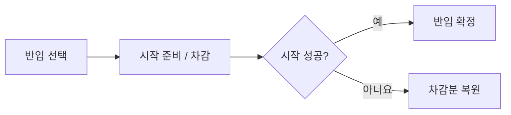

# REWARD_ITEM

## PURPOSE

결과 보상, 로비 구매, 게임 중에만 사용하는 반입 아이템 규칙을 관리합니다.

## SYSTEM_OVERVIEW

### 반입 확정과 복원

선택만으로 수량을 차감하지 않습니다. 시작 확정 후에는 종료 / 이탈해도 반입분을 반환하지 않습니다. SupportItemRunRequest가 반입 확정 / 복원을, PlayScene이 반입 / 효과 / 결과 보상 연결을 담당합니다. 구매 / 보유량과 CoinReward 지급 결과는 SaveManager를 통해 저장합니다.

| 종료 / 지급 조건 | 반입 / 보상 처리 |
| --- | --- |
| 시작 실패 | 미확정 차감분 복원 / 보상 없음 |
| 정상 결과 종료 | 반입 미반환 / 확정 결과와 종료 사유로 보상 계산 |
| 정상 실패 결과 | 실패 결과의 보상 규칙 적용. 중도 종료와 구분 |
| 중도 종료 | 반입 미반환 / 무보상 |
| 미정산 / 지급 대상 아님 | 보상 미지급 |
| 중복 결과 / 잔액 한도 초과 | 추가 지급하지 않음 |

코인은 미지급 결과와 잔액 한도를 검사한 뒤 단회 지급합니다. 결과 화면의 재표시나 카운트 연출은 지급을 다시 요청하는 근거가 아닙니다.

## CURRENT_DECISION

- 최종 점수 계산 후 종료 사유를 반영해 코인을 지급합니다. 실패성 종료도 최소 보상을 지급합니다.
- 코인은 로비에서 다음 게임에 사용할 일회성 아이템을 구매하는 데 사용하며 영구 능력치 성장은 두지 않습니다.
- 한 판에 서포트 아이템을 최대 3개 보유하고 동일 종류 중복 보유를 금지합니다. 해당 판에서만 사용하며 남은 사용 횟수와 관계없이 판 종료 시 소멸합니다.
- 상점에서 즉시 결제하여 종류별 수량을 보관합니다. 한 번 구매 수량은 1~100개, 종류별 누적 보유량은 최대 999개입니다. 미반입 보유분은 재실행 후에도 유지합니다.
- 게임 시작 시 선택한 종류별 1개만 보유량에서 차감합니다. 반입하지 않은 보유분은 판 종료 시 소멸하지 않습니다.
- 아이템 사용 자체로 점수를 감점하지 않으며 아이템 없이도 기본 플레이 / 클리어가 가능해야 합니다.
- 아이템은 이동 / 시간 절약 / 제작 / 운반 / 구조 / 변칙 대응을 보조하되 큰 실패나 위협을 즉시 무효화하지 않습니다.
- 아이템별 상세 기획과 첫 상점 후보는 [SUPPORT_ITEM_CATALOG](SUPPORT_ITEM_CATALOG.md)를 단일 원본으로 사용합니다. 서포트 아이템 반입 개수와 효과로 늘어나는 월드 아이템 동시 보유 개수는 서로 다른 제한입니다.

## REWARD_FLOW

`점수 확정 → GameResult 생성 → 종료 사유 보정 → 코인 지급 → 상점 구매·보관 → 최대 3종 선택·각 1개 차감 → 게임 종료 시 반입분 소멸`

- 현재 싱글 코드의 임시 지급액은 `max(5, 10 + 최종 점수)`입니다. 손님 전원 이탈 시 `10 + 최종 점수`의 50%를 올림한 뒤 최소 5코인을 적용합니다. 시간 만료는 추가 배율 없이 계산합니다. 등급과 미션 완료 수는 별도 가산하지 않습니다.
- 점수가 미정산이거나 결과가 Unscored이면 지급하지 않습니다. 같은 GameResult에는 한 번만 지급하며 로컬 PlayerPrefs 잔액에 저장합니다. 획득액과 지급 후 잔액은 결과 화면 / Console에서 확인합니다.
- 지급 / 구매 / 저장 / 반입 전달은 싱글 로컬 기준입니다. 멀티플레이 소유 권한은 별도 후속입니다.

## SHOP_PLAN

현재 싱글 상점의 동작 계약입니다. 구현 / 사용자 확인 범위는 [DONE](../DONE.md#상점), 남은 작업은 [TODO](../TODO.md#shop_implementation), 미정 정책은 [PENDING_DECISIONS](../PENDING_DECISIONS.md#shop)을 따릅니다.

### 화면 흐름

`타이틀 시작 → 로비 → 게임 시작 버튼 → 아이템 선택 → 선택 완료 → PlayScene 준비 / 반입 차감 → 게임 시작 → 결과 / 보상 → 타이틀 복귀`

- LobbyPanel은 Canvas_Lobby 아래에 있으며 LobbyView가 시작 / 상점 / 홈 / 난이도 입력을 전달하고 TitleScene이 전환을 중재합니다. 타이틀의 설정은 설정 패널을 열고 종료는 게임을 종료합니다.
- 로비는 상점 / 난이도 선택 중 유지하고 홈 복귀 / 게임 시작 때 숨깁니다. 상점 버튼은 상점을 열고 닫으며 다른 화면으로 이동할 때 상점을 닫습니다. 홈은 타이틀로 복귀합니다. 초기 패널 숨김과 상위 Canvas 활성화는 코드에서 준비합니다. 연출 계약은 [UI_PRESENTATION](UI_PRESENTATION.md#common_views), 난이도 확정은 [GAMEPLAY_CYCLE](GAMEPLAY_CYCLE.md#difficulty_implementation_plan)을 따릅니다.
- 게임 시작 버튼은 보유 아이템이 있을 때만 선택창을 표시하고, 없으면 바로 플레이로 진행합니다. 선택 완료 버튼은 0개 선택도 허용합니다. 선택창 닫기는 선택을 취소하고 로비로 돌아갑니다.
- 선택창을 열 때 선택 목록을 초기화합니다. 보유량이 1개 이상인 종류만 표시하고 TryToggle로 선택 / 해제를 처리합니다. 네 번째 종류는 거절합니다.
- 선택 순서를 슬롯 번호로 사용하고 선택 해제 시 뒤 항목을 당깁니다. 플레이 시작 후에는 번호를 유지합니다. 선택 중에는 코인과 보유량을 변경하지 않습니다.
- 구매한 Data만 전달하고 Player.CreateSupportItem은 SupportItemFactory.Create에 효과 생성을 위임합니다. PlayerSupportItems는 생성된 아이템의 보유 / 사용 상태를 관리하며, 효과 코드와 월드 아이템 보유 구조는 유지합니다.

### 스크립트 책임

| 파일 | 책임 |
| --- | --- |
| ShopDataMap.cs | 판매 SupportItemData 목록과 기본 표시 순서. 기존 Id / Cost / 표시 정보를 재사용 |
| ShopModel.cs | TryPurchase로 수량·보유 상한·잔액 확인과 구매 처리 |
| ShopPresenter.cs / ShopView.cs | 상품 슬롯 구성, 구매 입력, 잔액·보유량·안내 갱신 |
| ShopItemSlot.cs | 상품 표시와 수량 입력·슬라이더·버튼 동기화 |
| SliderPopup.cs | 정수 슬라이더 / Min / Max 입력과 기준 위치 추적. 상점 외 재사용 가능 |
| SupportItemInventory.cs | ID별 보유량 조회·증가·반입 차감 |
| SupportItemSave.cs | 코인·보유량의 공통 로컬 저장과 불러오기 |
| SupportItemSelectionModel.cs | 최대 3종 선택·해제와 선택 순서 |
| ItemSelectPresenter.cs / ItemSelectPanel.cs / ItemSelectSlot.cs | 보유 목록 구성, 선택 상태 표시, 완료 요청 |
| SupportItemRunRequest.cs | 이번 반입 목록과 시작·차감·복원 상태. 효과 시간·사용 횟수는 관리하지 않음 |
| TitleScene.cs | 화면 초기화·전환, 시작 요청과 씬 이동 |
| SupportItemFactory.cs | 설정 종류에 맞는 효과 생성과 실행 기능 연결 |
| PlaySupportController.cs | 서포트 설정 / 슬롯 입력 검사, 보유 목록 구성과 Begin / Tick / End, 슬롯 HUD 연결 |

- 상점 / 선택 코드는 `Assets/02. Scripts/Shop/`, 공통 SliderPopup은 `Assets/02. Scripts/09. UI/`, 씬 중재는 `Assets/02. Scripts/01. Scene/`에 둡니다.
- 구매 / 보유 / 선택 / 시작 요청은 UI와 분리합니다. 수량 변경은 ShopItemSlot.SetCount를 공통 경로로 사용합니다. 범용 풀링은 후속입니다.

- Budget.Balance / TryAdd는 공통 저장 모듈을 사용합니다. CoinReward 보상 계산은 유지합니다.
- PlayScene.Awake가 반입 요청을 인수하고 TryBeginGame이 PlaySupportController.Begin을 통한 실행 객체 준비 / 반입 차감 / 시작 확정을 순서대로 중재합니다. CancelStart와 OnDestroy가 미확정 요청을 취소합니다. 서포트 효과 종료는 PlaySupportController.End, PlayerItemHolder 정리는 PlayScene이 담당합니다. _supportTests는 반입 요청이 없는 에디터 직접 실행용이며 정식 빈 목록을 대체하지 않습니다.
- GameResultView에 복귀 요청을 추가하고 GameFlowController를 통해 PlayScene의 씬 이동에 연결합니다. CoinReward의 보상 계산은 유지합니다.
- 상품 이름 / 아이콘 / 가격은 SupportItemData를 사용합니다. 잔액 / 보유량은 구매 또는 저장 갱신 시 반영합니다.

### 구매 / 저장

| 항목 | 내용 / 조건 |
| --- | --- |
| 구매 검사 순서 | TryPurchase는 수량 / 상품 → 총가격 / 잔액 → 보유량 상한 순으로 검사합니다. 성공 시 Presenter가 코인과 보유량을 함께 저장하고, 실패 시 둘 다 유지합니다. 총가격은 long으로 계산합니다. |
| 구매 상한 | UI 구매 상한은 min(100, 999 - 보유량)입니다. 950개 보유 시 결제 전에 최대 49개로 제한하며 가격도 갱신합니다. 모델은 상한을 넘는 요청을 별도로 거절하고 부분 결제하지 않습니다. |
| 저장 창구 | 코인과 보유량을 하나의 저장 데이터로 관리합니다. 새 저장 데이터가 없을 때 기존 CoinWallet의 로컬 잔액을 한 번 가져옵니다. 선택 목록과 시작 요청은 메모리 상태입니다. |
| 판매 목록 검사 | TitleScene에서 판매 목록을 한 번 검증하고 상점과 선택 화면에 전달합니다. 빈 ID / 중복 ID와 종류 / 유효하지 않은 설정 / 0 이하 가격을 거절합니다. 저장 후 ID 변경은 기존 보유 기록과 연결이 끊길 수 있으므로 ID를 고정합니다. |

### 수량 UI

- ShopItemSlot.Init으로 상품을 연결합니다. SetCount가 직접 입력 / ± / 팝업 입력의 공통 변경 경로입니다. 구매 성공한 슬롯만 1개로 초기화하고, 다른 슬롯과 구매 실패 수량은 유지합니다.
- 999개 보유 시 수량 0, 입력 / 증감 / 구매 비활성화와 보유 한도 안내를 적용합니다. 보유 공간이 생기면 갱신 시 다시 입력할 수 있습니다. 편집 중 빈 문자열은 허용하고 편집 완료 시 유효 범위로 확정합니다.
- SetTextWithoutNotify / SetValueWithoutNotify로 양방향 이벤트 재호출을 막습니다. 슬라이더는 wholeNumbers를 사용합니다.
- ShopView 아래에 SliderPopup 프리팹 하나를 생성해 재사용합니다. 입력 필드 상단을 추적하고 마지막 형제로 배치합니다. 다른 슬롯 선택 시 대상을 바꾸며 영역 밖 선택 / 뷰포트 이탈 / 구매 / 상점 종료 시 닫습니다. 별도 Popup Root는 없습니다.
- 팝업 SetRange는 표시 범위를 1~100으로 유지하고 SetLimit은 보유 공간에 따른 선택 상한을 별도로 적용합니다. 상한이 99 이하이면 그 수량에 대응하는 위치에서 멈추며 슬라이더 전체 범위를 축소하지 않습니다. SetValue와 직접 입력 / 최소 / 최대 버튼은 같은 상한을 적용하고 상한이 0이면 팝업을 닫습니다. 잔액 검사는 실제 구매 시 모델이 수행합니다.
- 상품 / 선택 슬롯은 프리팹으로 동적 생성합니다. 선택 슬롯은 보유량 / 선택 순서 / 테두리를 갱신합니다. 정렬은 판매 목록 순서입니다.

### 시작 / 실패 처리

| 항목 | 내용 / 조건 |
| --- | --- |
| 단회 요청 | 시작 요청을 한 번만 인수하고 시작 버튼 연타 / 같은 반입 요청 재사용을 차단합니다. 씬 간 전달 상태를 static으로 구현한다면 Domain Reload 비활성 상태의 초기화도 포함합니다. |
| 차감 / 확정 | 기존 플레이·서포트 준비 이후 선택한 종류별 보유량 1개를 차감·저장하고 GameFlowController.Begin 성공 시 반입을 확정합니다. 시작 시 코인을 다시 결제하지 않습니다. Begin의 시작 알림 중 정상 종료된 경우를 시작 실패로 오인하지 않습니다. |
| 실패 / 복원 | 준비 실패는 미차감, 차감 후 시작 실패는 한 번 복원, 시작 성공 후 종료 / 이탈은 미반환입니다. CancelStart / OnDestroy가 겹쳐도 요청 상태로 중복 복원을 막습니다. 예상하지 못한 예외는 숨기지 않으며 미확정 요청은 OnDestroy 실행 시 복원합니다. |
| 강제 종료 한계 | 차감 직후 앱 강제 종료까지 복구하는 영구 시작 기록은 첫 범위에서 제외합니다. 메모리 요청만으로 해당 복구를 보장하지 않습니다. |
| 테스트 재시작 | R키 재시작은 테스트 경로로 구분하고 이전 반입 요청 재사용 / 재차감을 방지합니다. |

### 설정 / 테스트 지원

- TitleScene에 판매 목록 / 버튼 / Presenter, ShopView에 상품 프리팹 / Content / SliderPopup 프리팹 / Viewport, 선택 패널에 선택 슬롯 프리팹 / Content / 버튼, 결과 화면에 복귀 버튼을 연결합니다. Presenter는 닫히는 UI와 별도로 활성 상태를 유지합니다.
- 씬 이동은 코드의 Play / Title 이름을 사용합니다. 두 씬을 빌드 목록에 등록합니다. 결과 복귀 이벤트는 GameFlowController 비활성화 후에도 유지하고 파괴 시 해제합니다.
- 에디터 전용 코인 설정: TitleScene의 Test Balance 입력 후 컴포넌트 메뉴 `디버그/테스트 코인 적용`. 편집 / 플레이 모드에서 저장 잔액을 지정값으로 덮어쓰며 아이템 보유량은 유지합니다. 자동 적용하지 않고, 플레이 중 상점 수량 입력을 초기화하지 않은 채 잔액을 갱신합니다.
- 사용자 확인은 DONE, 미확인 경계 조건과 후속 UI는 TODO를 따릅니다.

## PENDING

- 기본 보상 / 점수 보상 곡선 / 종료 사유별 배율의 최종 수치 조정
- 구매 정책과 승인 필요 항목은 [PENDING_DECISIONS](../PENDING_DECISIONS.md#shop)에서 관리합니다.
- 아이템별 미정 사항은 [SUPPORT_ITEM_CATALOG](SUPPORT_ITEM_CATALOG.md#7-pending)에서 관리합니다.
- 상점 / 선택 UI와 멀티플레이 구매 / 소유 / 사용 권한

## UPDATE_RULE

- 코인 보상 / 구매 / 반입 / 사용 / 소멸 규칙이 변경될 때 갱신합니다.
