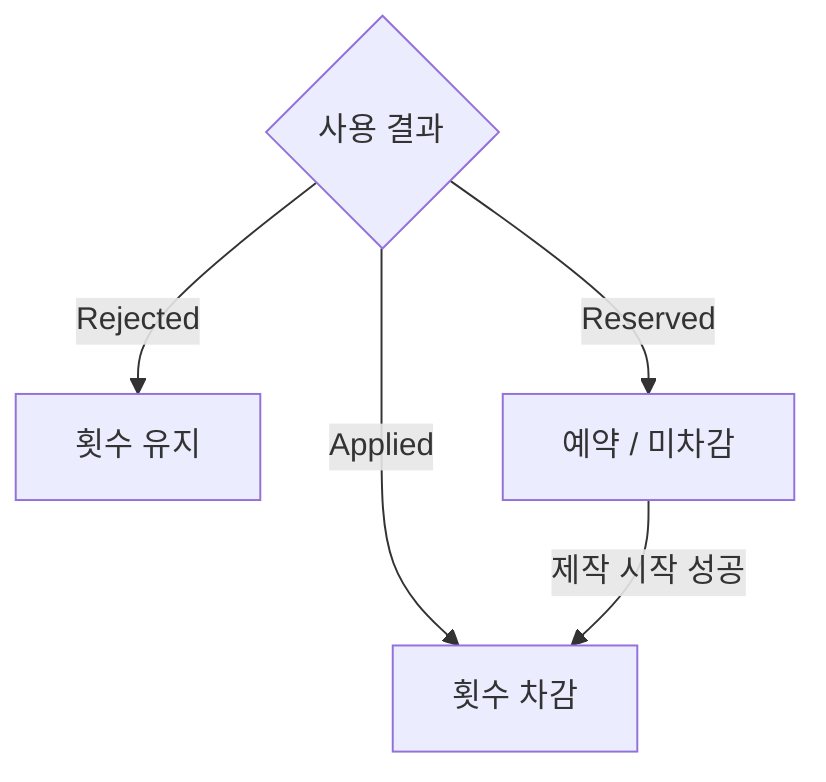

# SUPPORT_ITEM_CATALOG

## PURPOSE

점수 보상으로 획득한 코인으로 구매·보관하고, 판마다 선택하여 반입하는 서포트 아이템의 효과 / 구현 대상 / 후속 후보를 관리합니다. 미반입 보유분은 저장되며 반입분만 한 판에 사용합니다. 공식 영문 코드 용어는 `SupportItem`입니다.

아이템은 플레이어의 핵심 행동을 대신하지 않고 다음 중 하나를 강화합니다.

- 이동 / 운반 효율
- 제작 / 보급 효율
- 구조 / 복구 효율
- 변칙 대응 편의
- 위기 상황 완충

영구 능력치 업그레이드는 현재 범위에 포함하지 않습니다.

---

## SYSTEM_OVERVIEW

| 담당 | 소유 책임 |
| --- | --- |
| SupportItemData / 파생 Data | 표시 / 효과 설정. 실행 상태 제외 |
| SupportItemFactory | 설정으로 실행 상태 생성 |
| PlayerSupportItems | 목록 / 사용 요청 / 전체 종료 |
| SupportItem | 효과 모듈 소유와 사용 연결 |
| SupportItemUseState | 액티브 횟수 |
| ISupportItemEffect 구현 | 효과 시간 / 예약 / 연결 / 복원 |

뒤집개 예약은 시작 실패 시 보존하고 시작 후 중단에는 횟수를 반환하지 않습니다. 효과의 만료 / 제작 종료 / 판 종료에서는 해당 효과가 자신이 적용한 값을 복원하고 예약 / 연결을 정리합니다. 패시브 큰손에는 액티브 횟수 차감을 적용하지 않습니다.

## 1. COMMON_RULE

- 구매 / 반입 / 사용 / 소멸의 공통 계약은 [REWARD_ITEM](REWARD_ITEM.md#current_decision)을 따릅니다.
- 서포트 아이템 최대 3개 반입과 큰손 효과의 월드 아이템 최대 3개 동시 보유는 서로 다른 제한입니다.
- 아래 초기 수치는 확정값이 아닙니다. 사용형 효과의 지속시간 / 사용 횟수 / 배율은 SO 설정이며 상점은 SupportItemData의 Id / Cost를 사용합니다. 큰손은 판 전체 패시브로 사용 횟수 / 지속시간이 없습니다.
- 첫 5종의 구현 / 사용자 확인은 [DONE](../DONE.md#서포트-아이템), 구매 / 반입 확인은 [상점](../DONE.md#상점)을 따릅니다.
- 같은 종류 중복 보유를 금지합니다. 이미 승인된 사용 계약은 아래 RUNTIME_CONTRACT를 따르며 상점 구매 정책과 혼동하지 않습니다.

### RUNTIME_CONTRACT

| 항목 | 내용 / 조건 |
| --- | --- |
| 설정 / 실행 상태 | SupportItemData는 공통 표시 설정, PassiveSupportItemData / ActiveSupportItemData는 패시브 / 사용 횟수 설정을 분리합니다. 실행 상태는 SO에 저장하지 않습니다. |
| 효과 / 목록 수명 | SupportItem은 효과 모듈을 보유합니다. 액티브 횟수는 SupportItemUseState, 효과 시간 / 예약 / 연결은 해당 효과 모듈이 소유하고 PlayerSupportItems는 목록 / 사용 요청 / 전체 종료를 담당합니다. |
| 사용 결과 / 차감 | ISupportItemEffect의 공통 진입점은 Use()입니다. Applied는 횟수를 차감하고 Rejected는 차감하지 않으며 Reserved는 뒤집개 제작 시작 성공까지 차감을 보류합니다. |
| 입력 / HUD | 수동 사용 입력은 슬롯별 Support1 / Support2 / Support3입니다. 포획 / 스턴 / 제작 UI / 일반 상호작용 홀딩 중 차단합니다. 장갑은 슬롯 사용을 거절하고 유효한 NPC 구조 입력에서 자동 사용합니다. |
| 입력 / HUD | 고정 인벤토리 슬롯에 아이콘과 액티브의 남은 횟수를 표시합니다. 빈 슬롯은 유지하며 슬롯 번호는 씬에서 고정 표시합니다. 횟수 소진 후 진행 중인 효과가 없으면 아이콘을 흐리게 표시합니다. 종류 / 이름 / 자동 여부 / 효과 시간 텍스트는 표시하지 않습니다. |
| 이동 속도 | 이동 속도 업은 걷기 / 달리기에 적용하고 효과 중 재사용을 거절합니다. 시간제 효과는 적용 전에 지속시간 / 배율을 검증하고 만료 / 판 종료 시 자신이 적용한 값을 복원합니다. |
| 보급권 | 보급권은 사용 순간 공급원을 수동 조준 조회하고 기존 거리 / 가림 검사를 재사용합니다. CanTake는 검사하지 않습니다. 남은 재보충 시간의 비율을 줄이며 같은 재보충에 반복 사용을 허용합니다. |
| 뒤집개 | 뒤집개는 다음 제작 한 번에 적용하며 해당 제작의 모든 회차에 유지됩니다. Timing은 성공 구간 확대, ClickArea는 클릭 대상 유지시간 증가이며 배율은 별도로 설정합니다. 회차 제한시간과 생성 간격은 유지합니다. |
| 뒤집개 | 시작 성공 시 차감 / 시작 실패 시 예약 보존·미차감 / 시작 후 중단 시 미반환입니다. 예약 / 적용 중 재사용을 거절합니다. |
| 제작 효과 연결 | 제작 시작자와 예약을 PlayerSupportItems / SupportItem에서 연결하며 ProduceRecipePanel의 직접 시작 경로도 포함합니다. ProductionSession은 구체 효과 모듈을 알지 않고 실제 판정과 HUD가 같은 런타임 범위를 읽습니다. |
| 제작 효과 연결 | 판정 범위 복원은 제작 종료 경로, 예약과 구독 정리는 효과 모듈이 담당합니다. |
| 구조용 장갑 | 구조용 장갑은 첫 유효한 F 구조 입력 직전에 자동 발동하여 해당 입력부터 NPC 구조 진행량을 늘립니다. 대상 없음 / 자기 탈출은 미차감이며 효과 중 추가 차감은 없습니다. 만료 후 다음 유효 입력에 남은 횟수를 다시 사용합니다. 구조를 멈춰도 효과 시간은 흐릅니다. |
| 구조용 장갑 | RescueInteracter의 초기화 콜백으로 연결하고 기존 효과 적용 / 차감 함수를 재사용합니다. |
| 시작 / 종료 | PlayScene이 개인 상태 생성과 정상 종료 / 시작 실패 / 씬 해제를 연결합니다. 정식 반입 요청을 우선 사용하며 요청이 없는 에디터 직접 실행에만 테스트 목록을 사용합니다. |

---

## 2. CORE_ITEMS

아래 3종은 첫 상점에 사용할 기본 아이템입니다. 초기 수치와 실제 설정값은 구분합니다.

| 분류 | 상세 | 계약 / 후보 조회 |
| --- | --- | --- |
| 기본 아이템 | [큰손](#21-큰손가칭) / [에너지 드링크](#22-에너지-드링크) / [급속 보급권](#23-급속-보급권) | [현재 사용 계약](#runtime_contract) |
| 첫 상점 후보 | [뒤집개](#31-뒤집개) / [구조용 장갑](#32-구조용-장갑) | [현재 사용 계약](#runtime_contract), 실제 반영 / 확인은 DONE |
| 후속 후보 | [조사 키트](#33-조사-키트) / [파티 간식 세트](#34-파티-간식-세트) / [복구 스티커](#35-복구-스티커) / [비상 수리 키트](#36-비상-수리-키트) / [작업용 카트](#37-작업용-카트) / [비상 호출벨](#38-비상-호출벨) | 채택과 세부 효과는 미정 |

아이템별 초기안은 확정 수치와 구분하며, 발동 / 차감 / 지속 / 복원은 RUNTIME_CONTRACT를 기준으로 확인합니다.

### 2.1 큰손(가칭)

- 판 전체 패시브로 월드 ItemCarry 보유를 기본 1개에서 최대 3개로 늘립니다. 별도 바구니 / Container / 수납 UI와 선택키는 만들지 않으며 서포트 반입 슬롯과 구분합니다.
- PlayerItemHolder가 ItemHolder 계약을 조합합니다. 적 MultiItemHolder의 World 보유 / CapacityCost 계약은 사용하지 않습니다.
- 가장 최근에 집은 물건 하나가 배치 / 투척 / 전달 / 폐기의 활성 대상입니다. 해제 / 소비 / 비활성화 시 직전 보유 물건으로 전환합니다.
- 기존 Hold Point 아래 생성한 런타임 지점에 실제 표시 Bounds로 간격을 계산합니다. Hold Point / Hold Gap은 Player 설정이며 PlayScene이 생성 / 종료를 연결합니다. 별도 보유 View는 만들지 않습니다.
- 실제 집기 가능한 물건을 대상으로 하며 제외 데이터는 필요가 확인된 뒤 추가합니다. 가칭과 가격은 미정, 구현 우선도는 A입니다. 기본 보유와 기존 행동의 호환성 확인은 TODO를 따릅니다.

### 2.2 에너지 드링크

- 걷기 / 달리기에 런타임 속도 배율을 적용합니다. 점프 / 중력 / 포획 물리는 유지하고 기존 이동 설정을 덮어쓰지 않습니다.
- 효과 중 재사용은 거절하며 만료 / 판 종료 시 정상 배율로 복원합니다.
- 초기 테스트 제안: 속도 +20~25%, 8~10초, 3회. 확정 수치가 아니며 SO에서 조정합니다. 구현 우선도 A, 긴급 구조 / 재료 수급 / 방 이동에 사용합니다.

### 2.3 급속 보급권

- 재고 0으로 시작된 재보충에 사용합니다. 입력 순간 조준한 공급원의 남은 시간을 비율로 줄이고 게이지에 즉시 반영합니다. 외부 재료 소비 여부를 기다리지 않습니다.
- 초기 제안은 판당 1~2회, 남은 시간 30~50% 감소이며 확정값이 아닙니다. 구현 우선도 A입니다.
- 재고가 남아 있으면 재보충을 강제하지 않습니다. 수량 직접 증가 / 새 재료 즉시 생성 없이 기존 완료 순서를 유지하며 최대 재고와 월드 객체 수를 구분합니다. [전체 재고 계약](PARTY_PREPARATION.md#ingredient_refill)을 따릅니다.

## 3. PROPOSED_ITEMS

뒤집개 / 구조용 장갑은 첫 상점 후보이며, 나머지는 후속 후보입니다.
효과의 구현 / 사용자 확인은 [DONE](../DONE.md#서포트-아이템), 남은 검증은 [TODO](../TODO.md#shop_implementation)를 따릅니다. 나머지 후보의 채택과 세부 효과는 미정입니다.

### 3.1 뒤집개

- 다음 제작 한 번의 모든 회차에 적용합니다. Timing 성공 구간과 ClickArea 목표 유지시간을 늘리며 실제 판정과 HUD를 일치시킵니다.
- 제작 시작 성공 시 예약을 소비하고 횟수를 차감합니다. 시작 실패는 예약 보존 / 미차감, 이후 중단은 미반환입니다. 제작 종료 시 기본값에 대한 배율과 표시 범위를 복원해 누적 증가를 막습니다.
- 잘못된 Recipe를 교정하거나 자동 성공시키지 않습니다. 회차 제한시간이 먼저 끝나면 실패합니다.
- 초기 제안: 구간 약 20~25% 확대, 판당 2회. 구현 우선도 A이며 확정 설정과 구분합니다. 세부 예약 / 입력 계약은 [RUNTIME_CONTRACT](#runtime_contract)를 따릅니다.

### 3.2 구조용 장갑

- 첫 유효한 F 구조 입력 직전에 자동 발동 / 1회 차감하고 해당 입력부터 NPC 구조 진행량을 늘립니다. NPC 즉시 구조나 포식자 강제 퇴장은 수행하지 않습니다.
- 플레이어 자기 탈출은 대상이 아닙니다. Capturable의 전체 목표 / 감소 속도는 유지하고 효과 소유자의 입력량만 늘립니다.
- 초기 제안: 속도 +25~30%, 약 10초, 판당 2회. 구현 우선도 B이며 확정 설정과 구분합니다. 만료 / 재사용은 [RUNTIME_CONTRACT](#runtime_contract)를 따릅니다.

### 3.3 조사 키트

- 후속 후보: 다음 N회의 Investigate 홀딩 시간을 줄입니다. 초기 제안은 조사 시간 30% 감소 / 3회, 우선도 B입니다.
- 흔들리는 자루 / 수상한 가구 / 후속 조사 변칙과 변장 적 조사에 활용할 수 있습니다. 정답이나 정상 / 변칙 여부를 자동 판별하지 않습니다.

### 3.4 파티 간식 세트

- 후속 후보: 파티룸에서 일정 시간 주변 NPC Mood를 소량 회복합니다. 초기 제안은 판당 1회이며 큰 즉시 회복보다 시간에 걸친 회복을 우선합니다. 우선도 B입니다.
- 정상 NPC 오대응 / 장기 방치 손실을 완전히 상쇄하거나 Mood 관리를 대체하지 않습니다. Safety / Preparation은 복구하지 않습니다.

### 3.5 복구 스티커

- 후속 후보: 지정한 대상의 정상 Placement 위치 / 배치 표면에 일정 시간 가이드를 표시합니다. 초기 제안은 판당 2~3회, 우선도 B입니다.
- 이동 / 낙하 물건을 플레이어가 직접 집고 배치하도록 보조하며 자동 복구하지 않습니다.

### 3.6 비상 수리 키트

- 후속 후보: 손상 시설 / 장식의 Integrity를 일부 복구합니다. 초기 제안은 판당 1회 / 비율 복구이며 우선도 C입니다. Damage / Integrity 구현 후 채택과 수치를 결정합니다.
- NPC 손실 / Preparation 전체를 복구하거나 포식자의 결과를 취소하지 않습니다.

### 3.7 작업용 카트

- 후속 후보: 여러 물건을 적재한 카트를 밀어 이동합니다. 큰손보다 느리지만 적재량이 많고 통로 / 방향 전환 제약을 둡니다. 우선도 C입니다.
- 큰손은 개인 보유 확장, 카트는 실제 운반 도구입니다. 역할이 지나치게 겹치면 제외합니다.

### 3.8 비상 호출벨

- 후속 후보: 일정 시간 현재 구조 가능한 NPC 또는 미해결 중요 사건의 방 위치를 표시합니다. 우선도 C이며 세부 효과 / 수치는 미정입니다.
- 자동 이동 / 사건 해결을 수행하거나 포식자 위치를 상시 공개하지 않습니다.

## 4. INITIAL_ITEM_POOL

첫 상점은 큰손 / 에너지 드링크 / 급속 보급권 / 뒤집개 / 구조용 장갑의 5종입니다. 운반 / 이동 / 보급 / 제작 / 구조를 각각 보조합니다. 구현과 구매 / 반입 / 실행 확인의 완료 범위는 [DONE](../DONE.md#서포트-아이템)을 따릅니다. 나머지 항목은 후속 후보입니다.

## 5. LOADOUT_EXAMPLES

최대 3개 반입을 활용한 조합 예시이며 권장안을 확정하지 않습니다.

| 방향 | 조합 |
| --- | --- |
| 제작 | 큰손 / 급속 보급권 / 뒤집개 |
| 기동 / 구조 | 에너지 드링크 / 구조용 장갑 / 조사 키트 |
| 피해 후 복구 | 파티 간식 세트 / 복구 스티커 / 비상 수리 키트 |

후속 후보를 포함한 예시는 현재 사용 가능한 조합과 구분합니다. 가격 / 효율을 조정해 하나의 조합이 항상 우월하지 않게 합니다.

## 6. DESIGN_RULE

좋은 아이템:

- 사용형은 사용 시점, 패시브는 반입 조합을 플레이어가 판단함
- 기존 행동을 빠르게 / 편하게 만듦
- 한 판에서 특정 역할이나 플레이 스타일을 강화함
- 다른 아이템과 선택 경쟁이 생김

피해야 할 아이템:

- 포식자 즉시 제거
- NPC 납치 결과 취소
- 모든 Preparation 즉시 완전 복구
- 변칙 자동 해결
- 제작 자동 성공
- 매 판 반드시 구매해야 하는 필수 성능
- 다른 아이템보다 모든 상황에서 우월한 범용 아이템

---

## 7. PENDING

- 첫 5종 외 후속 후보의 실제 채택
- 각 아이템 이름의 최종 명칭
- 가격
- 상점 구매·보관 / 반입 선택 계획은 [REWARD_ITEM](REWARD_ITEM.md#shop_plan), 남은 미정 사항은 [PENDING_DECISIONS](../PENDING_DECISIONS.md#shop)에서 관리합니다. 종류별 창고 수량과 판 안의 동일 종류 중복 반입 금지를 구분합니다.
- 사용형 효과의 지속시간 / 횟수 / 배율과 검증용 임시값
- 큰손의 기존 집기 / 배치 / 전달 / 폐기 / 투척 호환성 검증과 실제 제외 필요 여부
- 급속 보급권 / 뒤집개 / 구조용 장갑의 실제 사용과 실패 / 종료 경로 플레이 검증
- Mood 아이템의 실제 회복 규칙
- Integrity 구현 이후 수리 키트 채택 여부
- 멀티플레이에서 개인 아이템 / 공동 아이템 처리 방식

---

## UPDATE_RULE

- 상점 아이템 종류 / 효과 / 반입 규칙 / 사용 규칙이 확정 또는 변경될 때 갱신합니다.
- 가격과 효과 수치는 실제 플레이테스트 결과를 기준으로 조정합니다.
