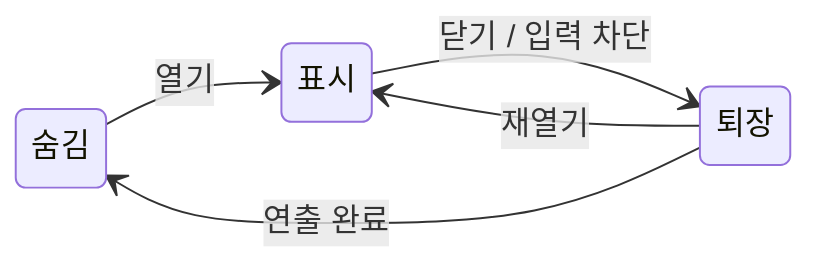

# UI_PRESENTATION

## PURPOSE

UI, 화면과 캐릭터 표시 연출의 기능 계약입니다. 구현 / 사용자 확인은 [DONE](../DONE.md#플레이-ui-연출), 남은 작업은 [TODO](../TODO.md#presentation_and_audio), 오디오는 [AUDIO](AUDIO.md)를 따릅니다.

## SYSTEM_OVERVIEW

### 패널의 표시 수명

닫기 요청에서 논리 상태와 입력을 먼저 닫고, 시각 퇴장 완료 뒤 비활성화합니다. 재열기는 이전 Tween / 완료 요청을 취소하고 표시로 돌아갑니다. 강제 종료 / 비활성화는 즉시 숨기며 소유 Tween을 정리하고 기준 표시값을 복원합니다.

기능 중재자는 확정 상태 / 결과를 HUD와 Panel에 전달하고, UI 입력은 실행 요청으로 돌려줍니다. PanelEffect / TextEffect / GaugeEffect는 자신의 Tween과 기준값만 관리하며 판정 / 소비 / 보상을 소유하지 않습니다. 실제 구매 / 제작 / 씬 이동은 Tween 완료를 기다리지 않습니다.

미션 모델의 단계 전환과 게임 알림은 즉시 처리하고, 이전 완료 표시는 잠시 유지할 수 있습니다. 유지 중 최신 표시 요청을 보관했다가 표시하며 숨김 / 비활성화에서는 대기 요청을 취소합니다. 다음 단계 행동 인정은 완료 연출과 독립적입니다. 결과 화면도 확정 GameResult와 지급 결과를 표시하며 카운트 연출로 보상을 지급하지 않습니다.

## CONFIRMED_SCOPE

- 장소 안내는 Player의 방 변경 이벤트를 PlayScene / GameFlowController를 통해 GameFlowHud에 전달합니다. 시작 / 숨김 시 초기화하고 장소 표시 후 3초 뒤 숨깁니다.

- 패널 / 버튼은 DOTween 공용 연출 View를 부착해 재사용합니다. 패널은 enum으로 효과를 선택합니다.
- 제작 성공 강조 / 실패 결과 텍스트 기울임, 흔들림과 사라짐 / 미션별 완료 강조 / 상점 반응 / Final Rush 최초 등장 후 점멸 / 결과 순차 표시를 진행합니다.
- 구조 / 탈출 안내는 키보드 키 이미지가 빠르게 눌렸다 돌아오는 반복 표현입니다. 안내 텍스트는 확인 후 사용자 삭제 예정이며 별도 연출하지 않습니다. 레시피 가이드는 연출 없이 표시합니다.
- 구조와 제작의 진행 게이지에 DOTween 표시 연출을 적용합니다. 판정에 쓰는 실제 진행률과 시각 보간값을 분리합니다.
- NPC / 플레이어 포획 중 버둥거림, 플레이어 스턴 중 옆으로 쓰러짐과 시야 90도 기울임, 포획 / 스턴 화면 점멸을 포함합니다. 애니메이션과 제작 성공 파티클은 담당 컴포넌트의 Inspector 참조를 사용합니다.
- 씬 / 프리팹 / Animator 구성은 Unity에서 연결합니다. YAML / .meta를 직접 편집하지 않습니다.

## COMMON_VIEWS

| 공용 View | 주요 API | 책임 |
| --- | --- | --- |
| PanelEffect | OnEnable / SetVisible / Show / Hide / SetVisibleImmediate / StopEffect | 자동 등장 / 퇴장, 입력 차단, 퇴장 완료 후 비활성화 |
| ButtonEffect | Pointer / Select 이벤트, PlayClick / ResetEffect | 진입 / 선택 / 누름 / 클릭 반동 |
| TextEffect | OnEnable / PlayEmphasis / PlayFailure / StartBlink / StopEffect / ResetEffect | 활성화 시 자동 강조 / 실패 / 점멸, None으로 자동 재생 제외 |
| KeyPromptEffect | SetVisible / StopEffect / ResetEffect | 키 이미지 눌림 반복 |
| GaugeEffect | SetProgress / SetProgressImmediate / ResetEffect | 시각 진행률 보간과 완료 반응 |

- 각 View는 자기 Tween과 기준 위치 / 회전 / 크기 / 알파를 소유합니다. 범용 연출 매니저 / 상속 계층은 선행 제작하지 않습니다. 실제 중복만 작은 공용 함수로 추출합니다.
- 패널은 부착 후 활성화 시 OnEnable에서 자동 등장합니다. 퇴장은 공용 SetVisible의 숨김 요청으로 실행하며 완료 후 비활성화합니다. 직접 SetActive(false)는 퇴장 없이 꺼집니다. 초기 숨김 / 강제 종료는 즉시 표시 경로를 사용합니다.
- 버튼은 부착된 ButtonEffect가 입력에 자동 반응합니다. 실행 중 자동 부착하지 않으며 씬 버튼 / 슬롯 프리팹은 기존 UI 연출 도구로 구성합니다. 기능 View는 표시 요청과 입력을 담당하고 연출 설정 / Tween 수명은 연출 View가 소유합니다.
- 텍스트는 활성화 시 설정한 연출을 자동 재생하며 기본값은 강조입니다. 비활성화 시 표시를 복구하고 미리보기에도 같은 종류를 사용합니다. 내용 변경만으로 재생하지 않으며 실패 미리보기는 완료 이벤트를 호출하지 않습니다.
- 반복 요청은 상태가 바뀐 경우에만 처리합니다. 연출 도중 새 요청은 자기 Tween을 중단하고 현재 표시값에서 이어갑니다. 완료 콜백은 이전 요청이 새 표시를 닫지 않도록 요청 수명을 확인합니다.
- 비활성 / 파괴 / 씬 종료와 재사용 시 자기 Tween을 중단하고 표시값을 복구합니다. 전역 KillAll로 다른 기능의 Tween을 중단하지 않습니다.
- UI는 unscaled time을 사용합니다. Sequence의 시간 설정 / 객체 연결은 최상위에 적용합니다. 캐릭터 / 월드 연출은 게임 진행 시간과 종료 정책을 따릅니다.
- LayoutGroup이 배치하는 루트 아래 별도 시각 Transform을 연출합니다. 버튼 클릭 영역과 시각 확대 대상을 분리합니다.
- 표시 / 입력 / 활성 상태를 구분합니다. 등장 중 입력 허용 시점은 패널 역할에 맞춰 정하고 퇴장 요청 즉시 입력을 차단합니다.

## PANEL_EFFECT_TYPES

PanelEffectType은 None / Slide / Fade / SlideFade / Pop / ZoomFade를 구분합니다. 등장 / 퇴장 종류를 각각 선택하며 Flip은 미정 표현 후보입니다.

| 종류 | 표현 | 사용 제안 |
| --- | --- | --- |
| None | 즉시 표시 / 숨김 | 연출 제외 UI |
| Slide | 방향별 이동, 슥-쇽 | 상점 / 선택 / 설정 |
| Fade | 알파 변화, 스륵 | 안내 / 배경 덮개 |
| SlideFade | 짧은 이동과 페이드 | 작은 팝업 / 알림 |
| Pop | 작은 크기에서 반동 확대, 뿅 | 확인 팝업 / 보상 |
| ZoomFade | 완만한 크기 변화와 페이드 | 결과 / 큰 화면 |
| Flip | 축 회전으로 펼침 | 선택적 카드형 화면 |

- 방향 / 거리 / 시간 / Ease / 배율은 Inspector 설정입니다. Flip은 Canvas와 가독성 확인 후 선택적으로 적용하며 초기 필수 범위가 아닙니다.
- 논리적인 닫힘은 즉시 반영하고 시각 퇴장만 완료 후 비활성화합니다. 저장 / 구매 / 제작 / 씬 이동을 Tween 완료에 종속시키지 않습니다. 강제 종료는 즉시 숨김 경로를 사용합니다.
- 패널 연출은 각 화면의 논리 표시 상태와 퇴장 수명을 따릅니다. 화면별 연결 작업은 [TODO](../TODO.md#presentation_and_audio)에서 관리합니다.
- ProduceHud.IsRecipeOpen과 OnUiVisibleChanged는 activeSelf 대신 논리 표시 상태를 기준으로 정리합니다. PlayInputController의 커서 / 이동 / 레시피 분기와 RecipeInputController의 대상 수명을 함께 확인합니다.

## BUTTON_KEY_AND_GAUGE

| 항목 | 내용 / 조건 |
| --- | --- |
| 버튼 입력 | ButtonEffect는 기존 Button 행동을 유지하며 마우스 진입 / 키보드 선택 확대, 눌림 축소, 정상 클릭 반동을 적용합니다. interactable / 부모 CanvasGroup 입력 제한을 반영하고 비활성 버튼의 반응을 차단합니다. |
| 클릭 / 기준 복구 | 닫기 클릭 반동은 패널 퇴장과 겹쳐 표시할 수 있으나 기능 실행을 늦추지 않습니다. 버튼 연타 / 누른 채 이탈 / 선택 전환 시 기준 크기를 복구합니다. |
| 구조 키 | PlayerHud.SetRescueHud는 키 이미지 연출만 연결하며 구조 진행 중 매 프레임 반복 시작하지 않습니다. 안내 텍스트는 별도 효과 대상에서 제외합니다. |
| 게이지 | GaugeEffect는 구조와 제작의 표시값만 보간합니다. 구조 감소도 반영하고 새 시도 / 대상 전환은 즉시 초기화합니다. 고빈도 갱신은 표시 목표값을 갱신하고 Tween / Sequence를 매 프레임 중첩 생성하지 않습니다. |
| 미니게임 판정 보존 | ProduceMinigamePanel의 타이밍 바 / 성공 구간 / 클릭 대상 등 판정 좌표는 그대로 유지합니다. 입력 타이밍을 나타내는 바를 지연 보간하지 않으며 별도 진행 게이지 / 테두리 / 완료 반응에 연출합니다. |

## ACTION_AND_RECIPE_GUIDE

| 항목 | 내용 / 조건 |
| --- | --- |
| 행동명 | PlayInputController는 조준 시 가능한 행동을 PlayerHud.SetActionName으로 전달합니다. PlayerHud는 [E] 접두어를 붙이고 불가능한 행동은 숨깁니다. 홀딩 중에는 시작 행동명을 유지하며 게이지와 행동명을 별도로 갱신합니다. 취소 / 상태 제한 / UI 전환에서 정리합니다. 종료 시 HUD가 먼저 파괴됐으면 표시 호출을 생략하고 입력 정리를 계속합니다. |
| 레시피 위치 | PlayerHud.SetRecipeGuide는 CookController 또는 null을 전달합니다. RecipeGuide는 GuidePoint를 카메라의 화면 좌표로 변환한 뒤 Screen Space Overlay Canvas의 전용 Position Root에 적용합니다. BillboardUI는 사용하지 않으며 자식 키 이미지의 연출 Transform과 위치 루트를 분리합니다. |
| 표시 조건 | F로 레시피를 열 수 있는 조준 대상에 표시합니다. 구조 안내를 우선하고 제작 화면 / 거리 이탈 / 대상 무효화 / 스턴 / 포획에서 숨깁니다. 실행과 안내는 같은 대상 판정을 사용합니다. |
| 레시피 문구 | F 키 이미지 옆에 레시피 확인을 표시하고 텍스트에는 F를 반복하지 않습니다. 실제 입력 바인딩은 유지합니다. 화면 밖 / 카메라 뒤 대상은 숨깁니다. |
| 대상 강조 | RecipeGuide와 독립적으로 InteractionHighlight가 조준 대상의 Renderer를 수집합니다. 직접 지정한 TargetHighlight / CookController.Highlight를 우선하며 없으면 비활성 자식을 포함해 MeshRenderer / SkinnedMeshRenderer를 수집하고 다른 ItemCarry 소유 자식과 파티클을 제외합니다. 구성 변경 시 명시적으로 갱신합니다. |
| 렌더링 경계 | Linework의 Rendering Layer 필터와 오브젝트 Layer Mask를 함께 사용합니다. InteractionOutline 비트만 추가 / 복구해 다른 비트 변경을 보존합니다. 공급원처럼 Default 레이어의 Renderer도 실제 카메라 렌더러의 Layer Mask에 포함해야 합니다. 수동 지정 시 Renderer 배열에는 원하는 시각 대상만 넣습니다. |

## PRODUCTION_AND_MISSION

| 항목 | 내용 / 조건 |
| --- | --- |
| 제작 결과 | ProduceHud.HandleMinigameResult에서 중간 성공 / 최종 완성 / 실패를 구분해 TextEffect를 요청합니다. 실패는 기울임 → 짧은 흔들림 → 페이드 순서입니다. |
| 제작 성공 파티클 | CookController는 활성 제작 대상의 완료 알림에서 ProductionEffect.PlaySuccess를 요청합니다. 이전 효과를 정리한 뒤 재생하며 HUD 표시와 독립적입니다. 해제 / 비활성화 / 내용물 정리에서는 StopEffect로 잔여 파티클을 제거합니다. |
| 알림 종료 수명 | ProduceHud는 안내 유지 시간과 실패 연출 완료를 함께 확인해 FinishNotification에서 종료합니다. 새 알림 / Open / Close / Unbind / 비활성화에서 이전 요청을 취소합니다. |
| 알림 종료 수명 | 재료 소비 / 결과 생성은 기존 순서를 유지합니다. |
| 미션 표시 | GameFlowHud는 GameProgressView / MissionView / GameLogView를 연결합니다. MissionView가 목표 목록을 관리하고 MissionGoalView가 목표별 이름 / 수량 / 최초 완료 강조를 담당합니다. |
| 미션 데이터 연결 | GameFlowController.RefreshMission은 MissionGoalDisplayData 목록을 전달합니다. TryAddMission은 반영 전 단계와 목표 진행을 비교해 최초 완료 연출을 요청하며 OnMissionProgressed / OnMissionChanged 계약을 유지합니다. |
| 완료 표시 수명 | MissionView는 완료된 단계 표시를 잠시 유지하고 최신 표시 요청을 보관합니다. 재사용 목록은 별도 배열에 복사하며 숨김 / 비활성화에서 대기 요청을 취소합니다. 전체 완료 안내의 실제 표시 시 OnCompleted를 전달합니다. |
| 마지막 항목 / 단계 전환 | 완료 수량을 최초 충족할 때 해당 항목을 강조합니다. 마지막 항목 완료 직후 다음 단계로 전환되는 규칙은 유지하며 이전 항목의 연출 표시만 잠시 보존합니다. 연출 때문에 다음 단계 행동 인정을 늦추지 않습니다. |
| 구매 결과 | ShopPresenter는 실제 구매 결과를 ShopView.PlayPurchaseResult에 전달합니다. 성공은 잔액 / 안내와 해당 ShopItemSlot의 상품 / 보유량을 강조하고 실패는 안내 실패 연출을 적용합니다. 이전 구매 연출은 재요청 / 상점 활성화 / 비활성화에서 정리합니다. |

## FINAL_RUSH_AND_RESULT

| 항목 | 내용 / 조건 |
| --- | --- |
| Final Rush | GameFlowHud는 GameProgressView에 안내 표시를 전달합니다. 연출 계약은 최초 진입 강조와 낮은 강도의 점멸이며 반복 요청으로 재등장하지 않고 Hide / 초기화 / 게임 종료에서 중단합니다. 진입 효과음은 GameFlowSound가 상태 알림으로 처리합니다. |
| 결과 / 보상 표시 | GameResultView.ShowResult는 결과 패널 → 평가 항목 → 등급 / 결과 → 보상 순차 표시를 적용합니다. ShowReward는 실제 지급 결과를 표시하고 카운트 연출이 지급을 수행하지 않습니다. |
| 스냅샷 / 종료 정리 | 점수와 보상은 확정된 스냅샷을 사용합니다. timeScale 0에서도 진행하고 다시 열기 / 복귀 / 씬 종료 시 이전 Sequence를 정리합니다. |

## CAPTURE_STUN_AND_ANIMATION

| 항목 | 내용 / 조건 |
| --- | --- |
| 상태 중재 | PlayScene은 Player.OnCaptureChanged / OnStunChanged를 구독하고 ScreenEffect.SetState, CameraEffect.SetStunned, StunEffect.SetStunned / ResetEffect, CaptureEffect.SetCaptured에 상태를 전달합니다. PlayInputController는 입력 제한과 시점 잠금을 담당합니다. |
| 초기화 / 종료 | 상태 전달 전에 각 연출의 Init을 호출합니다. 종료에서는 먼저 상태 구독을 해제하고 ResetEffect로 기본 표시를 복구합니다. 각 연출의 비활성화 / 파괴에서도 정리합니다. |
| 화면 중첩 | ScreenEffect는 포획 / 스턴을 별도로 보관하고 스턴을 우선 표시합니다. 스턴 해제 후 포획이 남아 있으면 포획 효과로 복귀합니다. NPC 포획 화면 경고의 대상 / 지속시간은 미정입니다. |
| 화면 점멸 | ScreenEffect는 전용 Volume의 실행용 프로필을 생성해 Vignette 색상 / 강도를 전환하고 반복 변화시킵니다. 원본 프로필은 유지하며 해제 시 기본값과 적용 여부를 복구하고 파괴 시 생성한 프로필을 정리합니다. |
| 스턴 시점 / 모델 | CameraEffect는 CameraFocus 아래 별도 카메라 피벗을 기울이고 Cinemachine은 해당 피벗을 추적합니다. StunEffect는 별도 시각 피벗의 회전과 위치를 보정합니다. 포획 중 모델 넘어짐은 즉시 복구하고 해제 후 스턴이 남으면 다시 적용하며 화면 / 카메라의 스턴 표시는 유지합니다. |
| 납치 자세 | CaptureEffect.Init은 기본 자세를 저장하고 SetCaptured는 납치 위치 / 회전을 즉시 적용하며 ResetEffect는 기본 자세를 복구합니다. 플레이어는 PlayScene, NPC는 Npc의 포획 성공 / 종료 경로에서 연결합니다. 실패한 포획은 자세를 적용하지 않습니다. |
| 피벗 계층 | 납치 자세 피벗 아래 스턴 자세 피벗, 그 아래 시각 모델 / Animator를 배치합니다. NPC는 스턴 피벗 없이 구성할 수 있습니다. 이동 루트 / 충돌체 / 기능용 보유 지점은 연출 계층 밖에 두고 애니메이터가 연출 피벗을 동시에 회전시키지 않습니다. |
| 카메라 충돌 경계 | CameraFocus.LateUpdate / ApplyCaptureYaw는 Z=0을 적용하므로 같은 Transform의 회전 Tween은 충돌합니다. 카메라 피벗 / 모델 / 포획 따라가기 계층을 확인한 뒤 연결하고 기존 이상 시점의 원인은 별도 재현으로 확인합니다. |
| NPC / 플레이어 애니메이션 | 공용 AnimatorHandler.SetCaptured(bool)와 IsCaptured Bool은 포획 성공 / 해제 상태를 나타냅니다. 납치자의 Kidnap 운반 상태와 구분하며 스턴 모델 / 시점 표현도 포획 상태와 구분합니다. |
| NPC / 플레이어 애니메이션 | NPC의 기존 상태 / 포획 이벤트와 플레이어 상태 이벤트를 이용합니다. 필요 없는 NPC 중재 계층은 추가하지 않습니다. |
| 에셋 / 복구 | Animator 클립 / 파라미터는 에셋 확보 후 연결합니다. Root Motion으로 포획 위치 / 이동 판정을 바꾸지 않는 방향을 권장합니다. 해제 / 취소 / 반복 포획 / 리스폰 / 종료에서 표시를 복구합니다. |

## ANIMATOR_HANDLER_PLAN

- AnimatorHandler는 공통 이동 표시를, PlayerAnimatorHandler / AttackAnimatorHandler / NpcAnimatorHandler는 전용 파라미터를 적용합니다. 이동 / 공격 / 포획 판정은 기존 기능이 결정하며 실제 행동 지점에서 해당 핸들러를 호출합니다.
- 이번 범위는 전 캐릭터 이동, 플레이어 점프, 요구 적 / 공격 적 공격, 피포획 토끼의 버둥거림과 납치 자세입니다. Mixamo의 걷기 / 점프 / 공격 / 버둥거리기 클립을 사용하는 방향입니다. 제작 애니메이션은 현재 싱글 범위에서 제외하고 요구 적 먹기는 파티클로 표현합니다.
- 납치는 기존 포획 따라가기와 CaptureEffect의 별도 시각 피벗 보정을 사용하고 토끼의 다리 기준을 적 홀드 포인트에 맞춥니다. 위치 / 회전 보정값은 실제 모델과 클립에 맞춰 설정하며 해제 시 기본 로컬 자세로 복구합니다. 이동 루트 / 충돌체는 회전시키지 않습니다. 별도 납치 클립은 필수로 두지 않습니다.
- 코드 반영 / 사용자 확인은 [DONE](../DONE.md#애니메이터-연결), 남은 작업은 [TODO](../TODO.md#presentation_and_audio)에서 관리합니다. Animator Controller / 클립 / Inspector 연결과 Unity 실행 확인은 코드 구현과 구분합니다.

### PARAMETERS_AND_FUNCTIONS

| 파라미터 | 타입 | 함수 | 적용 의미 |
| --- | --- | --- | --- |
| MoveSpeed | Float | SetMoveSpeed(float speed) | 실제 수평 이동 속력 |
| Jump | Trigger | PlayJump() | 실제 점프 시작 |
| Attack | Trigger | PlayAttack() | 한 차례 공격 동작 시작 |
| IsCaptured | Bool | SetCaptured(bool isCaptured) | 포획된 NPC / 플레이어의 버둥거림 상태 |

- Animator는 Inspector 참조로 연결하며 모델 자식의 Animator도 사용할 수 있게 합니다. 적 5종 / NPC는 중재에서 이동 모듈과 핸들러를 직접 연결하고 이동 초기화 때 핸들러를 전달합니다. 이동 모듈에 핸들러를 중복 할당하지 않습니다. 플레이어 Mover는 기존 직접 연결을 유지합니다. 파라미터 이름은 `static int _attackId = Animator.StringToHash( "Attack" );` 형식으로 한 곳에 선언하고 적용 / 초기화 모두 ID를 사용합니다.
- SetMoveSpeed는 0 이상의 속력을 SetFloat로 즉시 적용합니다. 감쇠 시간은 에셋 연결 후 전환을 확인해 추가 여부를 결정합니다. PlayJump / PlayAttack은 해당 ID의 SetTrigger, SetCaptured는 SetBool을 호출합니다. Trigger는 행동 시작마다 한 번만 요청합니다.
- AnimatorHandler는 MoveSpeed만 초기화합니다. PlayerAnimatorHandler는 MoveSpeed / Jump / IsCaptured, AttackAnimatorHandler는 MoveSpeed / Attack, NpcAnimatorHandler는 MoveSpeed / IsCaptured를 초기화합니다. 각 Controller에는 사용하는 Handler의 파라미터만 구성하고 사용하지 않는 Kidnap은 요구하지 않습니다.
- AnimatorHandler.CanApplyAnimation은 참조 존재 / Animator 활성 / runtimeAnimatorController 연결을 검사합니다. SetMoveSpeed / 기본 ResetAnimation과 PlayerAnimatorHandler의 PlayJump / SetCaptured / ResetAnimation에 적용했습니다. 공격 / NPC 전용 함수의 기존 null 검사까지 공통 검사로 변경한 것은 아닙니다.
- 플레이어 시각 애니메이션은 싱글 1인칭 단계에서 보류하며 멀티 작업 때 구현합니다. Controller 미연결 호출은 생략하지만 잘못된 파라미터 / 타입을 숨기거나 빈 Controller를 자동 생성하지 않습니다. 기본 이동 검사는 적 / NPC에도 적용됩니다.
- 사용 가능한 Animator의 활성화 / 비활성화에서는 기존 초기화 순서를 유지합니다. Animator 자체가 꺼져 종료 초기화를 생략한 경우 다음 활성화의 ResetAnimation으로 초기화합니다. 실행 중 Controller 교체나 강제 기본 상태 복귀 기능은 이번 보완에 포함하지 않습니다.

### MOVEMENT_AND_ACTION_CONNECTIONS

- 이동 속력은 초당 실제 수평 이동 거리로 통일하고 수직 점프 / 낙하 속도를 제외합니다. 핸들러가 캐릭터 종류를 판별하거나 Transform 위치 차이를 계산하지 않고 실제 이동 모듈에서 전달합니다. 별도 이동 방식도 같은 SetMoveSpeed를 사용합니다.
- 플레이어 Mover는 CharacterController.Move 이후 실제 수평 속력을 전달합니다. 이동 중단 / 컨트롤러 비활성 / 정지 경계에서는 0을 전달해 이전 속력이 남지 않게 합니다. Jump는 기존 차단 / 접지 검사를 통과하고 수직 속도를 설정한 직후 PlayJump를 호출합니다.
- CharacterMover는 초기화 / 에이전트 활성과 이동 가능 경계를 확인한 뒤 기존 Velocity의 수평 속력을 전달합니다. NPC가 포획되어 따라가거나 재배치되는 이동은 걷기로 해석하지 않습니다.
- 공격은 실제 공격 시작 경계에서 PlayAttack을 요청하며 기존 AttackDelay / AttackDuration / 명중 검사 / 피해 판정은 유지합니다. 개별 호출과 반복 공격의 애니메이션 타이밍은 플레이에서 확인합니다.
- 곰 먹기 / 분노의 사운드와 파티클은 FeedbackPlayer가 재생하고 BeginEat / EndEat와 상태 종료에서 정리합니다. 먹기는 Animator 파라미터를 사용하지 않으며 EatTime / CompleteEat 판정은 유지합니다. 상세 재생 수명은 [AUDIO](AUDIO.md#feedback_player_plan)를 따릅니다.
- 납치자의 운반은 별도 Kidnap 파라미터 없이 홀드 포인트와 자세 효과로 표현합니다. 제작 최종 완성 파티클은 ProductionEffect가 담당하며 조리 중 연출과 구분합니다.
- NPC / 플레이어는 TryCapture 성공 후 SetCaptured(true), 해제에서 false를 적용합니다. NPC는 납치 완료에서도 false로 복구합니다. 플레이어와 Mover에는 같은 AnimatorHandler를 연결합니다.

### CONTROLLER_AND_VALIDATION

- 사용자 선택 이펙트: 곰 분노는 msVFX_Stylized Smoke 4, 제작 최종 완성은 Flash_star_ellow_green입니다. 에셋 선택 / 사용자 할당 보고와 실제 재생 검증을 구분합니다. 파티클 원본의 활성 / 반복 / 위치 설정과 종료 시 정리는 실제 재생에서 확인합니다.

- 캐릭터별 Controller는 공통 파라미터 이름 / 타입을 맞추고 사용하는 행동만 호출합니다. MoveSpeed 기반 Blend Tree의 임계값은 캐릭터별 실제 속력에 맞춥니다. 납치자의 별도 운반 클립 없이 피포획 토끼의 버둥거림과 홀드 포인트 자세로 표현하며, 수직 비행은 MoveSpeed가 0이어도 제자리 비행을 표현하도록 구성합니다.
- Root Motion을 비활성화하고 이동 / 포획 위치는 기존 기능이 담당합니다. 시각 모델의 자세 보정은 이동 루트와 충돌체에 영향을 주지 않으며 해제 시 원래 로컬 자세를 복구합니다.
- 애니메이션 실행 확인 목록은 [TODO](../TODO.md#presentation_and_audio), 확인 이력은 [DONE](../DONE.md#애니메이터-연결)를 따릅니다.
- 집기 이후 보유 자세 전환은 싱글플레이의 이번 범위에서 제외하고 [멀티플레이 표시 후속](MULTIPLAYER.md#local_presentation)으로 진행합니다.

## FEEDBACK_PLAYER_PLAN

적의 행동 사운드와 파티클을 공통 FeedbackPlayer로 직접 호출하는 후속 계획은 [AUDIO](AUDIO.md#feedback_player_plan)를 따릅니다. StunEffect / CaptureEffect / UI Tween은 로컬 수명·기준 복원 책임을 유지합니다. 현재 플레이 검증과 기존 Inspector 할당을 보존하며, 구현 착수 대기와 단계별 확인은 [TODO](../TODO.md#feedback_player_migration)에서 관리합니다.

## INSPECTOR_CONNECTIONS

- 플레이 HUD는 왼쪽 위 미션 / 목표 수량, 오른쪽 위 시간 / 분위기 / 손님 수, 아래 서포트 3슬롯과 중앙 조준점 / 홀딩 행동명으로 구성합니다. 월드 그릇 안내와 화면 고정 안내는 별도 객체입니다. GameFlowHud의 MissionView / GameProgressView / GameLogView와 MissionGoalView 프리팹의 이름 / 수량 / TextEffect를 연결합니다.
- 서포트 슬롯은 1 / 2 / 3 번호, Icon Image와 Uses Count TMP로 구성하고 PlayerHud에 순서대로 연결합니다. 효과 시간 / 이름 텍스트는 추가하지 않습니다.
- ProduceHud의 레시피 / 진행 / 결과 패널과 닫기 입력, RecipePanel의 이름 / 재료 수량 / 목록 부모 / 목록 TMP / 정렬 / 이전 / 다음 / 조리 버튼을 연결합니다. F 닫기 안내를 표시합니다.
- 미니게임은 Timing의 성공 영역 / Handle과 Click의 생성 영역 / 목표 UI 프리팹을 나눕니다. 성공 횟수 TMP / 진행률 / 회차 시간 Image / 판정 Button은 공통으로 연결하고 ProduceMinigamePanel이 그룹을 전환합니다. 판정 좌표를 연출로 이동하지 않습니다.
- 상점 슬롯 프리팹은 아이콘 / 이름 / 보유량 / 가격, 수량 InputField와 감소 / 증가 / 구매 버튼을 연결합니다. Content / Viewport / 공통 SliderPopup과 선택 완료 / 닫기 입력을 연결하고 수량 팝업은 슬롯마다 만들지 않습니다. 이름 / 보유량에 TextEffect를 연결합니다.
- 결과 화면은 Canvas / 제목 / 종료 안내 / 경과 시간 / 손님 수 / 미션 결과 / 정산 / 총점, 목록 Content / Log Text Prefab / PanelEffect / 복귀 버튼을 연결합니다. 평가 항목과 보상 행은 같은 Content 아래 생성하며 항목명 / 점수는 TMP 하나에 출력합니다. 별도 보상 필드나 점수용 두 텍스트 프리팹을 만들지 않고 숫자 폭을 확보합니다.
- ScreenEffect는 전용 Volume / Vignette, 카메라 후처리 / Volume Layer Mask를 맞춥니다. CameraEffect는 CameraFocus와 별도 연출 피벗에 연결하며 CapturePivot → StunPivot → 시각 모델 계층과 PlayScene / NPC 참조는 위 자세 계약을 따릅니다. 설정 / 일시정지 패널의 기존 사용자 연결을 보존합니다.
- 모델의 머티리얼 / 크기 / 정면 / 발 높이와 Controller / Avatar를 맞추고 Root Motion을 끕니다. 이동 전환 임계값과 공격 클립 타격 시점은 실제 MoveSpeed / AttackDelay / AttackDuration에 맞춥니다. 까마귀 수직 비행을 수평 속력만으로 정지 상태에 묶지 않습니다.
- 제작 완성 효과는 사용자 할당한 Flash_star_ellow_green과 ProductionEffect / CookController 연결을 유지합니다. 곰 분노는 msVFX_Stylized Smoke 4, 먹기 부스러기는 입 앞 좁은 원뿔 / 짧은 수명 / 중력 / 속도 감소 / 크기와 색 변화 / 월드 공간을 기준으로 튜닝합니다. 작은 조각 메시 / 기본 머티리얼을 우선하고 충돌은 필요한 경우만 사용합니다. 자동 재생을 끄고 시작 / 종료 / 비활성화 정리는 담당 컴포넌트가 수행합니다.

## VERIFICATION

실행 확인 항목은 [TODO](../TODO.md#presentation_and_audio), 확인 이력은 [DONE](../DONE.md#플레이-ui-연출)를 따릅니다.

## PAUSE_AND_EXIT

- PausePanel의 재개 / 설정 / 나가기와 ExitPanel의 타이틀 복귀 / 게임 종료를 PlayPauseController가 중재합니다. Esc와 메뉴 버튼으로 진입하며 설정은 기존 SettingPanel을 재사용합니다.
- 싱글은 로컬 플레이 / 제작 입력을 차단하고 Time.timeScale=0, AudioListener.pause=true를 적용합니다. 멀티는 로컬 입력만 차단하고 월드 시간 / 사운드를 멈추지 않는 계약입니다. 실제 네트워크 일시정지 검증은 멀티 구현과 구분합니다.
- 재개 / 종료에서 이 메뉴가 소유한 시간 배율 / 오디오 정지 상태를 원래 값으로 복원합니다. 설정 취소 / 나가기 팝업 닫기는 메뉴로 돌아가며 종료 정리 실패 시 나가기 재시도를 허용합니다.
- BGM / 공통 UI 소리는 유지하고 싱글 월드 효과음은 정지 / 재개합니다. 출력별 ignoreListenerPause 설정은 [AUDIO](AUDIO.md#pause_audio)를 따릅니다.
- 중도 종료 보상은 없고 정상 시작 후 반입 아이템은 반환하지 않습니다. 시작 실패 복원은 별도 기존 계약입니다. 나가기 경로의 정리 / 저장 / 중복 요청 검증은 [TODO](../TODO.md#latest_play_readiness)를 따릅니다.

## REFERENCES

- [DOTween 공식 문서](https://dotween.demigiant.com/documentation.php): Sequence 시간 설정, 객체 연결과 Tween 정리.
