# Party's Not Ready! 26.10.16

파티 준비 업무를 수행하는 동시에, 공간 곳곳에서 발생하는 이상 변화와 포식자의 징후를 발견하고 대응해 초대받은 토끼들을 지키는 **3D 싱글플레이 게임**

- **장르**: 3D / Simulation
- **엔진**: Unity 6
- **언어**: C#
- **플랫폼**: PC
- **개발 형태**: 개인 프로젝트
- **개발 기간**: 2026.09.03~2026.10.16 / 멀티 플레이 구현 예정
- **포트폴리오 구분**: Unity 프로그래머 메인 포트폴리오

**\[대표 플레이 화면\]**

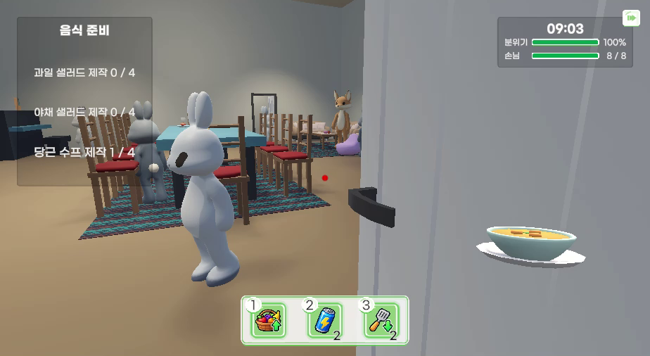

| **파티룸 입구** | **여우와 토끼** |
| --- | --- |
| 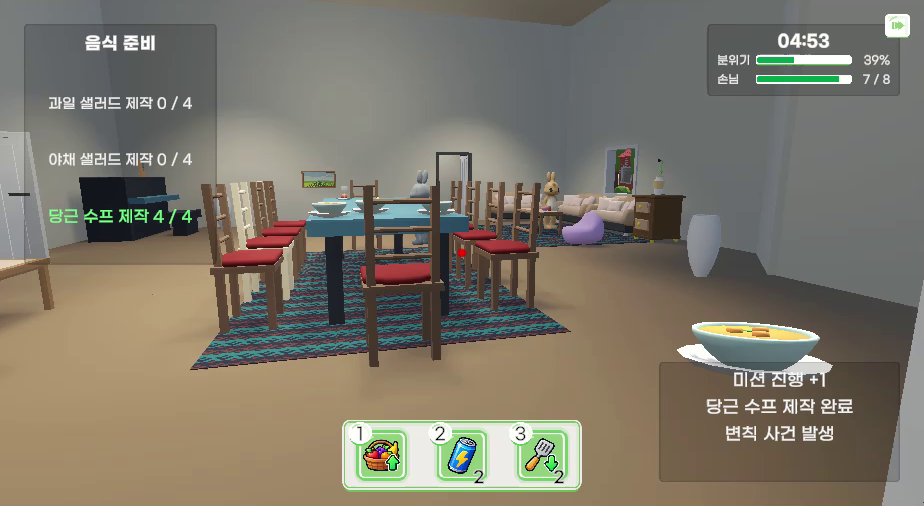 | 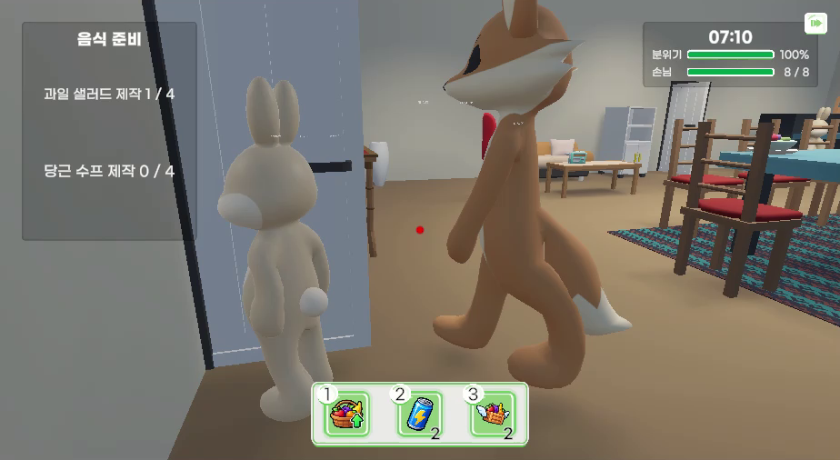 |

| **레시피 선택** | **조리 성공** |
| --- | --- |
| 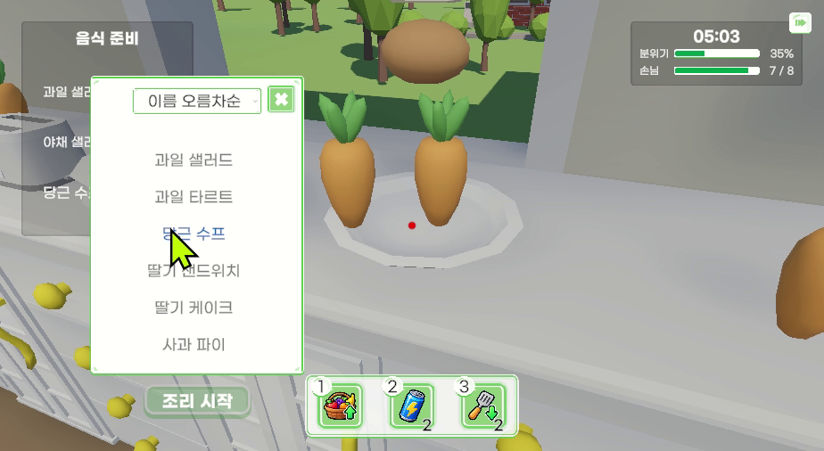 | 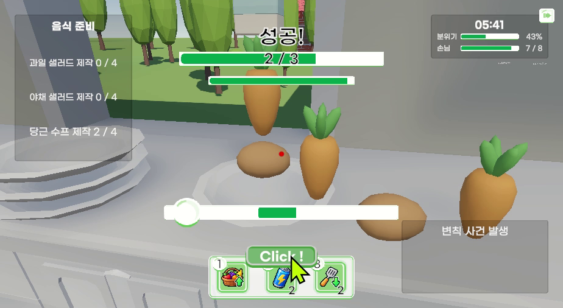 |

[▶ 플레이 영상 보기](https://youtu.be/p0TNChRhZu4)

[**\[빌드\] 구글 드라이브로 이동**](https://drive.google.com/file/d/1N-4cUHtk9XISCQZGb0Nqv67MsmXdwdZ5/view?usp=sharing)

> 이 저장소는 구현 코드와 구조를 소개하는 포트폴리오용입니다. 외부 에셋 원본과 일부 모델·음원·파티클·패키지를 제외했으므로, 저장소만으로 Unity 프로젝트를 바로 실행할 수 없습니다. 실제 플레이는 위의 영상과 빌드에서 확인할 수 있습니다.

---

## 1. 프로젝트 개요

### 게임 소개

<strong>Party's Not Ready!</strong>는 파티가 시작되기 전 제한된 시간 동안 음식을 제작·배치하면서 파티장에 접근하는 포식자와 비정상적인 환경 변화를 함께 처리하는 게임입니다.

플레이 공간은 **조리실 / 창고 / 파티룸 / 드레스룸**으로 나뉩니다. 현재 플레이의 중심은 공급원에서 재료를 확보하고, 그릇에서 음식을 제작한 뒤 파티룸에 배치하는 흐름입니다.<br>준비 중에는 물건의 낙하·이동·개폐·외형 변화가 발생하고, 포식자는 음식과 재료를 훔치거나 토끼를 포획합니다. 플레이어는 준비 업무를 계속하면서 이상 변화에 대응하고 손실을 복구해야 합니다.

플레이어는 파티 준비뿐 아니라 **손님 안전, 분위기와 포식자 대응 성과**를 함께 관리해야 합니다. 현재 준비 상태(Preparation), 손님 안전(Safety), 분위기(Mood), 포식자 대응 성과(Predator Control)를 집계해 최종 평가에 반영했습니다.

### 전체 플레이 흐름

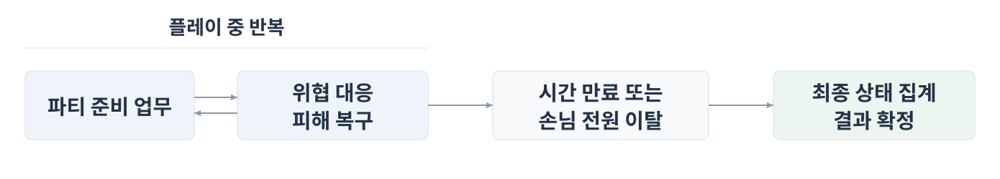

준비 업무와 위협 대응을 오가며 플레이합니다. 필수 미션을 모두 완료해도 즉시 종료하지 않고, 종료 시점까지 준비 상태와 손님 안전을 관리합니다.

### 주요 구현

- **공통 Anomaly(물건·환경의 이상 변화) 시스템과 사건별 생명주기 관리**<br>
  낙하·개폐·회전 등 9개 사건 유형에 공통 상태·시간 규칙을 적용하고, 사건별 동작과 월드 상태·구독 정리를 분리했습니다.
- **방별 Pressure(사건 발생 압력) 기반 사건 / 포식자 발생 제어**<br>
  방마다 발생 압력을 누적해 방과 발생 그룹을 선정하고, 실제 시작에 성공한 경우에만 압력과 재발생 시간을 갱신합니다.
- **서로 다른 대응 방식을 요구하는 5종 포식자 AI**<br>
  공놀이·음식 제공·절도 저지·구조 등 대응 방식을 구분하고, 적별 행동 State에서 필요한 기능을 실행합니다.
- **`A*` + NavMesh 기반 공용 Route 시스템**<br>
  NavMesh로 검증한 연결과 구간 길이를 바탕으로 직접 구현한 A\*가 경유 순서를 계산하고, NavMeshAgent가 각 구간을 이동합니다.
- **파티 준비 / Mission(업무 수행 이력) / 현재 Preparation / 최종 Evaluation(평가) 연동**<br>
  완료한 업무 이력과 현재 준비 상태를 분리해, 배치 후 도난과 같은 상태 변화도 최종 평가에 반영합니다.
- **게임 상태를 직접 확인할 수 있는 통합 Play Debug / Anomaly 진단 도구**<br>
  현재 상태 조회부터 실제 실행 요청, 거절 사유와 결과 확인까지 연결했습니다.

### 전체 게임 아키텍처

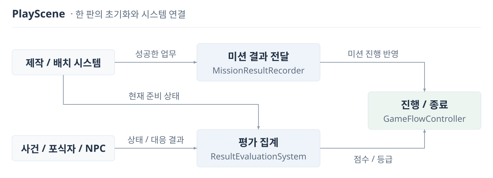

PlayScene이 시스템을 초기화하고 연결합니다. 성공한 업무는 미션 진행에 반영하고, 현재 준비 상태와 대응 결과는 담당 시스템을 통해 평가에 전달합니다.

도식은 주요 시스템과 결과 전달 흐름을 요약한 구조입니다. 미션 이력과 현재 준비 상태의 차이, 세부 평가 방식은 2-6에서 설명합니다.

---

## 2. 핵심 구현

### 2-1. 공통 Anomaly 시스템

음식 낙하, 열린 상자, 흔들리는 자루, 회전한 액자처럼 사건의 표현과 대응은 다르지만, **발생 → 시간 진행 → 해결 / 실패 → 사후 처리**는 같은 계약을 사용하도록 구성했습니다.

| 구분 | 내용 |
| --- | --- |
| **문제** | 사건마다 시간 제한과 결과 처리를 반복하면, 새 사건을 추가할 때 포식자 연계와 종료 정리까지 각각 구현해야 합니다. 시간 초과와 월드 복구도 같은 처리로 묶기 어려웠습니다. |
| **해결** | 공통 `AnomalyEvent`에 상태와 시간 규칙을 두고, 사건 시스템과 발생 건이 월드 기능 연결 및 구독 수명을 맡도록 나눴습니다. |
| **결과** | 개별 사건은 고유 조건과 동작을 구현하고, 적과 평가 시스템은 공통 결과를 받아 처리합니다. 기존 배치·조사·개폐 기능을 사건에도 재사용했습니다. |

#### 사건 규칙과 월드 동작의 분리

- **Model — `ItemDropEvent`**: 상태와 시간을 관리하고 재배치 결과로 해결 / 복구를 판정합니다.
- **System — `DropAnomalySystem`**: 기존 아이템 기능에 낙하를 요청하고 배치 알림을 사건 판정으로 연결합니다.
- **Occurrence — `DropOccurrence`**: 발생 건별 대상과 Model 참조, 구독 정보를 보관합니다.
- **Target — `AnomalyTarget`**: 정상 기준과 갱신 잠금을 관리하고 배치 / 무효화 알림을 전달합니다.

실제 고정 해제와 배치는 기존 아이템 기능을 사용합니다. 낙하 사건은 별도의 배치 규칙을 만들지 않고, 허용된 대상에 실제로 배치됐는지를 받아 해결 여부를 판정합니다.

#### 사건 실패와 월드 복구 분리

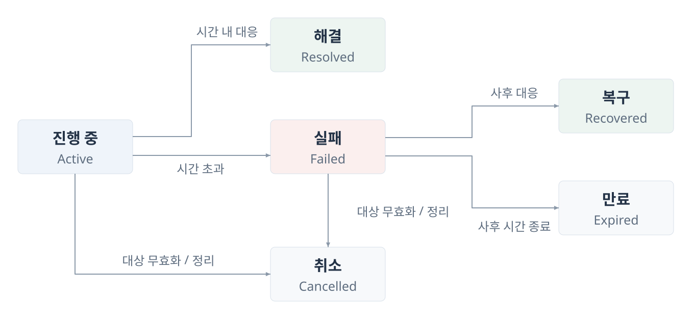

실패 후 환경을 복구해도 이미 확정된 실패 결과는 유지됩니다. 만료는 자동 원상복구가 아니라, 현재 환경을 유지한 채 사후 처리를 종료하는 상태입니다.

**실제 코드** — `AnomalyEvent.cs`의 완료 판정 발췌

```csharp
public bool TryComplete ( bool isCorrect )
{
    if ( isCorrect == false )
        return false;

    if ( _status == AnomalyStatus.Active )
    {
        ChangeStatus ( AnomalyStatus.Resolved );
        return true;
    }

    if ( _status == AnomalyStatus.Failed )
    {
        _recoveryType = AnomalyRecoveryType.Manual;
        ChangeStatus ( AnomalyStatus.Recovered );
        return true;
    }

    //이미 끝난 사건은 중복 처리하지 않음
    return false;
}
```

개별 사건은 올바른 대응 여부를 전달하고, 공통 Model은 현재 상태에 따라 해결과 사후 복구를 구분합니다. 종료된 사건에 같은 완료 요청이 들어와도 상태를 다시 변경하지 않습니다.

#### 정상 상태 관리와 기존 기능 재사용

`AnomalyTarget`은 Position / Rotation / Active / Parent / PlacementTarget을 정상 기준으로 저장합니다. 사건 진행 중에는 갱신을 잠가 변경된 상태가 새로운 정상 기준으로 덮어써지는 것을 막습니다. 운반 대상은 배치 완료 또는 지지 표면의 정착을 확인한 뒤 기준을 갱신하며, 정착 대기 중에는 새 사건 후보에서 제외합니다.

사건 유형은 **무엇이 달라졌는가**, 해결 Action은 **어떤 행동으로 대응하는가**로 구분했습니다. 런타임에서는 `AnomalyEventType`으로 사건을 구분하고, 흔들림은 Investigate, 낙하는 Carry / Place 등 기존 기능으로 대응합니다.

낙하는 최초 좌표로 되돌리는 대신, 사후 처리 기한 안에 기존 배치 기능이 허용한 대상에 배치하면 해결 또는 사후 복구로 판정합니다.

| **개폐 변칙 대응** | **회전 변칙 대응** |
| --- | --- |
| 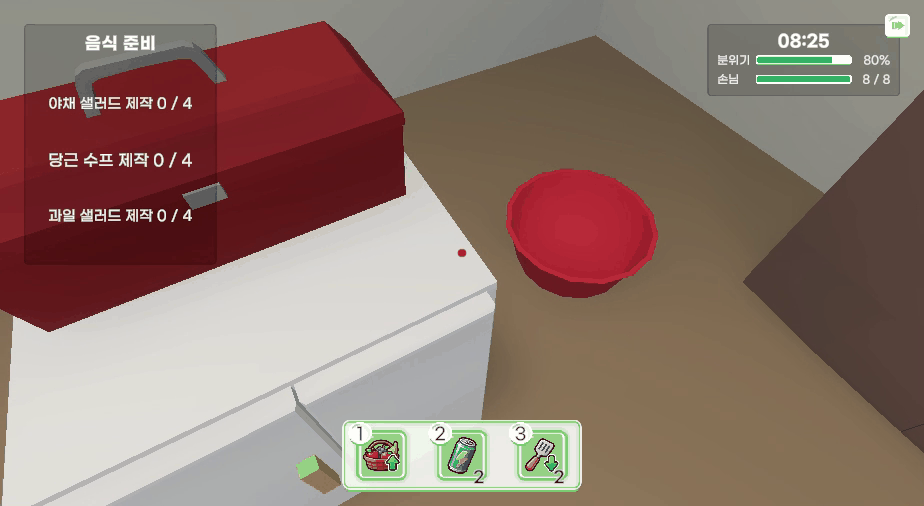 | 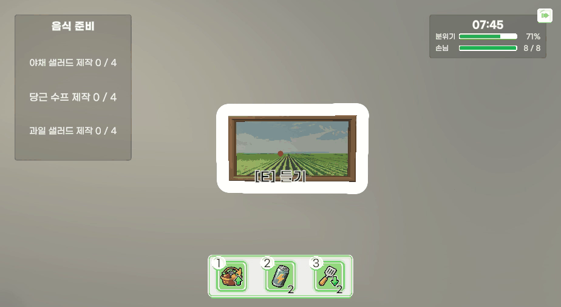 |

---

### 2-2. 방별 Pressure 기반 사건 발생 시스템

일정 간격의 랜덤 발생만으로는 방별로 누적된 위험과 대기 시간을 반영하기 어려웠습니다. **방 선정 / 그룹 선정 / 실제 실행**을 나누고, 각 방의 Pressure를 독립적으로 누적하도록 구성했습니다.

#### 발생 선정과 성공 기록

1. **방 선정**: 발생 가능한 방 중 임계치에 도달한 지 가장 오래된 방을 우선합니다. 해당 방이 없으면 Pressure에 비례한 확률로 선정합니다.
2. **그룹 선정**: 선택한 방에서 시작 가능한 그룹에 Weight / RepeatDelay를 적용합니다.
3. **시작 시도**: 선택한 그룹의 시작을 한 번만 시도하고 실제 시작 결과를 확인합니다.

**Pressure 소비와 Cooldown / RepeatDelay 갱신은 실제 시작에 성공한 뒤에만 처리합니다.** 후보가 없거나 시작 요청이 거절되면 성공으로 기록하지 않습니다.

방별 Pressure는 Cooldown 중에도 기본 증가량만큼 누적되며, 플레이어가 없는 동안에는 일정한 미방문 보너스가 더해집니다. 방문 시 미방문 시간은 초기화되지만 누적 Pressure는 즉시 감소하지 않습니다.

**실제 코드** — `AnomalySpawnSystem.cs`의 시작 결과 처리 일부 발췌

```csharp
if ( _isReady == false || started == false )
    return;

//실제 시작 성공 이후에만 압력과 Cooldown 변경
_pressures [ room ].RecordSuccess ( elapsedTime , _data );
_globalCooldownUntil =
    elapsedTime + _data.GlobalCooldown;
```

미방문 여부는 **방 안에 플레이어가 있는지**를 기준으로 판단합니다.

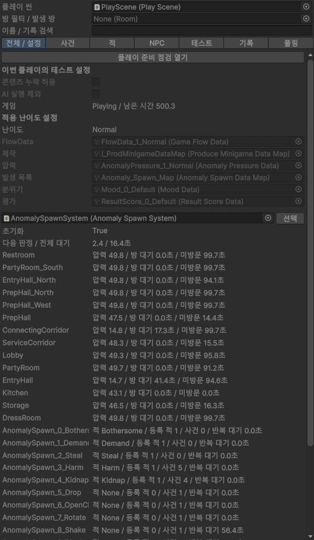

---

### 2-3. 서로 다른 대응을 요구하는 포식자 AI

포식자를 단순히 플레이어를 추적해 공격하는 적으로 만들지 않고, **각 포식자가 다른 종류의 문제를 발생시키도록** 구성했습니다.

| 포식자 | 핵심 행동 | 플레이어 대응 |
| --- | --- | --- |
| 개 | 플레이어를 따라다니며 동선 방해 | 공을 던져 놀아주기 |
| 곰 | 음식 요구 / 취향에 따른 만족·분노 | 적절한 음식 선택 |
| 까마귀 | 음식·재료 절도 | 침입과 절도 저지 |
| 담비 | 환경 교란 / 준비물 절도 / 누적 보복 | 이상 변화 발견과 대응 |
| 여우 | NPC 또는 플레이어 포획 | 징후 탐지 / 구조 / 탈출 |

공통 `Enemy`가 상태 실행과 전환을 관리하고, 각 적은 `IEnemyState`를 구현한 전용 State 중 필요한 것만 등록합니다.

적별 State는 해당 Enemy의 행동 메서드를 호출하고, 연결된 기능 모듈로 동작을 실행합니다. 상태 이름이 같아도 행동과 전환 규칙이 다르면 별도 State로 구현했습니다.

담비와 여우는 `Hide / Chase / Attack / Escape` 상태를 사용하지만, 담비의 Attack은 플레이어 타격이고 여우의 Attack은 포획 시도입니다. 담비에는 사건 실패 후 물건을 확보하는 Collect 상태가 추가됩니다.

#### 공통 상태 관리와 적별 행동 실행

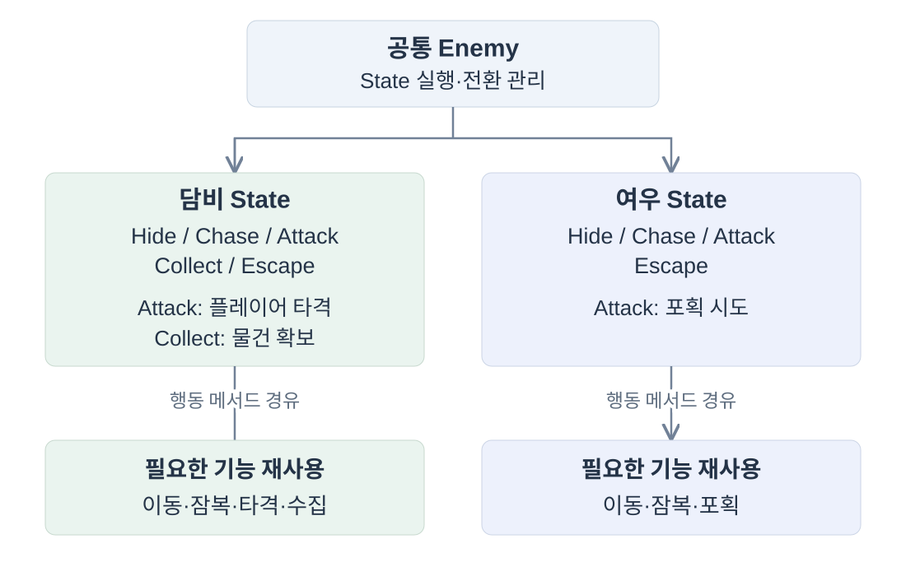

공통 Enemy가 상태 실행과 전환을 관리하고, 담비와 여우는 필요한 State를 각각 등록합니다. 각 State는 해당 Enemy의 행동 메서드를 거쳐 필요한 기능 모듈을 사용합니다.

#### Anomaly 결과와 Enemy 연결

`AnomalyLinker`는 자신의 요청으로 실제 시작한 사건과 동일한 발생 건의 결과만 해당 적에게 전달합니다. Anomaly는 적의 상태를 직접 변경하지 않고, 적이 전달받은 결과를 자신의 행동 규칙으로 해석합니다.

| 사건 결과 | 담비 | 여우 |
| --- | --- | --- |
| `Resolved` | 발생 건별 저지로 기록 | 출현하지 않고 다음 발생 대기 |
| `Failed` | 수집 요청을 남기고 잠복 State에서 전환 | 납치 행동 허용 |

시작 중 전달된 사건 결과는 적의 시작 상태를 반영한 뒤 처리하며, 활동 종료 시에는 결과 구독을 해제합니다.

#### 기존 기능의 재사용

담비와 여우의 이동·도주는 `CharacterMover`와 `RouteNavigator`를 사용하고, 타격·포획은 각 Enemy에 연결한 `CharacterAttacker`와 `CaptureController` 등으로 실행합니다. 까마귀의 비행은 `FlightMover`가 담당합니다.<br>까마귀와 담비의 공급원 절도도 실제 출력 아이템 획득과 보유 결과를 연결했습니다. 풀에 객체가 생성됐다는 사실과 적이 실제 재료를 확보했다는 결과는 구분합니다.

| **개 — 공 상호작용** | **개 — 던진 공 추적** |
| --- | --- |
| 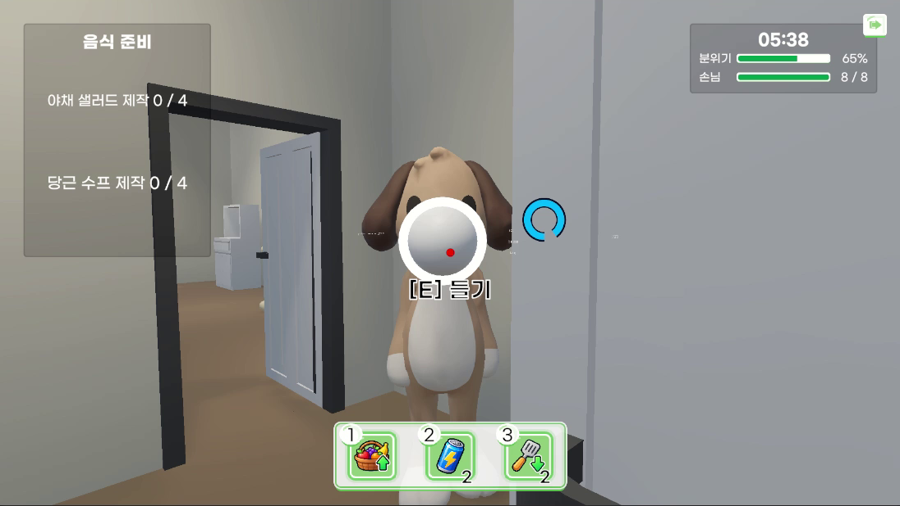 | 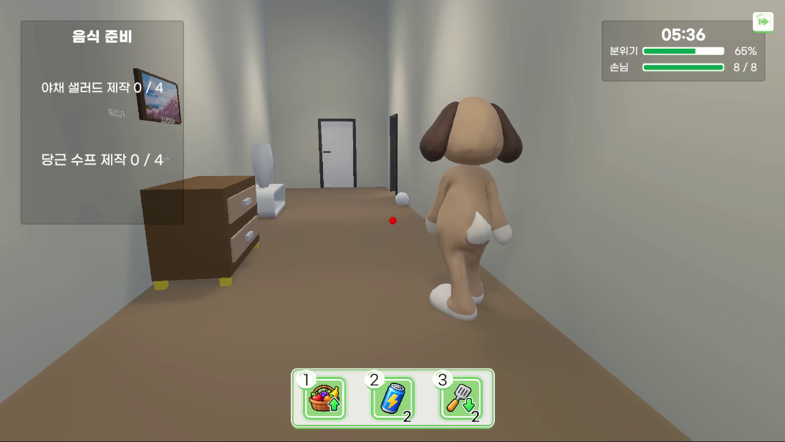 |

| **곰 — 분노 반응** | **곰 — 만족 반응** |
| --- | --- |
| 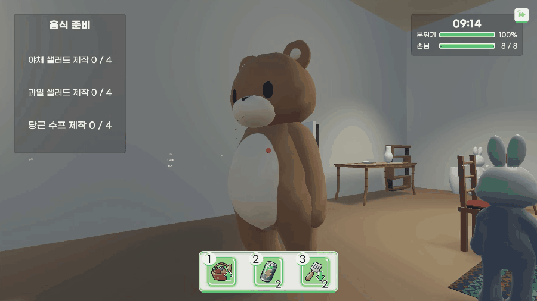 | 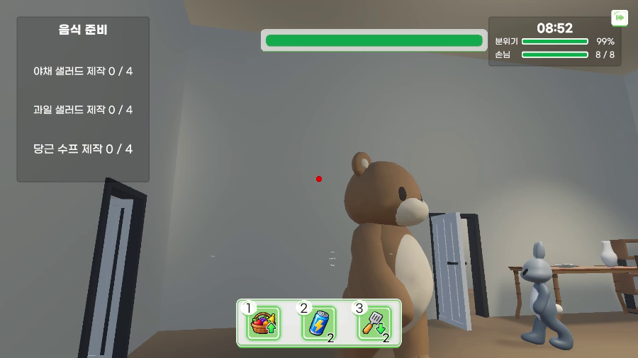 |

| **까마귀 — 재료 운반** | **여우 — 포획된 NPC 구조** |
| --- | --- |
| 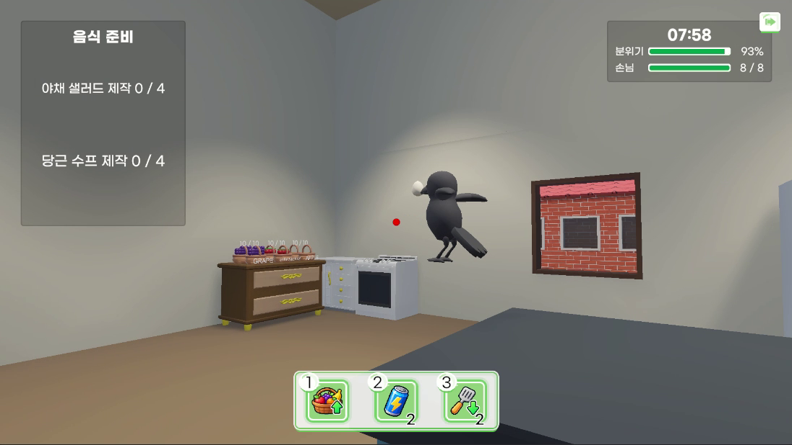 | 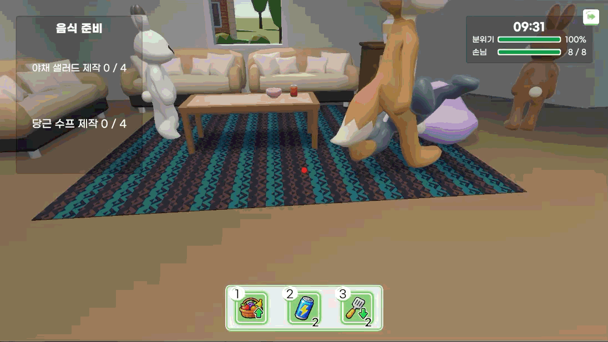 |

| **담비 — 공격 동작** | **담비 — 재료 운반·도주** |
| --- | --- |
| 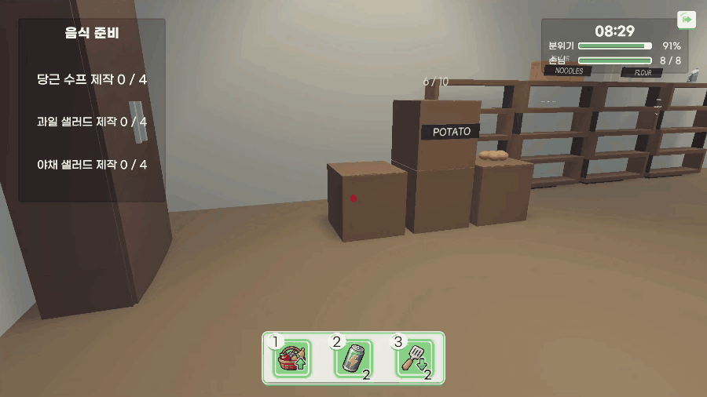 | 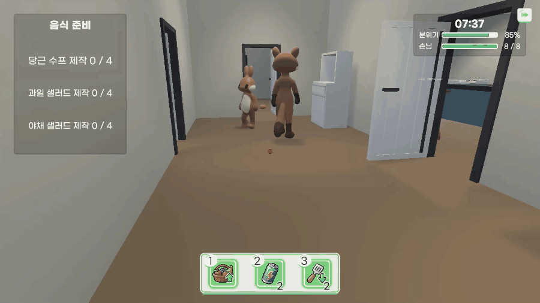 |

---

### 2-4. `A*` + NavMesh 기반 공용 Route 시스템

NavMeshAgent의 목적지 이동에 더해, 방 입구와 복도 분기를 경유하는 **큰 동선과 도주 경로**를 선택할 필요가 있었습니다. 노드 경로 선택과 실제 이동을 나누되, 그래프에서도 실제 통행 가능 여부를 사용하도록 구성했습니다.

| 구분 | 내용 |
| --- | --- |
| **RouteGraph / RouteNode** | 방 입구·분기·출구의 위치와 수동 연결을 보관합니다. |
| **RoutePathChecker** | 같은 Agent 조건으로 NavMesh 위치, 완전 경로와 실제 구간 길이를 검사합니다. |
| **RouteBuilder** | 유효 노드와 연결 비용, 임시 출발·목적지를 구성하고 이동할 지점 목록을 만듭니다. |
| **RoutePlanner** | 구성된 연결 비용을 사용해 `A*` 경로를 계산합니다. |
| **RouteNavigator** | 선택 경로의 진행, 도착·실패와 재시도를 관리합니다. 구간 이동은 CharacterMover를 통해 NavMeshAgent에 요청합니다. |

#### A\* 탐색 구현

**실제 코드 — `RoutePlanner.cs`의 최소 F값 선택**

`TakeNextNode()` 내부 발췌입니다.

```csharp
int bestIndex = 0;
int bestNode = _openNodes [ 0 ];

//G: 출발점부터 누적 비용, H: 목표까지 예상 거리
//F = G + H가 가장 작은 노드부터 확인
double bestScore = ( double ) _costs [ bestNode ] +
                   EstimateDistance( bestNode, goal );

for ( int i = 1; i < _openNodes.Count; i++ )
{
    int node = _openNodes [ i ];
    double score = ( double ) _costs [ node ] +
                   EstimateDistance( node, goal );

    if ( score >= bestScore )
        continue;

    bestIndex = i;
    bestNode = node;
    bestScore = score;
}

//주요 분기점 위주의 작은 그래프이므로 목록에서 직접 선택
_openNodes.RemoveAt( bestIndex );
return bestNode;
```

**실제 코드 — 더 짧은 경로의 비용과 이전 노드 갱신**

`UpdateConnections()` 내부 발췌입니다.

```csharp
float nextCost = _costs [ current ] + connection.Value;

//누적 비용이 표현 범위를 넘은 경로는 사용하지 않음
if ( float.IsInfinity( nextCost ) || float.IsNaN( nextCost ) )
    continue;

//더 짧은 경로를 발견한 경우에만 비용과 이전 노드 변경
if ( _costs.TryGetValue( next, out float previousCost ) &&
     nextCost >= previousCost )
    continue;

_costs [ next ] = nextCost;
_previous [ next ] = current;

//이미 확인한 노드도 더 짧은 경로가 발견되면 다시 검사
if ( _openNodes.Contains( next ) == false )
    _openNodes.Add( next );
```

G는 출발점부터의 누적 연결 비용, H는 목표까지의 직선거리입니다. F = G + H가 가장 작은 노드를 선택하고, 연결된 노드에 더 낮은 비용으로 도달하면 G와 이전 노드를 갱신합니다. 이 과정을 반복해 목표에 도달하면 이전 노드를 역추적하여 경유 순서를 구성합니다.

#### 경로 선정과 실제 이동

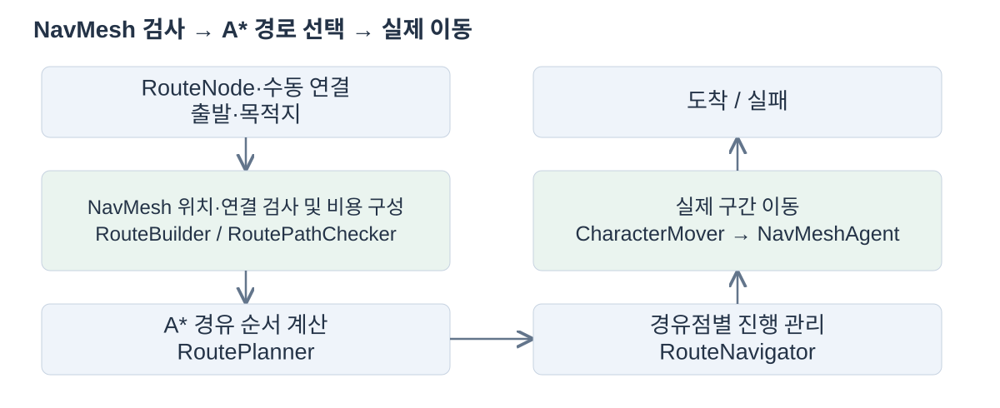

NavMesh로 통행 가능한 연결과 구간 길이를 구한 뒤, A\*가 경유 순서를 계산하고 NavMeshAgent가 각 구간을 이동합니다.

연결 비용은 직선거리 대신 **NavMesh 경로의 꺾이는 지점 사이 길이 합**을 사용합니다. 부분 경로와 끝점이 맞지 않는 경로를 제외하고, A → B 통행 성공만으로 B → A 연결까지 가능하다고 가정하지 않습니다.

이동 중 경로 문제나 정체가 감지되면 간격을 두고 재시도합니다. 일반 경로는 재구성하고, 필수 경유 경로는 선정 순서를 유지한 채 다음 미통과 지점까지 재검사합니다. 전체 이동 제한시간은 유지합니다.

#### 적별로 다른 도주 조건

- **여우**: 포획 대상을 보유하면 입구 반대 방향으로 우회한 뒤 입구로 돌아와 납치를 완료합니다. 빈손 도주는 연결된 두 노드를 이용합니다.
- **담비**: 개별 도주 지점이 있으면 일반 경로를 사용하고, 없으면 현관까지 최소 이동 거리를 확보하는 경로를 선정합니다.

Route는 도착·실패를 반환하고, **보유 재료 또는 포획 대상의 정리는 호출한 적**이 담당합니다. NPC의 방 이동도 같은 Route 구조를 사용합니다.

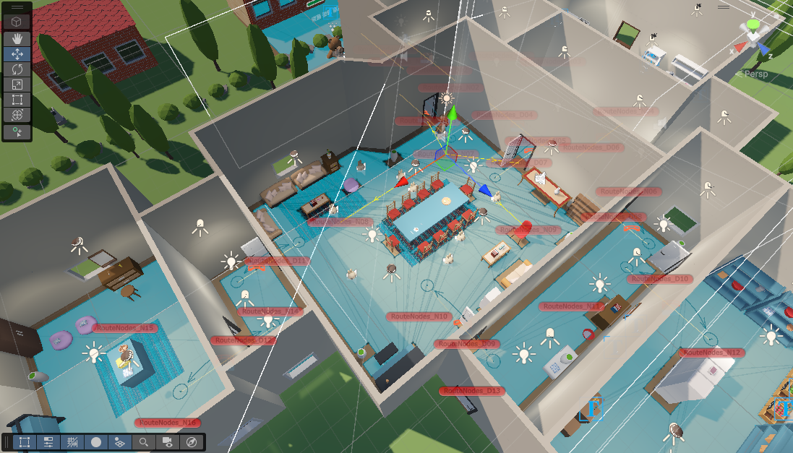

RouteGraph의 노드 배치와 연결 구조

#### 플레이 중 실제 선정 경로 확인

실제 플레이에서 Route 시스템이 채택한 경유 순서와 현재 목표·진행 상태를 Scene View와 Play Debug에서 확인하도록 디버그 표시를 구현했습니다. 빨간 선은 채택 당시의 NavMesh 구간 경로, 회색은 처리된 구간, 흰 선은 현재 Agent 구간이며, 캐릭터가 실제로 지나간 위치의 기록은 아닙니다.

**실제 채택 결과와 진행 상태**

[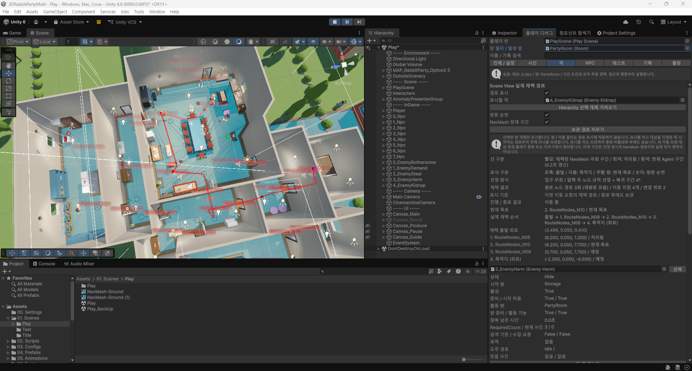](Ref/Portfolio/Screenshots/route-debug.png)

여우의 입구 우회·A* 복귀 경로를 Scene View에 표시하고, Play Debug에서 실제 채택 순서·현재 목표·이동 상태를 확인한 화면

**다른 이동 상황의 경로 사례**

[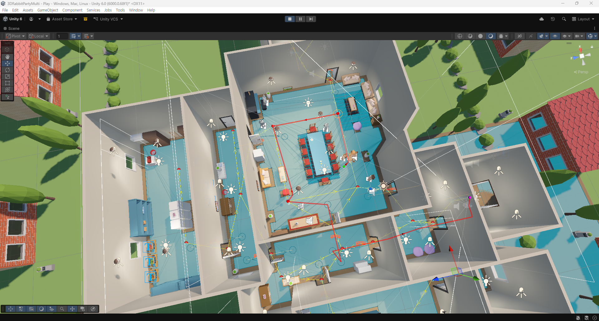](Ref/Portfolio/Screenshots/route.png)

다른 이동 상황에서 채택된 경유 순번과 NavMesh 구간 경로를 확대한 Scene View. 주황 링은 현재 목표를 표시합니다.

---

### 2-5. 그릇별 세션으로 관리하는 음식 제작

재료 확보부터 완성품 배치까지 이어지는 파티 준비 업무를 구현했습니다. **재료 등록 → 레시피 선택 → Timing / Click 미니게임 → 재료 소비 → 완성품 전환**을 그릇별 세션으로 관리합니다.

플레이어는 재료를 그릇에 배치한 뒤, F키로 조준한 그릇의 레시피를 열어 제작할 음식을 선택합니다. 재료 배치와 레시피 열기를 분리해, 여러 재료를 연속으로 옮기는 동안에는 화면과 커서 상태가 바뀌지 않도록 했습니다.

제작 성공뿐 아니라 잘못된 조합, 미니게임 실패에 따른 재료 소비와 제작 중 재료 소실도 구분해 처리합니다. 완성 결과는 미션 진행과 현재 파티 준비 상태에 연결합니다.

| **레시피 선택** | **완성 음식 배치** |
| --- | --- |
| 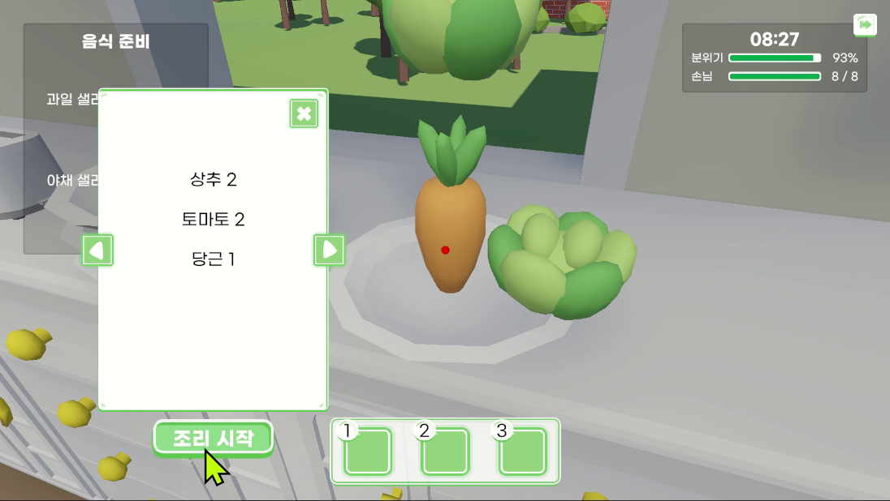 | 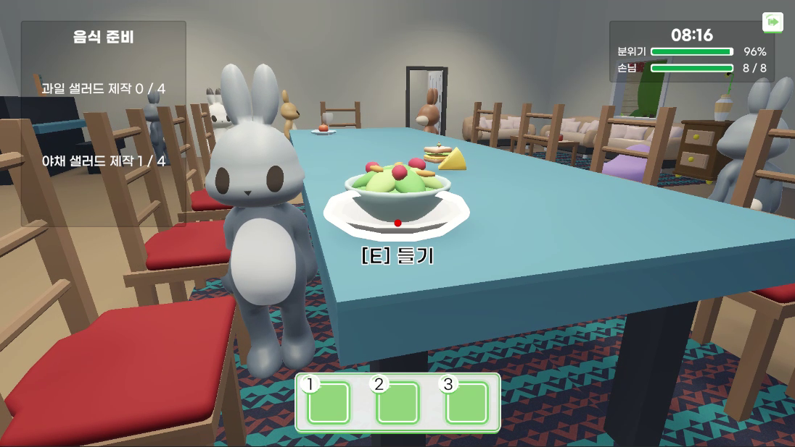 |

---

### 2-6. 미션 이력과 현재 파티 상태를 분리한 평가 구조

**한 번 완료한 업무**와 **지금 유지되는 준비 상태**는 다릅니다. 음식을 정상 배치한 뒤 포식자가 가져가더라도 배치했던 이력까지 취소하지 않도록, 미션 이력과 현재 준비 상태를 분리했습니다.

| 구분 | 내용 |
| --- | --- |
| **Mission** | 성공한 제작·배치 결과의 누적 이력입니다. `MissionResultRecorder`가 실제 결과를 전달하고 `MissionProgress`가 미션 ID와 결과 ID로 중복 진행을 막습니다. |
| **Preparation** | `PreparationSystem`이 실제 집기·이탈·소실과 재정착을 추적합니다. 현재 유효 수량을 목표별 상한과 카테고리 가중치로 평가합니다. |
| **Evaluation** | `ResultEvaluationSystem`이 현재 상태와 확정 결과를 수집하고 종료 시점에 점수와 등급을 확정합니다. |

#### 도식 — 이력과 현재 상태

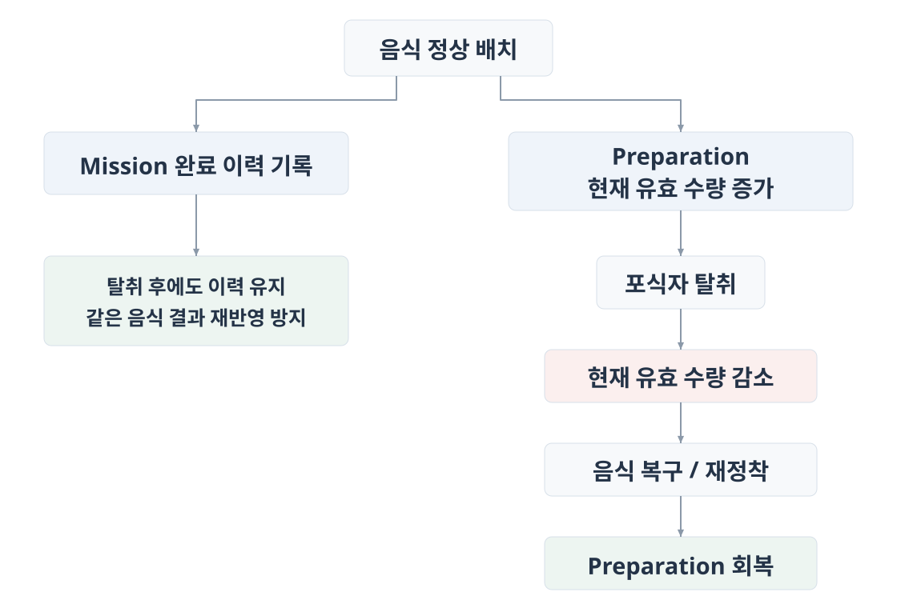

일반 아이템 배치의 중복 키는 현재 단계를 포함해, **같은 단계의 재배치**와 **다음 단계에서 새로 수행한 직접 배치**를 구분합니다. 미션 이력과 현재 준비 상태를 모두 하나의 개수로 처리하지 않았습니다.

#### 최종 평가와 종료 처리

- **Preparation**: 종료 시점의 실제 유효 준비 상태
- **Safety**: 시작 NPC 대비 실제 잔존 NPC 비율
- **Mood**: 게임 시간 기준 평균과 종료 시 최종값의 결합
- **Predator Control**: 확정된 대응의 성공 / (성공 + 실패)

각 시스템은 상태와 결과를 전달하고 평가 시스템이 점수를 집계합니다. 확정 대응이 없으면 Predator Control을 제외해 가중치를 재계산하며, 필수 입력이 없으면 **미정산**으로 구분합니다.

**실제 코드** — `ResultEvaluationModel.cs`의 대응 결과 확정 발췌

```csharp
public bool TryComplete ( object key, bool succeeded )
{
    if ( key == null || _active.Remove( key ) == false )
        return false;

    if ( succeeded )
        _successCount++;
    else
        _failureCount++;

    return true;
}
```

활성 대응 목록에서 제거한 건만 확정하므로 같은 결과가 다시 와도 성공·실패 수를 늘리지 않습니다. 사건의 `Failed`가 집계된 뒤 `Recovered` 또는 `Expired`가 와도 같은 실패를 다시 계산하지 않습니다.

종료는 **입력 차단 → 상태 집계·결과 확정 → 월드 정리·결과 표시** 순서로 진행합니다. `GameFlowController`가 미션 입력과 신규 발생을 차단하고, `FinalizeAt`이 결과 입력을 닫아 종료 시점의 상태를 집계한 뒤 `GameResult`를 확정합니다. 미완료 대응은 성공·실패 집계에서 제외합니다.

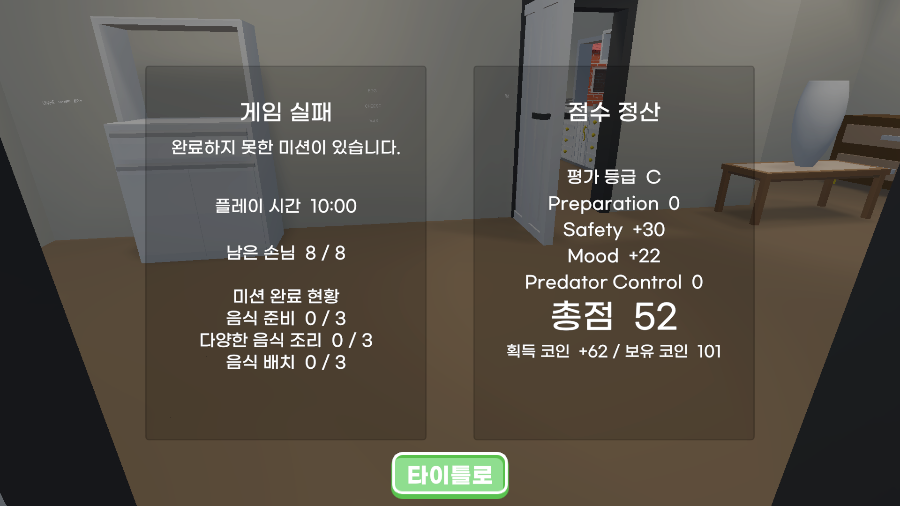

---

## 3. 트러블슈팅

### 3-1. 공용 도주 조건 적용 실패와 적별 경로 선정 기준 분리

#### 문제

담비가 재료를 수집한 뒤 활동 시작 위치로 돌아가도록 했을 때는 플레이어가 재료를 회수할 시간이 부족했습니다. 이를 보완하기 위해 현관으로 도주하는 경로를 적용하면서, 먼저 구현한 여우의 우회 경로 선정 기능을 재사용했습니다.

하지만 현관까지 이동할 수 있는 맵에서도 창고 / 부엌 등 일부 출발 위치에서는 도주 후보를 선정하지 못했습니다.

#### 원인

여우의 경로 선정에는 단순한 현관 도착 외에도 다음 조건이 포함돼 있었습니다.

- 접근 구간부터 입구 반대 방향으로 이동
- 입구에서 더 멀어지는 노드를 경유
- 복귀 경로에서 특정 접근 노드의 재방문 제한

담비는 여러 방으로 이동하며 활동하므로 출발 위치가 달라집니다. **현관까지 연결된 경로가 있다는 것과 여우의 우회 조건을 만족하는 경로가 있다는 것은 별개**였습니다. 방을 빠져나오려면 같은 연결 지점을 다시 지나야 하는 경우에도 기존 조건은 후보를 제외했습니다.

담비에게 필요한 것은 여우와 동일한 우회 형태가 아니라, 재료를 가지고 바로 퇴장하지 않도록 **최소 이동 거리를 확보하는 것**이었습니다.

#### 해결

통행 가능 여부 검사, `A*` 경로 계산과 실제 이동은 기존 Route 시스템을 사용하고, 도주 후보를 인정하는 기준을 적별로 구분했습니다.

| 구분 | 여우 | 담비 |
| --- | --- | --- |
| 경로 선정 기준 | 입구 반대 방향 우회 후 복귀 | 최소 이동 거리 확보 |
| 기본 경로 사용 | 우회 조건 적용 | 최소 거리 이상이면 사용 |
| 노드 재방문 | 특정 접근 노드 재방문 제한 | 필요한 재방문 허용 |

담비는 먼저 현관까지의 기본 경로 길이를 확인합니다. 최소 거리 이상이면 그대로 사용하고, 짧으면 등록된 노드들을 경유 후보로 검사합니다.

각 후보의 **출발 → 경유 노드 / 경유 노드 → 현관** 경로를 계산한 뒤, 최소 거리와 이동 거리 상한을 만족하는 후보 중 가장 짧은 경로를 선택하도록 변경했습니다. 거리에는 직선거리 대신 Route 시스템에서 검사한 NavMesh 구간 길이를 사용합니다.

**실제 코드 — 기본 경로가 짧을 때 경유 후보 검사**

**`RouteBuilder.cs` — `TrySelectDistanceDetour()` 일부 발췌**

```csharp
if ( _planner.TryFind( startIndex, via, _route ) == false ||
     _planner.TryFind( via, goalIndex, _detourReturnRoute ) == false )
    continue;
```

출발 지점에서 경유 노드까지 도달할 수 있는지만 확인하지 않고, 그곳에서 현관까지 이어지는 경로도 함께 검사합니다. 여우의 복귀 경로와 달리 특정 접근 노드를 제외하지 않아, 방을 빠져나오기 위해 필요한 재방문을 허용했습니다.

조건을 만족하는 후보가 없으면 짧은 경로로 대체하지 않고 도주 실패를 반환합니다. 담비는 실패 결과를 받아 보유 재료를 내려놓고 잠복 상태로 복귀합니다.

#### Before / After

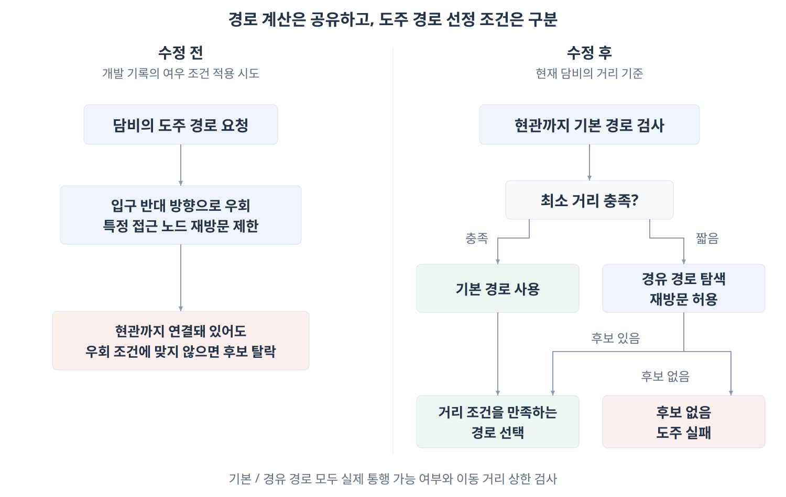

경로 계산과 이동은 공용 Route 시스템을 사용하고, 담비의 도주 경로는 방향 제한 대신 최소 이동 거리를 기준으로 선정했습니다.

수정 전은 개발 기록에 남은 여우 조건 적용 시도이며, 수정 후는 현재 구현입니다. 도식은 핵심 선정 조건을 표시했으며 기본 / 경유 경로 모두 실제 통행 가능 여부와 이동 거리 상한을 검사합니다.

#### 결과 / 배운 점

창고 / 부엌 / 파티룸에서 현관까지 도주하는 동작과 현관 근처에서 출발할 때 추가 경유 경로를 선택하는 동작을 확인했습니다. 최소 거리를 충족할 수 없는 조건에서는 보유 재료를 내려놓고 잠복 상태로 복귀하는 것도 확인했습니다.

이 과정에서 **목적지가 같다는 이유만으로 경로 선정 조건까지 공유할 수는 없다는 점**을 확인했습니다. 경로 계산과 이동 기능은 재사용하되, 각 적이 어떤 동선을 선택해야 하는지는 게임플레이 목적에 맞게 구분했습니다.

최소 이동 거리를 확보하는 동작은 확인했지만, 실제 플레이에서 재료 회수 기회가 충분한지는 추가 검증이 필요합니다.

---

### 3-2. 레시피 자동 표시로 끊기던 연속 재료 배치 흐름 개선

#### 문제

음식 제작을 위해 재료를 그릇에 배치하면 레시피 화면이 자동으로 열리고 커서 잠금이 해제됐습니다.

플레이어는 다음 재료를 가져오기 위해 시점을 돌려야 했지만, 입력이 UI 조작 상태로 바뀌면서 연속 작업이 끊겼습니다. 한 번의 배치는 가능해도 여러 재료를 반복해서 옮기는 과정에서는 불편이 누적됐습니다.

#### 초기 의도와 원인

처음에는 재료를 배치하면 레시피가 자동으로 나타나는 편이, 별도 버튼을 누르는 것보다 편리할 것으로 생각했습니다. 배치 완료 알림에서 화면을 열고 UI 조작을 위해 커서를 해제하도록 구현했습니다.

하지만 **재료를 배치한 시점과 레시피를 확인·조작하려는 시점은 같지 않았습니다.** 다음 재료를 계속 넣으려는 상황에서도 UI 조작 상태로 전환한 것이 문제였습니다.

#### 해결 과정

**1. 배치 직후 자동 열기**

초기에는 `HandleItemPlaced()`에서 그릇과 등록된 재료를 확인한 뒤 `OpenRecipes()`를 호출했습니다. 레시피 확인은 빨랐지만, 다음 재료를 배치하려는 상황까지 UI 조작 상태로 전환했습니다.

**2. 거리 기반 자동 표시와 UI 조작 상태 분리**

처음에는 자동 표시 방식은 유지하면서 불편을 줄이려 했습니다. 가까운 제작 대상을 찾아 레시피를 자동으로 표시하고, 화면이 보이는 상태와 실제 UI를 조작하는 상태를 구분했습니다.

같은 그릇의 화면을 반복해서 열지 않도록 하고, 재료 집기·배치도 별도 입력 경로로 처리했습니다. 그러나 해당 그릇에 재료를 배치하면 UI 조작 상태로 전환해 커서를 해제하는 처리가 남아 있었습니다.

화면을 여는 기준을 바꿔도 **재료 배치가 커서 전환으로 이어지는 불편**은 해결되지 않았습니다.

**3. 재료 배치와 레시피 열기 분리**

수정을 거치면서 표시·입력 조건은 늘어났지만, 플레이어가 원하지 않는 시점에 조작 상태가 바뀌는 문제는 남았습니다.

자동 표시를 계속 보완하기보다, **플레이어가 확인할 시점을 직접 선택하는 편이 연속 작업에 더 적합하다**고 판단했습니다. 최종적으로 접근이나 재료 배치만으로 레시피를 열지 않고, F키로 조준한 그릇의 레시피를 열고 닫도록 변경했습니다.

레시피를 열었을 때는 커서를 해제하되 이동과 오른쪽 드래그 시점 회전을 유지하고, 닫으면 일반 시점 조작으로 복귀하도록 했습니다.

현재는 `RecipeInputController`가 제작 대상과 거리·표시 조건을 확인해 화면 열기를 요청하고, `PlayInputController`가 화면 상태에 따른 커서와 시점 입력을 처리합니다.

#### Before / After

| 수정 전 | 수정 후 |
| --- | --- |
| 배치 또는 접근에 따라 레시피 자동 표시 | F키로 조준한 그릇의 레시피 열기 |
| 재료 배치가 UI 조작 상태 전환으로 이어짐 | 접근·재료 배치 자체는 화면과 커서 상태를 바꾸지 않음 |
| 자동 표시 조건을 바꿔도 연속 작업의 불편이 남음 | 재료 배치와 레시피 확인 시점을 플레이어가 선택 |

#### 결과 / 배운 점

최종 방식의 레시피 열기·닫기와 안내 표시를 확인했습니다. 재료 배치만으로 화면과 커서 상태가 전환되지 않도록 해, 연속 배치 후 필요한 시점에 레시피를 확인할 수 있게 했습니다.

이 과정에서 **처음 편리할 것으로 예상한 방식도 실제 반복 작업에서는 불편할 수 있다는 점**을 확인했습니다. 기존 방식을 유지한 채 조건만 조정하기보다, 문제가 계속 남는다면 처음 선택한 조작 방식 자체를 다시 검토할 필요가 있었습니다.

---

## 4. 기타 구현

- **재료 재고 / 재보충**: 공급원별 재고를 독립 관리하고 재고가 0이 되면 재보충 타이머를 시작합니다. 풀의 객체 수와 실제 공급 가능한 재고 수는 별도로 관리합니다.
- **NPC 토끼 AI**: 현재 플레이에서는 `Normal / Captured`로 일반 행동과 포획 상태를 전환합니다. 방 이동과 로컬 이동은 Normal 내부 행동으로 처리하고, 포획 해제 시 이동과 자세를 복원합니다.
- **서포트 아이템 / 상점**: 결과 보상으로 코인을 지급하고 로비에서 아이템을 구매한 뒤 한 판에 최대 3종을 선택해 반입합니다. 이동, 제작, 운반, 구조 등 기존 행동을 보조하되 자동 해결 기능은 두지 않았습니다.
- **오브젝트 풀링 / 재료 구성 검증**: 반복 생성되는 재료를 프리팹 단위 풀로 관리하고, 반환 전에 보유 / 투척 / 물리 / 배치 상태를 정리합니다. 정적 코드 검토에서 필수 구성이 누락된 재료는 대여와 반환 검사가 모두 실패할 수 있는 경로를 확인해, 공급원 초기화 시 풀 등록과 객체 생성 전에 프리팹 구성을 검사하도록 보완했습니다.
- **UI / 화면 연출**: 공용 DOTween View를 사용하고 실제 판정 상태와 시각 보간 값을 분리했습니다. 새 표시 요청이나 종료 시 이전 결과·게이지 연출을 정리합니다.
- **오디오**: 행동 결과를 기준으로 개별 `SoundPlayer`를 연결해 월드 3D 사운드와 UI 2D 사운드의 재생 수명을 구분했습니다.

| **상점** | **난이도 선택** |
| --- | --- |
| 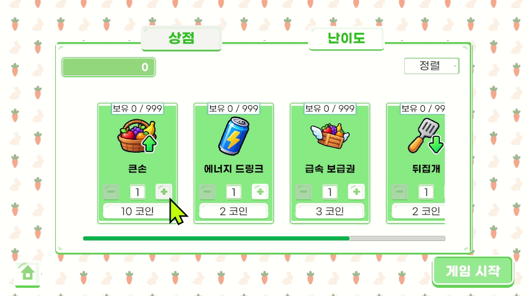 | 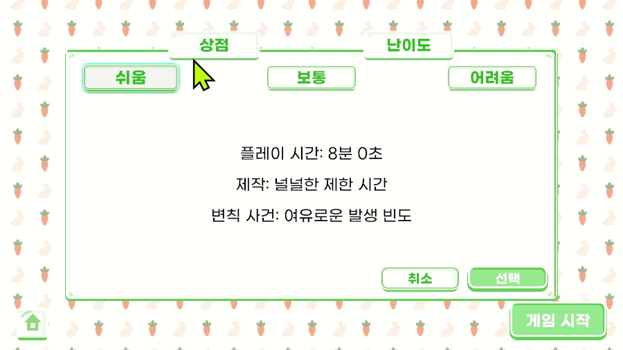 |

---

## 5. 개발 도구

Inspector를 개별 조회하는 작업과 상황 재현을 줄이기 위해, **현재 상태 조회 → 실제 실행 요청 → 거절 사유와 결과 확인**이 이어지는 Editor 도구를 제작했습니다.

### Play Debug

`Tools/Play/플레이 디버그`에서 난이도와 적용 설정, 방별 Pressure, Enemy / NPC 상태, 최근 상태 전이를 확인합니다. 사건 시작과 적 행동 테스트도 실제 준비·실행 API를 호출합니다.

예를 들어 사건 방치 후 적이 나타나지 않는 문제에서는 SpawnData가 독립 사건 경로로 읽히는 구성을 확인했습니다. 실제 EnemyType, 등록 상태와 시작 거절 사유를 표시해 **설정 문제와 적 행동 문제를 나눠 추적**했습니다.<br>도주 경로를 추적할 때는 선정된 경유점과 실제 NavMesh 경로, 제외된 연결과 실패 단계를 함께 확인합니다.

적 테스트는 이전 활동을 정리하고 선택 방을 준비하지만, 실제 대상·이동 준비 조건을 무조건 통과시키지는 않습니다.

### Anomaly Debug Inspector

발생 건 ID, 관련 대상, 상태와 남은 시간, 정상 기준 잠금·정착 대기, 최근 종료 결과를 조회합니다.

발생 버튼은 `RequestDebugStart`를 통해 기존 발생 함수를 호출하고, 실행 경로의 `ReportStartFailure`가 반환한 Category / Code / Message를 표시합니다. **Inspector가 별도 규칙으로 실패를 추측하지 않도록** 구성했습니다.<br>낙하 대상의 보유·잠금, 실제 지지 표면 없음과 저장된 배치 표면 불일치를 구분해 확인할 수 있습니다.

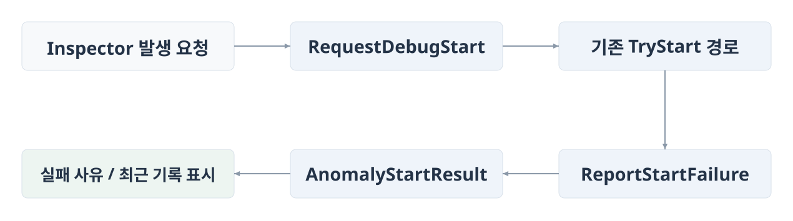

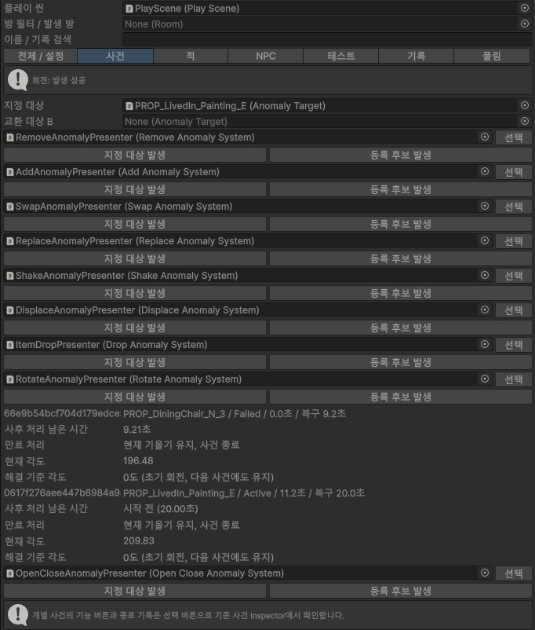

### 반복 설정 작업

- **Anomaly 대상 설정 / 컴포넌트 구성**: 대상의 기능 설정과 필요한 구성 검사를 모아 개별 Inspector를 반복 탐색하는 작업을 줄였습니다.
- **Data Importer**: CSV / JSON을 검사한 뒤 기존 ScriptableObject와 Map을 재사용하고 관리 필드만 갱신합니다. 수동 연결과 기존 에셋 참조를 보존하도록 구성했습니다.
- **Sound 설정 도구**: 행동별 음원과 공간·재생 설정을 확인하고 반복 연결 작업을 정리합니다.

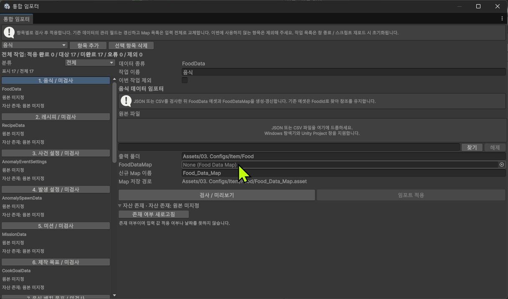

### 플레이 테스트와 확인 범위

정상 동작뿐 아니라 제작 실패 후 재시도, 적의 경로 선정 실패 등 결과가 달라지는 조건을 나눠 확인했습니다. 디버그 도구와 Inspector, 로그를 활용해 현재 상태와 실행 결과를 함께 확인했습니다.

| 확인 영역 | 주요 확인 내용 |
| --- | --- |
| 음식 제작 | 제작 성공, 실패 조건에 따른 재료 소비와 실패 후 재시도 가능 여부를 확인했습니다. 반복 배치 중 발생한 조작 불편은 레시피를 F키로 여는 방식으로 개선했습니다. |
| 적 행동 | 담비의 기본 도주 경로와 현관 근처에서 출발할 때의 경유 경로를 확인했습니다. 최소 거리 조건을 만족하지 못하면 보유 재료를 내려놓고 잠복 상태로 복귀하는 처리도 확인했습니다. |
| 게임 진행과 결과 | 단계 전환과 제한 시간 종료 후 결과 표시, 보상·저장 처리를 확인했습니다. 게임 진행 디버그 기능으로 시간 만료와 NPC 전원 이탈에 해당하는 종료 조건을 주입해 종료·재시작 흐름도 점검했습니다. |

**디버그 조건 변경에 따른 HUD 갱신**

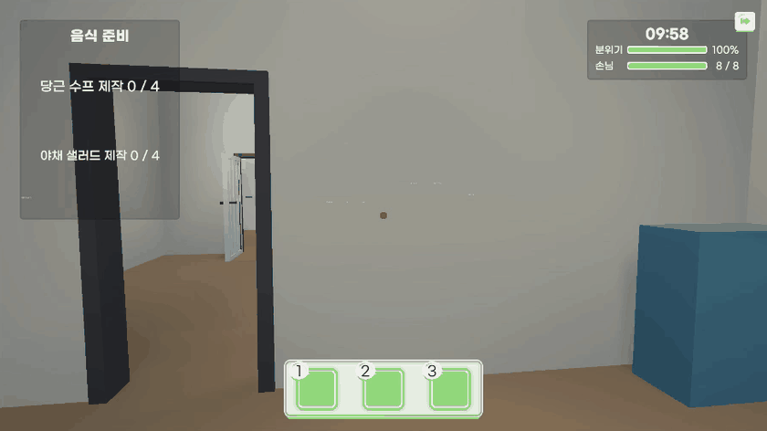

검증 범위는 현재 구현된 **싱글플레이 흐름**을 기준으로 합니다. NPC 전원 이탈 테스트는 실제 NPC를 모두 이탈시킨 것이 아니라 종료 조건만 주입한 것으로, 실제 NPC 상태와 Safety 평가는 변경하지 않았습니다.

멀티플레이 구현 후에는 여러 플레이어의 동시 상호작용과 게임 상태·결과 동기화를 추가로 검증할 계획입니다.

---

## 6. 개발 회고

### 가장 어려웠던 점

가장 어려웠던 부분은 적의 경로 탐색을 구현하고 실제 맵과 행동에 적용하는 과정이었습니다.

초반 테스트에서는 노드 배치 간격에 비해 연결 탐색 범위를 작게 설정해 경로를 구성하지 못했습니다. 맵의 일부 구간은 NavMesh가 서로 연결되지 않아 링크를 추가하기 전까지 이동 경로를 찾지 못하는 문제도 있었습니다. 노드를 어느 위치에 배치해야 방과 통로를 자연스럽게 경유할 수 있는지도 함께 고민해야 했습니다.

기본 이동이 가능해진 뒤에도 여우와 담비의 도주 목적이 달라 경로 선정 조건을 다시 구분해야 했습니다. 현관까지 도달할 수 있는 경로가 있어도, 특정 우회 조건까지 만족하는 경로가 항상 존재하는 것은 아니었습니다.

처음에는 A\*를 구현하고 노드를 연결하면 원하는 이동도 비교적 바로 만들 수 있을 것으로 생각했습니다. 실제로는 알고리즘뿐 아니라 노드의 배치와 연결 범위, 맵의 통행 가능 구간, 각 적에게 필요한 동선을 함께 고려해야 했습니다. 이 적용 조건을 초기에 충분히 고려하지 못해 반복적인 조정과 확인이 필요했던 점이 가장 어려웠습니다.

### 잘한 점

기능 구현뿐 아니라 반복적인 설정 작업과 플레이 테스트를 돕는 에디터 도구를 함께 만든 점입니다.

대상을 하나씩 찾아 설정하거나 같은 상황을 다시 만드는 작업을 줄이고자, 자주 사용하는 설정과 테스트 요청을 도구로 모았습니다. 데이터 갱신 시에는 기존 참조와 수동 설정을 보존해 연결 작업을 반복하지 않도록 했습니다.

Play Debug는 내부 클래스나 실행 순서를 자세히 알지 못해도 사건과 적 행동을 시험할 수 있도록 구성했습니다. 실행되지 않는 경우에도 거절 사유와 최근 상태 전이를 함께 확인해 원인을 추적할 수 있게 했습니다.

개발 중 반복해서 겪는 불편을 도구로 옮겨, 기능 구현과 함께 설정·시험 과정도 개선하려고 했습니다.

### 아쉬운 점

원하는 스타일의 에셋을 찾기 어려워 직접 제작하는 방안을 초반부터 고려했지만, 실제 제작은 중후반에 본격적으로 진행한 점이 아쉬웠습니다.

이전 프로젝트인 Baby Express에서도 이미지 소스를 제작해 사용한 경험이 있었지만, 이번에는 3D 모델의 형태와 메시 구조를 여러 방향에서 확인하고 수정해야 했습니다. 제작과 수정에 필요한 시간도 예상보다 컸습니다.

Meshy AI는 짧은 시간 안에 모델을 얻을 수 있었지만, 여러 방향의 참고 이미지를 제공해도 원하는 형태와 수정하기 좋은 메시 구조를 안정적으로 얻기는 어려웠습니다. **생성된 모델을 Blender로 고쳐 사용하려다가 하루를 들이고도 원하는 결과를 얻지 못해 새로 제작한 경우도 있었습니다.** 새 모델은 약 5~6시간이 걸렸지만 결과가 더 나았고, 앞선 제작에서 쌓인 경험도 도움이 됐습니다.

Blender에서도 AI를 활용해 모델을 제작하면서 위치와 형태를 수정하는 시행착오를 겪었습니다. 확인한 주의사항을 다음 제작에 반영하며 결과를 개선했지만, 이런 반복 작업까지 포함한 시간을 초기에 충분히 확보하지 못했습니다.

**직접 제작할 가능성을 일찍 고려했던 만큼, 실제 제작도 앞당겨 시행착오를 겪을 시간을 확보했어야 했습니다.**

### 다시 개발한다면

직접 제작할 에셋은 기획 단계에서 범위와 요구사항을 정하고, 핵심 캐릭터부터 일찍 제작하겠습니다. 더미로 기능을 구현하는 동안에도 에셋 제작을 병행해, 필요한 기능을 연결할 때 사용할 수 있도록 준비하겠습니다.

AI로 모델을 생성하는 시간과 원하는 형태로 완성하는 시간도 구분하겠습니다. 특히 형태 수정과 메시 정리에 필요한 시행착오 시간을 일정에 포함하고, 수정 비용이 커지는 모델은 계속 보정할지 새로 제작할지 중간에 판단하겠습니다. 제작 중 확인한 주의사항도 다음 모델에 반영하겠습니다.

현재 진행 중인 팀 프로젝트에서는 이 경험을 반영해 기획 단계부터 필요한 에셋을 정하고 제작을 시작했습니다. 이미 애니메이션 작업도 진행하고 있으며, 기능 구현 시 필요한 에셋을 바로 적용할 수 있도록 준비하고 있습니다.

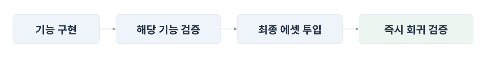

---

## 7. 향후 개발 계획

현재는 싱글플레이를 바탕으로 **NGO(Netcode for GameObjects)를 활용한 최대 4인 멀티플레이** 구현을 목표로 하고 있습니다. 대기 화면 개편과 방 생성·입장, 참가자 준비 및 게임 시작 흐름을 다음과 같이 계획했습니다.

- **모드 선택:** 싱글 / 멀티 선택 팝업을 추가하고, 멀티 선택 시 ‘방장 되기’ 토글을 활성화합니다.
- **대기 화면:** 싱글은 기존 화면을 유지하되 대기 탭을 비활성화합니다. 멀티는 대기 탭을 활성화해 생성된 방 목록을 표시하고, 초대 코드로도 입장할 수 있도록 구성할 예정입니다.
- **참가자 표시:** 방장은 별도 아이콘으로 구분하며, 한 방에서 최대 4인이 함께 플레이하도록 계획했습니다.
- **게임 시작:** 참가자 전원이 시작 버튼을 누르면 게임을 시작합니다. 응답하지 않는 참가자로 인해 대기가 길어지는 상황을 줄이기 위해, 참가자의 과반수가 시작 버튼을 누르면 10초 후 자동으로 시작하는 규칙도 적용할 예정입니다.

위 내용은 후속 개발 계획이며, 현재 포트폴리오에서 설명한 구현 범위는 싱글플레이입니다.

---

## 8. 리소스 출처 및 제작 방식

### 모델·배경·텍스처

| 구분 | 출처 / 제작 방식 |
| --- | --- |
| 캐릭터 모델 | AI를 활용해 제작했으며, 제작 과정에서 Meshy AI와 Blender를 사용했습니다. |
| 캐릭터 모델 텍스처 | 직접 제작한 모델용 텍스처를 사용했습니다. |
| 캐릭터 애니메이션 | [Mixamo — Adobe](https://www.mixamo.com/) |
| 배경·가구 | [Low Poly Home Set — VNBP / Leo](https://vnbp.itch.io/low-poly-home-set)를 활용해 공간을 구성했습니다. |
| 일부 가구·소품 | [Kenney](https://kenney.nl/assets) 제작 리소스. 원본 OBJ의 제작자 표기로 확인했습니다. |

### UI·글꼴

| 구분 | 출처 / 제작 방식 |
| --- | --- |
| UI 버튼·패널 | [Free Pro UI Light Minimalism — Wenrexa](https://wenrexa.itch.io/uilight)의 Green 버전 |
| UI 아이콘 | 직접 제작 |
| 글꼴 | [Gmarket Sans — G마켓](https://news.gmarket.com/fonts/) |

### 파티클·이펙트

| 구분 | 출처 |
| --- | --- |
| 파티클·시각 피드백 | [Hyper Casual FX — Lana Studio](https://assetstore.unity.com/packages/vfx/particles/hyper-casual-fx-200333) |
| 연기 이펙트 | [Free Stylized Smoke Effects Pack — MS Maiami Studio](https://assetstore.unity.com/packages/vfx/particles/fire-explosions/free-stylized-smoke-effects-pack-226406) |

### 오디오

| 구분 | 출처 |
| --- | --- |
| 배경음악 | [Banana Track — skrjablin](https://opengameart.org/content/banana-track) — `background.ogg`의 제목 메타데이터: Banana Track / 아티스트: Lars Johan Martin Nilsson |
| UI 효과음 | [Interface Sounds — Kenney](https://kenney.nl/assets/interface-sounds) — `Button.ogg`, `error_005.ogg`에 제작자 정보 확인 |
| 시계 효과음 | [Loopable Ticking Clock — OwlStorm / Owlish Media](https://freesound.org/people/OwlStorm/sounds/212181/) |
| 개 짖는 소리 | [Short Dog Bark — qubodup](https://freesound.org/people/qubodup/sounds/827323/) |
| 수집·타격 효과음 | [Owlish Media](https://opengameart.org/content/sound-effects-pack) — `Collect.wav`, `hit.wav`에 제작자 메타데이터 확인 |
| 음악 자료 | [Party and Gameover loop — gilzoide](https://opengameart.org/content/party-and-gameover-loop) — 원본 파일: `happy_theme.ogg`, `sad_theme.ogg` |
| 음악 자료 | [Happy Loop — wipics](https://opengameart.org/content/happy-loop) — 원본 파일: `happy loop.mp3` |
| 날갯짓 효과음의 원본 소스 | [fast simple chop 5 — dave.des](https://freesound.org/people/dave.des/sounds/127197/) — `wings_flap_large`의 동봉 문서에 명시 |
| 조리 효과음 자료 | [noodles - stir - unique — Anthousai](https://freesound.org/people/Anthousai/sounds/398767/) |

### 플러그인·렌더링 도구

| 구분 | 출처 |
| --- | --- |
| UI 애니메이션 | [DOTween — Demigiant](https://dotween.demigiant.com/) |
| 외곽선 렌더링 | [Linework — Alexander Ameye](https://linework.ameye.dev/) |
